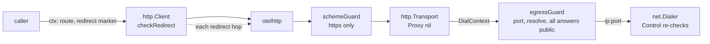

# Outbound egress guard

TICK-261, from the TICK-203 inventory. `telemetry.OutboundClient`
(`internal/platform/telemetry`) has a destination-guarded mode for URLs a
tenant or a third party controls, so that such a URL, or a redirect from it,
never reaches loopback, private or link-local space, cloud metadata or the
platform's own services. This is a library change; no ADR or service
boundary moves.

## Redirects: refused unless the call opts in

| Context marker                  | 3xx with a Location                                          |
| ------------------------------- | ------------------------------------------------------------ |
| none (default)                  | refused, `ErrRedirectRefused`                                |
| `WithoutRedirects`              | refused (states the default, as JWKS and discovery do)       |
| `WithRedirects`                 | followed, at most 3 hops, any host the egress policy allows  |
| `WithSameOriginRedirects`       | as above, only to the first request's scheme, host and port  |

Every opted-in hop goes through the transport again, so the egress guard
applies to it, and no hop may go from `https` to `http`. A caller that forgets
the marker fails closed. A webhook delivery answered with a 3xx is a failure.

## Egress policy

`OutboundOptions.Egress`:

- `EgressAny` (zero value): every destination. For URLs the platform
  configures: Keycloak, JWKS and discovery, internal services.
- `EgressPublicOnly`: only `https` (`EgressAllowHTTP` adds `http`), only ports
  443 and 8443 (`EgressPorts` overrides), only public unicast addresses.

The guard resolves the name itself at dial time and refuses the whole name if
any answer is not public; it then connects to the checked IP. The
`net.Dialer` `Control` hook checks the socket's address once more. Because
the check runs per connection, a DNS answer that changes after a URL was
validated (rebinding) is caught. Refused: loopback, RFC 1918, link-local
(`169.254/16`, `fe80::/10`, so `169.254.169.254`), CGNAT `100.64/10`, ULA
`fc00::/7` (so `fd00:ec2::254`), `0.0.0.0/8`, unspecified, multicast,
broadcast and reserved `240/4`, `192.0.0/24`, `198.18/15`, documentation,
NAT64, 6to4, Teredo, IPv4-compatible and site-local IPv6, and the
IPv4-mapped form of every IPv4 range. Errors wrap `ErrEgressRefused` and
name no address.

The transport's `Proxy` is nil, so `HTTPS_PROXY` is ignored: a proxy would
connect on the client's behalf, past the guard.

## Policy per caller class

| Caller                                   | Egress             | Redirects                  |
| ---------------------------------------- | ------------------ | -------------------------- |
| Keycloak admin, token, health            | `EgressAny`        | none (default)             |
| JWKS and OIDC discovery                  | `EgressAny`        | `WithoutRedirects`         |
| Webhooks                                 | `EgressPublicOnly` | none (default)             |
| LLM providers on the config allow-list   | `EgressPublicOnly` | `WithSameOriginRedirects`  |
| Tenant-configured LLM endpoints          | `EgressPublicOnly` | none (default)             |

Build one client per class: the egress policy is per client, the redirect
policy per call. The allow-list of LLM provider hosts belongs to that caller's
config and is checked by the caller before the call.

## Out of scope

A Node service such as Mastra that calls LLMs does not use this client. It
needs the same guard, or a network egress policy, before it ships.
