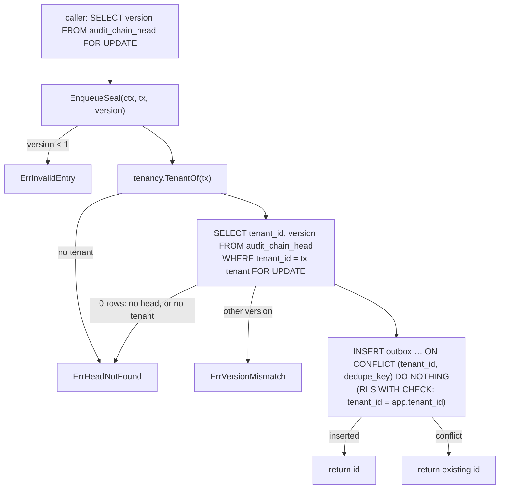
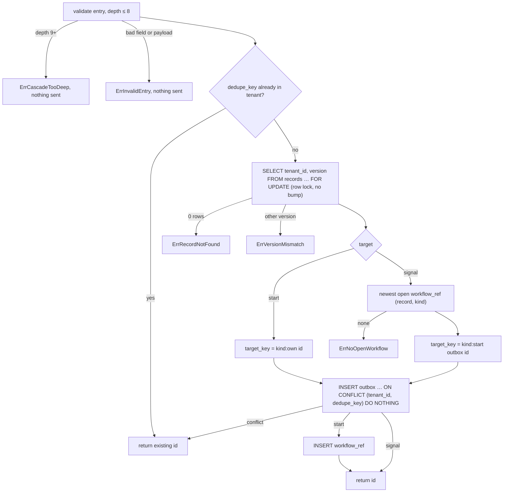

# Outbox producer

PLAN-001 T29 (TICK-70), ADR-001 I6, I9 and A.2 "Writing outbox rows".
Package `internal/outbox`. Decisions: `docs/delivery/decision-log.md`,
2026-10-25 "T29 carries the trace context through the outbox".

The producer never writes `records` (PLAN-003 D-3-6, TICK-411): the record
write pipeline's `UPDATE` is the one place `records.version` moves, and a
producer enqueues at the version that write gave the record. A pipeline
`EventSink` calls it, in the write's transaction:

```go
func (s sink) RecordChanged(ctx context.Context, tx pgx.Tx, ev pipeline.Event) error {
    _, err := outbox.EnqueueAtVersion(ctx, tx, outbox.Entry{
        Kind: "ticket.approval", KindVersion: 1, DedupeKey: eventID.String(), RecordID: ev.RecordID,
        Target:    outbox.TargetStart{Kind: "ticket.approval"},
        Causation: ev.Causation,
        Payload:   json.RawMessage(`{"ticket_id":"…"}`),
    }, ev.Version)
    return err
}
```

A start of `nava.interpreter` goes through `cascade.ClaimStart` and
`outbox.EnqueueStart` instead (ADR-001 A5-6), which takes `target_seq` the
same way.

## Seal start rows: EnqueueSeal (PLAN-005 C5, ADR-001 A6.3)

The audit sealer's start row is not tied to a record, so it has its own entry
point, `outbox.EnqueueSeal(ctx, tx, headVersion)`. `EnqueueAtVersion` refuses
a start of `audit.seal`, as it refuses one of `nava.interpreter`.



| Column | Value |
| --- | --- |
| `tenant_id` | the transaction's tenant (`app.tenant_id`), through the locked head row; never an argument |
| `kind`, `kind_version` | `audit.seal`, 1 |
| `dedupe_key` | `audit.seal:<headVersion>` (`outbox.SealDedupeKey`); every other producer refuses a key with the `audit.seal:` prefix, so only a seal row can hold one |
| `target_key` | `audit.seal:<own id>`; the relay starts it as `t:<tenant>:audit.seal:<id>`, `REJECT_DUPLICATE` |
| `target_seq` | `headVersion`, the head's `version` under the lock |
| `causation_id`, `causation_depth` | the row's own id, 0 |
| `payload` | `{}` |
| `workflow_ref` | none: `workflow_ref.record_id` references `records`, and a seal run is never signalled |

The caller holds the head `FOR UPDATE`; `EnqueueSeal` takes the same lock
again (a no-op when held) before it writes, so no seal row is written without
the head lock in its transaction (`TestEnqueueSealHoldsHeadLock`). The relay
needs no change: it tells a start by `target_key` and builds the workflow id
from `outbox.tenant_id` (`internal/relay` `TestSealStartRowStartsItsOwnRun`).

## What EnqueueAtVersion does, in the caller's transaction



| Column | Value |
| --- | --- |
| `tenant_id` | the locked `records` row's, which RLS shows only for the transaction's tenant; never an argument |
| `id` | UUIDv7 |
| `kind` | the Temporal name the relay dispatches to: workflow type (start) or signal name (signal) |
| `target_key` | `<workflow kind>:<start row id>`; a start row's ends in its own id |
| `target_seq` | the record's `version` as the caller's write left it; the pipeline's `UPDATE` holds the row lock, so writes on one record get consecutive values in commit order, and rows of one write share one |
| `causation_id`, `causation_depth` | `Entry.Causation`; NULL origin only at depth 0 |
| `payload` | references only: an object whose keys match `^[a-z][a-z0-9_]{0,31}$` and whose values are canonical UUID strings or arrays of them (`outbox_payload_check`) |
| `trace_context` | the caller span's W3C `traceparent`, or NULL; never `tracestate` or baggage |

## Notes

- **Dedupe:** a retry returns the first row's id and writes nothing, before
  it checks the version. A nil error does not mean a row was written.
- **No tenant:** a transaction without one sees no record, so it returns
  `ErrRecordNotFound` and writes nothing.
- **One writer of `records`:** `outbox.Enqueue`, which bumped the version
  itself, is gone (TICK-411). Tests that need a bump outside the pipeline do
  it in the test file and then call `EnqueueAtVersion`. See
  [record-write-pipeline.md](record-write-pipeline.md).
- **Deferred:** the cycle check (`ErrCascadeCycle`) and the audit row for a
  rejected cascade are TICK-88 (PLAN-002), against the record's own causation
  fields.
- **Tests:** `internal/outbox` unit tests, and `outbox_integration_test.go`
  against real PostgreSQL as `nava_app` and `nava_worker`;
  `TestEnqueueTenantIsolation` runs as each. The `TestCI10_` tests are the
  CI-10 cases T29 owns.
