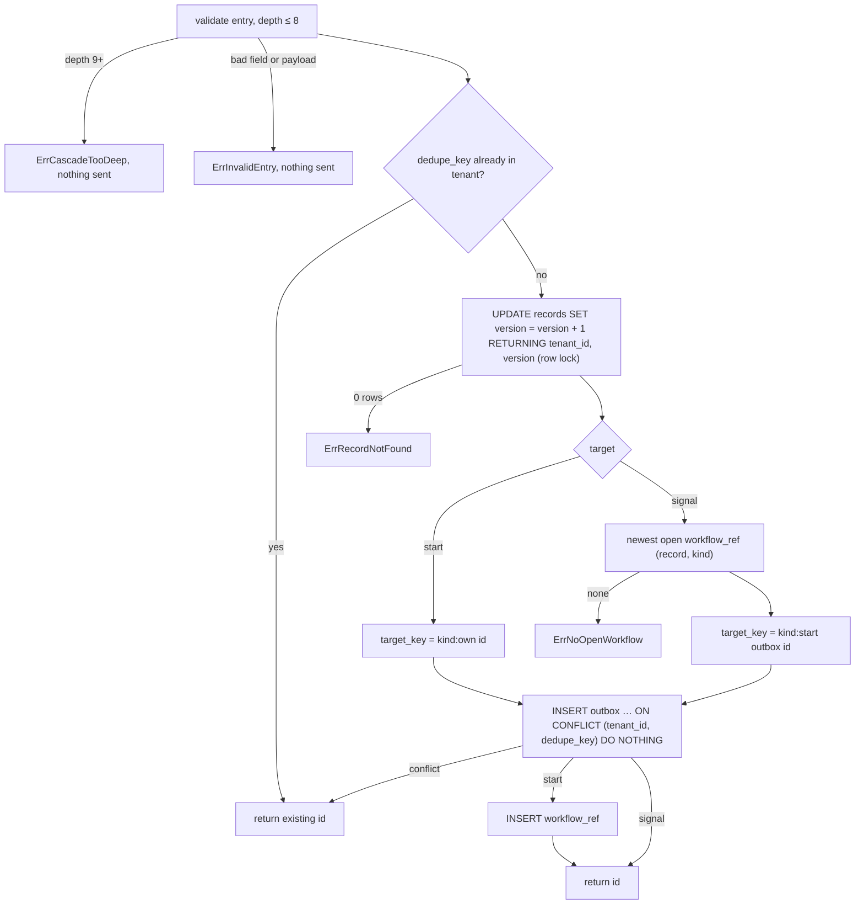

# Outbox producer

PLAN-001 T29 (TICK-70), ADR-001 I6, I9 and A.2 "Writing outbox rows".
Package `internal/outbox`. Decisions: `docs/delivery/decision-log.md`,
2026-10-25 "T29 carries the trace context through the outbox".

```go
err := tenancy.InTenantTx(ctx, pool, principal.TenantID, func(tx pgx.Tx) error {
    // ... the record write ...
    _, err := outbox.Enqueue(ctx, tx, outbox.Entry{
        Kind: "ticket.approval", KindVersion: 1, DedupeKey: eventID.String(), RecordID: ticketID,
        Target:    outbox.TargetStart{Kind: "ticket.approval"},
        Causation: outbox.Causation{OriginID: originID, Depth: depth},
        Payload:   json.RawMessage(`{"ticket_id":"…"}`),
    })
    return err
})
```

## What Enqueue does, in the caller's transaction



| Column | Value |
| --- | --- |
| `tenant_id` | the locked `records` row's, which RLS shows only for the transaction's tenant; never an argument |
| `id` | UUIDv7 |
| `kind` | the Temporal name the relay dispatches to: workflow type (start) or signal name (signal) |
| `target_key` | `<workflow kind>:<start row id>`; a start row's ends in its own id |
| `target_seq` | the record's `version` after the bump, so producers on one record get consecutive values in commit order |
| `causation_id`, `causation_depth` | `Entry.Causation`; NULL origin only at depth 0 |
| `payload` | references only: an object of UUID strings or arrays of them |
| `trace_context` | the caller span's W3C `traceparent`, or NULL; never `tracestate` or baggage |

## Notes

- **Dedupe:** a retry after commit returns the first id without bumping the
  record. A duplicate that commits concurrently has already bumped it; the
  gap in `target_seq` is harmless because the relay orders on it and never
  counts it.
- **No tenant:** a transaction without one sees no record, so Enqueue returns
  `ErrRecordNotFound` and writes nothing.
- **Deferred:** the cycle check (`ErrCascadeCycle`) and the audit row for a
  rejected cascade are TICK-88 (PLAN-002), against the record's own causation
  fields.
- **Tests:** `internal/outbox` unit tests, and `outbox_integration_test.go`
  against real PostgreSQL as `nava_app` and `nava_worker`. The `TestCI10_`
  tests are the CI-10 cases T29 owns.
