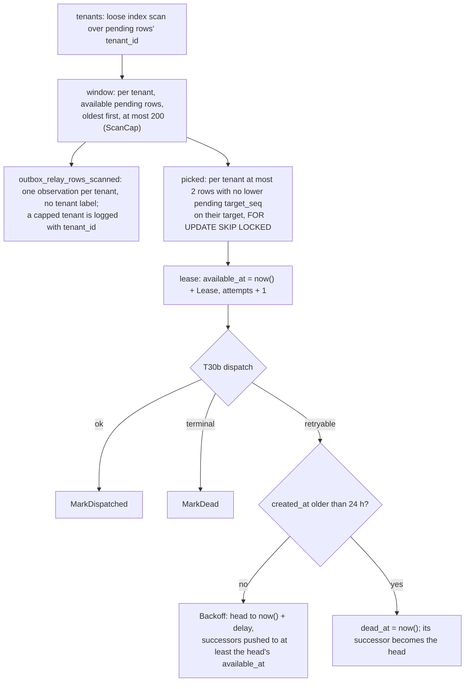

# Outbox relay: claim, backoff, dead letter

PLAN-001 T30a (TICK-74), ADR-001 A.2 "Claim order" and "Worst-case bound",
D-P8. Package `internal/relay`, connected as `nava_relay`. Dispatch to
Temporal is T30b (TICK-85); the producer is [outbox-producer.md](outbox-producer.md).

```go
r, err := relay.New(pool, tel.MeterProvider, log, relay.Options{})
rows, err := r.Claim(ctx)
for _, c := range rows {
    // T30b: start when c.IsStart(), else signal; workflow id t:<c.TenantID>:<c.TargetKey>
    err = r.MarkDispatched(ctx, c) // or r.Backoff(ctx, c, cause), r.MarkDead(ctx, c, cause)
}
```

## One poll



## Rules

- **One statement per call.** Claim's scan, locks and lease are one snapshot
  and one transaction. Backoff updates the head and pushes its successors in
  one statement (a writable CTE), so no successor is ever claimable before
  its head.
- **A claim is a lease.** Claim commits; the row stays hidden until
  `LeaseUntil` (default 30 s). `attempts` is the fencing token: Mark* and
  Backoff match it, so a claimer whose lease was taken over gets
  `ErrLeaseLost` and changes nothing. A crash between claim and dispatch
  therefore redelivers after the lease.
- **Start or signal.** A row is a start exactly when
  `target_key == kind + ":" + id.String()` (canonical lowercase UUID).
  Every other row is a signal. Nothing else is parsed from `target_key`.
- **Retry delay.** 1 s doubled per attempt, capped at 5 min (`Options`).
- **Dead letter.** Backoff marks a row dead instead once it is
  `MaxRedeliveryAge` (24 h, D-P8) old. The age is measured from `created_at`,
  which is never later than the first attempt, so a row is never redelivered
  for more than 24 h plus one delay, inside the worker's 48 h signal window.
  A row is only ever marked dead after an attempt.
- **Grants.** The relay never reads `last_error` or `dedupe_key`, and
  `outbox_relay_update` lets it touch only pending rows.
- **Known worst case.** A leased head is not backing off, so its available
  successors still fill the tenant's 200-row window until it settles. T33's
  flood test covers it.

## Tests

`relay_test.go` (unit: `IsStart`, delay, bucket boundaries 3/200/201) and
`relay_integration_test.go` against real PostgreSQL as `nava_relay`: two
concurrent claimers, lease takeover, fairness with the capped tenant's log
line and `le="200"` = `_count`, successor push with 0 rows scanned while the
head waits, the 24 h dead letter, rows written by `outbox.Enqueue`, and the
grants.
