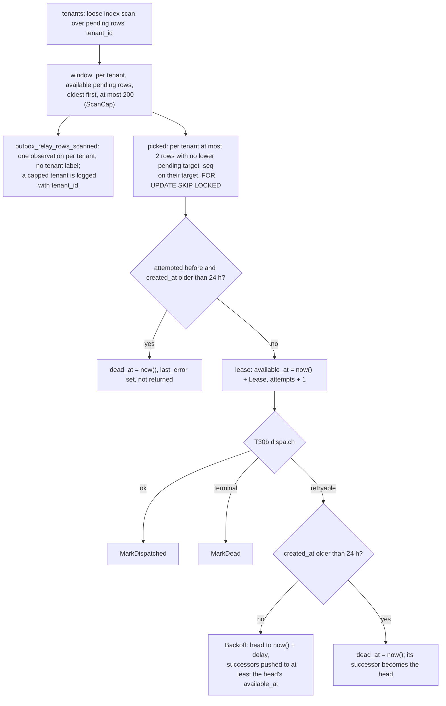
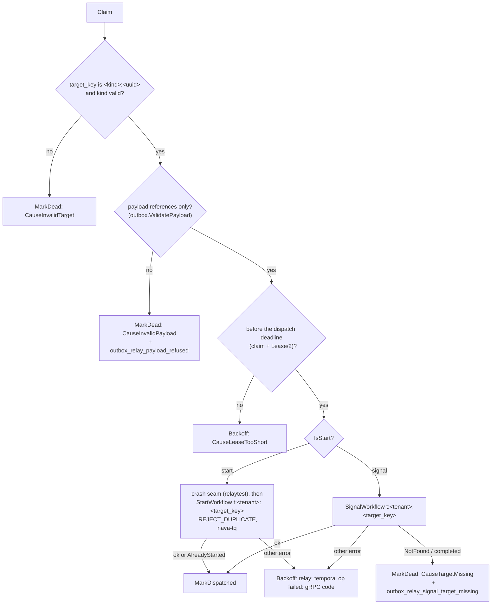

# Outbox relay: claim, backoff, dead letter

PLAN-001 T30a (TICK-74) and T30b (TICK-85), ADR-001 A.2 "What the relay
does", "Claim order" and "Worst-case bound", D-P8. Package `internal/relay`,
connected as `nava_relay`; process `cmd/nava-relay` (compose service
`nava-relay`, certificate `nava-relay`). The producer is
[outbox-producer.md](outbox-producer.md).

```go
r, err := relay.New(pool, tel.MeterProvider, log, relay.Options{})
d, err := relay.NewDispatcher(r, temporalClient, tel.TracerProvider, tel.MeterProvider, log, relay.DispatcherOptions{})
d.Run(ctx, 500*time.Millisecond) // Claim, then start or signal and settle each row
```

## One poll



## Dispatch (T30b)



- **Client.** `telemetry.NewTemporal` and `workerguard.ConfigureClient`, as
  the worker's. The tenant goes on the `nava-tenant` header through
  `workerguard.ContextWithTenant(ctx, outbox.tenant_id)`; nothing else sets it.
- **Workflow id** `t:<outbox.tenant_id>:<target_key>`, built by
  `relay.WorkflowID`. The workflow type (start) or signal name is
  `outbox.kind`; the start's task queue is `nava-tq`.
- **`target_key` forms (TICK-94 item 3).** Exactly `<kind>:<uuid>`: the kind
  matches `^[a-z][a-z0-9._-]{0,99}$` and the uuid is canonical lowercase.
  For a start it is `<workflow type>:<its own outbox id>`; for a signal it is
  the target workflow's start key, copied from `workflow_ref`. Neither part
  can hold free text, so no workflow id carries PII. Any other form is marked
  dead without a Temporal call.
- **Payload check (T32b finding 1, second line; TICK-215).** Before any start
  or signal the dispatcher runs `outbox.ValidatePayload`, the rule `Enqueue`
  applies. A row that fails it (record data written around `Enqueue`) is
  marked dead at once with `CauseInvalidPayload`, never retried and never sent
  to Temporal. The alert is an error log with `alert=true` and the outbox id,
  plus `outbox_relay_payload_refused_total`. Neither the validation error nor
  any payload text is logged, stored or put on the span.
- **Input.** One argument, `outbox.Delivery`: `outbox_id` (the signal dedupe
  key, I7), `kind_version`, `causation_id`, `causation_depth` and `payload`
  (references only, CI-7).
- **Every dispatch error is settled.** Each claimed row ends in exactly one of
  MarkDispatched, MarkDead or Backoff. Only a failed settle (database error,
  or `ErrLeaseLost`) leaves a row to be redelivered after its lease. Settles
  run on a context that outlives shutdown, so a row Temporal accepted while
  the relay stops is still marked.
- **Ordering.** A poll claims only heads, so its rows are on distinct targets
  and are dispatched concurrently (8 at a time). Every Temporal call must end
  by the dispatch deadline, half a lease after the claim on the relay's own
  clock. Past it, the lease could be taken over and the successor dispatched,
  so a late call could reorder a target.
- **`last_error` never carries record data** (TICK-74 security review).
  A cause is one of the fixed `Cause*` texts or
  `relay: temporal <start|signal> failed: <gRPC code name>`. An error's
  message is never stored or logged, because Temporal and SDK errors can quote
  a payload; the log line has `error_code`.
- **Age.** The 24 h dead letter is still measured from `created_at` (decision
  log 2026-10-25, AR-026), inside `Backoff` and `Claim`. The dispatcher never
  measures age.
- **Tracing.** The dispatch span `outbox.dispatch start|signal` is a new root
  with a link to the producer's `traceparent` and carries `nava.outbox_id`.
  The SDK's child span adds the workflow and run id. The `_tracer-data` header
  holds only `traceparent` (and `tracestate`); baggage is off.
  A failed call sets the dispatch span's status to Error with the gRPC code
  as `error.type` and description. The SDK child span records the full
  error message (`exception.message`, status description); the export filter
  in `internal/platform/telemetry` drops both, so no error text is exported
  (TICK-191, `TestDispatchErrorTextNeverReachesASpan`).
- **Metrics** (no tenant or workflow attribute):
  `outbox_relay_dispatches_total{op, outcome}`, where `outcome` is one of
  `dispatched`, `already_started`, `target_missing`, `invalid_target`,
  `invalid_payload`, `backoff`, `dead`, `lease_lost` and `settle_failed`. The
  alert metrics are `outbox_relay_signal_target_missing_total` and
  `outbox_relay_payload_refused_total`; the workflow and outbox ids are in
  their log lines. `nava-relay` serves `/metrics`, `/healthz` and `/readyz` on
  `NAVA_ADMIN_ADDR` (PostgreSQL and Temporal gate readiness).

### Crash seam (for T33)

A binary built with `-tags relaytest` pauses every start between its claim
and its `StartWorkflow` call when `NAVA_RELAYTEST_PAUSE=1`. At each pause it
writes `relaytest: paused before StartWorkflow <outbox id>` to stderr and
waits for one line on stdin, which releases one paused start. The production
image is built without the tag.

```sh
go build -tags relaytest -o bin/nava-relay-test ./cmd/nava-relay
NAVA_RELAYTEST_PAUSE=1 NAVA_DATABASE_URL=... NAVA_TEMPORAL_ADDRESS=... bin/nava-relay-test
# read stderr until the marker, then kill -9 the PID
```

At the marker the row is claimed (`attempts = 1`, leased) and no workflow
exists. After `kill -9` and a restart, the row is redelivered once its lease
ends (30 s by default) and exactly one execution exists.
`TestCrashSeam` (`dispatch_integration_test.go`) runs this sequence with the
same `StdinPause` in a subprocess.

## Rules

- **One statement per call.** Claim's scan, locks and lease are one snapshot
  and one transaction. Backoff updates the head and pushes its successors in
  one statement (a writable CTE), so no successor is ever claimable before
  its head.
- **A claim is a lease.** Claim commits; the row stays hidden until
  `LeaseUntil` (default 30 s). `attempts` is the fencing token: Mark* and
  Backoff match it, so a claimer whose lease was taken over gets
  `ErrLeaseLost` and changes nothing. A crash between claim and dispatch
  therefore redelivers after the lease.
- **Start or signal.** A row is a start exactly when
  `target_key == kind + ":" + id.String()` (canonical lowercase UUID).
  Every other row is a signal. Nothing else is parsed from `target_key`.
- **Retry delay.** 1 s doubled per attempt, capped at 5 min (`Options`).
- **Dead letter.** A row is marked dead once it is `MaxRedeliveryAge` (24 h,
  D-P8) old, measured from `created_at` (decision log, 2026-10-25). Backoff
  does it at a failure. Claim does it instead of claiming when the row was
  attempted before and its lease or backoff is over, so a crash between
  dispatch and `MarkDispatched` cannot redeliver a row past the worker's 48 h
  signal window; it writes `TakeoverExpiredError` as `last_error`. A row with
  no attempts is never marked dead. `last_error` is cleaned of invalid UTF-8
  and NUL, which PostgreSQL would reject, and cut to 1000 bytes.
- **Grants.** The relay never reads `last_error` or `dedupe_key`, and
  `outbox_relay_update` lets it touch only pending rows.
- **Accepted worst cases** (decision log, 2026-10-25). A leased head is not
  backing off, so its available successors can fill the tenant's 200-row
  window until it settles; T33's flood test covers it. A poll has no limit on
  tenants; revisit if T33 shows poll latency growing with the tenant count.

## Tests

T30b: `dispatch_test.go` runs the real SDK client, configured as in
production, against an in-process gRPC frontend (`frontend_test.go`). It
covers the start and signal requests and their headers, AlreadyStarted,
NotFound and completed, the error matrix with an error message that quotes
record data, the deadline, `target_key` forms and the `_tracer-data` header.
`dispatch_integration_test.go` adds real PostgreSQL as `nava_relay`: forced
redelivery starts one workflow, two relays never reorder a target's signals
under random failures, NotFound marks the row dead with the alert, the
`last_error` stored, and the crash seam with a killed subprocess.

T30a:

`relay_test.go` (unit: `IsStart`, delay, bucket boundaries 3/200/201) and
`relay_integration_test.go` against real PostgreSQL as `nava_relay`: two
concurrent claimers, lease takeover, fairness with the capped tenant's log
line and `le="200"` = `_count`, successor push with 0 rows scanned while the
head waits, the 24 h dead letter at Backoff and at a lease takeover, rows
written by `outbox.Enqueue`, and the grants.
