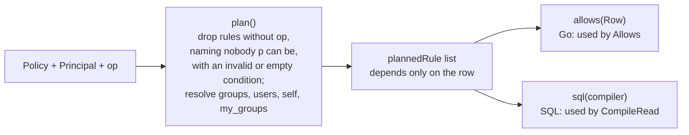
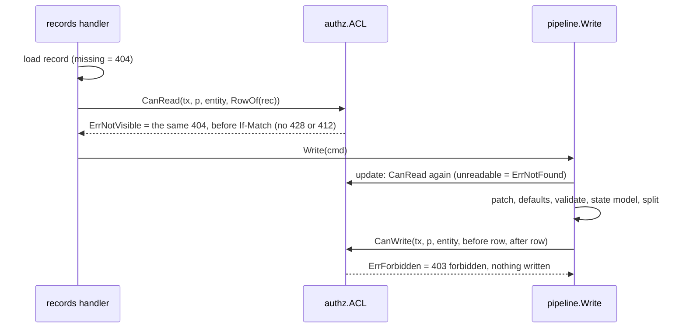

# Record ACL (S10 P3-31)

Scope: TICK-616. PLAN-003 S10 contract with amendment A1 (D-3-26); ADR-001
I5 (one authorization layer, inside the query). Code: `internal/authz`
(`acl.go`: model, `Allows`, `CompileRead`; `aclstore.go`: `PolicyStore`,
`SharesFor`, `ACL`). Tables: `acl_versions`, `record_shares`
([acl-tables.md](../data/acl-tables.md)).

An entity type's published ACL is a `Policy`: allow-only `Rule`s that OR
together. A rule admits a principal for an op (`read`, `write`) when its
`Who` names the principal (any of: one of its `Groups`, one of its `Users`,
the record's `Requester`, its `Assignee`, a `Shared` row) and every `Where`
condition holds. Conditions use the fixed columns only (`state`,
`requester_id`, `assignee_id`, `assignment_group_id`) with `eq` (one value)
or `in`, against literals or the caller (`self`, `my_groups`). **Fail
closed:** no published version, an empty policy, a rule with any malformed
condition, and an empty value set all match nothing. Since TICK-629 the database
refuses a stored policy outside the contract's shape at insert
(`acl_versions_rules_check`, `acl_versions_masks_check`;
[`docs/data/acl-versions-shape-check.md`](../data/acl-versions-shape-check.md)),
so the fail-closed handling of a malformed rule is defence in depth.

## One decision, two renderings

`Allows` (one record, Go) and `CompileRead` (a SQL predicate) must agree for
every policy, principal and row; P3-32 fuzzes it. Both start from the same
`plan` step, so the agreement is structural:

Every term has one Go and one SQL form: `everyone` is `true`; requester and
assignee compare the column with the caller's id; a condition is "column is
not NULL and is in the set"; a share is the pair-matched `EXISTS` below.
There is no `NOT`, so a NULL never flips a result.

## Shares are pair-matched (AR-S10-01)

A share matches on `(principal_kind, principal_id)`, never the id alone: a
`user` share for the caller's id, or a `group` share for one of the caller's
groups. `SharesFor` loads `Row.SharedWith` that way and `CompileRead` emits
the same predicate, so a `user` share that carries a group's UUID admits no
member of that group.

## Where it runs

`ACL` reads the newest `acl_versions` row of the type in the caller's
transaction (`PolicyStore`, tenant from `tenancy.TenantOf`) and refuses a
principal of any other tenant before reading it. The pipeline skips
`CanWrite` and the read check only for the system sources `rule`, `workflow`,
`function` and `system`; `user`, `ai` and any other source are authorized as
their principal.

## Tests

`internal/authz/acl_test.go` (every subject kind, condition op and caller
reference, rule OR, condition AND, malformed rules); `arch_test.go` (the
interim authorizer can never return); `internal/records/pipeline/acl_integration_test.go`
(real PostgreSQL: `CompileRead` returns exactly the rows `Allows` admits,
pair-matched shares, write scope); `internal/server/records_acl_integration_test.go`
(the byte-identical 404 on GET, PATCH and history; 403 on a scope move; no
ACL denies). Fixtures publish an allow-all test ACL with
`internal/authz/acltest` (through the audited publish path, since P3-35).

Field masks (P3-33) are in [record-field-masks.md](record-field-masks.md).

## Admin routes, the explainer and the default ACL (P3-35, TICK-620)

All three routes are tenant-admin only (`RequireTenantAdminTx`, first, in the
route's own transaction) and see their own tenant only. Code:
`internal/server/access.go`, `internal/authz/{policycheck,publish,explain}.go`,
`internal/onboard/acl.go`.

| Route | Answer |
| --- | --- |
| `GET /api/v1/entity-types/{key}/access` | `200 {version, rules, masks, published_by, published_at}` with `ETag: W/"<version>"`; `404` when the key is unknown, another tenant's, or has no published version (one body). |
| `PUT /api/v1/entity-types/{key}/access` | Version N+1 from `{rules, masks?}`. `If-Match` missing or `*` is `428 if_match_required`, stale is `412 version_conflict` with the current `ETag`; the first publish is `W/"0"`. A bad body is `422 invalid_access_policy` with pointers. |
| `GET /api/v1/access/explain?entity&record&user` | `200 {decision, rule_id, acl_version, masked_fields}`. |

**Order of the PUT checks:** admin (403), entity type (404), `If-Match` (428,
412), body (422), write. A refused request writes no version and no audit row.

**What the publish validation refuses (422, `errors[].pointer` and `rule`).**
`ParsePolicy` first applies the shape rules of the database CHECK
([acl-versions-shape-check.md](../data/acl-versions-shape-check.md)) on the
decoded JSON tree, so a user never sees a raw constraint error and a stored
row can never fail the strict decoder (a 500-vs-404 existence signal). Then:
rule ids are unique; a mask field is a top-level property of the type's
current schema; a mask's `read` and `write` set none of `requester`,
`assignee`, `shared` (A2); a mask's `write` names no group or user its `read`
does not (R3, so a write-without-read mask is no uniqueness oracle). Last, the
**tenant-scope check** (`authz.NotInTenant`): every group and user id in a
subject, in a mask and in the uuid values of a condition (`requester_id` and
`assignee_id` are users, `assignment_group_id` a group) is looked up with
`WHERE tenant_id = <the transaction's tenant>`. A foreign id and an id that
does not exist give the same `not_in_tenant` error, and the response never
repeats a value of the request.

**Audit.** `acl_versions` has the `audit_commit_check` trigger
(`20261109120000_acl_versions_audit_commit_check.sql`; `attached: true` in
`db/audited-tables.yaml`). `PolicyStore.Publish` is the one writer: it takes the
entity type's row lock (publishes of a type serialize), checks the version,
inserts, and appends one `config` / `publish` entry for the entity type in the
same transaction (versions are ACL versions, the content hash covers the
canonical rules and masks, the diff is against the previous version). A bare
insert fails at COMMIT with `audit_missing` (`TestP335ACLPublishWithoutAnAuditEntryIsRefused`).
The entry's `version_before` and `version_after` are ACL versions even though
its subject is the entity type, whose own publish entries use definition
versions.

**The explainer** decides with the same `Allows` a read uses, for the target
user's live groups (read in the transaction), so it cannot disagree with the
enforcement. `masked_fields` is the target's masked fields **that the asking
admin can read**: a field the admin cannot read is never listed. A record or
user of another tenant, an unknown one, a malformed id and a wrong entity are
the same 404. `acl_version` is 0 and `decision` is `deny` when no version is
published. The admin's own read access to the record is not checked: a tenant
admin can publish an ACL granting itself read, so the check would protect
nothing (the explainer returns only the decision, rule id and field names).

**The default incident ACL v1** (`onboard.DefaultIncidentRules`): the tenant's
admins group reads and writes everything; the `service-desk` group reads and
writes the incidents whose `assignment_group_id` is one of the caller's
groups; a requester reads its own incidents. No masks. Onboarding publishes it
for the seeded `incident` type after the admins group is recorded and before
the tenant is activated, through `authz.PolicyStore.PublishIfNone`, so a retry
publishes nothing twice. A tenant with no `service-desk` group gets no
service-desk rule (a rule naming no group matches no one) until an admin
publishes a newer version. `request` and `change` get no ACL and fail closed
until an admin publishes one. The backfill for tenants that already exist is
`nava-onboard reconcile-default-acl <tenant-id>...` (idempotent; the stack seed
runs it); see [the operator guide](../operator/onboarding.md).

**Tenant scope of the explainer and the compiler.** The compiler never emits
an id it did not get from the tenant's own policy row, and the publish route
refuses every id outside the tenant, so a stored policy names only its own
tenant's groups and users.
