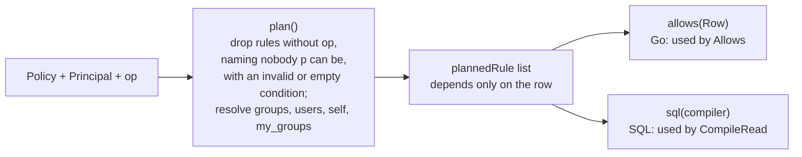
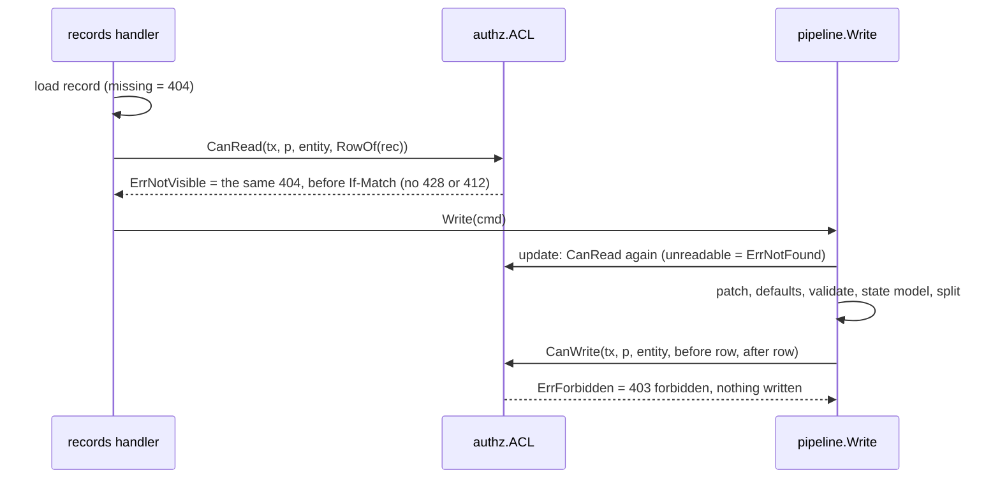

# Record ACL (S10 P3-31)

Scope: TICK-616. PLAN-003 S10 contract with amendment A1 (D-3-26); ADR-001
I5 (one authorization layer, inside the query). Code: `internal/authz`
(`acl.go`: model, `Allows`, `CompileRead`; `aclstore.go`: `PolicyStore`,
`SharesFor`, `ACL`). Tables: `acl_versions`, `record_shares`
([acl-tables.md](../data/acl-tables.md)).

An entity type's published ACL is a `Policy`: allow-only `Rule`s that OR
together. A rule admits a principal for an op (`read`, `write`) when its
`Who` names the principal (any of: one of its `Groups`, one of its `Users`,
the record's `Requester`, its `Assignee`, a `Shared` row) and every `Where`
condition holds. Conditions use the fixed columns only (`state`,
`requester_id`, `assignee_id`, `assignment_group_id`) with `eq` (one value)
or `in`, against literals or the caller (`self`, `my_groups`). **Fail
closed:** no published version, an empty policy, a rule with any malformed
condition, and an empty value set all match nothing.

## One decision, two renderings

`Allows` (one record, Go) and `CompileRead` (a SQL predicate) must agree for
every policy, principal and row; P3-32 fuzzes it. Both start from the same
`plan` step, so the agreement is structural:

Every term has one Go and one SQL form: `everyone` is `true`; requester and
assignee compare the column with the caller's id; a condition is "column is
not NULL and is in the set"; a share is the pair-matched `EXISTS` below.
There is no `NOT`, so a NULL never flips a result.

## Shares are pair-matched (AR-S10-01)

A share matches on `(principal_kind, principal_id)`, never the id alone: a
`user` share for the caller's id, or a `group` share for one of the caller's
groups. `SharesFor` loads `Row.SharedWith` that way and `CompileRead` emits
the same predicate, so a `user` share that carries a group's UUID admits no
member of that group.

## Where it runs

`ACL` reads the newest `acl_versions` row of the type in the caller's
transaction (`PolicyStore`, tenant from `tenancy.TenantOf`) and refuses a
principal of any other tenant before reading it. The pipeline skips
`CanWrite` and the read check only for the system sources `rule`, `workflow`,
`function` and `system`; `user`, `ai` and any other source are authorized as
their principal.

## Tests

`internal/authz/acl_test.go` (every subject kind, condition op and caller
reference, rule OR, condition AND, malformed rules); `arch_test.go` (the
interim authorizer can never return); `internal/records/pipeline/acl_integration_test.go`
(real PostgreSQL: `CompileRead` returns exactly the rows `Allows` admits,
pair-matched shares, write scope); `internal/server/records_acl_integration_test.go`
(the byte-identical 404 on GET, PATCH and history; 403 on a scope move; no
ACL denies). Fixtures publish an allow-all test ACL with
`internal/authz/acltest`; the onboarding default ACL is P3-35's.

Field masks (P3-33) are in [record-field-masks.md](record-field-masks.md).
