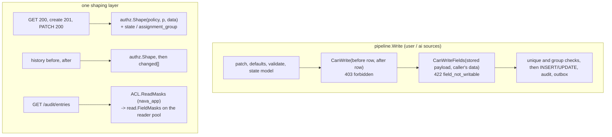

# Record field masks (S10 P3-33)

Scope: TICK-618. PLAN-003 S10 contract with amendments A1 (the mask write
check is a separate method beside `CanWrite`) and A2 (masks are
row-independent); ADR-001 I5 (masks apply on write and read). Code:
`internal/authz/mask.go` (`Readable`, `Writable`, `Shape`,
`CheckQueryFields`, `WrittenFields`, `CheckWriteFields`) and
`internal/authz/aclstore.go` (`ACL.CanWriteFields`, `ACL.Policy`,
`ACL.ReadMasks`). Rules are in [record-acl.md](record-acl.md).

A `Mask` names one top-level schema property. It is hidden from every
principal its `Read` subject does not name, and unwritable for every principal
its `Write` subject does not name. Several masks on one field must all admit
the principal.

## Row-independent (A2)

A mask subject matches on `Groups` and `Users` only. `Requester`, `Assignee`
and `Shared` in a mask never match, so the mask fails closed: it hides the
field from that requester, assignee or share holder too. P3-35's publish
route rejects them with `422 invalid_access_policy`. So one answer per caller
and field holds everywhere: a field you cannot read is a field you cannot
filter, sort, count or aggregate on (`CheckQueryFields`, called by P3-34
before any SQL runs, `400 masked_field`).

## Where it runs

- **Write.** The caller's write is the data it sent on a create, and the
  stored payload with its patch merged on an update, both before defaults: a
  default the server applies is not the caller's write. A field whose
  presence or value differs is written; setting, changing or removing a
  masked field is refused before any write statement, so nothing is written
  (no record, audit or outbox row). The system sources skip it, as they skip
  `CanWrite`.
- **Read.** `Shape` returns a new map without the masked properties and never
  mutates its input. A masked fixed-column property also hides its top-level
  copy: `state` reads `""`, `assignment_group` is absent.
- **History.** `before` and `after` are shaped first and `changed[]` is
  computed from the shaped pair, so an entry that changed only masked fields
  is still listed, with an empty `changed[]`.
- **Audit timeline.** `audit.read` is not ACL-filtered, but each record
  entry's diff is masked for the reader's field masks exactly as secrets are
  (`{"redacted":"mask"}`, no salt). The masks are read on `nava_app`, where
  `acl_versions` is readable, and passed to the reader's masker
  (`read.FieldMasks`); the reader role gets no new grant.

## Unique values (PR #523 finding 1)

A `409 unique_violation` names the property only (`/data/<field>`), never
the id, number or ETag of the record that holds the value, which the caller
may not be able to read. That some record holds it is accepted under D-3-22.

## Tests

`internal/authz/mask_test.go` (groups and users, A2 row-dependent subjects
never match, masks AND, `Shape` does not mutate, `CheckQueryFields`,
`WrittenFields`); `internal/records/pipeline/authz_test.go` (the field check
sees only the caller's write, a refusal writes nothing, system sources skip
it); `internal/audit/read/fieldmask_test.go`; and, on real PostgreSQL,
`internal/server/records_masks_integration_test.go` (422 with nothing
written, the agent in `Write` can; GET, 201, PATCH 200, history and the audit
timeline hide a masked field and show it to an allowed caller; the 409 body).
