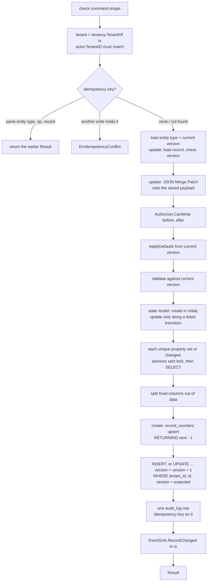

# Record write pipeline (P3-10, P3-11)

Scope: TICK-354, TICK-355. PLAN-003 D-3-2, D-3-6, D-3-7a, D-3-9, D-3-10,
D-3-13, D-3-14, D-3-22; ADR-001 I4, I8, I9. Code: `internal/records/pipeline` (the one entry point),
`internal/records/store` (its SQL), `outbox.EnqueueAtVersion`,
`authz.TenantMemberAuthorizer`, `tenancy.TenantOf`. Tables:
[`platform-tables.md`](../data/platform-tables.md#records-pipeline-records-audit_log-record_counters-p3-09).

`pipeline.Write(ctx, tx, cmd)` is the only way to create or update a record.
It runs in the caller's `tenancy.InTenantTx` transaction and never commits:
the caller commits on success and rolls back on any error, so a write leaves
the record, its audit row and whatever the `EventSink` wrote together, or
none of them.

## Rules the code holds

- **Tenant from the transaction.** `Write` reads the tenant with
  `tenancy.TenantOf` and refuses a command whose `Actor.TenantID` differs
  (`authz.ErrForbidden`). Every statement also names that tenant
  explicitly, on top of RLS. Another tenant's record or entity type is
  `ErrNotFound`, the same as a missing one.
- **One version bump per write.** A create inserts version 1. An update's
  `UPDATE` is the only statement that bumps `version`; no row at the
  expected version is `ErrVersionConflict`, and so is a stale
  `ExpectedVersion` seen at load. A sink that enqueues outbox rows must use
  `outbox.EnqueueAtVersion(ctx, tx, entry, ev.Version)`, which locks the row
  without bumping it again; `outbox.Enqueue` would bump it a second time.
- **Current version wins.** An update validates against the current
  definition after its defaults, and moves `schema_version` to it. The stored
  payload is rebuilt with the mapping of the version it was written under.
- **Fixed columns.** A property mapped to `state`, `requester_id`,
  `assignee_id` or `assignment_group_id` is stored only in its column.
  `store.Record.Payload` merges it back on read. The state column is never
  NULL: a create with no state gets the initial state, and an update that
  removes it is a `required` field error.
- **Audit.** One row per write: `action` is `create` or `update`, `before`
  (NULL on a create) and `after` are snapshots
  `{"number", "version", "schema_version", "data"}` with `data` the merged
  payload. The idempotency key is on this row only.
- **Idempotency (system writers only).** A user write with a key is
  `ErrInvalidCommand`. The key is looked up first; a hit for the same entity
  type, op and (on an update) record returns the earlier `Result` from that
  row's `after` and writes nothing. A hit for any other write is
  `*ErrIdempotencyConflict` (P3-14 maps it to 409, as PLAN-001 T22 does for a
  different body). A concurrent duplicate hits `23505` on
  `audit_log_idempotency_key`, which aborts the transaction: `Write` returns
  `*ErrIdempotencyConflict{Concurrent: true}`, and the retry replays.
- **Numbering (D-3-9).** A create takes its number with one upsert,
  `INSERT INTO record_counters ... VALUES (..., 2) ON CONFLICT ... DO UPDATE
  SET next = record_counters.next + 1 RETURNING next - 1`, after every check
  and right before the record, audit and outbox inserts. The counter row's
  lock is held from there to commit, so creates of one type in one tenant
  queue on it and get consecutive numbers; a rollback gives its number back.
  Nothing creates the counter row in advance, and there is no sequence (I8).
  Format `<prefix><7 digits>` (`INC0000001`), growing past 7 digits; past
  that the text does not sort by number, so lists sort on `created_at`.
- **State model.** A create must be in the type's `Initial` state. An
  update that changes the state must follow a listed transition; keeping the
  state is no transition. Otherwise `*ErrIllegalTransition{From, To}` (`From`
  empty on a create).
- **Unique properties (D-3-22).** For each `"x-nava-unique": true` property
  set on a create, or changed on an update, in property order: take
  `pg_advisory_xact_lock(hashtextextended(tenant ‖ type ‖ field ‖ canonical
  value, 0))`, then a plain `SELECT` for another record of the type holding
  the value (jsonb equality on `data`, or the fixed column). A match is
  `*ErrUniqueViolation{Field}`. The lock is released at commit, so it is safe
  under PgBouncer transaction pooling, and the waiter's `SELECT` (READ
  COMMITTED) sees the holder's committed row. The canonical value makes
  values jsonb calls equal share a lock: numbers as exact rationals, object
  keys sorted, fixed uuid columns lowercase. A missing or null value is not
  checked. There is no JSONB unique index (D25); the check scans the type's
  records in the tenant.

## Errors

| Error | Meaning |
| --- | --- |
| `ErrInvalidCommand` | Caller bug: bad op, source, key or causation, or no tenant on tx |
| `authz.ErrForbidden` | Actor of another tenant, or the Authorizer refused |
| `ErrNotFound` | No such entity type or record in the tenant |
| `*ErrValidation{Fields}` | Schema failures, JSON pointers and keywords only |
| `*ErrIllegalTransition{From, To}` | State change not in the state model, or a create not in `Initial` |
| `*ErrUniqueViolation{Field}` | Another record of the type holds the unique value |
| `ErrVersionConflict` | Not at `ExpectedVersion` |
| `*ErrIdempotencyConflict{Concurrent}` | Key held by another write (409), or a concurrent duplicate: roll back and retry |

## Stubs and later tasks

- `TxRunner` is taken and held for P3-12 (TICK-88), which writes a rejected
  cascade's audit row on it (D-3-7a). P3-12 also adds the depth and cycle
  checks.
- `NoopSink` is wired in S9. S11b's sink (P3-42) enqueues through
  `EnqueueAtVersion`.
- `TenantMemberAuthorizer` lets any principal of the tenant, or a system
  writer, write. S10 deletes it (P3-31).

## Tests

P3-11's concurrency tests (`numbering_integration_test.go`) reach the
platform database through the CI PgBouncer in transaction mode
(`scripts/ci/pgbouncer/pooled.ini`, pool of 5 server connections, so 50
clients share 5), as nava-core does on the compose stack.

`internal/records/pipeline/*_integration_test.go` (tag `integration`, real
PostgreSQL, `nava_app` under RLS) cover the P3-10 acceptance criteria. The
kill test re-runs the test binary as a child process (as
`internal/relay/dispatch_integration_test.go` does), parks it in the
test-only `beforeReturn` hook after every statement and before commit, kills
it with SIGKILL, and checks that no record or audit row is left.
