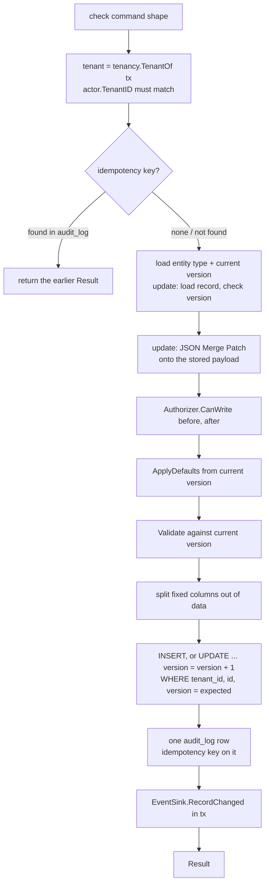

# Record write pipeline (P3-10)

Scope: TICK-354. PLAN-003 D-3-2, D-3-6, D-3-7a, D-3-10, D-3-13, D-3-14;
ADR-001 I4, I9. Code: `internal/records/pipeline` (the one entry point),
`internal/records/store` (its SQL), `outbox.EnqueueAtVersion`,
`authz.TenantMemberAuthorizer`, `tenancy.TenantOf`. Tables:
[`platform-tables.md`](../data/platform-tables.md#records-pipeline-records-audit_log-record_counters-p3-09).

`pipeline.Write(ctx, tx, cmd)` is the only way to create or update a record.
It runs in the caller's `tenancy.InTenantTx` transaction and never commits:
the caller commits on success and rolls back on any error, so a write leaves
the record, its audit row and whatever the `EventSink` wrote together, or
none of them.

## Rules the code holds

- **Tenant from the transaction.** `Write` reads the tenant with
  `tenancy.TenantOf` and refuses a command whose `Actor.TenantID` differs
  (`authz.ErrForbidden`). Every statement also names that tenant
  explicitly, on top of RLS. Another tenant's record or entity type is
  `ErrNotFound`, the same as a missing one.
- **One version bump per write.** A create inserts version 1. An update's
  `UPDATE` is the only statement that bumps `version`; no row at the
  expected version is `ErrVersionConflict`, and so is a stale
  `ExpectedVersion` seen at load. A sink that enqueues outbox rows must use
  `outbox.EnqueueAtVersion(ctx, tx, entry, ev.Version)`, which locks the row
  without bumping it again; `outbox.Enqueue` would bump it a second time.
- **Current version wins.** An update validates against the current
  definition after its defaults, and moves `schema_version` to it. The stored
  payload is rebuilt with the mapping of the version it was written under.
- **Fixed columns.** A property mapped to `state`, `requester_id`,
  `assignee_id` or `assignment_group_id` is stored only in its column.
  `store.Record.Payload` merges it back on read. The state column is never
  NULL: a create with no state gets the initial state, and an update that
  removes it is a `required` field error.
- **Audit.** One row per write: `action` is `create` or `update`, `before`
  (NULL on a create) and `after` are snapshots
  `{"number", "version", "schema_version", "data"}` with `data` the merged
  payload. The idempotency key is on this row only.
- **Idempotency (system writers only).** A user write with a key is
  `ErrInvalidCommand`. The key is looked up first; a hit returns the earlier
  `Result` from that row's `after` and writes nothing. A concurrent duplicate
  hits `23505` on `audit_log_idempotency_key`, which aborts the transaction:
  `Write` returns the retryable `ErrIdempotencyConflict`, and the retry
  replays.

## Errors

| Error | Meaning |
| --- | --- |
| `ErrInvalidCommand` | Caller bug: bad op, source, key or causation, or no tenant on tx |
| `authz.ErrForbidden` | Actor of another tenant, or the Authorizer refused |
| `ErrNotFound` | No such entity type or record in the tenant |
| `*ErrValidation{Fields}` | Schema failures, JSON pointers and keywords only |
| `ErrVersionConflict` | Not at `ExpectedVersion` |
| `ErrIdempotencyConflict` | Concurrent duplicate key: roll back and retry |

## Stubs and later tasks

- Numbering is a stub, `<prefix>-<record uuid>`: unique, not sequential.
  P3-11 (TICK-355) replaces it with the `record_counters` upsert (D-3-9) and
  adds the state-transition and uniqueness checks.
- `TxRunner` is taken and held for P3-12 (TICK-88), which writes a rejected
  cascade's audit row on it (D-3-7a). P3-12 also adds the depth and cycle
  checks.
- `NoopSink` is wired in S9. S11b's sink (P3-42) enqueues through
  `EnqueueAtVersion`.
- `TenantMemberAuthorizer` lets any principal of the tenant, or a system
  writer, write. S10 deletes it (P3-31).

## Tests

`internal/records/pipeline/*_integration_test.go` (tag `integration`, real
PostgreSQL, `nava_app` under RLS) cover the P3-10 acceptance criteria. The
kill test re-runs the test binary as a child process (as
`internal/relay/dispatch_integration_test.go` does), parks it in the
test-only `beforeReturn` hook after every statement and before commit, kills
it with SIGKILL, and checks that no record or audit row is left.
