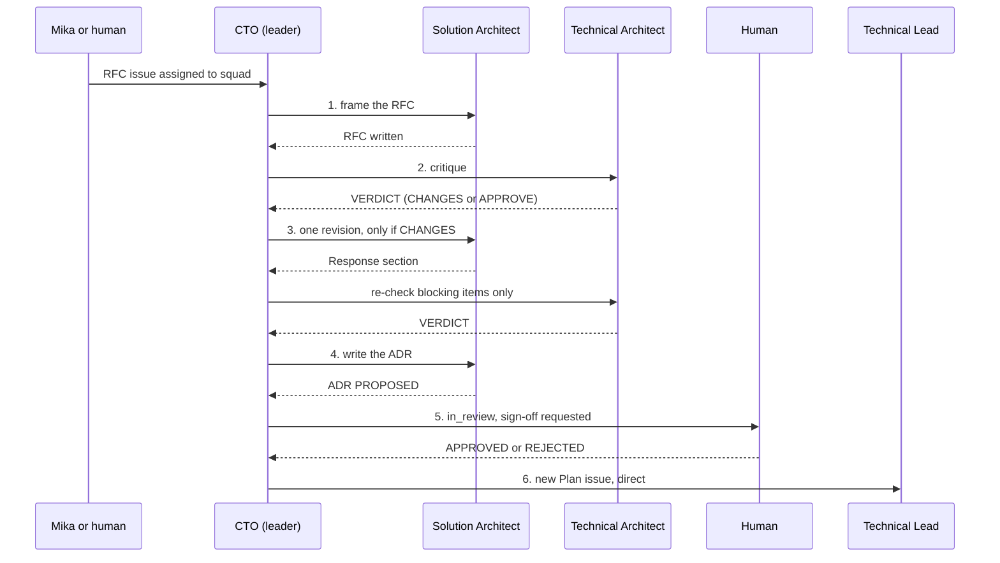

# The Design Triad

Three seats, each with one authority:

| Seat | Authority | Decides |
|---|---|---|
| Solution Architect | design | invariants, service boundaries, contracts |
| Technical Architect | verification | what the runtime or library actually does (by spike) |
| Technical Lead | delivery | cost, sequencing, scope fit |

The CTO leads the Architecture squad: it routes each step, chairs, and arbitrates what the ladder does not settle. A design that has not been through the triad is a draft, not a decision.

## How it runs on Multica
One issue per design question, titled `RFC: <question>`, assigned to the **Architecture squad**. Every step is one run by one agent. The member posts its result **without @mentions**; that wakes the CTO, who mentions the next agent (`issue-workflow` skill).

## Steps (two rounds maximum, never a third)

1. **Frame (Solution Architect).** `01_Architecture/RFC-NNN-<slug>.md`: recommendation, context, bounded contexts and domain model, two or three candidate designs, the invariants touched, and the assumptions you have *not* verified. If tenant data or identity is touched, the CTO also mentions the Security & Multi-Tenancy Reviewer for a parallel review; data-model questions bring in the Postgres & Data Modeling Specialist.
2. **Challenge (Technical Architect).** Append `## Critique — round N` to the RFC. Label every objection:
   - `blocking` — wrong or unsafe as written; include the failing scenario.
   - `non-blocking` — a real cost worth recording in the ADR.
   - `verify-by-spike` — a factual dispute; settle it with a timeboxed spike (`spikes` skill), not prose.
   - `confirmed` — you checked it and it holds. Say so explicitly.
   Every objection names the mechanism, a concrete failing scenario with inputs, and what would change your mind. Any `blocking` → `VERDICT: CHANGES`; otherwise `VERDICT: APPROVE` listing the non-blocking items.
3. **Converge (Solution Architect).** One revision. Add `## Response — round N` and resolve every `blocking` item: accepted (and how the design changed), rejected (with the reason), or deferred (with a named trigger). Do not reopen items a spike settled. On re-check the Technical Architect judges only whether each blocking item was resolved; no new objections. Still split → the tie-break ladder.
4. **Record (Solution Architect).** `01_Architecture/ADR-NNN-<slug>.md` from the approved RFC: decisions only, two pages at most, rejected options and recorded dissent. Status stays `PROPOSED`. Move the RFC to `01_Architecture/_archive/`.
5. **Sign-off (the human).** The CTO sets the issue to `in_review` and mentions the human with a link to the ADR and its summary. The human replies `APPROVED` or `REJECTED: <why>`.
   - `APPROVED` → the CTO mentions the Solution Architect to set the ADR to `ACCEPTED`, then goes to step 6.
   - `REJECTED` → back to step 3 with the human's notes; this does not count as a debate round.
6. **Close (CTO creates, Technical Lead plans).** The CTO creates `Plan ADR-NNN` assigned directly to the Technical Lead, linking only the ADR, and leaves the RFC issue in `in_review` for the human to mark `done`. The Technical Lead plans per the `delivery-planning` skill.

## Review checklists for the critique
- **Solution level:** every stated goal maps to a capability; module boundaries do not leak; integration contracts are versionable; multi-tenancy and embedding are addressed; non-goals are explicit.
- **Technical level:** single points of failure, unbounded growth, chatty service boundaries, missing failure modes, tenancy leaks, accidental complexity. Concurrency, consistency, latency.

## Rules
- **Silence is assent.**
- Do not block on a concern you have not made falsifiable.
- Attack the mechanism, not the designer. Under ten lines per point when disagreeing, with evidence.
- When overruled with reasoning, drop it, record the assumption you flagged, and move on.

## Tie-break ladder (when split after the revision)
1. Invariant or service boundary → **Solution Architect** decides.
2. Runtime or library behavior → **the spike** decides. If no spike can settle it in the timebox, choose the option that fails more safely. A verified spike result is never overruled.
3. Delivery cost, sequencing, or scope fit → **Technical Lead** decides.
4. Anything else technical → **CTO** decides and records why on the issue.
5. Business tradeoff (timeline vs. correctness, cost, new vendor) → **the human**: the CTO posts both positions in ten lines each and mentions the human.

A blocking isolation finding from the Security & Multi-Tenancy Reviewer outranks the design and the schedule: fold it in, do not negotiate it down.
