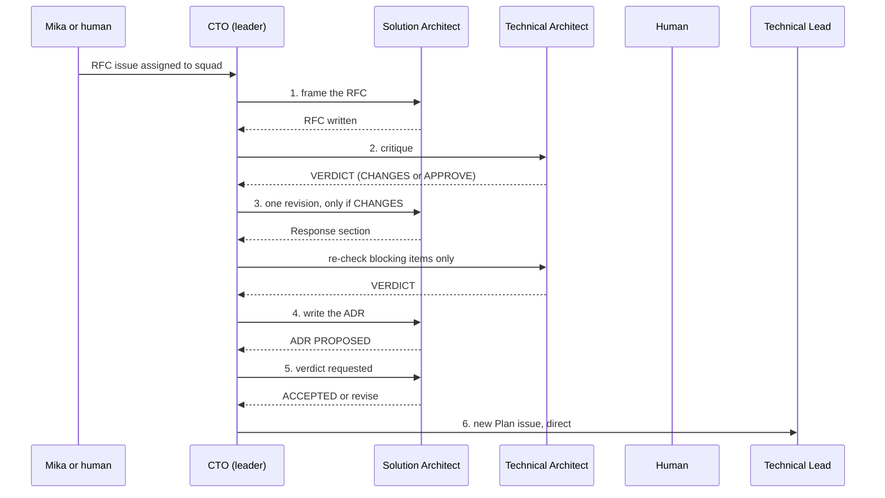

# The Design Triad

Three seats, each with one authority:

| Seat | Authority | Decides |
|---|---|---|
| Solution Architect | design | invariants, service boundaries, contracts |
| Technical Architect | verification | what the runtime or library actually does (by spike) |
| Technical Lead | delivery | cost, sequencing, scope fit |

The CTO leads the Architecture squad: it routes each step, chairs, and arbitrates what the ladder does not settle. A design that has not been through the triad is a draft, not a decision.

## How it runs on Multica
One issue per design question, titled `RFC: <question>`, assigned to the **Architecture squad**. Every step is one run by one agent. The member posts its result **without @mentions**; that wakes the CTO, who mentions the next agent (`issue-workflow` skill).

## Steps (two rounds maximum, never a third)

1. **Frame (Solution Architect).** `RFC-NNN-<slug>.md`, written in your workdir and posted as an issue comment attachment; the RFC enters the repo only in step 4. Contents: recommendation, context, bounded contexts and domain model, two or three candidate designs, the invariants touched, and the assumptions you have *not* verified. If tenant data or identity is touched, the CTO also mentions the Security & Multi-Tenancy Reviewer for a parallel review; data-model questions bring in the Postgres & Data Modeling Specialist.
2. **Challenge (Technical Architect).** Append `## Critique — round N` to the RFC. Label every objection:
   - `blocking` — wrong or unsafe as written; include the failing scenario.
   - `non-blocking` — a real cost worth recording in the ADR.
   - `verify-by-spike` — a factual dispute; settle it with a timeboxed spike (`spikes` skill), not prose.
   - `confirmed` — you checked it and it holds. Say so explicitly.
   Every objection names the mechanism, a concrete failing scenario with inputs, and what would change your mind. Any `blocking` → `VERDICT: CHANGES`; otherwise `VERDICT: APPROVE` listing the non-blocking items.
3. **Converge (Solution Architect).** One revision. Add `## Response — round N` and resolve every `blocking` item: accepted (and how the design changed), rejected (with the reason), or deferred (with a named trigger). Do not reopen items a spike settled. On re-check the Technical Architect judges only whether each blocking item was resolved; no new objections. Still split → the tie-break ladder.
4. **Record (Solution Architect).** `docs/adr/ADR-NNN-<slug>.md` from the approved RFC: decisions only, two pages at most, rejected options and recorded dissent. Status stays `PROPOSED`. Ship it on a design PR (see [Branch and PR](#branch-and-pr)) before the sign-off request.
5. **Verdict (Solution Architect).** The CTO mentions the Solution Architect with the design PR link, the `.html` explainer, the Technical Architect critique and any CTO tie-break. The Solution Architect decides `ACCEPTED` or revise. No human sign-off (policy set by vknavaladi).
   - `ACCEPTED` → the Solution Architect sets the ADR to `ACCEPTED` in both the `.md` and the `.html` (same PR if still open, otherwise a follow-up design PR), merges the design PR (no `MergePr`), then goes to step 6.
   - revise → back to step 3; this does not count as a debate round. A deadlock goes to the CTO, who decides.
6. **Close (CTO creates, Technical Lead plans).** The CTO creates `Plan ADR-NNN` assigned directly to the Technical Lead, linking only the ADR, and sets the RFC issue `done`. The Technical Lead plans per the `delivery-planning` skill. A plan that splits work into stories keeps them independent: each story lists the files and packages it touches, no two stories touch the same file, and a real dependency is sequenced explicitly (`Depends on: <story>`, which starts only after that story is merged into `main`).

## Where design artefacts live

| Artefact | Path |
|---|---|
| ADR | `docs/adr/ADR-NNN-<slug>.md` |
| Amendment / erratum | `docs/adr/ADR-NNN-A<k>-<slug>.md` / `docs/adr/ADR-NNN-E<k>-<slug>.md` |
| HTML explainer (self-contained, for the decision-maker) | `docs/adr/ADR-NNN[-A<k>\|-E<k>]-explained.html` |
| Archived RFC (final text, plus earlier revisions) | `docs/adr/ADR-NNN/rfc/RFC-NNN-<slug>.md`, `docs/adr/ADR-NNN/rfc/rev-<n>/` |
| Spike code and output | `docs/adr/ADR-NNN/spikes/<area>/<round-or-rfc>/` |
| Plan | `docs/delivery/plan-adr-NNN[-a<k>].md` |

Amendments and errata archive their RFC and spikes under the parent ADR's directory. ADR frontmatter: `type, id, title, status, date, issue, rfc, supersedes`.

## Branch and PR

- **Branch:** `TICK-<issue-no>/<short-kebab-description>`, where the number is the design issue (RFC, ADR, erratum or plan issue), e.g. `TICK-129/adr-001-a2-system-workflow-reach`. `multica repo checkout` creates an `agent/...` branch; rename it before the first push (`git branch -m`). No other prefixes.
- **Target:** the story branch when the artefact belongs to one story (`TICK-<story-no>/<story-slug>`); otherwise `main`. Docs-only design work (RFC, ADR, amendment, erratum, plan) to `main` is the only task-level exception to "nothing goes straight to `main`" (`docs/delivery/branching-strategy.md`).
- **Contents:** docs only, under `docs/adr/` (plans under `docs/delivery/`). An ADR PR carries the `.md`, the `.html` explainer, and the archived RFC and spikes. A fix that needs code is a task under a story, not part of the design PR.
- **Title and labels:** `TICK-<no>: <ADR id> <title>`. Add the `PR #N` label to the issue. The Solution Architect merges after the ACCEPTED verdict and the status update; no `MergePr`.

## Review checklists for the critique
- **Solution level:** every stated goal maps to a capability; module boundaries do not leak; integration contracts are versionable; multi-tenancy and embedding are addressed; non-goals are explicit.
- **Technical level:** single points of failure, unbounded growth, chatty service boundaries, missing failure modes, tenancy leaks, accidental complexity. Concurrency, consistency, latency.

## Rules
- **Silence is assent.**
- Do not block on a concern you have not made falsifiable.
- Attack the mechanism, not the designer. Under ten lines per point when disagreeing, with evidence.
- When overruled with reasoning, drop it, record the assumption you flagged, and move on.

## Tie-break ladder (when split after the revision)
1. Invariant or service boundary → **Solution Architect** decides.
2. Runtime or library behavior → **the spike** decides. If no spike can settle it in the timebox, choose the option that fails more safely. A verified spike result is never overruled.
3. Delivery cost, sequencing, or scope fit → **Technical Lead** decides.
4. Anything else technical → **CTO** decides and records why on the issue.
5. Business tradeoff (timeline vs. correctness, cost, new vendor) → **the human**: the CTO posts both positions in ten lines each and mentions the human.

A blocking isolation finding from the Security & Multi-Tenancy Reviewer outranks the design and the schedule: fold it in, do not negotiate it down.
