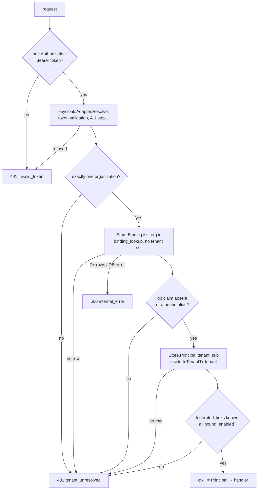

# Tenant resolution and the auth middleware (T17)

Scope: TICK-72. ADR-001 A.1 steps 2–5, PLAN-001 T17, TICK-93 (log ids,
baggage), TICK-69 security review (NULL links, missing row).

Every `/api/v1` operation runs behind `internal/platform/auth`. It reads the
bearer token, calls `identity.IdentityResolver.Resolve`, and puts the
returned `identity.Principal` (tenant, principal, groups, IdP alias) in the
request context. Handlers read it with `identity.FromContext` and pass
`TenantID` to `tenancy.InTenantTx`. Nothing reads a tenant from a header, the
query, the body or baggage.

## Pieces

| Piece | Where |
| --- | --- |
| `identity.Store`, `Binding`, `PrincipalRecord`, `NewContext` / `FromContext` | `internal/identity` |
| A.1 steps 2–4 | `keycloak.Adapter.Resolve` (`Config.Store`) |
| PostgreSQL store, as `nava_app` | `internal/identity/pgstore` (query measured in [identity.md](../data/identity.md)) |
| Middleware, `nava.auth.requests{result}` | `internal/platform/auth` |
| `tenant_id`, `principal_id` on every log record after auth | `internal/platform/logging` |
| `nava.tenant_id` on the server span after auth (T17b) | `internal/platform/auth` |
| `GET /api/v1/me` | `internal/server/api.go` |
| Wiring, `NAVA_OIDC_ISSUERS` | `cmd/nava-core/identity.go` |
| Fake realm for tests outside the adapter | `internal/identity/keycloak/keycloaktest` |

## Rules

- **Fail closed.** `federated_links IS NULL` (sync has not recorded the
  links) and no `principals` row for `sub` are both 401
  `tenant_unresolved`, as are a disabled principal and a link to an IdP not
  bound to the tenant. With `NAVA_OIDC_ISSUERS` or `NAVA_DATABASE_URL`
  unset, nava-core refuses every token.
- **401 vs 500.** A refusal wraps `ErrInvalidToken` or `ErrTenantUnresolved`.
  A store failure, or more than one binding row (impossible under
  `UNIQUE (issuer, org_id)`), wraps neither and is answered 500, so a
  database outage never makes clients drop good tokens.
- **What is logged.** A refusal logs `code` and the resolver's fixed reason
  (`tenant_unresolved: federated links unknown`), never the token or a claim
  value. `tenant_id` and `principal_id` are log fields only, never metric
  attributes.
- **What is on the span (T17b, TICK-190).** Checked against the TICK-94
  item 3 span id policy and the T01g allow-list (`spanAttributeAllowed`,
  TICK-105):
  - **Tenant id: yes.** It is platform-generated and resolved server-side,
    and `nava.tenant_id` is already on the allow-list. After resolution the
    middleware sets it on the server span; a refused request has none.
  - **Principal id: no.** The policy keeps ids that identify a person off
    spans ("principal id goes in logs only"), so there is no
    `nava.principal_id` key and the allow-list would drop one. Adding it
    needs a new ruling on TICK-94 item 3.

## Tests

| Criterion | Test |
| --- | --- |
| Zero / two orgs, unbound `idp`, foreign link, NULL links, no row → 401 | `keycloak.TestResolveRefusals`, `TestContract`; against PostgreSQL `dbtest.TestT17RefusalsAgainstPostgres`; over HTTP `server.TestMeThroughKeycloakAdapter` |
| Forged tenant in query, header, body, baggage only touches A | CI-2 paths in `internal/tenancy/isolation/registry.go`, run by the HTTP runner; `server.TestMeIgnoresForgedTenant`; `auth.TestForgedBaggageIsNotInTheContext` |
| Handler log line carries both ids; no token in logs | `auth.TestHandlerLogCarriesTenantAndPrincipal`, `auth.TestRefusalLogsNoToken` |
| Error mapping, `WWW-Authenticate`, no echo | `server.TestMeRefusals` |
| Exported server span has `nava.tenant_id` after a 200, none after a 401, never a principal id | `auth.TestServerSpanCarriesTenantOnlyAfterAuth` |
| No tenant or principal on `nava.auth.requests` | `auth.TestMetricHasNoTenantAttribute` |
