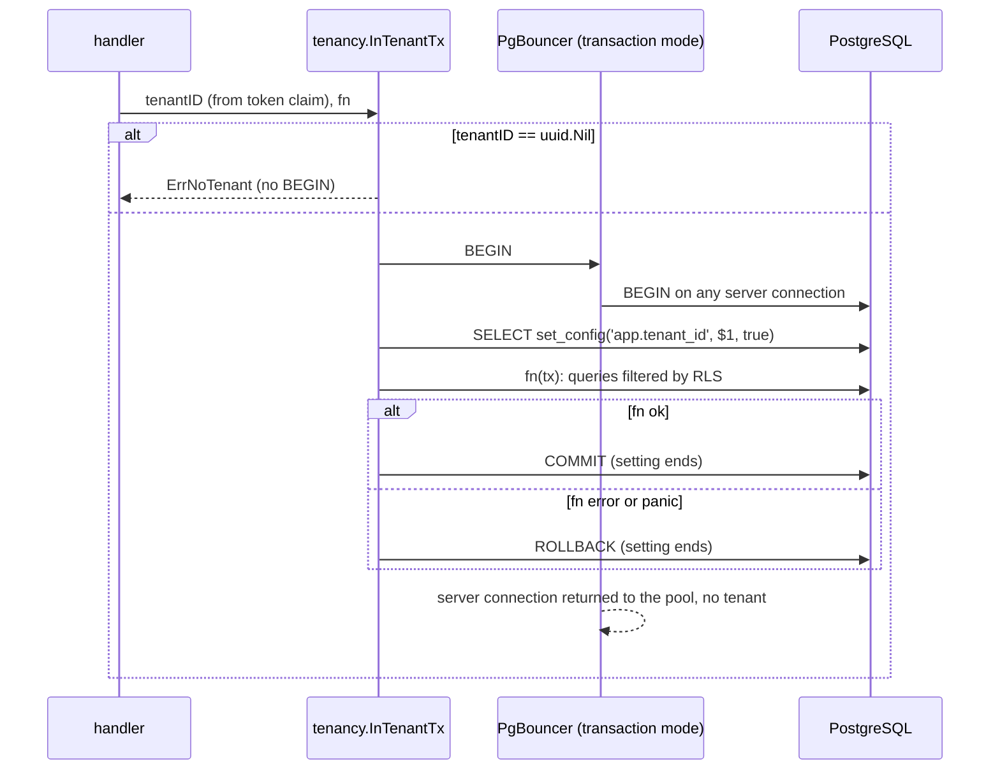

# Tenant-scoped transactions

PLAN-001 T07 (TICK-61). Every tenant-scoped database access goes through
`tenancy.InTenantTx`. It is the only Go code that sets `app.tenant_id`, the
setting the row-level security policies under `db/` read.

```go
func InTenantTx(ctx context.Context, pool *pgxpool.Pool, tenantID uuid.UUID, fn func(pgx.Tx) error) error
```

- `uuid.Nil` returns `ErrNoTenant`. No transaction is opened.
- The tenant is set with `set_config('app.tenant_id', $1, true)`. The `true`
  makes it transaction-local, so it ends with the transaction. Through
  PgBouncer in transaction mode, the next transaction on the same server
  connection starts with no tenant, even when it belongs to another client.
- If `fn` returns an error, the transaction rolls back and the error is
  returned unwrapped. If `fn` panics, the transaction rolls back and the panic
  is re-raised.
- `tenantID` comes from the validated token's tenant claim in the request
  context. It never comes from a path, query or body.



## The pool

`internal/platform/db.NewPool` builds the one traced pool (TICK-94 item 4).
It always passes the tracer and meter providers from `telemetry.Telemetry` to
otelpgx, and it returns `ErrNilProvider` if any of them is nil. Otherwise
otelpgx would fall back to the global providers, which bypass the export
allow-list.

The tracer records no SQL text and no parameter values. Span names are SQL
keywords (`telemetry.DBSpanName`), and the statement attribute is off. The
export filter also keeps only allow-listed `db.*` keys and reduces any other
otelpgx span name to `_OTHER`.

## Lint

| Rule | Where | What fails |
|---|---|---|
| `navalint` `setconfig` | `tools/navalint`, its own module, run by `make lint` as `go vet -vettool` | `set_config` or `app.tenant_id` in a Go string constant outside `internal/tenancy`. SQL files are not checked, so policies may use `current_setting('app.tenant_id')` |
| `forbidigo` | `.golangci.yml` | `otelpgx.WithIncludeQueryParameters` anywhere |

`make lint-fixture` checks that both rules still fire on
`internal/platform/lintfixture`. The `setconfig` analyzer folds constant
expressions, so `"set_" + "config"` is caught. A string built at run time is
not. The rule is defence in depth; the database grants are the control.
