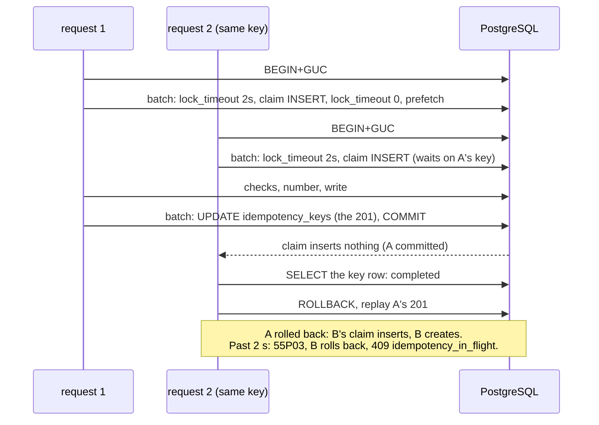

# Batched round trips in a tenant transaction

TICK-648 (PLAN-003 P3-36b). A record create and a single-record GET used to
send one statement per round trip: 29 statements for a create, across two
transactions, and 13 for a GET. This note covers how they are batched now,
and why every batch runs under the right tenant.

## The tenant is set by BEGIN

`tenancy.InTenantTx` opens its transaction with one simple-query round trip:

```sql
BEGIN; SELECT set_config('app.tenant_id', '<tenant uuid>', true)
```

pgx runs a `TxOptions.BeginQuery` with no arguments over the simple protocol,
which takes several statements, and fails the begin, closing the connection,
if either one fails. A simple query has no bind parameters, so the tenant is a
literal. It is `uuid.UUID.String()`: 36 characters of hex and hyphens, never
caller text. The tracer exports no statement text
(`TestTracedTxExportsNoValues`).

So nothing `fn` sends, a single statement or a `pgx.Batch`, can run in the
transaction before the tenant is set. There is no separate `set_config` round
trip to forget or to reorder.

The transaction `fn` gets is a `*scopedTx`. Only `InTenantTx` builds one:

- `tenancy.TenantOf` returns the tenant BEGIN set, with no round trip. Before
  this change, a create asked the database 9 times and a GET 5 times. Any
  other `pgx.Tx` is still asked.
- `Remember`, `Recall` and `Forget` keep a per-transaction memo. A read that
  was prefetched in a batch (definition, policy, the row a create stored) is
  used by the code that would otherwise read it again. The memo dies with the
  transaction, which belongs to one tenant. Publishing a definition or an ACL
  drops the matching entry. A savepoint shares the memo: rolling it back
  undoes the `Remember` and `Forget` calls made since it opened, so a record
  created in it is no longer recalled; releasing it keeps them (TICK-651).
- `ExecAtCommit` queues a statement for the round trip that commits. The
  statement's result is read after COMMIT, so a statement that must stop the
  commit has to fail in SQL. A savepoint cannot queue one.

```mermaid
sequenceDiagram
    participant H as handler / pipeline
    participant T as tenancy.InTenantTx
    participant P as PostgreSQL
    H->>T: tenantID (resolved principal), fn
    T->>P: BEGIN; set_config('app.tenant_id', tenant, true)
    Note over T,P: one round trip: the tenant is set before anything fn sends
    T->>H: fn(scopedTx)
    H->>P: batch 1 (prefetch reads)
    H->>P: batch 2 (checks)
    H->>P: number: tenancy.AllocTx, one send (BEGIN, GUC, SET LOCAL, upsert, COMMIT) on the allocator pool
    H->>P: batch 3 (INSERT record, audit)
    T->>P: batch: ExecAtCommit statements, COMMIT
```

## Create

| Round trip | Statements |
|---|---|
| BEGIN | BEGIN+GUC |
| claim + prefetch | `set_config('lock_timeout', '2000ms', true)`; `INSERT idempotency_keys … ON CONFLICT DO NOTHING` (the claim, TICK-688); `set_config('lock_timeout', '0', true)`; definition id; current definition; ACL policy |
| checks | per unique property its advisory lock then its lookup; assignment group live; payload preview |
| number (`tenancy.AllocTx`, allocator pool, TICK-657, ADR-005 L2s) | one pipelined send: BEGIN; `set_config` (tenant); `SET LOCAL synchronous_commit = off`; `record_counters` upsert `RETURNING next - 1, now()`; COMMIT |
| write | `INSERT records` (with the number); `record_write_keys` (system writers with a key); `INSERT audit_log` |
| commit | `UPDATE idempotency_keys` (completed, the 201); COMMIT |

That is 6 round trips, 19 statements and one synchronous commit (9 and 21
under TICK-657, 8 and 17 under TICK-648): TICK-688 folds the idempotency
claim, which was a transaction of its own (BEGIN+GUC, INSERT, COMMIT: three
round trips, a second synchronous commit), into the claim + prefetch batch.
The number's own transaction adds one round trip of five statements and moves
the upsert out of the write batch. The counter row is locked for that one
round trip, with no fsync in it (its COMMIT is asynchronous, ADR-005 A4), no
longer from the write batch to the create's synchronous COMMIT.

- **Number after the checks, in its own transaction.** The upsert runs after
  every check, so a refused create moves nothing, and commits before the
  write batch, which inserts the record with that number. A failure after
  the number is taken leaves a gap (`TestCreateRollsBackAtEveryStage`,
  `TestRolledBackCreateLeavesAGap`). A `gapless` type (TICK-659) keeps the
  TICK-648 layout: the upsert opens its write batch, there is no allocation
  trip, and a rollback gives the number back
  (`TestRolledBackCreateNumberIsReused`).
- **Audit diff.** The audit entry is built before the write batch, from the
  payload PostgreSQL makes of the values about to be stored (the payload
  preview: `PayloadJSON`'s expression over bind parameters). The INSERT
  returns the stored row's payload, and the pipeline fails the write unless
  the two are byte-equal. So the diff is still the stored row's jsonb text.
- **Idempotency (TICK-688).** The claim is the transaction's first write,
  ahead of validation, the write check and the number, and is settled
  (`idempotency.ResolveClaim`) right after the batch. A replay, a reuse or a
  wait past the bound rolls the transaction back there and takes no number
  (I4). The claim alone waits at most `idempotency.ClaimWait` (2 s,
  `tenancy.QueueUnderLockTimeout`) on a concurrent request with the key; any
  other lock wait of the create keeps its unbounded behaviour. The completion
  rides in the COMMIT's round trip, wrapped to divide by zero when it matches
  no row (TICK-482). A failed create leaves no key row. The pipeline's
  `record_write_keys` replay, `in_flight` and per-actor rules are unchanged.



- **The 201** is built from the row the write stored (`pipeline.Get` answers
  from the memo), with the stored number, timestamps and payload.

## GET

BEGIN+GUC, then one batch of the current definition, the record, the caller's
shares of it and the ACL policy, then COMMIT: 3 round trips and 7 statements,
down from 13 in 13. A record written under an older schema version adds one
read of that version.

## Tests

- `internal/tenancy/tenancytest.Guard` is a pgx tracer. It marks a
  connection scoped at the tenancy BEGIN and unscoped at COMMIT or ROLLBACK,
  and records a violation for any statement or batch sent on an unscoped
  connection. The tenancy, pipeline and server tests run requests through it.
- The tenancy tests cover the cross-tenant and empty-tenant cases for
  batches, `ExecAtCommit` atomicity, the memo, and savepoints, including
  memo undo on savepoint rollback, nested savepoints and release.
- The server test holds create and GET to their round-trip and statement
  budgets, and two tenants interleaved on one connection, and 16 concurrent
  clients, to their own tenant.
