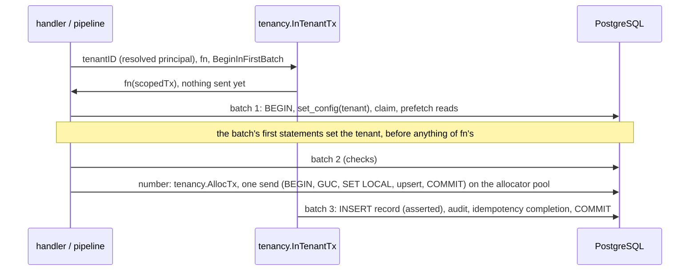
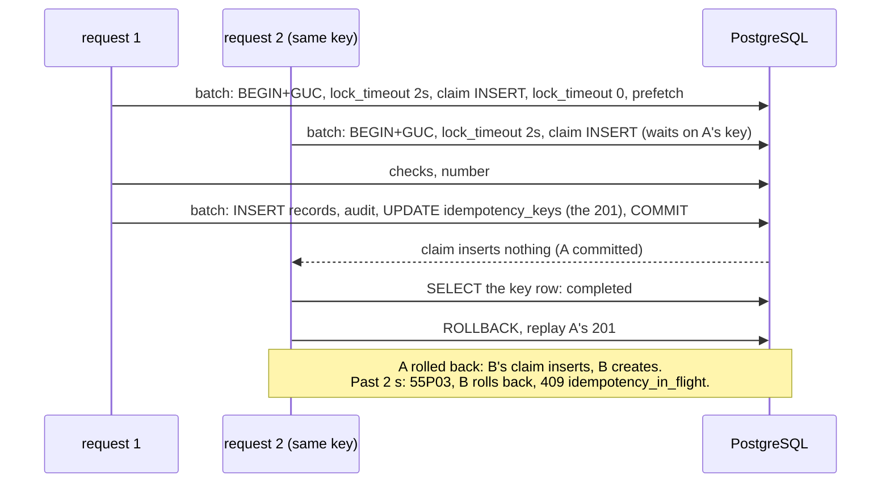

# Batched round trips in a tenant transaction

TICK-648 (PLAN-003 P3-36b). A record create and a single-record GET used to
send one statement per round trip: 29 statements for a create, across two
transactions, and 13 for a GET. This note covers how they are batched now,
and why every batch runs under the right tenant.

## The tenant is set by BEGIN

`tenancy.InTenantTx` opens its transaction with one simple-query round trip:

```sql
BEGIN; SELECT set_config('app.tenant_id', '<tenant uuid>', true)
```

pgx runs a `TxOptions.BeginQuery` with no arguments over the simple protocol,
which takes several statements, and fails the begin, closing the connection,
if either one fails. A simple query has no bind parameters, so the tenant is a
literal. It is `uuid.UUID.String()`: 36 characters of hex and hyphens, never
caller text. The tracer exports no statement text
(`TestTracedTxExportsNoValues`).

So nothing `fn` sends, a single statement or a `pgx.Batch`, can run in the
transaction before the tenant is set. There is no separate `set_config` round
trip to forget or to reorder.

### BEGIN in the first batch (TICK-692)

With `tenancy.BeginInFirstBatch()`, `InTenantTx` sends no BEGIN round trip.
The transaction (`lazyTx`) opens in the round trip of the first thing `fn`
sends:

- **A `pgx.Batch`** goes out as `BEGIN`;
  `SELECT set_config('app.tenant_id', $1, true)`; then the batch's own
  statements, in one pipelined send, as `tenancy.AllocTx` does. PostgreSQL
  runs a pipeline in order and skips everything after a failed statement, so
  no statement of the caller's runs before the tenant is set, and any failure
  leaves an aborted transaction that `InTenantTx` rolls back. The caller
  reads its own results only; the BEGIN and tenant results are read for it.
- **Anything else** (Exec, Query, QueryRow, a savepoint) sends the usual
  `BEGIN; set_config(...)` round trip first.
- **Nothing sent:** nothing goes out, not even COMMIT. **Only `ExecAtCommit`
  statements:** one round trip of BEGIN, tenant, statements, COMMIT.

Record create uses it. `tenancytest.Guard` recognises the first batch
(`tenancy.FirstBatchTenant`) and scopes the connection from its first
statement.

The transaction `fn` gets is a `*scopedTx`. Only `InTenantTx` builds one:

- `tenancy.TenantOf` returns the tenant BEGIN set, with no round trip. Before
  this change, a create asked the database 9 times and a GET 5 times. Any
  other `pgx.Tx` is still asked.
- `Remember`, `Recall` and `Forget` keep a per-transaction memo. A read that
  was prefetched in a batch (definition, policy, the row a create stored) is
  used by the code that would otherwise read it again. The memo dies with the
  transaction, which belongs to one tenant. Publishing a definition or an ACL
  drops the matching entry. A savepoint shares the memo: rolling it back
  undoes the `Remember` and `Forget` calls made since it opened, so a record
  created in it is no longer recalled; releasing it keeps them (TICK-651).
- `ExecAtCommit` queues a statement for the round trip that commits;
  `QueueAtCommit` returns that batch, for statements with a result callback
  (TICK-692). A failing statement makes PostgreSQL skip the rest, COMMIT
  included, so a statement that must stop the commit has to fail in SQL. A
  savepoint cannot queue one.



## Create

| Round trip | Statements |
|---|---|
| 1. BEGIN + claim + prefetch | `BEGIN`; `set_config('app.tenant_id', $1, true)` (TICK-692); `set_config('lock_timeout', '2000ms', true)`; `INSERT idempotency_keys … ON CONFLICT DO NOTHING` (the claim, TICK-688); `set_config('lock_timeout', '0', true)`; definition id; current definition; ACL policy |
| 2. checks | per unique property its advisory lock then its lookup; assignment group live; payload preview |
| 3. number (`tenancy.AllocTx`, allocator pool, TICK-657, ADR-005 L2s) | one pipelined send: BEGIN; `set_config` (tenant); `SET LOCAL synchronous_commit = off`; `record_counters` upsert `RETURNING next - 1, now()`; COMMIT |
| 4. write + commit | `INSERT records` (with the number, asserted, TICK-692); `record_write_keys` (system writers with a key); `INSERT audit_log`; `UPDATE idempotency_keys` (completed, the 201); COMMIT |

That is 4 round trips, 19 statements and one synchronous commit (6 and 19
under TICK-688, 9 and 21 under TICK-657, 8 and 17 under TICK-648). TICK-692
removes the standalone BEGIN round trip (`BeginInFirstBatch`) and the
separate write round trip (`pipeline.Command.InsertAtCommit`). TICK-688 folded
the idempotency claim, which was a transaction of its own (BEGIN+GUC, INSERT,
COMMIT: three round trips, a second synchronous commit), into the claim +
prefetch batch. The number's own transaction adds one round trip of five
statements and moves the upsert out of the write batch. The counter row is
locked for that one round trip, with no fsync in it (its COMMIT is
asynchronous, ADR-005 A4), no longer from the write batch to the create's
synchronous COMMIT.

- **Number after the checks, in its own transaction.** The upsert runs after
  every check, so a refused create moves nothing, and commits before the
  write batch, which inserts the record with that number. A failure after
  the number is taken leaves a gap (`TestCreateRollsBackAtEveryStage`,
  `TestRolledBackCreateLeavesAGap`). A `gapless` type (TICK-659) keeps the
  TICK-648 layout: the upsert opens its write batch, there is no allocation
  trip, and a rollback gives the number back
  (`TestRolledBackCreateNumberIsReused`). It is 4 round trips too: BEGIN +
  claim + prefetch, checks, write (with the number), completion + COMMIT.
- **The write rides in the COMMIT's batch (TICK-692).** For a `gaps` type
  everything the 201 shows is known before the INSERT runs: the id, the
  number and the instant from `AllocTx`, version 1, and the payload preview
  of round trip 2. So the pipeline queues the record, the write key and the
  audit entry on the commit batch (`tenancy.QueueAtCommit`) and answers with
  the record as it will be stored. The INSERT asserts that in SQL: it is a
  CTE that divides by zero unless the stored row has exactly that number,
  `created_at`, `updated_at` and payload text
  (`store.QueueInsertRecordAsExpected`, `store.ErrStoredRowDiffers`). A
  mismatch fails the batch before COMMIT, so no 201 is stored for a row that
  differs from it. A failing statement in the batch (a 23503 foreign key,
  the write key's duplicate, the audit entry's checks) is mapped as the
  write batch mapped it, inside `*pipeline.ErrAtVersion`, and comes out of
  `InTenantTx`. Only `gaps` creates with the no-op event sink are deferred:
  a sink that sends statements needs them after the INSERT, and a `gapless`
  type takes its number in its INSERT.
- **Audit diff.** The audit entry is built before the write, from the
  payload PostgreSQL makes of the values about to be stored (the payload
  preview: `PayloadJSON`'s expression over bind parameters). The INSERT
  checks the stored row's payload against it (a `gapless` write in Go after
  its batch, a deferred `gaps` write in SQL before COMMIT), and the write
  fails unless the two are byte-equal. So the diff is still the stored row's
  jsonb text.
- **Idempotency (TICK-688).** The claim is the transaction's first write,
  ahead of validation, the write check and the number, and is settled
  (`idempotency.ResolveClaim`) right after the batch. A replay, a reuse or a
  wait past the bound rolls the transaction back there and takes no number
  (I4). The claim alone waits at most `idempotency.ClaimWait` (2 s,
  `tenancy.QueueUnderLockTimeout`) on a concurrent request with the key; any
  other lock wait of the create keeps its unbounded behaviour. The completion
  rides in the COMMIT's round trip, wrapped to divide by zero when it matches
  no row (TICK-482). A failed create leaves no key row. The pipeline's
  `record_write_keys` replay, `in_flight` and per-actor rules are unchanged.
- **Order (TICK-692 keeps it):** the claim and replay check, then validation
  and `CanWrite`, then the number, then the INSERT. A replayed or refused
  create never takes a number.



- **The 201** is built from the row as stored (`pipeline.Get` answers from
  the memo), with the stored number, timestamps and payload.

## GET

BEGIN+GUC, then one batch of the current definition, the record, the caller's
shares of it and the ACL policy, then COMMIT: 3 round trips and 7 statements,
down from 13 in 13. A record written under an older schema version adds one
read of that version.

## Tests

- `internal/tenancy/tenancytest.Guard` is a pgx tracer. It marks a
  connection scoped at the tenancy BEGIN and unscoped at COMMIT or ROLLBACK,
  and records a violation for any statement or batch sent on an unscoped
  connection. The tenancy, pipeline and server tests run requests through it.
- The tenancy tests cover the cross-tenant and empty-tenant cases for
  batches, `ExecAtCommit` atomicity, the memo, and savepoints, including
  memo undo on savepoint rollback, nested savepoints and release.
- `BeginInFirstBatch` has its own (`firstbatch_integration_test.go`):
  tenants interleaved on one connection, a cross-tenant write in the first
  batch rolling everything back, results read in order, savepoints, and the
  empty, commit-only and Exec-first transactions.
- `TestCreateRecordFailureInFirstOrLastTripLeavesNothing` injects a failure
  into round trip 1 (the claim) and round trip 4 (the completion) in both
  numbering modes: no key row, no record, and the counter unchanged except
  for the gap a `gaps` create's number, committed in round trip 3, leaves.
  `TestInsertRecordAsExpected` holds the deferred INSERT to the row the 201
  was built from.
- The server test holds create and GET to their round-trip and statement
  budgets, and two tenants interleaved on one connection, and 16 concurrent
  clients, to their own tenant.
