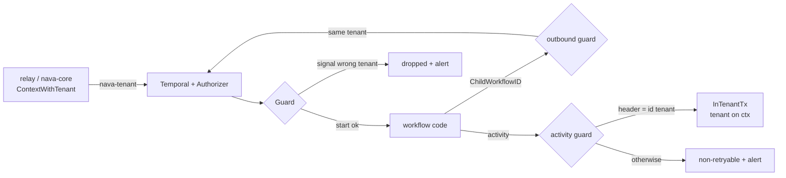

# Worker tenant guards

PLAN-001 T31 (TICK-65), ADR-001 A.2 "Guards in the worker". Package
`internal/workerguard`; the shared Temporal SDK telemetry is
`telemetry.NewTemporal` in `internal/platform/telemetry` (TICK-94 item 5).

The tenant of a workflow is the `<tenant>` of its id `t:<tenant>:<rest>`
(a canonical UUID). The relay builds that id from `outbox.tenant_id` (I2), and
Temporal never changes it. The `nava-tenant` header, signal bodies, inputs and
`NavaTenantId` are never a source: the guards only compare them with the id.
The Authorizer checks the same commands again (`docs/temporal-server.md`); the
worker checks first, so a bad command fails one workflow or activity instead of
a workflow task retrying a server deny until someone acts.

## Setup

```go
tt, _ := tel.NewTemporal(log)                  // tracer, TraceContext only, no baggage, meter, OnError logs
opts := client.Options{ /* address, mTLS */ }
workerguard.ConfigureClient(&opts, tt)         // Propagator, tracing first, metrics, no worker heartbeats
g, _ := workerguard.New(log, tel.MeterProvider)
w := worker.New(c, queue, workerguard.WorkerOptions(worker.Options{}, g))
(&workerguard.Activities{Pool: workerPool}).Register(w)
```

The relay and `nava-core` use `ConfigureClient` too, and put the tenant on the
call's context with `workerguard.ContextWithTenant`; the Propagator writes it as
the header. From workflow code the Propagator writes the tenant of the
workflow's own id, never a context value.

## Guards

| Call | Wrong or missing `nava-tenant` header, or bad target | Outcome |
| --- | --- | --- |
| Workflow start | header missing, not `json/plain`, or another tenant; id without a tenant prefix | workflow fails, non-retryable `nava.TenantGuard` |
| Signal | header missing or another tenant | **dropped**; the workflow keeps running |
| Update | header missing or another tenant | rejected by the validator |
| Activity | header missing or another tenant (TICK-84 finding 1) | fails non-retryably; the body never runs |
| Child | id not prefixed with this tenant (the SDK default `<runID>_<n>` is not), other namespace, cron, `NavaTenantId` of another tenant | the child future fails |
| Signal-external, cancel-external | target id not prefixed with this tenant, other namespace | the future fails |
| Continue-as-new | header not this tenant (no Propagator), a cron schedule copied from a cron-started run, or the copied `NavaTenantId` is another tenant's | the workflow fails instead of continuing |
| Upsert `NavaTenantId` | another value, or unset | the upsert fails |
| Nexus | always | the future fails |

Every decision adds to `nava.worker.guard.decisions{guard, outcome}` (no tenant
or workflow id on the metric). Every deny logs `worker tenant guard denied` at
error level with `alert=true` and the workflow id, run id and signal, update,
activity or target name; never a header or payload value. Workflow guards do
not count or log while the workflow replays (`TestReplayRecordsNothing` replays
a history with an allowed start and a denied signal through a fresh Guard). A guard never panics: an internal
failure is outcome `internal`, a deny.



## Children, signals and `workflow_ref`

- **Child ids:** `workerguard.ChildWorkflowID(ctx, kind)` returns
  `t:<tenant>:<kind>:<uuid>` (uuid from a SideEffect). It is the only way to
  name a child.
- **Signal dedupe (I7):** each signal carries its `outbox.id`.
  `AppliedSignals.TryApply` applies an id once and forgets it 48 h later
  (`SignalDedupeWindow`, D-P8: longer than the relay's 24 h redelivery age).
  Pass the set in the continue-as-new input, and drain pending signal channels
  before continuing as new, or a signal that arrived with the rollover is lost.
- **`workflow_ref.closed_at` (A.3):** a relay-started workflow calls
  `workerguard.CloseWorkflowRef(ctx)` as its final activity. The activity finds
  the row from its workflow id (`t:<tenant>:<kind>:<start outbox id>`), never
  from an argument, and updates it in `InTenantTx` with the header tenant as
  `nava_worker`. A retry keeps the first `closed_at`; no row is non-retryable
  `nava.WorkflowRefNotFound`.

## Residual risks

- The worker keeps `GetWorkflowExecutionHistory` (SDK history paging), which
  takes any workflow id, and the task-token APIs, which the Authorizer does not
  inspect. Activity code must never get a raw Temporal client
  ([AR-025](../security/accepted-risks.md)).
- Within 48 h the applied-signal set grows with every distinct signal; a flood
  to one workflow grows its continue-as-new input (Epic 08 flood test, R9).

## Deferred

| Item | Owner | Revisit trigger |
| --- | --- | --- |
| Worker binary (`cmd/nava-worker`) and compose service, serving `/metrics` and the probes on `NAVA_ADMIN_ADDR` with the T04 listener, not wrapped in `httpobs.Middleware` (TICK-94 item 1). Nothing hosts the worker yet. | Technical Lead (TICK-159, T31b) | When T32b runs the worker in the stack |
| Alert rule on `nava.worker.guard.decisions{outcome!="allow"}` (Prometheus: `nava_worker_guard_decisions_total`). Denies are already logged with `alert=true`. | Whoever installs the rules (TODO-004, with AR-011 and AR-012; tracked in TICK-159) | When TODO-004 installs the alert rules |
| Queries are not guarded: they are not in the A.2 contract. `nava-core` builds query ids from the token's tenant (AR-004). | Security & Multi-Tenancy Reviewer | First `nava-core` query call, or a query that returns tenant data |

## Tests

- `go test ./internal/workerguard/`: every guard's allow and deny path, the
  header on activity, child and continue-as-new commands (`json/plain`, the
  prefix tenant), dedupe across continue-as-new and the 48 h window, and an
  exported span with no payload value after a guard failure.
- `make test-integration`: `workflow_ref.closed_at` set by `nava_worker` under
  RLS against real PostgreSQL; cross-tenant and wrong-header closes change
  nothing.
- `make stack-test-sdk` (`internal/temporalstack/workerguard_test.go`): the
  guarded worker against the real Authorizer: the helper child completes, the
  default-id child fails in the worker, wrong-tenant signal and update,
  redelivery across a real continue-as-new.
