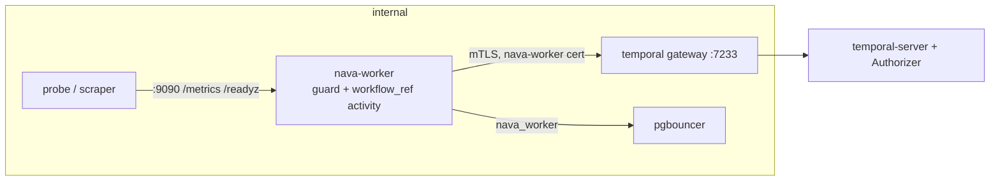
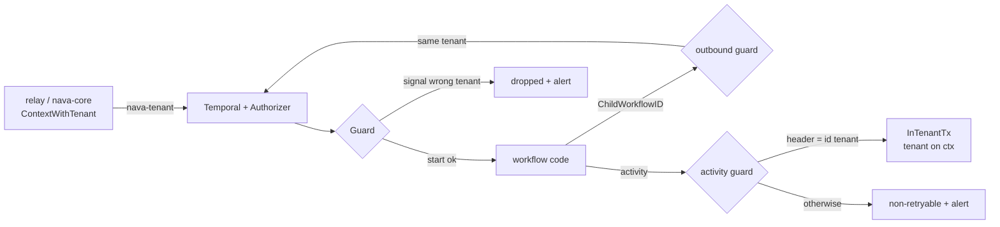
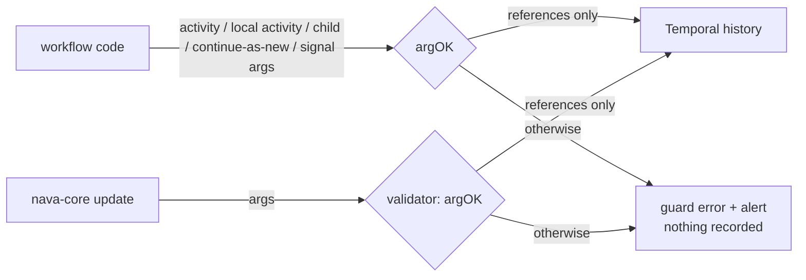
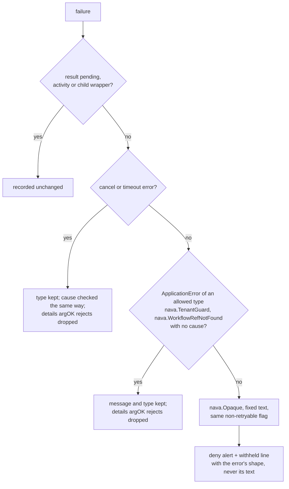

# Worker tenant guards

PLAN-001 T31 (TICK-65), ADR-001 A.2 "Guards in the worker". Package
`internal/workerguard`; the shared Temporal SDK telemetry is
`telemetry.NewTemporal` in `internal/platform/telemetry` (TICK-94 item 5).

The tenant of a workflow is the `<tenant>` of its id `t:<tenant>:<rest>`
(a canonical UUID). The relay builds that id from `outbox.tenant_id` (I2), and
Temporal never changes it. The `nava-tenant` header, signal bodies, inputs and
`NavaTenantId` are never a source: the guards only compare them with the id.
The Authorizer checks the same commands again (`docs/temporal-server.md`); the
worker checks first, so a bad command fails one workflow or activity instead of
a workflow task retrying a server deny until someone acts.

## Setup

```go
tt, _ := tel.NewTemporal(log)                  // tracer, TraceContext only, no baggage, meter, OnError logs
opts := client.Options{ /* address, mTLS */ }
workerguard.ConfigureClient(&opts, tt)         // Propagator, tracing first, metrics, no worker heartbeats
g, _ := workerguard.New(log, tel.MeterProvider)
w := worker.New(c, queue, workerguard.WorkerOptions(worker.Options{}, g))
(&workerguard.Activities{Pool: workerPool}).Register(w)
```

The relay and `nava-core` use `ConfigureClient` too, and put the tenant on the
call's context with `workerguard.ContextWithTenant`; the Propagator writes it as
the header. From workflow code the Propagator writes the tenant of the
workflow's own id, never a context value.

## The `nava-worker` process (T31b)

`cmd/nava-worker` is the setup above and nothing more, run as the compose
service `nava-worker` (image `nava/nava-worker`):

- Client: namespace `nava`, the `nava-worker` certificate over mTLS through the
  `temporal` gateway, options from `ConfigureClient`. Worker: queue `nava-tq`,
  options from `WorkerOptions`. Activity code gets no client (AR-025).
- Hosts the `workflow_ref` activity only, as `nava_worker` through PgBouncer.
  No workflow is registered yet, so the workflow poller is off
  (`DisableWorkflowWorker`); T32b registers the first workflow and turns it on.
- Admin listener on `NAVA_ADMIN_ADDR` (`:9090`): `telemetry.NewAdminHandler`,
  not wrapped in `httpobs.Middleware`. `/metrics` carries
  `nava_worker_guard_decisions_total` and the SDK metrics; `/readyz` is 200
  once the worker has started and PostgreSQL and Temporal both answer. A fatal worker error
  (the SDK stops the worker, for example on `NamespaceNotFound`) reaches
  `OnFatalError` and ends the process non-zero, so compose restarts it. Never
  published: the service is on `internal` only.



`make stack-test-worker` (`internal/workerstack`): the service is ready,
`/healthz` reports PostgreSQL and Temporal ok, `/metrics` answers without the
httpobs request id, the admin port is not published, and a relay-started
workflow's `workflow_ref` activity runs in the service: the guard allows it and
`/metrics` counts it, and the activity returns `nava.WorkflowRefNotFound` from
PostgreSQL. It runs after `stack-test-sdk`, whose workers also poll `nava-tq`.

## Guards

| Call | Wrong or missing `nava-tenant` header, or bad target | Outcome |
| --- | --- | --- |
| Workflow start | header missing, not `json/plain`, or another tenant; id without a tenant prefix | workflow fails, non-retryable `nava.TenantGuard` |
| Signal | header missing or another tenant | **dropped**; the workflow keeps running |
| Update | header missing or another tenant | rejected by the validator |
| Activity | header missing or another tenant (TICK-84 finding 1) | fails non-retryably; the body never runs |
| Child | id not prefixed with this tenant (the SDK default `<runID>_<n>` is not), other namespace, cron, `NavaTenantId` of another tenant, or under a non-Keyword key | the child future fails |
| Signal-external, signal-child, cancel-external | target id not prefixed with this tenant, other namespace | the future fails |
| Continue-as-new | header not this tenant (no Propagator, or rewritten on the returned error: checked again when the workflow returns), a cron schedule copied from a cron-started run, or the copied `NavaTenantId` is another tenant's | the workflow fails instead of continuing |
| Upsert `NavaTenantId` | another value, or unset; or any change through a non-Keyword key of the same name (Text, KeywordList, ...), which the SDK encodes under the same name | the upsert fails |
| Nexus | always | the future fails |
| Arguments (CI-7, TICK-216, TICK-245) | an activity, local activity, child, continue-as-new, update, signal-external or signal-child argument that is not references only (see below) | the future fails (`activity_args`, `local_activity_args`, `child`, `signal_external`), the workflow fails (`continue_as_new`), or the validator rejects the update (`update`); outcome `record_data` |
| Memo (CI-7, TICK-245) | any memo on a child, any `UpsertMemo` (the platform names no memo key) | the child future fails (`child`) or the upsert fails (`memo`); outcome `record_data` |
| Results (CI-7, TICK-245) | an activity, local-activity, workflow or update result that is not nil or references only | replaced by the guard error (`activity_result`, `workflow_result`, `update_result`); outcome `record_data` |
| Side effects (CI-7, TICK-245) | a `SideEffect` value that is not nil, a UUID, a time, a number, a bool or references only; any `MutableSideEffect` | the marker holds a sentinel and `Get` returns the guard error (`side_effect`, `record_data`); `MutableSideEffect` fails without running `f` (`not_allowed`) |
| Failure text (CI-7, TICK-245) | an activity, workflow or update failure that is not an SDK error or an allowed `ApplicationError` type with no cause | replaced by `nava.Opaque` with fixed text and the same non-retryable flag (`activity_failure`, `workflow_failure`, `update_failure`; outcome `record_data`); the log gets its shape |

Every decision adds to `nava.worker.guard.decisions{guard, outcome}` (no tenant
or workflow id on the metric). Every deny logs `worker tenant guard denied` at
error level with `alert=true` and the workflow id, run id and signal, update,
activity or target name; never a header or payload value. Workflow guards do
not count or log while the workflow replays (`TestReplayRecordsNothing` replays
a history with an allowed start and a denied signal through a fresh Guard). A guard never panics: an internal
failure is outcome `internal`, a deny.



## Arguments: references only (CI-7)

Histories are cross-tenant and unencrypted (ADR-001 R1), so the guard checks
every argument a workflow hands to Temporal before the command exists. The Go
type picks the rule; the JSON `workerguard.DataConverter` encodes, which is what the
history records, is what is checked (`argOK`, TICK-216 contract decision):

| Go type | Accepted when |
| --- | --- |
| `outbox.Delivery` | `Payload` passes `outbox.ValidatePayload` (the relay's rule) |
| `workerguard.RunInput` | `Delivery.Payload` and `Refs` pass it; every `Seen` key is a UUID and every value an RFC3339 time |
| anything else | its encoding is a JSON object that passes it (UUIDs and UUID arrays only) |

No arguments is allowed, and so is a nil signal argument. A struct with the same JSON shape as `RunInput` is
"anything else" and fails. `RunInput` embeds `Delivery`, so a relay-started
workflow takes it as its input and carries it, with its applied-signal set and
its own references in `Refs`, across continue-as-new. `ContinueAsNewError` is
plain data, so when the workflow returns it the input must be one
`NewContinueAsNewError` checked. The deny is the fixed `nava.TenantGuard` error
and alert; neither carries an argument value.



Update arguments are checked as the handler's parameter types decoded them;
what the decoding drops is recorded unchecked (TODO-010).

**One converter (TICK-245).** `argOK` checks the encoding of
`workerguard.DataConverter`. `ConfigureClient` sets that converter on every
platform client, replacing any other, so the worker records exactly the bytes
the guard checked (`TestConfigureClientUsesTheGuardsDataConverter`). Workflow
code could still swap it for one context with `workflow.WithDataConverter`,
which an interceptor cannot see, so the `forbidigo` lint rejects that call.

## Results, side effects and failure text (CI-7, TICK-245)

What a workflow, activity or update ends with is recorded too, so the guard
checks it on the way out (`results.go`). Results follow the argument rule:
nil, or a value `argOK` accepts. A `SideEffect` value may also be a canonical
UUID (`ChildWorkflowID` draws one), an RFC3339 time, a number or a bool.

Failures keep their text only when it is known not to hold data:



Add a type to the allowed list only after a review that its messages are
constants or ids. An activity panic is recovered in the guard and withheld,
so neither its value nor its stack is recorded. A workflow panic is not: see
AR-037. The full path table, with severities, is in
`docs/security/temporal-ci6.md` ("Remaining history-write paths").

## Children, signals and `workflow_ref`

- **Child ids:** `workerguard.ChildWorkflowID(ctx, kind)` returns
  `t:<tenant>:<kind>:<uuid>` (uuid from a SideEffect). It is the only way to
  name a child.
- **Signal dedupe (I7):** each signal carries its `outbox.id`.
  `AppliedSignals.TryApply` applies an id once and forgets it 48 h later
  (`SignalDedupeWindow`, D-P8: longer than the relay's 24 h redelivery age).
  Pass the set in the continue-as-new input (`RunInput.Seen`), and drain pending signal channels
  before continuing as new, or a signal that arrived with the rollover is lost.
- **`workflow_ref.closed_at` (A.3):** a relay-started workflow calls
  `workerguard.CloseWorkflowRef(ctx)` as its final activity. The activity finds
  the row from its workflow id (`t:<tenant>:<kind>:<start outbox id>`), never
  from an argument, and updates it in `InTenantTx` with the header tenant as
  `nava_worker`. A retry keeps the first `closed_at`; no row is non-retryable
  `nava.WorkflowRefNotFound`.

## Residual risks

- The worker keeps `GetWorkflowExecutionHistory` (SDK history paging), which
  takes any workflow id, and the task-token APIs, which the Authorizer does not
  inspect. Activity code must never get a raw Temporal client
  ([AR-025](../security/accepted-risks.md)).
- Update arguments a handler's decoding drops (an unknown field, a payload
  past its last parameter) reach the history unchecked (TODO-010).
- A workflow panic's value and stack reach `WorkflowTaskFailed` (AR-037);
  activity heartbeat details (TODO-012) and user metadata summaries
  (TODO-013) are not checked.
- Within 48 h the applied-signal set grows with every distinct signal; a flood
  to one workflow grows its continue-as-new input (Epic 08 flood test, R9).

## Deferred

| Item | Owner | Revisit trigger |
| --- | --- | --- |
| Alert rule on `nava.worker.guard.decisions{outcome!="allow"}` (Prometheus: `nava_worker_guard_decisions_total`). Denies are already logged with `alert=true`, and `nava-worker` now exports the counter (T31b). No Prometheus or Alertmanager runs in the stack yet, so there is nowhere to install it. | Whoever installs the rules (TODO-004, with AR-011 and AR-012; deferred from TICK-159) | When TODO-004 installs the alert rules |
| Queries are not guarded: they are not in the A.2 contract. `nava-core` builds query ids from the token's tenant (AR-004). | Security & Multi-Tenancy Reviewer | First `nava-core` query call, or a query that returns tenant data |

## Tests

- `go test ./internal/workerguard/`: every guard's allow and deny path, the
  header on activity, child and continue-as-new commands (`json/plain`, the
  prefix tenant), dedupe across continue-as-new and the 48 h window, and an
  exported span with no payload value after a guard failure.
- `make test-integration`: `workflow_ref.closed_at` set by `nava_worker` under
  RLS against real PostgreSQL; cross-tenant and wrong-header closes change
  nothing.
- `make stack-test-sdk` (`internal/temporalstack/workerguard_test.go`): the
  guarded worker against the real Authorizer: the helper child completes, the
  default-id child fails in the worker, wrong-tenant signal and update,
  redelivery across a real continue-as-new.
