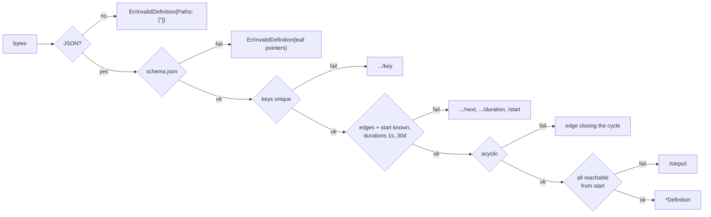

# Workflow definition format v1 (`nava.workflow/v1`)

Package `internal/workflow/def` (P3-20, TICK-347; PLAN-003 D-3-11, D-3-12, D-3-15, D-3-18). Pure Go, no Temporal import. It is the port the interpreter (P3-22a), the publish path (P3-41) and the Epic 12 canvas share.

## Shape

`schema.json` (JSON Schema 2020-12, embedded) is the shape contract:

```json
{ "format": "nava.workflow/v1",
  "trigger": { "on": "record.created" | "record.updated", "entity": "<entity key>" },
  "start": "<step key>",
  "steps": [ { "key": "<step key>", "type": "...", ... } ] }
```

| Type | Fields | Out-edges |
|---|---|---|
| `condition` | `field` (JSON Pointer), `op` (`eq`/`ne`/`in`), `value` | `then`, `else` |
| `branch` | `cases[]` of `{field, op, value, next}` (1..50) | `cases[].next`, `default` |
| `timer` | `duration` | `next` |
| `wait_signal` | `name`, `timeout` (required in v1) | `next` (signalled), `on_timeout` |
| `update_record` | `set`: field → literal (1..100) | `next` |
| `end` | none | none |

Unknown fields are refused everywhere, so a client cannot send a step `id`, an expression or a field reference in a duration or edge. Durations and edges are literals of the definition (TICK-363).

## Parse



- Paths are RFC 6901 pointers into the submitted document, sorted, deduplicated; a missing or extra property points at the property (`/steps/3/timeout`). The error never carries values.
- The schema is compiled per call with a loader that refuses every URL (D-3-18).
- `update_record.set` is checked against the entity schema at publish (P3-41), not here.

## Durations

`ParseDuration` is hand-written: `PnDTnHnMnS` only, each designator at most once and in order, at most 7 digits each, total within `MinWaitSeconds`..`MaxWaitSeconds` (1..2592000, the `workerguard.Directive` range). `Y`, months, `W`, fractions and signs are refused. `Step.WaitSeconds()` returns the parsed value.

## Conditions (`NextStep` contract)

`Condition.Holds(record)`: `eq` compares decoded JSON values (`1` equals `1.0`, no coercion of `"1"`); `ne` is its negation; `in` is `eq` against any element. A missing field equals nothing: `eq` and `in` are false, `ne` is true. JSON `null` present equals `null`. Numbers compare by decimal value whether the record was decoded to `float64` or `json.Number`: a `float64` is taken at its shortest round-trip text, so `0.1` equals `0.1` and `1e-1`.

A `branch` evaluates its `cases` in array order; the first case that holds wins and its `next` is taken; `default` applies when none holds.

## Step and signal ids

`AssignStepIDs(def, prev)` keeps `prev`'s id for every key still present and draws `uuid.New()` (v4, crypto/rand) for new keys. Ids are never derived from a key. Signal ids share the map under `signal:<name>`. P3-41 calls it at publish and stores the map in the immutable version row.

Fixtures `testdata/fixture-v1.json` and `fixture-v2.json` (v2 changes the condition value after the timer) commit their maps in `*.ids.json`; v2 reuses v1's ids, so recorded histories replay.
