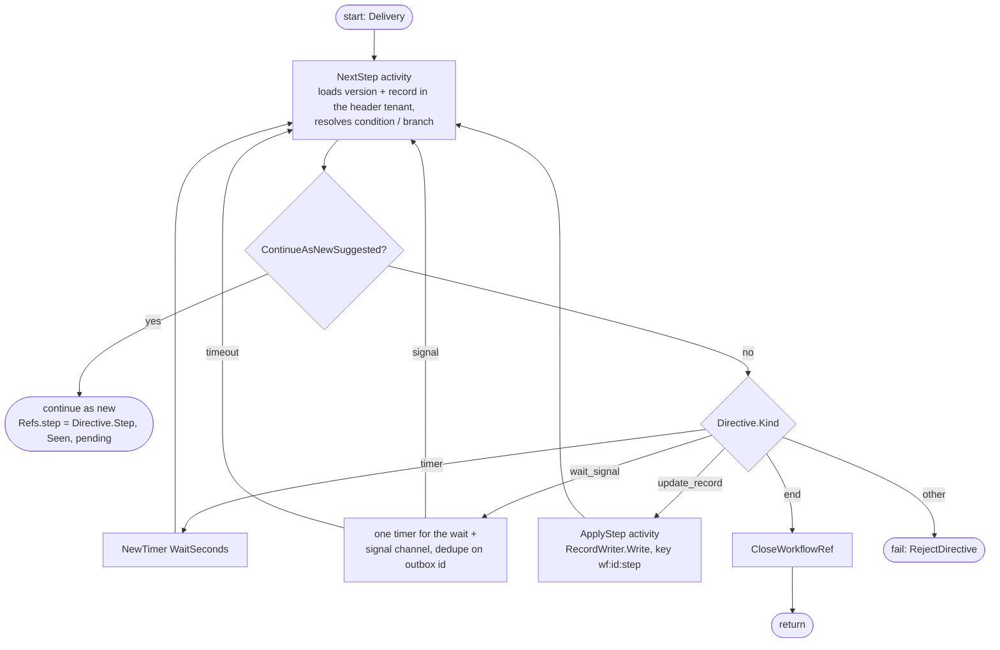

# Workflow interpreter (`nava.interpreter`)

Package `internal/workflow/interp` (P3-22a, TICK-349; PLAN-003 D-3-11, D-3-12, D-3-13, D-3-15, D-3-23). One Temporal workflow type, on `nava-tq`, runs any published v1 definition (`internal/workflow/def`, see `workflow-definition.md`). Worker registration and the relay start are P3-22b (TICK-367).

## Reference-only

Workflow code holds the definition version id, the record id, the current step id and the `workerguard.Directive` the `NextStep` activity returns. It never holds the definition or a record value, so neither reaches a history (ADR-001 R1, CI-7).

| Value in history | Shape | Guard rule |
|---|---|---|
| Start input | `outbox.Delivery`, payload `{definition_version_id, record_id}` | `deliveryOK` |
| `NextStep` / `ApplyStep` argument | one `StepRef{definition_version_id, record_id, step, signal?}` (`signal` omitted, never null; `step` nil = start) | generic: UUID-only object |
| `NextStep` result | `workerguard.Directive` | `directiveOK` (regular activities only) |
| Signal | `outbox.Delivery` on `nava.interpreter.signal`, payload `{signal}` | `deliveryOK` |
| Continue-as-new input | `RunInput`: `Seen`, `Refs{step, pending_outbox[], pending_signal[]}` | `runInputOK` |
| Failure | `nava.WorkflowRejected` with a fixed `Rejection` text, else `nava.Opaque` | `recordable` |

Only `NextStep` builds a `Directive`. Every value comes from the published definition and its step-id map. `WaitSeconds` is `def.Step.WaitSeconds()`, never a record field.

## Loop



- **Continue-as-new happens only between steps.** The check runs after `NextStep` returns and before the Directive's wait starts, never during a wait: `Refs` carries only the step, so a new run would restart the wait. A run continues at `Directive.Step`, which the next run's `NextStep` returns again. Deliveries still buffered on the channel are carried in `Refs.pending_*` and checked first by the next wait.
- **Signals.** A delivery is applied only when its `signal` is the one the wait awaits and its outbox id is new (`AppliedSignals.TryApply`, I7). Any other delivery is dropped. One timer covers the whole wait.
- **Failures.** A business rejection from `RecordWriter` (`ErrValidation`, `ErrIllegalTransition`, `ErrForbidden`) and a missing version, record or step (`ErrNotFound`) are non-retryable `workerguard.Rejected` errors with fixed text. Anything else is retried (SDK default policy, 1 min per attempt), and the guard withholds its text as `nava.Opaque`. The guard keeps a `nava.WorkflowRejected` message only if it is one `Rejected` writes. AR-044's `guarderrtype` reports the type anywhere else.
- **Tenancy.** The activities take the tenant only from the context the activity guard set from the `nava-tenant` header, and pass it to the ports. The real adapters read in `workerguard.InTenantTx` (P3-22b, P3-43).

## Ports

```go
type DefinitionStore interface { Load(ctx, tenantID, versionID uuid.UUID) (*Version, error) } // Version{Definition, StepIDs}
type RecordReader    interface { Read(ctx, tenantID, recordID uuid.UUID) (map[string]any, error) }
type RecordWriter    interface { Write(ctx, tenantID, recordID, stepID uuid.UUID, idempotencyKey string, set map[string]any) error }
```

## Fixture seams (P3-24 uses these)

`internal/workflow/interp/interptest`, file-backed under one root so a test can drive a worker in another process through a mounted volume:

- `FixtureStore`: `<root>/<tenant>/definitions/<version>.json` + `.ids.json`, read on every `Load`. Use P3-20's fixtures and their committed id maps.
- `FileRecords`: `<root>/<tenant>/records/<record>.json`.
- `FileWriter`: one JSON line per call in `<root>/writes/calls.jsonl` (key, attempt, step, set), and one effect per key (`writes/applied/<sha256>.json`, created `O_EXCL`). `Applications(key)` is 0 or 1.
- Pause after commit: in an `interptest` build, `NAVA_INTERPTEST_PAUSE_DIR=<dir>` makes `ApplyStep` write `PauseMarker(dir, key)` after the write returns, then block until `ReleaseFile(dir, key)` exists.

depguard (`interp-fixtures`) refuses `interptest` outside `_test.go` files. P3-22b adds its build-tagged stack worker file there.

## Determinism lint (D-3-23)

`make lint` / `task lint` runs `scripts/ci/workflowcheck.sh` on `internal/workflow/...`, using the checker pinned in `tools/workflowcheck` (its own module; row in `docs/pins.md`). The reviewed overrides are in `tools/workflowcheck/workflowcheck.config.yaml`. `lint-fixture.sh` expects exactly the planted map range in `internal/platform/lintfixture/workflowmaprange.go`. As a second layer, `forbidigo` bans `time.Now` and `math/rand` in `internal/workflow/interp`.
