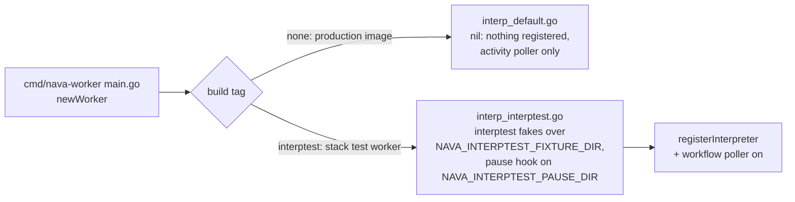

# Workflow interpreter (`nava.interpreter`)

Package `internal/workflow/interp` (P3-22a, TICK-349; PLAN-003 D-3-11, D-3-12, D-3-13, D-3-15, D-3-23). One Temporal workflow type, on `nava-tq`, runs any published v1 definition (`internal/workflow/def`, see `workflow-definition.md`). Worker registration and the relay start are P3-22b (TICK-367); see [Worker registration](#worker-registration-p3-22b).

## Reference-only

Workflow code holds the definition version id, the record id, the current step id and the `workerguard.Directive` the `NextStep` activity returns. It never holds the definition or a record value, so neither reaches a history (ADR-001 R1, CI-7).

| Value in history | Shape | Guard rule |
|---|---|---|
| Start input | `outbox.Delivery`, payload `{definition_version_id, record_id}` | `deliveryOK` |
| `NextStep` / `ApplyStep` argument | one `StepRef{definition_version_id, record_id, step, signal?}` (`signal` omitted, never null; `step` nil = start) | generic: UUID-only object |
| `NextStep` result | `workerguard.Directive` | `directiveOK`, only for the regular activity `workerguard.DirectiveActivity` (= `NextStep`) |
| Signal | `outbox.Delivery` on `nava.interpreter.signal`, payload `{signal}` | `deliveryOK` |
| Continue-as-new input | `RunInput`: `Seen`, `Refs{step, pending_outbox[], pending_signal[]}` | `runInputOK` |
| Failure | `nava.WorkflowRejected` with a fixed `Rejection` text, else `nava.Opaque` | `recordable` |

Only `NextStep` builds a `Directive`, and the guard enforces it: `directiveAllowed` accepts a `Directive` result only from a regular (never local) activity of type `workerguard.DirectiveActivity`, which `interp.NextStepActivity` is defined as. Any other activity that returns one, even a valid one, has it withheld (D-P10 regression guard, TICK-367). Every value comes from the published definition and its step-id map. `WaitSeconds` is `def.Step.WaitSeconds()`, never a record field.

## Loop


- **Continue-as-new happens only between steps.** The check runs after `NextStep` returns and before the Directive's wait starts, never during a wait: `Refs` carries only the step, so a new run would restart the wait. A run continues at `Directive.Step`, which the next run's `NextStep` returns again. Deliveries still buffered on the channel are carried in `Refs.pending_*` and checked first by the next wait.
- **Signals.** A delivery is applied only when its `signal` is the one the wait awaits and its outbox id is new (`AppliedSignals.TryApply`, I7). Any other delivery is dropped. One timer covers the whole wait.
- **Retries.** `NextStep` and `ApplyStep` run with an explicit `RetryPolicy` (`interp.ActivityRetryPolicy`: 1 s initial, x2, 1 min maximum interval, `ActivityMaxAttempts` = 10), never the SDK default that retries forever, so a persistent retryable adapter fault fails the run as `nava.Opaque` (TICK-384 review).
- **Failures.** A business rejection from `RecordWriter` (`ErrValidation`, `ErrIllegalTransition`, `ErrForbidden`) and a missing version, record or step (`ErrNotFound`) are non-retryable `workerguard.Rejected` errors with fixed text. Anything else is retried (the policy above, 1 min per attempt), and the guard withholds its text as `nava.Opaque`. The guard keeps a `nava.WorkflowRejected` message only if it is one `Rejected` writes. AR-044's `guarderrtype` reports the type anywhere else.
- **Tenancy.** The activities take the tenant only from the context the activity guard set from the `nava-tenant` header, and pass it to the ports. The real adapters read in `workerguard.InTenantTx` (P3-22b, P3-43).

## Ports

```go
type DefinitionStore interface { Load(ctx, tenantID, versionID uuid.UUID) (*Version, error) } // Version{Definition, StepIDs}
type RecordReader    interface { Read(ctx, tenantID, recordID uuid.UUID) (map[string]any, error) }
type RecordWriter    interface { Write(ctx, tenantID, recordID, stepID uuid.UUID, idempotencyKey string, set map[string]any) error }
```

## Fixture seams (P3-24 uses these)

`internal/workflow/interp/interptest`, file-backed under one root so a test can drive a worker in another process through a mounted volume:

- `FixtureStore`: `<root>/<tenant>/definitions/<version>.json` + `.ids.json`, read on every `Load`. Use P3-20's fixtures and their committed id maps.
- `FileRecords`: `<root>/<tenant>/records/<record>.json`.
- `FileWriter`: one JSON line per call in `<root>/writes/calls.jsonl` (key, attempt, step, set), and one effect per key (`writes/applied/<sha256>.json`, created `O_EXCL`). `Applications(key)` is 0 or 1.
- Pause after commit: in an `interptest` build, `NAVA_INTERPTEST_PAUSE_DIR=<dir>` makes `ApplyStep` write `PauseMarker(dir, key)` after the write returns, then block until `ReleaseFile(dir, key)` exists.

depguard (`interp-fixtures`) refuses `interptest` outside `_test.go` files. P3-22b adds its build-tagged stack worker file there.

## Determinism lint (D-3-23)

`make lint` / `task lint` runs `scripts/ci/workflowcheck.sh` on `internal/workflow/...`, using the checker pinned in `tools/workflowcheck` (its own module; row in `docs/pins.md`). The reviewed overrides are in `tools/workflowcheck/workflowcheck.config.yaml`. `lint-fixture.sh` expects exactly the planted map range in `internal/platform/lintfixture/workflowmaprange.go`. As a second layer, `forbidigo` bans `time.Now` and `math/rand` in `internal/workflow/interp`.

## Worker registration (P3-22b)

`cmd/nava-worker` registers `nava.interpreter`, `NextStep` and `ApplyStep` on `nava-tq` behind the existing guard (`registerInterpreter`), with the ports `interpreterActivities` returns. Which ports depends on the build tag:



- The production image (`deploy/compose/nava-worker/Dockerfile`) builds the untagged binary. `TestProductionBuildLinksNoFakes` fails if that build links `interptest` or compiles `pause_interptest.go`, or if the Dockerfile builds with `-tags`.
- Production registers no interpreter until the real ports exist (TODO-TICK-367-01, P3-41, P3-43).
- `cichanged`'s `stackRoots()` and its package `-tags` include `interptest`, so a change to the fakes runs the stack stage.
- **Stack worker.** `nava-worker-interptest` (`deploy/compose/compose.test.yaml`, profile `interptest`) is the same Dockerfile built with `NAVA_BUILD_TAGS=interptest`. Its fixtures are a read-only bind mount (`NAVA_INTERPTEST_FIXTURES` on the host, `NAVA_INTERPTEST_FIXTURE_DIR` inside), and the fake writer writes to a tmpfs (`NAVA_INTERPTEST_WRITES_DIR`). It publishes no port. The always-on `nava-worker` stays the production image, activity-only, with no build args.
- **Stack cases** (`internal/workerstack/interp_test.go`, in the serial `worker` case): each test starts `nava-worker-interptest`, writes a `nava.interpreter` start row (`target_key nava.interpreter:<outbox id>`, decision 2026-11-01) and its `workflow_ref` as `outbox.Enqueue` would, and reads the result as `nava-core`. One case runs to the end step and checks that `workflow_ref` is closed. The other checks that tenant B's version or record is not found for tenant A. `t.Cleanup` removes the container and waits until compose lists none.
- **Queue sharing.** The service is up only inside those tests. The serial runner (`run-cases.sh`, `PARALLEL=1`) finishes the parallel group, including the `temporalstack` suite and its `nava.smoke.Echo` bodies, before the `worker` case, and `demo_outbox` (`nava.smoke.relay`) runs after it. That ordering covers CI and `make stack-tests`. It does not cover `make stack-test-worker` run by hand beside another suite. The always-on `nava-worker` polls activity tasks on `nava-tq` and does not register `NextStep`/`ApplyStep`. An attempt it took would fail as `ActivityNotRegisteredError` (retryable), spend one of the 10 attempts and add up to a minute of backoff. So each interpreter case stops it before `nava-worker-interptest` starts. Its `t.Cleanup` (registered before the stop, run on failure too) starts it again with `up --no-deps --wait`, so it is healthy before the next test and `demo_outbox`. While the case runs, `nava-worker-interptest` is the only `nava-tq` poller.

## Version pinning and crash tests (P3-24)

- **Pinning** (`internal/workflow/interp/pinning_test.go`, `testsuite`): `testdata/pinned-v1` and `pinned-v2` differ only in the `update_record` value after a 5 s timer, with one step-id map. v2 is published into the fixture store while the v1 run waits on the timer: the v1 run writes v1's value, also when it continues as new at that point, and a new run on v2 writes v2's.
- **Crash** (`internal/workerstack/interp_crash_test.go`, tag `workerstack,interpcrash`; stack case `interpreter`, `make stack-test-interpreter`): the run starts on `testdata/applyonce`. The test sets `NAVA_INTERPTEST_WRITES_DIR` and `NAVA_INTERPTEST_PAUSE_DIR` to a per-run directory in the `interptest-state` volume (`compose.test.yaml`), waits for the pause marker, kills `nava-worker-interptest` with SIGKILL (exit 137), creates the release file and starts the same container again. A fresh one-shot container then reads `calls.jsonl` and the applied files: at least 2 calls, an attempt above 1, the one key `wf:<workflow id>:<step id>`, and exactly 1 applied effect. Without these variables the writer stays on the tmpfs and the hook stays off.
- The retry of the killed attempt waits for `ApplyStep`'s `StartToCloseTimeout` (1 min), so the case takes about 70 s.
- The same crash case against the real `pipeline.Write` is P3-43/P3-44.
