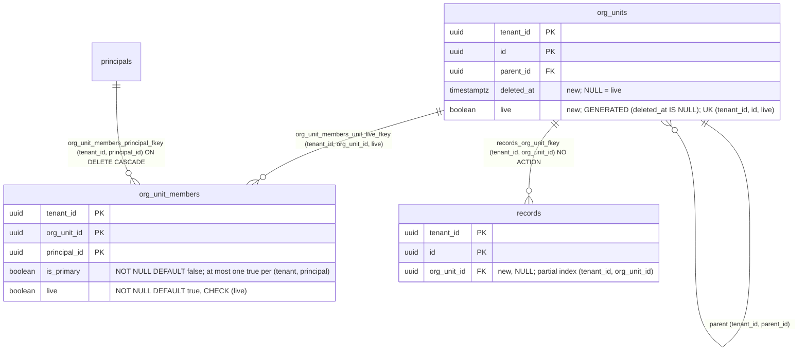

# ADR-010 format-2 caps, branch threshold, CHECK cost and `org_unit_members` (SP-2)

Scope: TICK-933, PLAN-011 P11-02, contract C6 (and C5 for item 5). ADR-010
D4, D6, D7, R6. The prototype is `docs/data/acl-format2-caps/format2_check.sql`
(not a migration). Benchmarks are in `scratch/acl-format2-caps/`: `check.sh`
(items 1 and 2), `branches.sh` (item 3) and `d6.sql` (item 4). Each writes its
raw output next to itself.

## Results

| # | Question | Answer |
|---|---|---|
| 1 | Caps | Depth 8, 16 children and 64 policies are **confirmed**. Leaves per policy go **256 → 128** and leaves per document go **1,024 → 128**. |
| 2 | CHECK + trigger at the caps | **4.2 ms p50, 5.9 ms p95** at the SP-2 caps (128 leaves). At the D4 caps (1,024 leaves) it is 11–27 ms for the CHECK alone, so R6 fires there. A document padded to the 1 MiB body limit costs 0.15–0.6 s, and no D4 cap bounds that (see Hand-offs). |
| 3 | Total-branch threshold | **16.** Up to 16 branches, the index-per-branch form wins whenever one branch is heavy. Above 16, the OR form wins in every case measured. |
| 4 | D6 re-check | 2 tenants, max **4** branches. 4 ≤ 16: **passes**. |
| 5 | `org_unit_members` | The proposed DDL is below: a 3-index set, a live-unit FK and per-role grants. |

Constants to copy:

```go
// SP-2 (docs/data/acl-format2-caps.md): TICK-939 P11-07, TICK-940 P11-08
const MaxDepth, MaxChildren, MaxPolicies, MaxPolicyLeaves, MaxDocumentLeaves = 8, 16, 64, 128, 128
// SP-2 (docs/data/acl-format2-caps.md): TICK-938 P11-06
const ReadBranchesThreshold = 16
```

## Setup

- **PostgreSQL:** `postgres:16.10` (`docs/pins.md`) in Docker Desktop.
- **Host:** 16 vCPUs and 26 GB for the VM, on Windows 11.
- **Contention:** the VM also ran the idle S18 stack (17–19 containers). During some runs it also ran another agent's 800k ACL benchmark (`nava-aclperf-pg-*`). Each raw file names the containers that were running.
- **Timings are noisy:** the same documents varied by up to 2× between runs. The conclusions below hold in every run. Where it matters, the low and high values are both given.
- **Item 3 data:** `bench/records-list` seed (P3-01): 800,000 records, 400,000 in tenant 0 (80,000 per entity type), and 1 KB of `data` per row. The bench has the TICK-640 list indexes, runs as `nava_app` under FORCE RLS with JIT off, and uses P3-01's memory settings with a warm cache.
- **Items 1 and 2 data:** 400 tenants. Tenant 0 has 5,000 users, 50 groups and 200 org units.

## 1. Caps

| Cap | D4 | SP-2 | Why |
|---|---|---|---|
| Depth after expansion | 8 | **8** | It bounds Go and SQL recursion only. The cost follows leaves, not depth. |
| Children per `all`/`any` | 16 | **16** | It bounds the width of one node. The leaf caps bound the total. |
| Policies per document | 64 | **64** | Each policy has at least one leaf, so the leaf cap is reached first. |
| Leaves per policy | 256 | **128** | It cannot exceed the document cap. |
| Leaves per document | 1,024 | **128** | A list request plans the whole read tree. See the read path below and item 2. |

**The read path decides.** When a caller has more than 16 branches, the list
uses the `CompileRead` OR form. That form has one term per surviving leaf. The
server plans every statement afresh (`QueryExecModeExec`), so each request
pays the planning cost. Measured on page 1 at 800k records, median of 5
(`branches-result.txt`, run 3):

| OR terms | Planning ms | Total ms (sparse / heavy caller) |
|---:|---:|---:|
| 64 | 3.5–5.0 | 9.1 / 10.7 |
| 128 | 12.0–12.5 | 19.4 / 44.4 |
| 256 | 58.6–81.0 | 134 / 171 |
| 512 | 212–242 | 467 / 480 |
| 1,024 | 7.8–9.5 | 66 / 62 (the planner drops `BitmapOr` and walks `records_list_updated`) |

At 256 terms, a single page costs as much as the whole 150 ms list budget
(`docs/quality/acl-perf-800k.md`). At 128 terms it stays at 44 ms or less. Every
stored document has at most 4 branches (item 4), so 128 leaves leaves a lot of
room. If an admin hits the cap, R2 applies (owner: Solution Architect).

**Method:** `bench_run(f, ARRAY[256, 512, 1024], 5)` in
`scratch/acl-format2-caps/branches_bench.sql`, run by `branches.sh`. The
terms are flat equality disjuncts, as `ReadBranches` renders them. A nested
tree with the same leaf count has the same number of leaf terms.

**Rerun:** `sh scratch/acl-format2-caps/branches.sh` (about 6 minutes).

```text
MaxDepth=8 MaxChildren=16 MaxPolicies=64 MaxPolicyLeaves=128 MaxDocumentLeaves=128
```

## 2. CHECK + tenant-id trigger cost

The prototype has four parts:

- `acl2_problem(doc)` returns the C1 code of the first problem it finds, or NULL.
- `acl2_rules_valid` is the CHECK predicate. A format-1 value goes to TICK-629's `acl_rules_valid`.
- `acl2_expr` walks one expression with a worklist.
- `acl2_tenant_ids` is the trigger.

How it counts: leaves and depth are memoized per condition, in Kahn's order
over the reference graph. A doubling chain of 60 conditions (2^60 leaves if
expanded) is refused as `depth_exceeded` in 2.9 ms, not by expanding it. A
condition still waiting when Kahn's queue empties is on a cycle. Every
boundary case returns its C1 code: depth 9 directly and through a ref, 17
children, 257 leaves through refs, 65 policies, 1,025 leaves, self-reference,
an a→b→a cycle, a missing ref, an `fn` node, two keys in one node, a duplicate
name, an invalid name, and `self` on `state`. A cross-tenant id is refused
with 23514 and detail `foreign_id`. All of these are at the end of
`check-result.txt`.

**Before and after, at the SP-2 caps.** These figures are the CHECK
predicate plus the trigger's id lookup, run in a quiet container. Each row is
90 calls, in ms:

| Document (written leaves, ids per `member_of`) | CHECK p50 | Lookup p50 | Sum p50 | Sum p95 |
|---|---:|---:|---:|---:|
| 128 leaves, 1 id | 2.38 | 1.81 | **4.19** | **5.88** |
| 256 leaves, 1 id | 5.58 | 3.62 | 9.37 | 12.78 |
| 256 leaves, 10 ids | 10.16 | 12.06 | 22.48 | 34.03 |

A single-row insert with no CHECK and no trigger is 0.05–0.3 ms. A
realistic format-1 document (6 rules) costs 0.57 ms with the CHECK and
2.4 ms with CHECK + trigger. That includes the new `acl_uuids_valid` body
below.

**At the D4 caps (1,024 leaves, 64 policies), the R6 trigger fires.**
Single-row inserts, `check-result.txt`, 3 passes, in ms:

| Document | Bytes | No CHECK | CHECK | CHECK + trigger |
|---|---:|---:|---:|---:|
| D4 caps, written out, 1 id | 86 k | 0.29 | 28.5 | 43.0 |
| D4 caps, written out, 10 ids | 245 k | 1.8 | 36.6 | 68.2 |
| D4 caps through refs, 10 ids | 12 k | 0.05 | 6.9 | 9.2 |
| D4 caps plus unused conditions, 1 MiB | 1.0 M | 4.3 | 301 | 589 |
| D4 caps, 55 ids per leaf, 1 MiB | 1.0 M | 92 | 151 | 426 |

Cost grows with the *written* size (nodes and ids), not with the expanded
leaves. Without the SP-2 caps, a document has to stay under about 128
written leaves to meet 5 ms.

**Two changes from the first draft halved the cost:**

- The node-key test now uses plain expressions instead of
  `SELECT ... FROM jsonb_object_keys(n)`. That cut 21 ms to 11 ms on the D4
  caps document, because each `SELECT` ran a full SPI plan per node.
- `acl_uuids_valid` now checks the whole array with one regular expression
  over its canonical jsonb text, instead of looping over the elements. 5,000
  ids took 141 ms with the loop and 5 ms with the regex. The accepted set is
  the same: 8-4-4-4-12 hex digits in either case, and `[]` is valid. Format 1
  benefits too. TICK-940 should ship this as a `CREATE OR REPLACE` of the
  TICK-629 function.

**Trigger timing, AFTER rather than BEFORE INSERT.** CHECK constraints run
after BEFORE triggers. A BEFORE trigger would therefore see unvalidated JSON:
it would have to run the shape check itself (paying the CHECK cost twice), or
a malformed id would surface as 22P02 instead of 23514. A non-deferred AFTER
row trigger runs after the CHECK and aborts the statement just the same.
This is TICK-940's decision to make. The measured trigger is the AFTER one.

**Method:** `check_bench.sql`. Each call or single-row insert is timed with
`clock_timestamp()` around one statement inside PL/pgSQL. The arguments are
columns, so nothing is constant-folded.

**Rerun:** `sh scratch/acl-format2-caps/check.sh` (about 9 minutes).

## 3. Total-branch threshold

The branched form (`branchedPage`) and the OR form (`PageStatement`) were run
on the same N disjuncts. Each disjunct has the `ReadBranches` text: branch i
carries `AND NOT` of the i−1 branches before it. Page 1, sort `-updated_at`,
LIMIT 51. The figures are median planning + execution in ms over 5 runs,
from run 2, the less contended run. Run 3 repeats it, with the same
crossover.

| N | heavy: branches | heavy: OR | sparse: branches | sparse: OR | dense: branches | dense: OR |
|---:|---:|---:|---:|---:|---:|---:|
| 2 | **0.77** | 4.65 | 0.30 | 0.27 | 0.29 | 0.29 |
| 4 | **0.88** | 3.40 | 0.68 | 0.43 | **0.60** | 7.02 |
| 8 | **1.87** | 4.00 | 1.74 | 0.61 | 1.37 | 0.43 |
| 16 | **3.39** | 3.95 | 2.78 | 1.03 | 3.24 | 0.51 |
| 24 | 5.94 | 4.34 | 5.22 | 1.59 | 5.58 | 0.47 |
| 32 | 8.52 | 4.95 | 7.32 | 2.10 | 8.97 | 0.82 |
| 64 | 31.5 | 8.42 | 23.8 | 5.47 | 62.2 | 1.18 |
| 128 | 207 | 116 | 110 | 15.3 | 473 | 2.57 |

The three families:

- **heavy:** the caller is the tenant's heaviest requester (1,127 rows of the type), plus N−1 smaller disjuncts.
- **sparse:** requester = me and assignee = me, plus N−2 named assignees (about 16 rows each).
- **dense:** N−2 named groups (about 1,600 rows each).

What decides it:

- **The branched form's cost is planning, and planning grows with N².** The statement is 20 kB at N = 16 and 880 kB at N = 128. Execution stays at 0.3–7 ms.
- **The OR form loses only when one disjunct is large:** heavy, and dense at N = 4. Then `BitmapOr` collects thousands of rows and sorts them. When every disjunct is small, `BitmapOr` wins from about N = 6, but both forms stay under 3.4 ms up to N = 16.
- **So the branched form is worth using up to 16, and never above 16.** Run 3, under contention, gave heavy N = 16 at 11.1 ms for branches against 19.5 ms for OR, and heavy N = 24 at 15.4 ms against 10.0 ms.

**Limits:**

- These are page-1 measurements. The 38–166 ms OR figures in `docs/data/records-list-indexes.md:14-17` came from heavier requesters and from page 20.
- No `shared` (EXISTS) disjunct was included, because the bench `record_shares` table has no `principal_kind`. An EXISTS branch cannot use an ordered index in either form.

**Rerun:** `sh scratch/acl-format2-caps/branches.sh`.

```text
ReadBranchesThreshold=16
```

## 4. D6 re-check

The query from the TICK-933 body, unchanged, is in
`scratch/acl-format2-caps/d6.sql`. It runs in `BEGIN READ ONLY` as the
superuser, which sees every tenant.

- **Run:** 2026-11-15 on the dev stack database `nava`, migrated to `20261115100000`.
- **Result:** 2 tenants, `max_total_branches` = **4**. There are 4 newest documents, and none of them is format 2.
- **Verdict:** 4 is at most the threshold of 16, so **D6 passes**. The threshold is not below the largest stored document.

**Rerun:**

```sh
docker cp scratch/acl-format2-caps/d6.sql <pg>:/tmp/d6.sql
docker exec <pg> sh -c 'PGPASSWORD="$(cat $POSTGRES_PASSWORD_FILE)" psql -X -U pgadmin -d nava -f /tmp/d6.sql'
```

## 5. `org_unit_members`, `org_units.deleted_at`, `records.org_unit_id` (C5)

These are proposals for TICK-947 P11-14 to turn into migrations. None of them
is per-tenant DDL.



```sql
-- M1 (expand org_units; one transaction). Rewrites org_units, which is small:
-- groups took 205 ms at 50,000 rows under the same change (ADR-004-E5).
SET LOCAL lock_timeout = '5s';
ALTER TABLE org_units
    ADD COLUMN deleted_at timestamptz,
    ADD COLUMN live boolean GENERATED ALWAYS AS (deleted_at IS NULL) STORED,
    ADD CONSTRAINT org_units_live_key UNIQUE (tenant_id, id, live);
DROP POLICY org_units_delete ON org_units;          -- groupsync tombstones (D7)

CREATE TABLE org_unit_members (
    tenant_id    uuid    NOT NULL,
    org_unit_id  uuid    NOT NULL,
    principal_id uuid    NOT NULL,
    is_primary   boolean NOT NULL DEFAULT false,
    live         boolean NOT NULL DEFAULT true,
    CONSTRAINT org_unit_members_pkey PRIMARY KEY (tenant_id, org_unit_id, principal_id),
    CONSTRAINT org_unit_members_live_check CHECK (live),
    -- A member of a tombstoned unit fails with 23503, and tombstoning a unit that still has members fails too, as group_members does (ADR-004-E5 D11).
    CONSTRAINT org_unit_members_unit_live_fkey FOREIGN KEY (tenant_id, org_unit_id, live)
        REFERENCES org_units (tenant_id, id, live),
    CONSTRAINT org_unit_members_principal_fkey FOREIGN KEY (tenant_id, principal_id)
        REFERENCES principals (tenant_id, id) ON DELETE CASCADE
);
-- "Units of a principal" (the set S seed, D7) and groupsync's per-user diff.
CREATE INDEX org_unit_members_principal ON org_unit_members (tenant_id, principal_id, org_unit_id);
-- D-11-6: at most one primary unit per (tenant, principal).
CREATE UNIQUE INDEX org_unit_members_one_primary ON org_unit_members (tenant_id, principal_id) WHERE is_primary;
ALTER TABLE org_unit_members ENABLE ROW LEVEL SECURITY;
ALTER TABLE org_unit_members FORCE ROW LEVEL SECURITY;
CREATE POLICY org_unit_members_select ON org_unit_members FOR SELECT TO nava_app, nava_worker, nava_groupsync
    USING (tenant_id = NULLIF(current_setting('app.tenant_id', true), '')::uuid);
CREATE POLICY org_unit_members_insert ON org_unit_members FOR INSERT TO nava_groupsync
    WITH CHECK (tenant_id = NULLIF(current_setting('app.tenant_id', true), '')::uuid);
CREATE POLICY org_unit_members_update ON org_unit_members FOR UPDATE TO nava_groupsync
    USING (tenant_id = NULLIF(current_setting('app.tenant_id', true), '')::uuid)
    WITH CHECK (tenant_id = NULLIF(current_setting('app.tenant_id', true), '')::uuid);
CREATE POLICY org_unit_members_delete ON org_unit_members FOR DELETE TO nava_groupsync
    USING (tenant_id = NULLIF(current_setting('app.tenant_id', true), '')::uuid);
ALTER POLICY org_units_select ON org_units TO nava_app, nava_worker, nava_groupsync;

-- M2 (records column + key; one transaction). ADD COLUMN with no default
-- does not rewrite the table. The FK is NOT VALID: every existing row is
-- NULL, and a bare VALIDATE under FORCE RLS passes vacuously (TICK-715).
SET LOCAL lock_timeout = '5s';
ALTER TABLE records ADD COLUMN org_unit_id uuid,
    ADD CONSTRAINT records_org_unit_fkey FOREIGN KEY (tenant_id, org_unit_id)
        REFERENCES org_units (tenant_id, id) NOT VALID;

-- M3: VALIDATE records_org_unit_fkey with the TICK-715 migrator_validate
-- policy pattern (docs/data/fk-validate-force-rls.md), one transaction.

-- M4 (-- +goose NO TRANSACTION, with the TICK-640 invalid-index DO block).
CREATE INDEX CONCURRENTLY IF NOT EXISTS records_org_unit
    ON records (tenant_id, org_unit_id) WHERE org_unit_id IS NOT NULL;
```

Notes on the DDL:

- **Partial index on `records.org_unit_id`.** Tenants without regions leave the column NULL, so the index holds only rows that have a unit. Both the leaf `org_unit_id IS NOT NULL AND org_unit_id = ANY(S)` and the FK check imply its predicate. ADR-010 D7 names the key `(tenant_id, org_unit_id)`, and the key is unchanged.
- **Indexes on `org_unit_members`: 3.**
  - The primary key leads with `(tenant_id, org_unit_id)`. It serves the NO ACTION check when a unit is tombstoned, and groupsync's per-unit reads.
  - `_principal` serves "units of a principal" as an index-only scan.
  - The partial unique index enforces one primary unit per principal and holds one row per principal at most.
- **No index on `parent_id`.** `org_units_parent` already exists.

Grants (`db/grants.yaml`):

| Role | `org_units` | `org_unit_members` | `records` |
|---|---|---|---|
| `nava_groupsync` | `SELECT`, `INSERT`, `UPDATE: [parent_id, name, deleted_at]`. **No `DELETE`** | `SELECT`, `INSERT`, `UPDATE: [is_primary]`, `DELETE` | none |
| `nava_app` | `SELECT` (unchanged) | `SELECT` | `org_unit_id` is in `INSERT: []` already. Add it to `UPDATE` (D8: a stored field, moved by a workflow step); **removed by TICK-1120**, because no shipped statement updates it |
| `nava_worker` | `SELECT: [tenant_id, id, parent_id, deleted_at]` (new) | `SELECT: [tenant_id, org_unit_id, principal_id, is_primary]` | the same as `nava_app` |

`records.org_unit_id` is a new audited column. TICK-947 must add it to the
record writer's column lists that `db/audited-tables.yaml` generates.

## Hand-offs

- **Solution Architect (the size of a stored document).** The SP-2 caps bound the read path, and the CHECK at those caps. They do not bound the written size. Unused conditions and ids per `member_of`/`cmp` leaf have no cap. A 1 MiB document within every cap costs 0.15–0.6 s to CHECK + trigger (0.43–0.59 s p50 with the trigger), against the 5 ms R6 threshold. Publishing is an admin action, so this is a slow publish, not a list-path cost. A new kind of cap needs a decision. One option is a byte limit on `rules`, for example 64 KiB, which is 15 times today's 4.5 kB format-1 document. The other is caps on conditions and on ids per leaf.
- **Security & Multi-Tenancy Reviewer and TICK-940 (the trigger as `nava_worker`).** `nava_worker` has `INSERT` on `acl_versions` but no `SELECT` on `principals`, and is not in `principals_select`'s `TO` list. An invoker trigger on a worker insert would see no principal and refuse every user id with `foreign_id`. That fails closed, but the trigger needs a defined path: either a column grant plus a policy for the worker, or a `SECURITY DEFINER` function with the explicit `tenant_id` predicate. The trigger's lookups are backed by `groups_pkey`, `principals_pkey` and `org_units_pkey`, all of which lead with `tenant_id`.
- **Technical Lead (handbook).** This report changes the D4 caps used by the S30 handbook page (TICK-945) and the access route's OpenAPI description (TICK-939).
