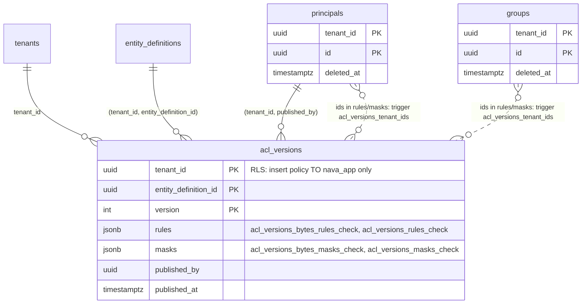

# acl_versions: the database side of the format-2 access document

## In plain words

- **What it does:** when anything inserts a new access-rules version, the
  database checks the format-2 document itself, even if the Go code was
  skipped. It refuses a bad shape, a missing or circular reference, a
  document over the size caps, a document over 128 KiB, and any group or
  user id that is not a live member of the publishing tenant.
- **Who can publish:** only the API's login, `nava_app`. The worker's login
  can still read versions but can no longer write them.
- **What it costs:** a realistic document at the caps costs about 5 ms to
  insert (p50). The worst document that fits the default 32 KiB limit costs
  34 ms p50 and 42 ms p95. That cost is paid on an admin's publish, never on
  the list path.
- **What changes for stored data:** nothing. Every stored format-1 row still
  passes, which the migration test proves.

## Tables and what guards them

The dotted links are not foreign keys. A CHECK cannot read other tables, and
an id inside `jsonb` cannot carry a foreign key, so the AFTER INSERT trigger
does that check.

## What runs on an insert, in order

PostgreSQL runs CHECK constraints in name order, then AFTER row triggers.

| # | Guard | Refuses | SQLSTATE, constraint | DETAIL |
|---|---|---|---|---|
| 1 | `acl_versions_bytes_masks_check` | `octet_length(masks::text) > 131072`, every row | 23514, that name | none |
| 2 | `acl_versions_bytes_rules_check` | a format-2 `rules` (has a `format` key) over 131,072 bytes | 23514, that name | none |
| 3 | `acl_versions_masks_check` | TICK-629 mask shape | 23514, that name | none |
| 4 | `acl_versions_rules_check` → `acl_rules_valid` | object: `acl2_rules_valid`; array: TICK-629 format-1 check | 23514, `acl_versions_rules_check` | format 2 (and a non-array, non-object value): `{"column": "rules", "code", "pointer"}`. Format 1 keeps TICK-629's plain refusal, with no detail. |
| 5 | trigger `acl_versions_tenant_ids` (`acl2_tenant_ids`) | a group or user id in `rules` (format 1 or 2) or `masks` that is not a live row of `NEW.tenant_id` | 23514, no constraint name | `{"column": "rules" or "masks", "code": "foreign_id", "pointer"}` |

Because the byte ceilings run first, an oversize row is refused after one
serialization, without any walk: 37 ms p50 for 1 MiB of `rules` and 24 ms for
1 MiB of `masks`. `acl2_rules_valid` also returns true above 131,072 bytes
without walking, so this still holds if the constraints are ever renamed.
The function's comment names its dependency on
`acl_versions_bytes_rules_check`.

The trigger is AFTER, so it only ever sees shape-valid values (every id is a
uuid string) and never scans an oversize row.

## The DETAIL contract (for TICK-939's 23514 mapping)

- **`acl_versions_bytes_rules_check` / `_masks_check`:** 422
  `document_too_large`, pointer `/rules` or `/masks`.
- **`acl_versions_rules_check` with a JSON DETAIL:** parse
  `{"column", "code", "pointer"}`. The body pointer is `"/" + column + pointer`.
- **No constraint name, DETAIL `code` = `foreign_id`:** the same, from the
  trigger.
- **The database reports one problem: the first its walk meets.** The route
  reports them all. Every problem the database reports is one of the route's
  problems for the same document. `TestTICK940Format2Fixtures` asserts this
  for every structural row of `internal/authz/testdata/format2_invalid.json`.

Pointers for the codes the Go decoder does not produce yet. TICK-939 should
emit the same ones:

| Code | Pointer |
|---|---|
| `unresolved_ref` | the `ref` key: `.../ref` |
| `ref_cycle` | the first `ref`, in document order, from a condition still waiting in Kahn's queue to another waiting one |
| `depth_exceeded`, `policy_leaves_exceeded` | `/policies/<i>/when` |
| `policies_exceeded`, `document_leaves_exceeded` | `/policies` |
| `child_count` | the `all` / `any` key |
| `foreign_id` | the id's own pointer; the first by (rules before masks, then pointer in C collation), the order the route sorts in |

## Counting (A1-1 caps, not configurable)

- **Caps:** depth 8, children 16, policies 64, leaves per policy 128, leaves
  per document 128.
- **Depth:** a lone leaf has depth 1; `all`, `any` and `not` add one.
- **Refs:** a `ref` is replaced by its condition: it adds that condition's
  leaves, and its depth is the ref's depth plus the condition's depth minus 1.
- **Memoization:** counts are memoized per condition in Kahn's order (SP-2),
  so a doubling chain of 60 conditions is refused as `depth_exceeded` without
  expanding 2^60 leaves (tested).
- **What is capped:** only policies. An unused condition is shape-checked and
  ref-checked but not counted (D4; tested).
- **Under:** `under` is accepted by shape. Its org-unit ids join the trigger
  in TICK-947, when `under` ships. Until then the route refuses `under` with
  `not_available`.
- **Under sets (TICK-1059, SP-1d change 5):** a policy names at most 4
  distinct `under` start sets U after its refs expand, refused as
  `under_sets_exceeded` at `/policies/<i>`, the same code and pointer as
  Prepare. `{"of": "caller"}` is one U; a listed `{"of": [ids]}` is one U per
  set of ids, so order, repeats and letter case do not count again. Sets are
  memoized per condition in the same Kahn order and saturate at 5 keys. The
  cap lives once, in `acl2_max_under_sets()`, and
  `TestTICK1059UnderSetsCap` pins it to `authz.MaxUnderSets`. `under_nested`
  has no database backstop: it reads `org_unit_closure`, which a CHECK
  cannot.

### Evidence: the under-set cap

`scratch/acl2-under-sets-cap/bench.sql`, `acl2_problem` per call, 400 calls
per shape, TICK-940 function then TICK-1059 function in one rolled-back
transaction, two alternating rounds. PostgreSQL 16.10 in Docker
(`fsync=off`) on a Windows 11 laptop shared with other agents' test runs, so
the round-to-round spread (up to 1.7x on the same function) is larger than
the change.

| Shape | Bytes | Before, round 1 / 2 (µs) | After, round 1 / 2 (µs) |
| --- | ---: | ---: | ---: |
| A: 64 policies, 128 `member_of` leaves, no `under` | 12,260 | 4,240 / 2,516 | 2,822 / 2,972 |
| B: 64 policies x 2 `under` of one id (accepted) | 11,236 | 5,988 / 2,604 | 3,101 / 2,967 |
| C: one condition of 120 `under`, reffed (refused after) | 7,539 | 2,726 / 2,299 | 2,430 / 2,031 |

No added cost is measurable above that spread. A first version built the key
in a SQL function and cost about 1 ms more on C (2,112 to 3,199 µs, 50
calls); the shipped PL/pgSQL key with a one-id fast path removed it. No
index, column or stored byte changes, so there is no write amplification
beyond the CHECK's CPU.

## Evidence: insert cost with the shipped code

**Setup:**

- **Harness:** `sh scratch/acl-format2-checks/bench.sh`, the A1 bench
  harness. It loads TICK-629's functions and this migration's functions
  straight from `db/migrations`, adds the four shipped constraints at 131,072,
  and creates the AFTER trigger.
- **Data:** tenant 0 has 5,000 users, 50 groups and 200 org units, alongside
  399 small tenants. Each variant is the largest document of its shape that
  fits `:cap`.
- **Timing:** three passes, single-row inserts.
- **Environment:** postgres 16.10 (docs/pins.md), Docker Desktop on Windows
  11, 16 vCPUs, 26 GB. The host was shared with 33–34 other running
  containers, so absolute figures move between runs and the ratios are the
  steadier measure.

Results in ms, CHECKs + trigger:

| Row | 32 KiB p50 | 32 KiB p95 | 128 KiB p50 | 128 KiB p95 |
|---|---:|---:|---:|---:|
| Format 1, 6 rules (today) | 1.7 | 3.5 | 1.2 | 1.9 |
| **b** SP-2 caps, 128 leaves, 1 id (10.8 kB) | **5.4** | **8.7** | **4.6** | **7.0** |
| SP-2 caps, ids per leaf up to the cap | 10.5 | 12.8 | 33.4 | 44.4 |
| SP-2 caps plus unused conditions | 13.4 | 16.5 | 57.2 | 78.9 |
| Most nodes (unused `any` of 16 `shared`) | 17.0 | 23.1 | 75.5 | 96.6 |
| Most refs (chains of 16 refs) | 31.0 | 40.1 | 111.5 | 146.6 |
| One `member_of` with the most users | 8.5 | 10.7 | 33.1 | 40.1 |
| Masks at the cap (rules = b) | 11.3 | 17.0 | 36.1 | 44.1 |
| **Worst row: most refs + masks at the cap** | **34.4** | **41.7** | **154.8** | **207.9** |
| 1 MiB rules, refused by `acl_versions_bytes_rules_check` | 37.5 | 41.0 | 40.6 | 43.9 |
| 1 MiB masks, refused by `acl_versions_bytes_masks_check` | 25.9 | 28.7 | 22.6 | 29.4 |

Without any CHECK or trigger, the same inserts cost 0.02–2.5 ms (row b:
0.04 ms p50).

**R6 (ADR-010-A1, ratio of worst-row p95 to row-b p95 in the same run):**

| Run | Ratio | Trigger fires above | Status |
|---|---:|---:|---|
| 32 KiB | **4.8×** | 10× | holds |
| 128 KiB | **29.6×** | 50× | holds |

The A1 bench measured 3.0–4.2× and 19–27×. The shipped code is a little
dearer than the prototype on the worst shapes, because it builds a pointer
for every node and also checks refs inside unused conditions. It stays below
both triggers. Owner: Postgres & Data Modeling Specialist.

**The 131,072-byte boundary:** in the 128 KiB run, a document at exactly
131,072 bytes inserts and 131,073 bytes is refused by the matching
`bytes_` constraint, for both columns. `TestTICK940ByteCeilings` pins the same
thing in CI.

## Indexes, storage and write cost

- **No new index.** The trigger's lookups are
  `WHERE tenant_id = NEW.tenant_id AND deleted_at IS NULL AND id = ANY(...)`.
  They are served by the existing primary keys `principals_pkey` and
  `groups_pkey`, both `(tenant_id, id)`.
- **Plan at a realistic size** (404,002 principals, 5,000 in the tenant; 455
  ids, which is more than a 32 KiB document can name):
  `Index Scan using principals_pkey`,
  `Index Cond: (tenant_id = ... AND id = ANY ($0))`, 1,812 shared buffers,
  2.1 ms.
- **Storage:** the constraints and the trigger store nothing. Write
  amplification is CPU only (the table above), paid once per publish.
  Publishes are admin-only and versioned.

## Rollout

| Step | What it does | Lock |
|---|---|---|
| `20261119100000` | Replaces `acl_uuids_valid` (SP-2's one-regex body, same accepted set) and `acl_rules_valid` (format-1 body unchanged, objects go to `acl2_rules_valid`). Adds the `acl2_*` functions. Adds both `bytes_` constraints `NOT VALID`, creates the trigger, and sets `ALTER POLICY acl_versions_insert ... TO nava_app`. | Short ACCESS EXCLUSIVE, catalogue only, no scan |
| `20261119100100` | `VALIDATE CONSTRAINT` on both `bytes_` constraints | SHARE UPDATE EXCLUSIVE: reads and publishes go on |

`acl_versions_rules_check` is not re-added; it keeps its name and its call.
Replacing a function behind a validated CHECK does not re-check old rows, so
`TestTICK940MigrationOverFormat1Rows` seeds every format-1 fixture before the
migrations and asserts that every row passes the replaced functions and that
both `bytes_` constraints validate.

**Grants** (`db/grants.yaml`, `db/audited-tables.yaml`, A1-3):

- `nava_worker.acl_versions` is now `{ SELECT: [] }`, and the worker has no
  EXECUTE on any `acl%` function.
- `nava_app` gets EXECUTE on the `acl2_*` functions its CHECK calls, plus
  `acl2_id_pointers`, which the trigger calls as the inserting role on its
  refusal path.
- `acl_versions` `writer_roles` is now `[nava_app]`.
- The trigger function needs no EXECUTE grant. It is `SECURITY INVOKER`, like
  every function here (I3).

## Residuals

- **One problem per refusal:** the database DETAIL names one problem, the
  first its walk meets, not the full list. That is enough for a backstop; the
  route is what reports the full list.
- **Org-unit ids** are not checked until TICK-947.
- **`acl2_rules_valid` raises instead of returning false**, so that its
  refusal can carry a DETAIL. It must only be called from
  `acl_versions_rules_check`.
