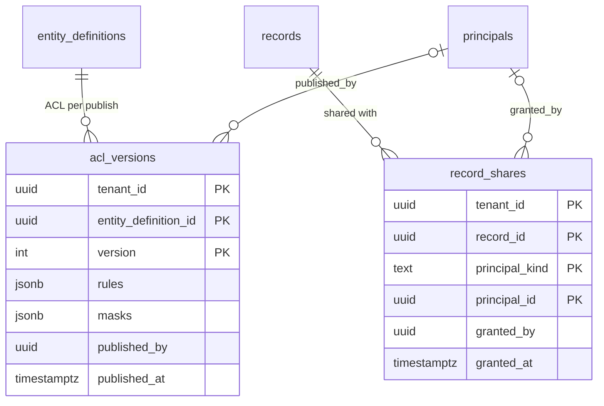

# ACL and share tables (P3-30, TICK-615)

PLAN-003 S10, D-3-2; ADR-001 I5 (one authorization layer, inside the query).
Migration: `db/migrations/20261108124249_acl_tables.sql`. Tests:
`internal/db/dbtest/acl_tables_test.go` and the isolation registry
(`internal/tenancy/isolation/acl_paths.go`).

## Model

Every foreign key is composite, `(tenant_id, …)`, so it holds the tenant even
though PostgreSQL checks it as the owner, past RLS. `principal_id` has no
foreign key: it names a user (`principals`) or a group (`groups`) by
`principal_kind`. A foreign id matches nothing, because the evaluator compares
it only with the caller's own principal and group ids, read under the caller's
tenant.

## Access and grants

| Role | acl_versions | record_shares |
|---|---|---|
| nava_app, nava_worker | SELECT, INSERT | SELECT, INSERT |
| every other role | nothing | nothing |

Both tables are immutable: publishing an ACL inserts version n + 1; an unshare
is not in S10. `ENABLE` + `FORCE` RLS, one policy per command
(`_select`, `_insert`) testing `app.tenant_id`.

## Access patterns and indexes

| Query | Index | Plan |
|---|---|---|
| Newest ACL of a type (P3-31) | `acl_versions_pkey` | backward PK scan, `LIMIT 1` |
| Shares of one record (record view) | `record_shares_pkey` prefix `(tenant_id, record_id)` | PK range scan |
| Records shared with the caller's principal ids (list, P3-34) | `record_shares_principal (tenant_id, principal_id)` | bitmap scan, then `records_pkey` probes |
| `record_shares` → `records` FK | `record_shares_pkey` prefix | — |

## Evidence: the list-join index

Setup: PostgreSQL 16.10 (`postgres:16.10`, the compose image) in Docker 29.9.2
on a 12th Gen Intel Core i7-1260P laptop (16 threads, Docker VM 19.4 GiB),
`max_parallel_workers_per_gather = 0`, superuser (no RLS; this compares index
shapes only). 1,000,000 records over 50 tenants, one holding 400,000;
2,000,000 shares, 2,000 principal ids per tenant. Query: the big tenant's
newest 50 records shared with 4 principal ids (one user, three groups), which
reach 1,573 records. Script and full output: `scratch/acl-tables-bench/`.

| Index | Size | Execution (2 runs, warm) | Buffers | 20,000-share insert |
|---|---|---|---|---|
| `(tenant_id, principal_id)` | 18 MB | 12.0, 13.0 ms | 7,973 | 304 ms |
| `(tenant_id, principal_id, record_id)` | 129 MB | 12.4, 16.5 ms | 6,506 | 298 ms |

The covering index makes the share lookup index-only (30 buffers instead of
1,497), but 6,476 of the buffers in both plans are the `records_pkey` probes,
so the total time does not improve. B-tree deduplication collapses the
two-column index's repeated `(tenant, principal)` keys, which is why it is a
seventh the size. Kept: the two-column index, as PLAN-003 states it. Revisit
in P3-36 if the list query's shape changes.
