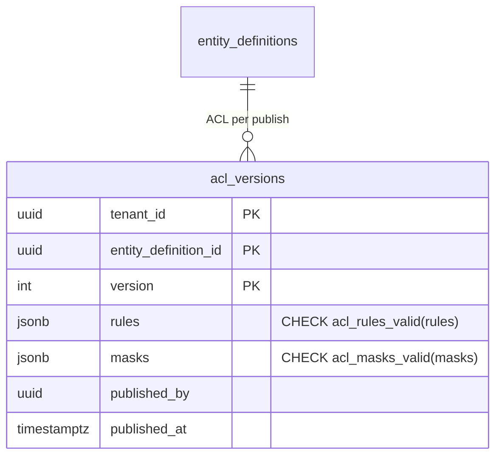

# `acl_versions.rules` and `masks` shape CHECK (TICK-629)

Scope: TICK-629, deferred from P3-31 (TICK-616). Migrations
`db/migrations/20261109100000_acl_versions_shape_check.sql` (functions, add
`NOT VALID`) and `20261109100100_acl_versions_shape_check_validate.sql`
(validate). Tests: `internal/db/dbtest/acl_versions_shape_check_test.go`.
Benchmark: `scratch/acl-versions-shape-check/` (`run.sh`, output in
`result.txt`).

## Decision

**Adopted:** two CHECK constraints on `acl_versions`, each calling an
`IMMUTABLE` PL/pgSQL function over the `jsonb`:

- `acl_versions_rules_check CHECK (acl_rules_valid(rules))`
- `acl_versions_masks_check CHECK (acl_masks_valid(masks))`

with helpers `acl_subject_valid`, `acl_cond_valid` and `acl_uuids_valid`.

- **Why:** `authz.PolicyStore.Current` decodes both columns strictly (unknown
  keys refused). One malformed row makes every read of its entity type a 500,
  and versions are immutable, so no role can fix the row afterwards. The
  insert is the only place to stop it.
- **CHECK, not a trigger.** The shape is a property of the one value, so a
  pure function of the column expresses all of it. No trigger is needed.
- **PL/pgSQL, not `LANGUAGE sql`.** The SQL-language version walked arrays
  with subqueries, so it could not be inlined, and it re-planned every nested
  call: 1.3 ms for a 6-rule policy. The PL/pgSQL version takes 0.30 ms
  (Evidence).
- **Grants:** a CHECK runs its functions as the inserting role. `nava_app`
  and `nava_worker` get `EXECUTE` on all five (`db/grants.yaml`). `PUBLIC`
  has none. The functions are not `SECURITY DEFINER`.

## The accepted shape

This is the reference for the publish validation in P3-35 (TICK-620).

General rules:

- No key outside the ones listed.
- No value is JSON `null`. A key is either absent or has the listed type.
- A uuid string is the 8-4-4-4-12 hex form, in either case. That is the form
  `encoding/json` writes for `uuid.UUID`, and one `uuid.Parse` accepts.

| Value | Shape |
| --- | --- |
| `rules` | array of Rule. May be empty: the policy allows nothing. |
| Rule | `{id, ops, who, where?}` |
| `id` | non-empty string |
| `ops` | non-empty array. Each element is `"read"` or `"write"`. |
| `who` | Subject (required) |
| `where` | array of Cond. May be empty: every record. |
| Subject | `{groups?, users?, requester?, assignee?, shared?}`. May be `{}`. |
| `groups`, `users` | arrays of uuid strings. May be empty. |
| `requester`, `assignee`, `shared` | booleans |
| Cond | `{column, op, values?, caller?}` |
| `column` | `state`, `requester_id`, `assignee_id` or `assignment_group_id` |
| `op` | `eq` or `in` |
| `caller` absent or `""` | `values` are literals, and every one is a string. A column other than `state` takes uuid strings. `eq` takes exactly one value. `in` takes any number; none matches nothing. |
| `caller` `"self"` | `column` is `requester_id` or `assignee_id`. `values` is absent or `[]`. |
| `caller` `"my_groups"` | `column` is `assignment_group_id`. `values` is absent or `[]`. |
| `masks` | array of Mask. May be empty. |
| Mask | `{field, read, write}`. All three are required. |
| `field` | non-empty string |
| `read`, `write` | Subject |

Beyond what the decoder needs, the constraint also refuses these Cond cases:

- `eq` without exactly one value.
- `self` or `my_groups` on the wrong column, or with values.
- An unknown `caller`.

The compiler (`planCond`) drops each of these silently as "matches nothing",
so a policy that contains one is a mistake. Refusing it at insert means it
cannot quietly deny everyone.

What the constraint does not check:

- that group and user ids exist (ids of another tenant match nothing; see
  `docs/architecture/record-acl.md`),
- that rule ids are unique,
- that a mask `field` is a property of the schema.

These belong to the publish validation, which has the schema and the
tenant's groups.

## Evidence

Run on postgres:16.10 in Docker Desktop (16 vCPUs, 19 GiB for the VM) on
Windows 11.

Data: 2,000 tenants × 10 types × 5 versions = 100,000 versions, 452 MB in
total. Each version is a realistic policy:

- 6 rules, each with 2 groups, 10 users, flags, a `state in` condition and a
  `my_groups` condition;
- 3 masks;
- `rules` is 4.5 kB as text and 3.1 kB stored (compressed).

The table has `acl_versions`' columns and primary key, but not its foreign
keys or RLS, which do not change the cost of the CHECK.

| Step | Lock | Time |
| --- | --- | --- |
| `ADD CONSTRAINT ... NOT VALID` ×2 (migration 1) | ACCESS EXCLUSIVE | 3.4 ms (catalogue only, no scan) |
| `VALIDATE CONSTRAINT` rules / masks (migration 2) | SHARE UPDATE EXCLUSIVE (reads and inserts continue) | 26.8 s / 3.1 s |
| Insert 20,000 versions, no CHECK (3 runs) | — | 1,103 / 977 / 938 ms |
| Insert 20,000 versions, both CHECKs (3 runs) | — | 6,801 / 7,095 / 6,904 ms |
| One publish (single-row insert), no CHECK (3 runs) | — | 4.2 / 3.4 / 3.2 ms |
| One publish, both CHECKs (3 runs) | — | 5.2 / 3.9 / 3.9 ms |
| Both predicates alone, seq scan of 100,000 rows | — | 30.4 s (0.30 ms a row) |
| Earlier `LANGUAGE sql` version, the same scan | — | 127.1 s (1.27 ms a row) |

- **Write amplification:** 0.30 ms of CPU per published version: the batch
  medians are 977 ms and 6,904 ms for 20,000 rows. A publish is an admin
  action, so this is about 0.5 ms on a 3 to 4 ms insert. No extra I/O and no
  WAL.
- **Storage:** none. No index is added and no column changes.
- **Where the time goes:** checking the uuids. The regular expression
  `^[0-9A-Fa-f]{8}-([0-9A-Fa-f]{4}-){3}[0-9A-Fa-f]{12}$` costs 6.6 µs a match
  in PostgreSQL, and a 6-rule policy holds about 70 ids. `acl_uuids_valid`
  checks the same set with length, hyphen positions and a regular expression
  without counted repetition, at about 1.7 µs a match.
- **Online:** migration 1 holds ACCESS EXCLUSIVE for about 3 ms under
  `lock_timeout = '5s'`. Migration 2 scans under SHARE UPDATE EXCLUSIVE, which
  blocks neither reads nor publishes. There is no per-tenant DDL. A deployed
  database has no `acl_versions` rows (S10 has not shipped), so in practice
  validation scans nothing. 100,000 versions would take 30 s and block
  nothing.
- Inserting a malformed value fails with `23514` and names the constraint
  (shown at the end of `result.txt`).

## Rollout

- **Merge order:** none. This PR lands before P3-35 and is the reference
  P3-35 mirrors.
- **Fixtures changed in this PR:** the isolation seed and
  `internal/tenancy/isolation/acl_paths.go` used `'{}'` and `'{"b": 2}'`, and
  `internal/db/dbtest/acl_tables_test.go` used `'{"roles": {}}'`. These now
  use valid shapes.
- **Changed test:** `TestPolicyStoreReadsTheNewestVersionOfItsTenant` stored
  an undecodable row as superuser to show that `Current` returns an error.
  That row is now refused at insert, and the test asserts the refusal.
  `Current`'s decode error stays as defence in depth.
- **Story-branch databases:** a long-lived database built from the story
  branch that ran the old isolation seed fails migration 2, naming the
  constraint. Rebuild it, as `db/migrations/README.md` says for story-branch
  databases.
- **Go writers:** a Go `authz.Rule` with nil `Ops` encodes as
  `"ops": null`, which the CHECK refuses. Such a rule grants nothing. The
  only writers today are `acltest.Publish` and the acceptance seed, and both
  always set ops.
