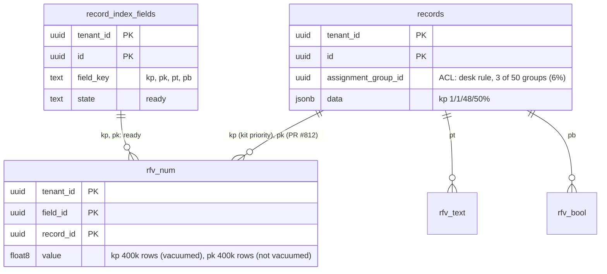

# ADR-006-A2 A2-8 (2), (2a), (3a): budget check and S-A2-cancel (TICK-1048)

Scope: PLAN-007-A2 T-A2-4. The run used the T-A2-2 code (TICK-1046, PR #827,
head `bc81fe34`) with `CountBudget` = 200 ms in force. Harness:
`internal/server/records_a2_gate_perf_integration_test.go` (`TestA2Gate`, tags
`integration perf`, not in CI). Runner: `scratch/tick-1048-a2-gate/run.sh`.
Raw output: `docs/data/adr-006-a2-gate/run-1/`.

## Verdict (run 1, 2026-11-21 12:45Z)

| Gate | Rule | Result | Status |
| --- | --- | --- | --- |
| (2a) host rule | floor p50 ≤ 3 ms and no-filter control p95 ≤ 80.3 ms, before and after | **Failed on both attempts**: control p95 172.9 / 408.0 ms (attempt 1) and 242.5 / 168.7 ms (attempt 2); floor 1.90 / 14.13 and 5.39 / 4.47 ms | **Inconclusive.** Stopped after two attempts (Technical Lead's rule). |
| (2) non-count p95, band (ii) | ≤ 94 ms | 198.6 ms (attempt 1), 139.5 ms (attempt 2), on a host that failed its gates | **Inconclusive**: not used in A2-2's formula. Rerun on an idle host. |
| (3a) S-A2-cancel | count phase ≤ 215 ms at p99; every answer 200 + `unknown`; a further statement; no temp growth | p99 299.3 ms single-client (+99.3), 655.3 ms at 8 clients (+455.3); 67 of 100 single-client answers `unknown`, 33 `capped`; 200 of 200 at 8 clients `unknown`; every request ran `commit` after `ROLLBACK TO`; temp_files 17 / temp_bytes 200,074,288 before, after and 60 s after | **Measured FAIL on a contended host.** The cell is also too close to the budget (see below). Rerun on an idle host. |

These numbers are not a ruling on the 94 ms or on the 15 ms overshoot term.
The host was busy for the whole run. The owner's `nava` stack (12
containers) and another agent's integration databases (`nava-it-pg-*`,
`nava-it-pgb-*`) were up. Their `docker stats` CPU summed to a median of 64% of
one core, a p95 of 225% and a maximum of 584% (`run-1/contention.txt`, 72
samples). The transport floor was 8.11 ms just before the spike. P3-36's
control read 72.5–73.5 ms on an idle host and 90.7–215.9 ms p50 here.

## Setup

- Host: Windows 11, 12th Gen Intel Core i7-1260P, Docker 29.9.2 on WSL2
  (kernel 5.15.167.4), VM with 16 CPUs and 24.5 GiB. A fresh `postgres:16.10`
  container with P3-01's settings (`shared_buffers = 2GB`,
  `effective_cache_size = 6GB`, `fsync = on`, `jit = off`). `nava_app` runs
  with `plan_cache_mode = force_custom_plan`. No PgBouncer: the handler's own
  pool, as in P3-36. The server runs in-process, so `WithSkipCount` works
  (D-7A2-7). Latency is client-side, at the harness.
- Data: P3-36's seed (800,000 records, one tenant with 400,000 tickets and 399
  tenants with about 1,000 each). It is used so that P3-36's control reads on
  P3-36's data. The S21 kit's shape sits on top: a num field `kp`, flagged
  `ready`, at the kit's priority distribution. It came out as 3,976 / 4,081 /
  191,830 / 200,113 records for values 1 / 2 / 3 / 4 (1 / 1 / 48 / 50%).
- ACL: the agent is P3-36's agent (the agents group plus 3 of 50 assignment
  groups, about 6% of the type; agent-1 sees 11,551 records with `kp = 3`). The
  kit's Alice sees about 5% through one group. That is the one deviation from
  the kit's shape, and it is a little stricter.
- (2) cell: `GET /api/v1/records/ticket?filter[kp]=3`, 8 clients for 15 s,
  round-robin over P3-36's 200 agents (also run as agent-1 alone), with the
  count skipped by `WithSkipCount`. Each attempt first takes the floor (`SELECT
  1`, 8 × 200) and the control (agent list with no filter, 8 clients, 15 s),
  then takes both again after the cell.



## (2) Band (ii), count skipped: 8 clients, 15 s, ms

| Attempt | Host before (floor p50 / control p95) | Host after | Non-count p50 / p95 / p99 (agents) | p95, agent-1 alone | With the budgeted count, p50 / p95 (reported only) |
| --- | --- | --- | --- | --- | --- |
| 1 | 1.90 / **172.9** | **14.13** / **408.0** | 107.1 / 198.6 / 265.2 (n = 1,014) | 210.6 | 225.9 / 665.5 |
| 2 | **5.39** / **242.5** | **4.47** / **168.7** | 80.3 / 139.5 / 167.0 (n = 1,370) | 144.1 | 199.5 / 325.3 |

Bold marks a failed gate. Raw samples: `run-1/band-samples.txt`. With the
count skipped, a request runs 7 statements and no count: BEGIN + tenant, type,
definition, ACL, registry, page, commit (`run-1/raw.md`). The page statement
took 17.2 ms server-side in the captured request. Its plan is in
`run-1/plans.md`.

## (3a) S-A2-cancel

Fixture: PR #812's (A2-11). a6 sees 24,055 records (6%) and a50 sees 200,379
(50%). The side rows `pk`, `pt`, `pb` were not vacuumed and autovacuum was
off. `pk` uses `rfv_num`, whose `kp` half was already vacuumed, so the table
reads 50% all-visible. `pk`'s own pages were never vacuumed. Each count was
timed unbudgeted first (EXPLAIN (ANALYZE, BUFFERS), 3 runs, median):

| Candidate | Unbudgeted count, median ms |
| --- | --- |
| a6, pk = 3 (broad, 6% ACL) | **591.5** (spike cell) |
| a6, pk = 3 + pt = x + pb = true | 501.1 |
| a6, pk = 20 (partly correlated) | 86.7 |
| a50, pk = 3 | 34.4 |
| a6, pk = 10 (anti-correlated, 0 visible) | no count: the first page is empty (A2-4 shortcut) |

The pk = 10 cell named in the task never reaches a count on the T-A2-2 code.
The shortcut answers it exactly with no count statement. The spike therefore
used the slowest count that does run. Its plan is a Parallel Hash Semi Join
that builds a hash of `rfv_num` (78k rows per worker) and stops at the
`LIMIT 1001` cap (`run-1/plans.md`).

| Run | n | 200 + `unknown` + `total: null` + 50 items | `commit` after `ROLLBACK TO` | count phase p50 / p95 / p99 / max ms | p99 overshoot | client p50 / p95 ms |
| --- | --- | --- | --- | --- | --- | --- |
| 1 client | 100 | 67 (33 answered `capped`: their count finished inside the budget, p50 165.9 ms, max 200.9 ms) | 100 | 234.0 / 291.9 / 299.3 / 465.1 | **+99.3** | 289.5 / 470.9 |
| 8 clients | 200 | 200 | 200 | 295.7 / 469.0 / 655.3 / 1,192.6 | **+455.3** | 502.7 / 835.2 |

The count phase splits into the count statement and the two round trips
around it. These figures come from `run-1/spike-samples.csv`, and cover only
the `unknown` answers:

| Run | count statement p50 / p99 / max ms | two round trips p50 / p99 ms |
| --- | --- | --- |
| 1 client | 236.9 / 412.8 / 412.8 | 8.9 / 52.3 |
| 8 clients | 260.2 / 511.0 / 1,158.0 | 31.8 / 196.4 |

What this run shows, and what it doesn't:

- **The failure path held on every request:** 300 of 300 answered 200 with
  50 items. No response was a 5xx. Each budget overrun gave `total: null` /
  `unknown`. The transaction committed after `ROLLBACK TO`. Temp files did not
  grow (0 bytes across the run and the 60 s after).
- **The overshoot is not measured on a valid host.** The two round trips alone
  took 8.9 ms at the p50 single-client. A2-2 assumes 3 ms each. The count
  statement ran to 237 ms at the p50 against a 200 ms timeout. That 37 ms
  mixes the cancel latency with the scheduling delay of a busy VM. These
  figures can't be used as the extra A2-2 term.
- **The cell is too close to the budget.** Without EXPLAIN's per-row timing,
  this count takes about 166–201 ms. One single-client request in three
  finished inside the budget. On an idle host most would, and "every answer
  `unknown`" would fail for the wrong reason. The harness now times each
  candidate plainly, adds a heavier candidate (`pk < 5`, 78% of the side
  rows) and picks on the plain median. It also reports the split shown above.

## Rerun

On an idle host (the `nava-*` stacks stopped, and no `nava-it-*` or bench
containers):

```sh
sh scratch/tick-1048-a2-gate/run.sh                               # (2), (2a) and (3a), about 25 min
NAVA_PERF_GATE_ATTEMPTS=0 sh scratch/tick-1048-a2-gate/run.sh     # (3a) only
```

`NAVA_PERF_OUT` sets the report path. The samples, plans, host and contention
files are written beside it.
