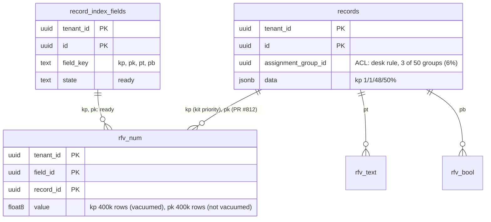

# ADR-006-A2 A2-8 (2), (2a), (3a): budget check and S-A2-cancel (TICK-1048, TICK-1083)

Scope: PLAN-007-A2 T-A2-4. The run used the T-A2-2 code (TICK-1046, PR #827,
head `bc81fe34`) with `CountBudget` = 200 ms in force. Harness:
`internal/server/records_a2_gate_perf_integration_test.go` (`TestA2Gate`, tags
`integration perf`, not in CI). Runner: `scratch/tick-1048-a2-gate/run.sh`.
Raw output: `docs/data/adr-006-a2-gate/run-N/`. TICK-1083 (T-A2-4b) added the
spill-then-cancel and parallel-plan cells: see
[its section](#tick-1083-t-a2-4b-spill-then-cancel-and-parallel-plan-cells).

## (3e) serial-count check (TICK-1098, ADR-006-E2 E2-4)

**(3e) INCONCLUSIVE (host), window 1 (2026-11-22 17:38–17:49Z). No block
passed its host gates, so nothing was pooled. Window 2 (from 17:52Z) was lost
when Docker Desktop and the WSL VM stopped responding mid-run. The rerun is
pending.**

Harness: `TestA2Gate` with `NAVA_PERF_SPIKE_CELLS=serial`
(`internal/server/records_e2_serial_perf_integration_test.go`). Runner:
`scratch/tick-1098-e2-3e/run.sh`. Raw output:
`docs/data/adr-006-a2-gate/run-e2-3e/window-N/`. Code: T-E2-1 (TICK-1097) at
`d814a15b` plus this harness. PostgreSQL 16.10 in Docker 29.9.2 (WSL2 VM:
16 CPUs, 24.5 GiB), P3-01's memory settings, server parallel settings
`max_parallel_workers_per_gather = 2`, `max_parallel_workers = 8`,
`max_worker_processes = 8`. Seed: P3-36's 800k records (400k on the large
tenant) plus the kit's `kp`.

- **Arm A:** the shipped handler (`CountBudget` 170 ms; the savepoint `Exec`
  adds `SET LOCAL max_parallel_workers_per_gather = 0`). **Arm B:**
  `WithCountArm(140 ms, true)` (server settings). Both run on the harness's
  pool with no `gateCountTracer`, so no setting is forced.
- **Blocks:** 8 clients × 15 s, A, B, B, A. Each cell is its own ABBA: band
  (ii) runs before the S-A2-cancel fixture, because that fixture reassigns
  every large-tenant record and empties the agents' view, and `a50, pk = 3`
  runs after it. The (2a) gate runs before and after each block, and adjacent
  blocks share the reading between them. A failed block is rerun up to twice.
  `parallel worker` backends are sampled every 50 ms on their own connection.
- **Band (ii):** `filter[kp]=3` (48% of the type) over P3-36's 200 agents
  (about 6% visible each), the harness's stand-in for the kit's Alice (about
  5% through one group), as in (2).

| Window | Cell | Block 1 (arm A) tries: before / after control p95, ms (gate 80.3) | Outcome |
| --- | --- | --- | --- |
| 1 | band (ii) | 131.8 / 125.4; 117.4 / 110.2; 136.6 / 139.4 (floor passed every time) | void after 3 tries. Arm A answered 993 / 1,223 / 1,243 requests, 0 `unknown`, peak 0 workers (not pooled) |
| 1 | `a50, pk = 3` | 744.3 / 167.6 (floor 16.62 ms, fail); 174.9 / 97.1; 108.7 / 100.8 | void after 3 tries. Arm A: 200 / 446, 481 / 492, 254 / 509 `unknown` (not pooled) |
| 2 | — | — | lost: Docker stopped responding after the seed (17:57Z) |

Window 1 had no other container running, and the Docker VM's load stayed
between 0.8 and 3.5 on 16 CPUs (`window-1/contention.txt`). The control's p50
was 58–77 ms, against 47.4 ms p95 in TICK-1048 run 2, so the host itself was
slow. At 17:50Z the Windows host was running other sessions' builds:
`golangci-lint` and 16–25 `go.exe` processes, which `docker stats` can't
see. Since window 2, `run.sh` records those processes in `contention.txt`.

**What window 1 does show (not a verdict):**

- **Plan check on `a50, pk = 3`** (`window-1/plans.md`, replayed from the
  traced savepoint `Exec` on one connection, with only `SET LOCAL
  statement_timeout = 0` added so that ANALYZE can finish). Arm A: no
  `Gather` (`Settings: … max_parallel_workers_per_gather = '0'`), 66.7 ms
  single-client. Arm B: `Gather`, 2 workers planned, **2 launched**, 49.9 ms.
  So the server's settings do give this count workers. Whether they launch
  under 8 clients is what the run's peak worker count shows.
- **(3a) leak reading after (3e) (E2-3): PASS.** `pg_ls_tmpdir()` listed 0
  files after the run and 60 s later. `temp_files` rose by 1,665 (3.99 GB)
  during the `a50` cell, so the reading covered a cell that spilled.
  `base/pgsql_tmp` had 0 entries and 0 workers were left.
- Under 8-client load on a slow host, arm A's serial `a50` count often ran
  past 170 ms (up to 98% `unknown` in one try). Arm B was never reached. The
  pass line needs arm B's share, measured on a clean host.

Rerun on a quiet host (no `nava-*` stacks, no other sessions' `go` or
`golangci-lint`), avoiding 08:00–10:00 UTC:

```sh
sh scratch/tick-1098-e2-3e/run.sh     # about 11 min: 2 min seed, then gates and blocks
```

## Verdict: PASS (runs 2 and 4, 2026-11-21 22:33–22:49Z, the Technical Lead's bench window)

| Gate | Rule | Result | Status |
| --- | --- | --- | --- |
| (2a) host rule | floor p50 ≤ 3 ms and no-filter control p95 ≤ 80.3 ms, before and after | floor 0.54 / 1.11 ms; control p95 **47.4 / 44.4 ms** (n = 3,282 / 3,176) | **Pass**, attempt 1 |
| (2) non-count p95, band (ii) | ≤ 94 ms | **50.7 ms** (n = 2,787, p50 42.1, p99 57.8); agent-1 alone 49.2 ms | **PASS, final** (passes by 46%). A2-2's formula is not rerun; `CountBudget` stays 200 ms |
| (3a) S-A2-cancel | count phase ≤ 215 ms at p99; every answer 200 + `unknown`; a further statement; no temp growth (since E2-3: no `pg_ls_tmpdir()` file after the run and 60 s later) | p99 **205.5 ms (+5.5)** single-client, **211.0 ms (+11.0)** at 8 clients; 300 of 300 answered 200 + `unknown` + `total: null` + 50 items; every request ran `commit` after `ROLLBACK TO`; temp_files 22 / temp_bytes 239,756,336 before, after and 60 s after | **PASS** |

The host was idle for the window. `docker ps` showed only the bench database,
`buildx_buildkit_nava-ci0` and `multica-*`; other containers used a median
0.65% and at most 14.6% of one core (`run-2/contention.txt`). Run 2 measured
(2a) and (2) and then stopped: on the idle host no fixture count exceeded the
budget (slowest 70.2 ms, `run-2/raw.md`), so (3a) had no slow plan. Run 3
added the anti-correlated field `pw` (115.8 ms, still under). Run 4 made `pw`
multi-valued (four values per invisible record) and scored (3a)
(`NAVA_PERF_GATE_ATTEMPTS=0`, floor 1.08 ms before the spike).

### Run 2: band (ii), count skipped, 8 clients, 15 s

| | p50 | p95 | p99 | n |
| --- | --- | --- | --- | --- |
| control before (agent list, no filter) | 38.0 | 47.4 | | 3,282 |
| **band (ii) `filter[kp]=3`, count skipped (agents)** | 42.1 | **50.7** | 57.8 | 2,787 |
| band (ii), count skipped (agent-1 alone) | | 49.2 | | 2,875 |
| band (ii) with the budgeted count (reported only) | 64.8 | 75.9 | | 1,824 |
| control after | 36.7 | 44.4 | | 3,176 |

P3-36's control read 73 ms when it was scored; the same handler reads 44–47 ms
here (QA's TICK-946 baseline on the same idle host: 59.12 ms on its own
scenario). The non-count request runs 7 statements; its page statement took
11.4 ms in the captured request, the other six 1.7–1.9 ms each
(`run-2/raw.md`, plans in `run-2/plans.md`). Raw samples:
`run-2/band-samples.txt`.

### Run 4: S-A2-cancel

Cell: **a50, `filter[pw]=1`**. `pw` is 1 on four side rows (`ord` 0–3) of
each of the 176k records that neither a6 nor a50 sees (704k rows), and on 100
records a50 sees and 100 a6 sees. So the first page is full (50 of 100) and the
count must find all 100, past the 1001 cap's early stop. Unbudgeted plain
count: 442.8 / 452.6 / 462.1 ms (EXPLAIN median 472.4). Visibility-map state
`none` for `pw`'s pages. Plans: `run-4/plans.md`.

| Run | n | 200 + `unknown` + `total: null` + 50 items | `commit` after `ROLLBACK TO` | count phase p50 / p95 / p99 / max ms | p99 overshoot |
| --- | --- | --- | --- | --- | --- |
| 1 client | 100 | 100 | 100 | 203.8 / 205.0 / 205.5 / 205.6 | **+5.5 ms** |
| 8 clients | 200 | 200 | 200 | 207.7 / 209.2 / 211.0 / 212.6 | **+11.0 ms** |

| Run | count statement p50 / p99 / max ms | statement overshoot p99 | two round trips p50 / p99 ms |
| --- | --- | --- | --- |
| 1 client | 201.4 / 202.6 / 202.6 | +2.6 ms | 2.4 / 3.6 |
| 8 clients | 202.7 / 205.0 / 207.0 | +5.0 ms | 4.9 / 7.7 |

The cancel itself costs 2.6–5.0 ms at p99. Most of the remainder is the two
round trips A2-2 already budgets (6 ms). At 8 clients the round trips reach
7.7 ms at p99, so the phase lands at +11.0, inside the 15 ms margin. **No extra
A2-2 term is needed.** The cell's client latency is 615 ms p50 single-client
and 1,301 ms at 8 clients: that is the anti-correlated page walk (A2-9, the
R-a track), not the count, which is capped at the budget.

## TICK-1083 (T-A2-4b): spill-then-cancel and parallel-plan cells

Scope: the Technical Architect's two non-blocking findings on TICK-1082.
S-A2-cancel's "no extra A2-2 term" claim was checked for two more cases: a
cancel that has already spilled to temp files, and a cancel that waits for
parallel workers to shut down. Same harness and seed as run 4, on a fresh
`postgres:16.10` with `NAVA_PERF_GATE_ATTEMPTS=0`. Raw output: `run-5/` and
`run-6/`.

### Run 6 (2026-11-22 10:09–10:23Z): spill FAIL confirmed; parallel FAIL by a wide margin, but a host gate flagged it

Fresh `postgres:16.10` (commit `7de2a4a8`), i7-1260P, WSL2 Docker VM with 16
vCPUs and 24.5 GiB, P3-36's 800k-record seed (seeded in 2m4s), `CountBudget`
200 ms. `NAVA_PERF_GATE_ATTEMPTS=0 NAVA_PERF_SPIKE_CELLS=spill,parallel`. Only
`multica-*` containers ran beside the bench database (`run-6/host.txt`). The
VM load average peaked at 6.5 of 16 CPUs, from the spike's own workers
(`run-6/contention.txt`).

| Cell | Pick (first `UNION ALL` branch) | count phase p99, 1 client (n = 100) / 8 clients (n = 200) | 200 + `unknown` + `commit` after `ROLLBACK TO` | `pgsql_tmp` after the run / 60 s later | Host gates before / after | Status |
| --- | --- | --- | --- | --- | --- | --- |
| `spill` | a50 `pw = 1 and pk < 5`, `work_mem = 64kB`, no parallel, nested loops and merge joins off; plain median 1,318.1 ms; hash join, 512 batches | **219.0 (+19.0) / 227.8 (+27.8) ms** | 300 / 300 | empty / empty (`pg_ls_tmpdir()` 0 files, `base/pgsql_tmp` 0 entries, 0 parallel workers). It spilled: 78,537 temp files, 2.59 GB during the spike | pass (floor 0.63, control p95 72.1) / pass (1.65, 79.1) | **FAIL**, confirms run 5 |
| `parallel` | a50 `pw = 1`, nested loops off; plain median 578.1 ms; `Gather` with 2 workers launched, running 325–407 ms under EXPLAIN, over a Parallel Hash Semi Join whose shared hash spills (8 batches) | **239.5 (+39.5) / 271.2 (+71.2) ms** | 300 / 300 | empty / empty, 0 parallel workers. 7,352 temp files, 7.95 GB during the spike | **fail** (floor 2.21, control p95 80.6 against 80.3) / **fail** (1.26, 84.3) | **FAIL, gate-flagged**: the harness scores it INCONCLUSIVE |

| Cell | Run | count phase p50 / p95 / p99 / max ms | count statement p50 / p99 / max ms | two round trips p50 / p99 ms | harness `SET LOCAL` p50 / p99 ms (left out) |
| --- | --- | --- | --- | --- | --- |
| spill | 1 client | 210.5 / 214.9 / 219.0 / 222.9 | 207.6 / 214.1 / 214.3 | 2.8 / 8.1 | 2.27 / 3.74 (both runs) |
| spill | 8 clients | 220.3 / 226.2 / 227.8 / 229.1 | 214.6 / 222.6 / 224.0 | 5.4 / 9.0 | |
| parallel | 1 client | 232.6 / 238.7 / 239.5 / 261.6 | 229.1 / 236.6 / 258.1 | 3.3 / 5.1 | 2.36 / 9.41 (both runs) |
| parallel | 8 clients | 234.6 / 252.5 / 271.2 / 274.2 | 226.9 / 260.7 / 267.5 | 6.9 / 24.7 | |

What run 6 shows:

- **Spill, two runs, both FAIL.** Run 5 gave +16.1 / +45.9 ms, run 6 gives
  +19.0 / +27.8 ms. Run 6's host gates passed on both sides of the cell. The
  extra cost is systematic, as in run 5: the single-client count statement's
  p50 is 207.6 ms (run 5: 208.2 ms; `base`, run 5: 201.6 ms). The 8-client
  tail varies between runs (+27.8 against +45.9 ms).
- **Parallel: the claim fails here too, and by more.** The single-client
  count statement's **p50** is 229.1 ms, 29 ms over the budget on every
  cancel, not only in the tail. The pick's `Gather` runs while its workers
  are still building a shared Parallel Hash that spills, so the cancel
  waits for two workers to stop and drop the shared temp files. That is
  parallel shutdown and a spill together. The host gates failed narrowly:
  control p95 80.6 ms before (0.4% over 80.3) and 84.3 ms after (5% over).
  A 0.3–4 ms drift in the no-filter control can't produce a 29 ms shift at
  the median, so I read the FAIL as real. The 8-client figure (+71.2 ms) is
  the less certain of the two.
- **The cancel path holds in both cells.** Every request answered 200 +
  `unknown` + `total: null` + 50 items and ran `commit` after `ROLLBACK TO`.
  No `pgsql_tmp` file or parallel worker was left after the run or 60 s
  later.

**For the Solution Architect (the ticket's fail rule): the extra A2-2 term.**
The term is the count phase's p99 overshoot at 8 clients, less the 6 ms of
round trips A2-2 already budgets. A single count either spills or runs in
parallel (or both, as the parallel pick does), so the terms don't add up:
the larger one applies.

| Basis | 8-client p99 overshoot | Extra term | A2-2: 350 − 94 − 6 − 35 − term | `CountBudget` (rounded down to 10 ms) |
| --- | --- | --- | --- | --- |
| spill, run 6 | +27.8 ms | +22 ms | 193 | 190 ms |
| spill, worst of runs 5 and 6 | +45.9 ms | +40 ms | 175 | 170 ms |
| parallel, run 6 (gate-flagged) | +71.2 ms | +66 ms | 149 | 140 ms |

The spill shape needs settings forced on this seed: `work_mem = 64kB`, no
parallel, and nested loops and merge joins off. At 64 kB its hash has 512
batches, far more than a 4 MB spill of the same hash, so the spill rows are
an upper bound for that shape. The parallel shape needs no forcing. Under
the server's settings, run 6's `a6, three broad fields` count (plain median
208.6 ms) has a launched `Gather` in branch 1 that is still running at
1.25 × the budget (`run-6/raw.md`, cell parallel). The measured pick forced
only `enable_nestloop = off`, and its shared Parallel Hash spilled at the
server's `work_mem` (4 MB). So the parallel row is the one that applies, and
the release trigger's "production count with a `Gather`" holds on the bench
seed. Before the 140 ms row is adopted, a parallel-only rerun with clean
gates (`NAVA_PERF_SPIKE_CELLS=parallel`, about 10 minutes) settles the
8-client figure.

### Run 5 verdict: spill FAIL (one run, measured); parallel INCONCLUSIVE (not validly measured)

| Cell | Rule | Result | Status |
| --- | --- | --- | --- |
| `base` (run 4's cell, rerun as the control) | count phase p99 ≤ 215 ms | p99 **206.4 ms (+6.4)** single-client, **213.6 ms (+13.6)** at 8 clients; 300 of 300 answered 200 + `unknown` + `total: null` + 50 items, then `commit` | **PASS**: it reproduces run 4 (+5.5 / +11.0) |
| `spill`: hash join, `work_mem = 64kB`, spilling when the budget expires | count phase p99 ≤ 215 ms; 200 + `unknown`; a further statement; no `pgsql_tmp` files after the run or 60 s later | p99 **216.1 ms (+16.1)** single-client, **245.9 ms (+45.9)** at 8 clients. 300 of 300 answered 200 + `unknown` + `total: null` + 50 items, then `commit`. `pg_ls_tmpdir()` and `base/pgsql_tmp` were empty after the run and 60 s later. No parallel worker was left. The spill happened: 75,207 temp files and 2.08 GB were written during the spike | **FAIL** on the overshoot. The cancel path and the leak check pass |
| `parallel`: a `Gather` running when the budget expires | as (3a) | p99 +26.8 ms single-client, +195.6 ms at 8 clients, but **the cell did not test the claim** (see below) | **INCONCLUSIVE**: rerun |

**For the Solution Architect (the ticket's fail rule):** the spill cell's
overshoot is an extra A2-2 term. The count phase's p99 overshoot at 8 clients
is 45.9 ms. A2-2 already budgets the two round trips in it (6 ms), so the extra
term is **40 ms** (39.9 rounded up). A2-2 rerun with it: 350 − 94 − 6 − 35 −
40 = 175, rounded down to 10 ms, gives **`CountBudget` = 170 ms**. Two caveats
belong with that number:

- **One run.** The cell's host was clean by the VM load average. P3-36's gate
  before the spike passed (floor 0.60 ms, control p95 60.3 ms), and so did the
  floor just before the cell (1.15 ms). The gate after the spike failed, but
  that was a `buildx` build that started at 04:38:55, five minutes after the
  spill cell had finished. A confirmation run (run 6) was started at 05:17 and
  stopped at 05:27: the S21 fresh stack came back up and was busy, and its
  acceptance measurement must not share the host with a bench.
- **The spill needs forced plans on this seed.** Under the server's settings
  no count both spills and runs past 200 ms here. The spill cell needs
  `work_mem = 64kB`, no parallel, and nested loops and merge joins off before
  the planner picks a hash join over the side table. A production count
  spills only if its hash exceeds `work_mem` (4 MB). The release trigger
  (any production count plan with a hash spill in the R-a track) decides
  whether 170 ms is needed.

**Why a spilled cancel is slower** (an explanation, not measured phase by
phase): the first branch hashes 702k `rfv_num` rows into 512 batches. In
`run-5/plans.md` the build runs from 67 to 290 ms under EXPLAIN, so the
cancel lands mid-build with the batch files open. The abort then closes and
unlinks them: on average 250 files and 6.9 MB per request. The cost shows at
the median, not only in the tail. The single-client count statement takes
208.2 ms at p50, against 201.6 ms in `base`. That is a systematic +6.6 ms on
every cancel. At 8 clients, eight such spills write through WSL2's virtual
disk at once, and the p99 of the statement alone reaches 232.1 ms.

| Cell | Run | n | count phase p50 / p95 / p99 / max ms | p99 overshoot | count statement p50 / p99 / max ms | two round trips p50 / p99 ms |
| --- | --- | --- | --- | --- | --- | --- |
| base | 1 client | 100 | 204.5 / 205.7 / 206.4 / 206.9 | +6.4 | 201.6 / 203.0 / 204.7 | 2.7 / 4.7 |
| base | 8 clients | 200 | 208.6 / 211.3 / 213.6 / 214.4 | +13.6 | 203.1 / 206.4 / 207.7 | 5.3 / 8.5 |
| spill | 1 client | 100 | 211.0 / 214.6 / 216.1 / 217.3 | **+16.1** | 208.2 / 213.4 / 215.6 | 2.6 / 4.2 |
| spill | 8 clients | 200 | 222.4 / 235.1 / 245.9 / 251.9 | **+45.9** | 215.0 / 232.1 / 242.8 | 6.9 / 23.0 |

The spill cell's `SET LOCAL` (the harness's, see below) took 2.56 ms at p50
and 9.36 ms at p99. It is left out of the count phase above.

**Why the parallel cell is inconclusive.** Its pick was a50 `pw = 1` and
`pk < 5` with `enable_nestloop = off`, plain median 2,562.8 ms. The harness then
asked only for "a launched `Gather` somewhere in the plan". In that plan the
`Gather` sits in a later `UNION ALL` branch, and the first branch, the one
running at 200 ms, is a serial Merge Semi Join. So the cancel never waited
for workers. Separately, the 8-client half overlapped the `buildx` build
(six `go build`s, VM load average 288). The harness now requires a launched
`Gather` **in the first branch** with an EXPLAIN total ≥ 1.25 × the budget.
On run 5's plans that criterion selects a50 `pw = 1` with `enable_nestloop =
off`: a Parallel Hash Semi Join whose `Gather` runs 479–582 ms. That is the
candidate a rerun should pick.

### What the harness does now

- **Three cells** (`NAVA_PERF_SPIKE_CELLS`, default `base,spill,parallel`).
  Each picks from its own candidate list the slowest plain (no EXPLAIN)
  median among the candidates whose plan has the cell's shape in the first
  `UNION ALL` branch. `spill` needs a hash join with temp writes there;
  `parallel` needs a launched `Gather` there, still running at 1.25 × the
  budget.
- **The cell's settings cover the count statement alone.** The harness sends
  `SET LOCAL …` on the same connection right after the handler's `SAVEPOINT
  list_count`, through a wrapping pgx tracer (`gateCountTracer`, test file
  only, no production change). `ROLLBACK TO` ends the settings, so the page
  statement runs on the server's settings. The extra round trip is timed and
  left out of the count phase. A first try set the settings as pool startup
  parameters instead. The page walk then spilled too (94 GB of temp writes in
  one spike, on a host Defender was loading), so that try was discarded and
  is not reported.
- **Leak check (reworded by ADR-006-E2 E2-3, TICK-1098):** "`pg_ls_tmpdir()`
  lists no `pgsql_tmp` files after the run, and none 60 s later." Any file at
  either reading is a FAIL line in `raw.md` and fails the cell, on every cell.
  `pg_stat_database.temp_files` / `temp_bytes` are spill context only: they
  prove a spill happened, never a leak, and feed no verdict. The
  `pg_ls_dir('base/pgsql_tmp')` listing (which also shows a parallel hash's
  shared fileset directories, skipped by `pg_ls_tmpdir()`) and the count of
  `parallel worker` backends are reported and gate nothing. Before TICK-1098
  the harness gated the spill cell on `temp_files` rising and on the listing,
  and every cell on the worker count.
- **Host gates around each cell** (P3-36's floor and control, before and
  after). The sampler in `run.sh` also records the Docker VM's load average:
  a `buildx` build runs in BuildKit's own containers, which `docker stats`
  does not list. That is how run 5's late contention was found. Run 5's
  `raw.md` came from the version before these last two changes (one gate pair
  around the whole spike, and "a `Gather` anywhere").

Rerun the two new cells (about 20 minutes on an idle host, no `nava-*`
stack up):

```sh
NAVA_PERF_GATE_ATTEMPTS=0 NAVA_PERF_SPIKE_CELLS=spill,parallel sh scratch/tick-1048-a2-gate/run.sh
```

## Run 1 (2026-11-21 12:45Z, contended host): inconclusive, kept as history

| Gate | Rule | Result | Status |
| --- | --- | --- | --- |
| (2a) host rule | floor p50 ≤ 3 ms and no-filter control p95 ≤ 80.3 ms, before and after | **Failed on both attempts**: control p95 172.9 / 408.0 ms (attempt 1) and 242.5 / 168.7 ms (attempt 2); floor 1.90 / 14.13 and 5.39 / 4.47 ms | **Inconclusive.** Stopped after two attempts (Technical Lead's rule). |
| (2) non-count p95, band (ii) | ≤ 94 ms | 198.6 ms (attempt 1), 139.5 ms (attempt 2), on a host that failed its gates | **Inconclusive**: not used in A2-2's formula. Rerun on an idle host. |
| (3a) S-A2-cancel | count phase ≤ 215 ms at p99; every answer 200 + `unknown`; a further statement; no temp growth | p99 299.3 ms single-client (+99.3), 655.3 ms at 8 clients (+455.3); 67 of 100 single-client answers `unknown`, 33 `capped`; 200 of 200 at 8 clients `unknown`; every request ran `commit` after `ROLLBACK TO`; temp_files 17 / temp_bytes 200,074,288 before, after and 60 s after | **Measured FAIL on a contended host.** The cell is also too close to the budget (see below). Rerun on an idle host. |

These numbers are not a ruling on the 94 ms or on the 15 ms overshoot term.
The host was busy for the whole run. The owner's `nava` stack (12
containers) and another agent's integration databases (`nava-it-pg-*`,
`nava-it-pgb-*`) were up. Their `docker stats` CPU summed to a median of 64% of
one core, a p95 of 225% and a maximum of 584% (`run-1/contention.txt`, 72
samples). The transport floor was 8.11 ms just before the spike. P3-36's
control read 72.5–73.5 ms on an idle host and 90.7–215.9 ms p50 here.

## Setup

- Host: Windows 11, 12th Gen Intel Core i7-1260P, Docker 29.9.2 on WSL2
  (kernel 5.15.167.4), VM with 16 CPUs and 24.5 GiB. A fresh `postgres:16.10`
  container with P3-01's settings (`shared_buffers = 2GB`,
  `effective_cache_size = 6GB`, `fsync = on`, `jit = off`). `nava_app` runs
  with `plan_cache_mode = force_custom_plan`. No PgBouncer: the handler's own
  pool, as in P3-36. The server runs in-process, so `WithSkipCount` works
  (D-7A2-7). Latency is client-side, at the harness.
- Data: P3-36's seed (800,000 records, one tenant with 400,000 tickets and 399
  tenants with about 1,000 each). It is used so that P3-36's control reads on
  P3-36's data. The S21 kit's shape sits on top: a num field `kp`, flagged
  `ready`, at the kit's priority distribution. It came out as 3,976 / 4,081 /
  191,830 / 200,113 records for values 1 / 2 / 3 / 4 (1 / 1 / 48 / 50%).
- ACL: the agent is P3-36's agent (the agents group plus 3 of 50 assignment
  groups, about 6% of the type; agent-1 sees 11,551 records with `kp = 3`). The
  kit's Alice sees about 5% through one group. That is the one deviation from
  the kit's shape, and it is a little stricter.
- (2) cell: `GET /api/v1/records/ticket?filter[kp]=3`, 8 clients for 15 s,
  round-robin over P3-36's 200 agents (also run as agent-1 alone), with the
  count skipped by `WithSkipCount`. Each attempt first takes the floor (`SELECT
  1`, 8 × 200) and the control (agent list with no filter, 8 clients, 15 s),
  then takes both again after the cell.



### Run 1: (2) band (ii), count skipped: 8 clients, 15 s, ms

| Attempt | Host before (floor p50 / control p95) | Host after | Non-count p50 / p95 / p99 (agents) | p95, agent-1 alone | With the budgeted count, p50 / p95 (reported only) |
| --- | --- | --- | --- | --- | --- |
| 1 | 1.90 / **172.9** | **14.13** / **408.0** | 107.1 / 198.6 / 265.2 (n = 1,014) | 210.6 | 225.9 / 665.5 |
| 2 | **5.39** / **242.5** | **4.47** / **168.7** | 80.3 / 139.5 / 167.0 (n = 1,370) | 144.1 | 199.5 / 325.3 |

Bold marks a failed gate. Raw samples: `run-1/band-samples.txt`. With the
count skipped, a request runs 7 statements and no count: BEGIN + tenant, type,
definition, ACL, registry, page, commit (`run-1/raw.md`). The page statement
took 17.2 ms server-side in the captured request. Its plan is in
`run-1/plans.md`.

### Run 1: (3a) S-A2-cancel

Fixture: PR #812's (A2-11). a6 sees 24,055 records (6%) and a50 sees 200,379
(50%). The side rows `pk`, `pt`, `pb` were not vacuumed and autovacuum was
off. `pk` uses `rfv_num`, whose `kp` half was already vacuumed, so the table
reads 50% all-visible. `pk`'s own pages were never vacuumed. Each count was
timed unbudgeted first (EXPLAIN (ANALYZE, BUFFERS), 3 runs, median):

| Candidate | Unbudgeted count, median ms |
| --- | --- |
| a6, pk = 3 (broad, 6% ACL) | **591.5** (spike cell) |
| a6, pk = 3 + pt = x + pb = true | 501.1 |
| a6, pk = 20 (partly correlated) | 86.7 |
| a50, pk = 3 | 34.4 |
| a6, pk = 10 (anti-correlated, 0 visible) | no count: the first page is empty (A2-4 shortcut) |

The pk = 10 cell named in the task never reaches a count on the T-A2-2 code.
The shortcut answers it exactly with no count statement. The spike therefore
used the slowest count that does run. Its plan is a Parallel Hash Semi Join
that builds a hash of `rfv_num` (78k rows per worker) and stops at the
`LIMIT 1001` cap (`run-1/plans.md`).

| Run | n | 200 + `unknown` + `total: null` + 50 items | `commit` after `ROLLBACK TO` | count phase p50 / p95 / p99 / max ms | p99 overshoot | client p50 / p95 ms |
| --- | --- | --- | --- | --- | --- | --- |
| 1 client | 100 | 67 (33 answered `capped`: their count finished inside the budget, p50 165.9 ms, max 200.9 ms) | 100 | 234.0 / 291.9 / 299.3 / 465.1 | **+99.3** | 289.5 / 470.9 |
| 8 clients | 200 | 200 | 200 | 295.7 / 469.0 / 655.3 / 1,192.6 | **+455.3** | 502.7 / 835.2 |

The count phase splits into the count statement and the two round trips
around it. These figures come from `run-1/spike-samples.csv`, and cover only
the `unknown` answers:

| Run | count statement p50 / p99 / max ms | two round trips p50 / p99 ms |
| --- | --- | --- |
| 1 client | 236.9 / 412.8 / 412.8 | 8.9 / 52.3 |
| 8 clients | 260.2 / 511.0 / 1,158.0 | 31.8 / 196.4 |

What this run shows, and what it doesn't:

- **The failure path held on every request:** 300 of 300 answered 200 with
  50 items. No response was a 5xx. Each budget overrun gave `total: null` /
  `unknown`. The transaction committed after `ROLLBACK TO`. Temp files did not
  grow (0 bytes across the run and the 60 s after).
- **The overshoot is not measured on a valid host.** The two round trips alone
  took 8.9 ms at the p50 single-client. A2-2 assumes 3 ms each. The count
  statement ran to 237 ms at the p50 against a 200 ms timeout. That 37 ms
  mixes the cancel latency with the scheduling delay of a busy VM. These
  figures can't be used as the extra A2-2 term.
- **The cell is too close to the budget.** Without EXPLAIN's per-row timing,
  this count takes about 166–201 ms. One single-client request in three
  finished inside the budget. On an idle host most would, and "every answer
  `unknown`" would fail for the wrong reason. The harness now times each
  candidate plainly, adds a heavier candidate (`pk < 5`, 78% of the side
  rows) and picks on the plain median. It also reports the split shown above.

## Rerun

On an idle host (no `nava-*`, `nava-it-*` or bench containers, no other agent runs):

```sh
sh scratch/tick-1048-a2-gate/run.sh                               # (2), (2a) and (3a), about 15 min idle
NAVA_PERF_GATE_ATTEMPTS=0 sh scratch/tick-1048-a2-gate/run.sh     # (3a) only, about 6 min
```

The spike picks the candidate with the slowest plain count. Since run 4 that
is a50 `pw = 1`, the multi-valued anti-correlated fixture. `NAVA_PERF_OUT`
sets the report path; samples, plans, host and contention files are written
beside it.
