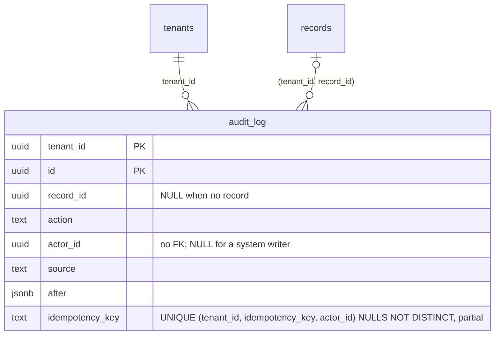

# audit_log idempotency key per actor (TICK-498)

TICK-480 scoped the pipeline's replay lookup (`store.AuditByKey`) to the
caller's principal. The unique index `audit_log_idempotency_key` stayed on
`(tenant_id, idempotency_key)`, so member B writing under member A's key got
409 `ErrIdempotencyConflict`, which told B the key existed in the tenant
(AR-TICK-480-01). This change makes the index per principal. B's write now
creates B's own record and learns nothing about A's key.

## Decision

| Question | Answer |
| --- | --- |
| Uniqueness | `(tenant_id, idempotency_key, actor_id) NULLS NOT DISTINCT WHERE idempotency_key IS NOT NULL`. |
| `NULLS NOT DISTINCT` | A system writer has no principal (`actor_id` NULL). Two of its writes under one key must still conflict, or a retry would write twice. |
| Column order | Key before actor. The issue proposed `(tenant_id, actor_id, idempotency_key)`, which enforces the same uniqueness. But `AuditByKey` matches the actor with `IS NOT DISTINCT FROM`, which a btree cannot search on. With the actor in the middle, the lookup scans every keyed row of the tenant: 120 to 132 buffers and 3.3 to 8.9 ms, against 5 buffers and 0.04 ms (figures below). |
| Name | Stays `audit_log_idempotency_key`. `store.InsertAudit` maps a 23505 on that name to `ErrDuplicateKey`, so no code change is needed. |
| Index count | Unchanged: one index replaces one index. |
| Query code | Unchanged. The replay lookup and the insert are the same statements. |
| `ON CONFLICT` target | Must now name all three columns: `ON CONFLICT (tenant_id, idempotency_key, actor_id) WHERE idempotency_key IS NOT NULL`. No production code uses one; `TestP309IdempotencyKeyPerTenant` does. |

## Migration

`20261103032000_audit_log_idempotency_key_per_actor.sql`, `NO TRANSACTION`:

1. `CREATE UNIQUE INDEX CONCURRENTLY audit_log_idempotency_key_actor`. Writes
   continue. The new index is strictly finer than the old one, so existing
   rows cannot violate it.
2. `DROP INDEX CONCURRENTLY audit_log_idempotency_key`.
3. `ALTER INDEX ... RENAME TO audit_log_idempotency_key`. This takes a
   SHARE UPDATE EXCLUSIVE lock and changes only the catalogue.

Between steps 2 and 3, a concurrent duplicate reports the temporary name. For
that instant, `Write` returns a 500 instead of a 409. Nothing is written
twice. Every step is `IF [NOT] EXISTS`, and an INVALID index left by a failed
build is dropped first, so a re-run after a partial failure finishes the job
(`TestNoTransactionMigrationsAreIdempotent`).

Down reverses the same steps. It fails on the `CREATE` once two actors in one
tenant hold the same key, which is exactly what this change allows. It then
leaves an INVALID `audit_log_idempotency_key_tenant`, which slows writes until
a re-run drops it. Those rows must be resolved by hand first.

Tested on PostgreSQL 16.10 against the 2 M-row table below: Up, an Up re-run,
Down, and Down refusing after a cross-actor duplicate. In CI:
`TestTICK498MigrationOverExistingRows`.

## Evidence

Hardware: Intel Core i7-1260P (16 threads), 40 GB RAM, Windows 11, Docker
Desktop (16 CPUs, 19 GB to the VM). PostgreSQL 16.10 (`postgres:16.10`,
default config). `plan_cache_mode = force_generic_plan`, which is `nava_app`'s
setting.

Data: 2,000,000 `audit_log` rows across 200 tenants (10,000 each). Each tenant
has 50 actors, plus NULL (system writer) on 1 row in 10. Half the rows are
keyed, so each tenant has 5,000 keyed rows. Scripts and raw output:
`scratch/audit-idempotency-per-actor/` (`bench.sql`, `bench2.sql`,
`result*.txt`).

Replay lookup (`AuditByKey`'s statement). Each index was measured alone. Times
are warm, from 3 runs:

| Index | Index Cond | Buffers (cold) | Execution |
| --- | --- | --- | --- |
| old `(tenant_id, idempotency_key)` | tenant, key | 5 | 0.049 to 0.060 ms |
| `(tenant_id, actor_id, idempotency_key)` | tenant, key; actor is a filter, so it scans the whole tenant | 132 (member), 120 (NULL) | 3.3 to 8.9 ms |
| **`(tenant_id, idempotency_key, actor_id)`** | tenant, key | 5 (member, NULL) | 0.037 to 0.050 ms |

Size and build:

| Index | Size | Build (2 M rows, 1 M keyed) |
| --- | --- | --- |
| old | 83 MB | — |
| new, chosen order | 98 MB (+15 MB, +18 %: one more uuid per keyed row) | 5.1 s `CONCURRENTLY` |

Write amplification: there is still one unique index on the insert path. For
20,000 keyed inserts in one statement, run 3 times each and alternating, the
old index took 695 / 826 / 1,090 ms and the new one 664 / 741 / 802 ms. That is
within noise, so there is no measurable write cost.

## Tests

- `internal/db/dbtest`, `TestTICK498IdempotencyKeyPerActor`. Raw inserts as
  `nava_worker`: two members with one key both succeed. The same member twice
  is 23505 on `audit_log_idempotency_key`, and so is NULL twice.
- `internal/db/dbtest`, `TestTICK498MigrationOverExistingRows`. Migrates over
  keyed rows and checks that the index definition is the one valid index.
- `internal/records/pipeline`, `TestIdempotencyKeyIsScopedByPrincipal`.
  Through `Pipeline.Write`: member B under A's key gets B's own record (no
  409), and each member's retry replays its own write. A different write
  under one's own key is `*ErrIdempotencyConflict`. A concurrent duplicate by
  the same principal, or by two NULL actors, is `ErrDuplicateKey`.
