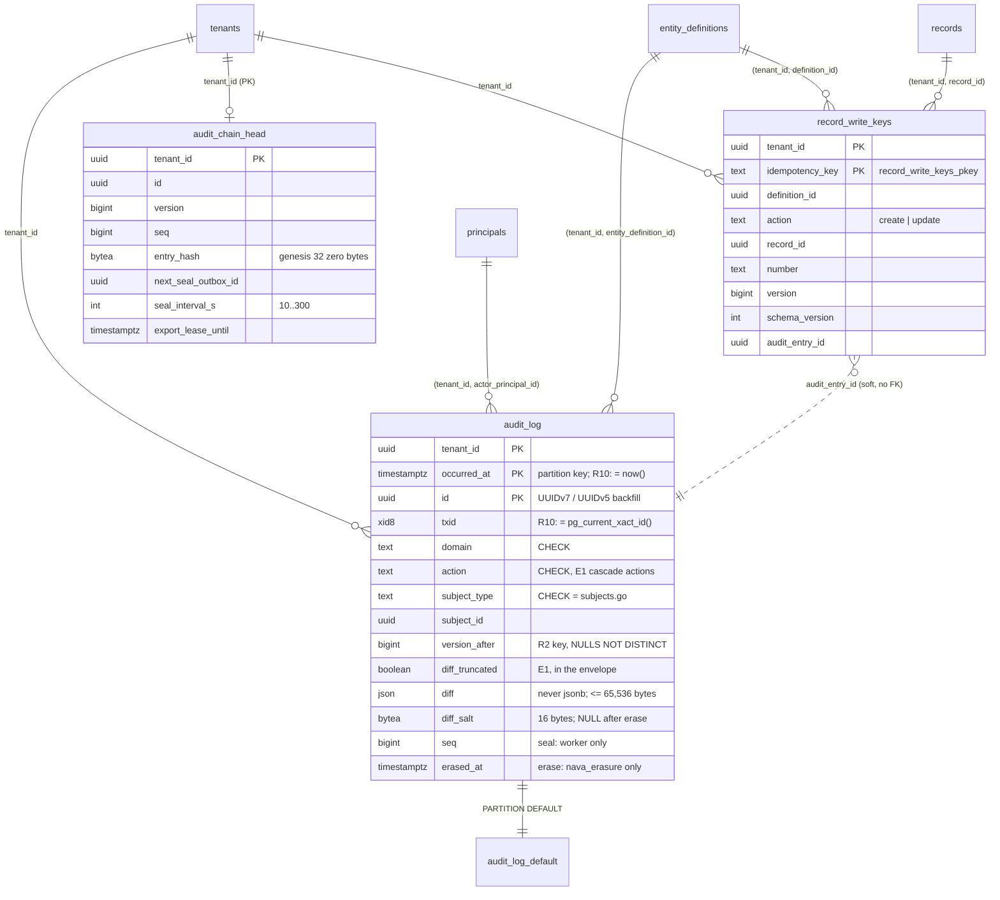
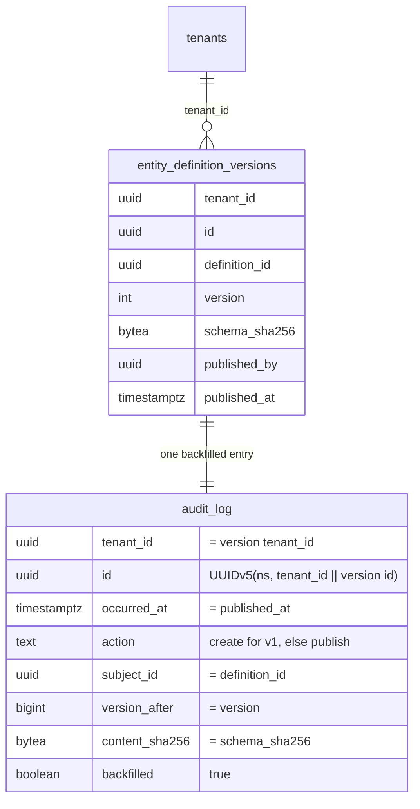

# Audit log tables (P5-10b, TICK-450)

This document covers the [ADR-004](../adr/ADR-004-audit-log.md) data layer, with [E1](../adr/ADR-004-E1-cascade-entries-and-diff-truncated.md), [ADR-001-A6.1](../adr/ADR-001-A6-audit-roles-and-non-record-starts.md) and PLAN-005 D-5-3.
- Migration: `db/migrations/20261102233600_audit_log.sql`.
- Grants: `db/grants.yaml`.
- Tests: `internal/db/dbtest/audit_log_test.go`.
- Subject-type registry: `internal/audit/subjects.go`.

## Who may do what

The DEFAULT partition is under ENABLE + FORCE RLS and has no policy and no grant, so every runtime role is refused a direct query on it.

| Role | `audit_log` | `audit_chain_head` | `record_write_keys` |
|---|---|---|---|
| `nava_app` | INSERT on the R10 columns; SELECT on the commit-check columns | SELECT; UPDATE `export_lease_until`, `next_seal_outbox_id`, `next_seal_at` | SELECT, INSERT |
| `nava_worker` | INSERT on the R10 columns; SELECT on every column except `diff` and `diff_salt`; UPDATE of the 4 seal columns | SELECT; UPDATE `version`, `seq`, `entry_hash`, `next_seal_outbox_id`, `next_seal_at`, `seal_interval_s` | SELECT, INSERT |
| `nava_erasure` | SELECT on the R23 columns only; INSERT on the R10 columns; UPDATE `diff`, `diff_salt`, `erased_at`, `erasure_ref` | — | — |
| everyone | no DELETE | no INSERT, no DELETE | no UPDATE, no DELETE |

Later tasks add the rest:
- P5-11 generates the `nava_onboard` and `nava_groupsync` writer grants and policies.
- P5-17 (TICK-435) added the reader's SELECT (nava_app, diff and diff_salt included).
- P5-33 adds onboarding's pinned INSERT on the head (A6.2).
- P5-15 and P5-32 add the migrator's temporary policies, created and dropped inside the backfill (see [S8 backfill](#s8-backfill-migration-a-p5-15)).

The column grants decide which columns a role may name. Two triggers decide what a role may do with them:
- `audit_log_assert_insert` (R10) **asserts** `occurred_at = now()`, `txid = pg_current_xact_id()` and `backfilled = false` for every role except `nava_migrator`. For every role, the migrator included, it requires the seal and erasure columns to be NULL. It never rewrites a row: a rewrite could move the row to another partition, which PG 16 refuses.
- `audit_log_guard_update` (R11) allows exactly two transitions, for every role, the superuser included:
  - **seal**, by `nava_worker`;
  - **erase**, by `nava_erasure`. It is allowed once, and only on a row that has a diff.

Both trigger functions are SECURITY INVOKER and owned by `nava_migrator`. The test asserts that `nava_migrator` owns no SECURITY DEFINER function, and that `pg_parameter_acl` grants no role `session_replication_role`, which would switch the triggers off.

## Choices that are not in ADR-004's text

- **`version_before` and `version_after` are `bigint`**, not Annex A's `integer`. `records.version` is bigint, and C1 carries `*int64`.
- **Row checks** go beyond R2:
  - digests are 32 bytes and the salt is 16 bytes;
  - the stored diff is at most 65,536 bytes (E1);
  - the diff and its salt are both present or both absent;
  - the seal columns are all set or all NULL, and so are the erasure columns;
  - an erased row has no diff;
  - a config entry has `content_sha256` unless it is a delete (Annex A).
- **Partition index names.** Each index copy on a partition is renamed to `<partition>_<parent suffix>`. A duplicate entry therefore reports `audit_log_default_commit_key`, never a generated name. P5-12b should match the `_commit_key` suffix. Epic 30 should rename the same way.
- **`occurred_at` statistics override: `n_distinct = 1`, not F1's `-0.0001`.** Finding 5 found that `-0.0001` ties at 10,000 tenants (see below). The override is per relation, so Epic 30 must set it on every partition it creates. `TestP510bOccurredAtNDistinct` catches any leaf that lacks it.

## Evidence: the commit-check probe at 10,000 tenants

`scratch/audit-log-f1-margin/` holds the script, the outputs and `RESULT.md`. The environment: postgres:16.10 in Docker with 16 CPUs, on a Windows 11 host. The table has 10,000 tenants. The probe is in its plpgsql-locals form and runs as `nava_app`.

| rows per partition | override | R2 or subject path | best prefix path | margin |
|---|---|---|---|---|
| 100,000 | `-0.0001` | 8.45 | 8.45 | 1.0× |
| 1,000,000 | `-0.0001` | 8.45 | 8.45 | 1.0× |
| 100,000 | `1` | 8.45 | 42.59 | 5.0× |
| 1,000,000 | `1` | 8.45 | 390.05 | 46× |

The margin under `n_distinct = 1` grows with rows per tenant, and passes 10× at about 20 rows per tenant per partition. No `occurred_at` override reaches 10× in a sparser partition. The probe form or the plan test (P5-11, TICK-428) has to cover that case.

Time-window estimates are unchanged by the override: the 3-day, one-tenant read estimates 20 rows and returns 20 under both overrides.

## S8 backfill: migration A (P5-15)

Migration: `db/migrations/20261103120000_audit_backfill_s8.sql`. It creates `audit_backfill_s8()`, runs it once, then fails if any `nava_migrator` policy is left (R26.3). P5-32 (migration B) calls the same function again.

- **Entry.** Domain `config`, subject `entity_definition`. `version_before` is NULL for v1 and `version - 1` otherwise. The actor is `published_by` with source `user`. Only a v1 seeded by onboarding has no publisher; its actor is `actor_system = onboarding` with source `onboarding`. No diff: R3 makes the content hash the evidence.
- **Id.** UUIDv5 under the fixed namespace `3767d3ad-0a89-4b41-847c-9e4bf30c2055`, over the 32 raw bytes `tenant_id ‖ version_id`. ADR-004-E1 rules out `pgcrypto` and PG 16 has no built-in SHA-1, so `audit_backfill_sha1` implements FIPS 180-4 in plpgsql. `TestP515UUIDv5MatchesGo` checks it against `crypto/sha1` at every padding boundary and against Go's `uuid.NewSHA1`.
- **Dedupe.** `NOT EXISTS (tenant_id, 'entity_definition', definition_id, version_after = version)`, so a re-run adds only versions published since the last run (CI-A9).
- **Access path (R26).** Four temporary policies, created and dropped inside the function, in the migration's single transaction:
  - `FOR SELECT TO nava_migrator USING (true)` on `tenants`, the only cross-tenant policy, used to list ids;
  - canonical SELECT on `entity_definition_versions`;
  - canonical SELECT and INSERT on `audit_log`.

  For each tenant it calls `set_config('app.tenant_id', id, true)` and runs one `INSERT … SELECT`. All three functions are SECURITY INVOKER, owned by `nava_migrator` and have no EXECUTE grant.
- **Plan pin.** The function runs with `enable_seqscan = off`. While the run fills `audit_log`, its statistics still say it is empty, so the cached plan seq-scanned `audit_log_default` for each tenant's dedupe: O(n²), 291.7 s for 300,000 versions. With the pin, the probe is an index scan on `audit_log_default_subject` (0.5–0.8 ms per tenant).
- **Lock cost.** CREATE POLICY holds ACCESS EXCLUSIVE on `tenants`, `entity_definition_versions` and `audit_log` until COMMIT, so tenant resolution waits for the whole run. Measured on postgres:16.10 in Docker (16 CPUs, Windows 11 host), from `scratch/audit-backfill-s8/RESULT.md`:

| Tenants | Versions | Migration A | Re-run, all present |
|---:|---:|---:|---:|
| 1,000 | 30,000 | 5.62 s | 0.14 s |
| 10,000 | 300,000 | 54.69 s | 2.32 s |

Runbook: the migration sets `lock_timeout = '5s'`. That limits only how long it **waits** to take the locks; once it has them it holds them for the whole run, about 0.18 ms per version to backfill (budget: ≤ 18 s at 100k versions, `docs/budgets.md`). Size the window from the S8 version count, not from `lock_timeout`. The function takes the locks in the order tenants, entity_definition_versions, audit_log (the order of its CREATE POLICY statements); an explicit `LOCK TABLE` up front was measured and not adopted (`scratch/audit-backfill-s8/tick515-lock/RESULT.md`).

## Cost

All three tables are new and empty, so the migration takes no lock that blocks anything existing.

The write path has not been measured in this task:
- `audit_log` has 7 indexes per partition (the PK, the R2 key and 5 from R28), and every append writes all 7.
- `record_write_keys` adds one PK insert per keyed write.

S1 measured the same index set on the spike schema (`docs/adr/ADR-004/spikes/postgres/s1/RESULT.md`):
- item 3: 1,344 B of WAL per insert, plus 1,323 B per seal, so 1.98× with sealing;
- item 1: commit-check trigger overhead within the 10% p95 bar.
