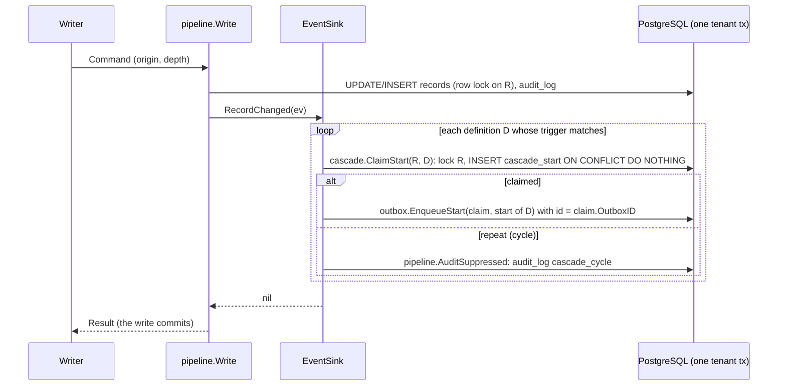

# Cascade start key and rejected cascades (P3-12, TICK-88)

ADR-001 I9 as amended by [A5](../adr/ADR-001-A5-i9-cycle-suppress-start.md).
Migration: `db/migrations/20261102100000_cascade_start.sql`.

## The rules in code

| Rule | Where |
|---|---|
| A depth-0 write mints a new origin (UUIDv7); a given one is refused | `pipeline.Write`, `Command.check` |
| A `source = workflow` write at depth 0 is refused (`ErrInvalidCommand` wrapping `outbox.ErrInvalidEntry`) | `Command.check` (A5-7) |
| A write deeper than `config.CascadeDepthLimit` (8) is refused with `outbox.ErrCascadeTooDeep` before any statement in the caller's tx but the tenant read; one `cascade_rejected` audit row is committed on the `TxRunner` | `Pipeline.rejectTooDeep` |
| Every outbox row has an origin, depth 0 included | `outbox.validate` (A5-3) |
| A `nava.interpreter` start goes through `outbox.EnqueueStart` with a claimed `cascade.Claim` only | `outbox.Enqueue`, `EnqueueAtVersion`, `EnqueueStart` (A5-6) |
| A definition starts at most once per (tenant, origin, record) | `cascade.ClaimStart` on `cascade_start` (A5-2) |
| A repeat start is suppressed: the write commits, one `cascade_cycle` row in the write's tx | the EventSink, with `pipeline.AuditSuppressed` (A5-4) |

The claim's tenant, origin and depth are never arguments. `ClaimStart` reads
them from R's `records` row under the tenant's RLS, as the pipeline stored them
for the triggering write, and `EnqueueStart` stamps the start row with them.

## The sink's sequence (P3-42 wires the real one)

## Audit rows

| action | record_id | after | written in |
|---|---|---|---|
| `cascade_rejected` | NULL on a create, else R | `{"reason": "cascade_too_deep"}` | its own tenant tx (`TxRunner`), so it survives the rollback |
| `cascade_cycle` | R | `{"reason": "cascade_cycle", "definition_id": "<D>"}` | the write's tx |

Both carry the writer's actor and source and the write's causation origin and
depth. `after` holds codes and ids only, never record data. A `PoolRunner` on
the caller's pool needs at least two connections, because the rejected row is
written while the caller's transaction is still open (it has made no change).

## Table

`cascade_start (tenant_id, causation_origin_id, record_id, definition_id,
outbox_id, created_at)`, every column `NOT NULL`, primary key on the first
four, composite foreign key `(tenant_id, record_id) → records`, `ENABLE` and
`FORCE` RLS, `SELECT` and `INSERT` for `nava_app` and `nava_worker`, no
`UPDATE` or `DELETE`. P3-40 adds `(tenant_id, definition_id) →
workflow_definitions`. A future record purge deletes a record's rows first and
adds the `(tenant_id, record_id)` index with its `DELETE` policy.

## Tests

- `internal/records/pipeline/cascade_integration_test.go`: CI-10 (a)–(e), the
  `TxRunner` contract, concurrent claims, the `EnqueueStart` guards.
- `internal/db/dbtest/cascade_start_test.go`: grants, RLS, append-only,
  NOT NULL origin, the composite foreign key.
- `internal/tenancy/isolation/cascade_paths.go`: CI-10 (f) in the isolation
  report. (g), signal ping-pong, needs the interpreter and is P3-42's, so CI-10
  reads partial until P3-42 registers it (CTO ruling, TICK-415).

## Lock order across writes (from the P3-11 review, PR #360)

P3-11 orders its locks within one `Write` (uniqueness advisory locks, then
the `record_counters` row lock), not across writes. A5 cascades never put two
pipeline writes in one transaction: the sink only enqueues starts, and each
workflow write runs in its own activity transaction. A caller that does put
two or more writes in one transaction can deadlock with another such caller.
`Write` then returns `pipeline.ErrRetryable` (40P01, and 40001), wrapping the
database error. Roll back and run the whole transaction again
(`TestTwoWritesPerTransactionDeadlockIsRetryable`).
