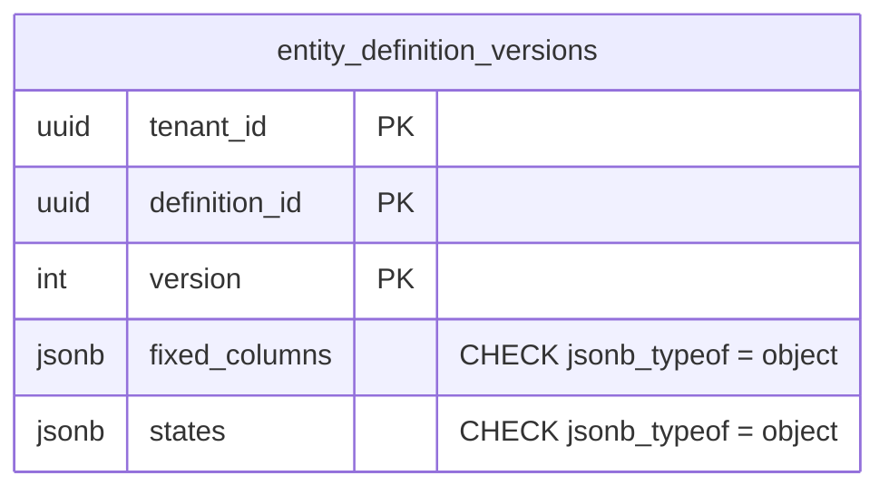

# `fixed_columns` and `states` must be JSON objects (TICK-378)

Scope: TICK-378, part 3. Migrations
`db/migrations/20261101180000_entity_definition_versions_jsonb_check.sql`
(add, `NOT VALID`) and `20261101180100_..._validate.sql` (validate). Tests:
`internal/db/dbtest/entity_definition_versions_jsonb_check_test.go` and
`internal/entitytypes/encode_test.go`. Benchmark:
`scratch/entity-def-versions-jsonb-check/` (`run.sh`, output in `result.txt`).

## Decision

**Adopted:** `CHECK (jsonb_typeof(fixed_columns) = 'object')` and
`CHECK (jsonb_typeof(states) = 'object')` on `entity_definition_versions`.

- The store scans `fixed_columns` into `map[string]string` and `states` into
  `metadata.StateModel`. pgx v5 refuses any other top-level type, so a single
  `'[]'` row turns every read of that type into a 500 (the TICK-378 bug).
- Versions are immutable (D-3-4): no role may `UPDATE` a bad row afterwards.
  The insert is the only place it can be stopped.
- The constraint checks the top-level type only. The members (string values,
  `initial` / `states` / `transitions`) are validated by `metadata.Compile`
  before the insert. Repeating those rules in SQL would drift from the Go ones.
- The store now writes a nil `FixedColumns` (the request left out
  `fixed_columns` or sent `null`) as `{}`, not `null`. Without that change
  the new CHECK would turn such a create into a 500. `states` is a Go struct
  and always encodes as an object.

## Evidence

Run on postgres:16.10 in Docker Desktop (16 vCPUs, 19 GiB for the VM) on
Windows 11 with an Intel Core i7-1260P and 40 GB RAM. Data: 2,000 tenants ×
10 types × 5 versions = 100,000 versions, about 1.6 kB of schema each, 138 MB
total.

| Step | Lock | Time |
| --- | --- | --- |
| `ADD CONSTRAINT ... NOT VALID` ×2 (migration 1) | ACCESS EXCLUSIVE | 1.5 ms (catalogue only, no scan) |
| `VALIDATE CONSTRAINT` ×2 (migration 2) | SHARE UPDATE EXCLUSIVE (reads and inserts continue) | 31 ms |
| Insert 20,000 versions, no CHECK (3 runs) | — | 1,527 / 1,966 / 1,859 ms |
| Insert 20,000 versions, both CHECKs (3 runs) | — | 2,016 / 1,736 / 1,842 ms |
| Both predicates on their own, seq scan of 100,000 rows | — | 61.5 ms (about 0.3 µs per row per worker) |

- **Write amplification:** none measurable. The insert medians are 1,859 ms
  without the CHECKs and 1,842 ms with them, well inside the run-to-run noise
  (±220 ms). Versions are written only when a type is published, which
  happens rarely.
- **Storage:** none. No index is added and no column changes.
- **Online:** migration 1 holds ACCESS EXCLUSIVE for 1.5 ms under
  `lock_timeout = '5s'`. Migration 2 scans under SHARE UPDATE EXCLUSIVE.
  No per-tenant DDL.
- Inserting `'[]'` fails with `23514` and names
  `entity_definition_versions_fixed_columns_check` (shown at the end of
  `result.txt`).

## Rollout

- On a deployed database the API has always written objects, so validation
  has nothing to reject. `null` can only come from a request with no
  `fixed_columns`, and this story has not shipped.
- A long-lived database built from the story branch that ran the old
  isolation seed (`'[]'`) fails validation and names the constraint. Rebuild
  it, as `db/migrations/README.md` already says for story-branch databases.
- **Merge order:** this PR must land after the seed fix (TICK-378 parts 1 and
  2). Otherwise `make isolation` fails while it loads the seed, because the
  new CHECK refuses `'[]'`.
