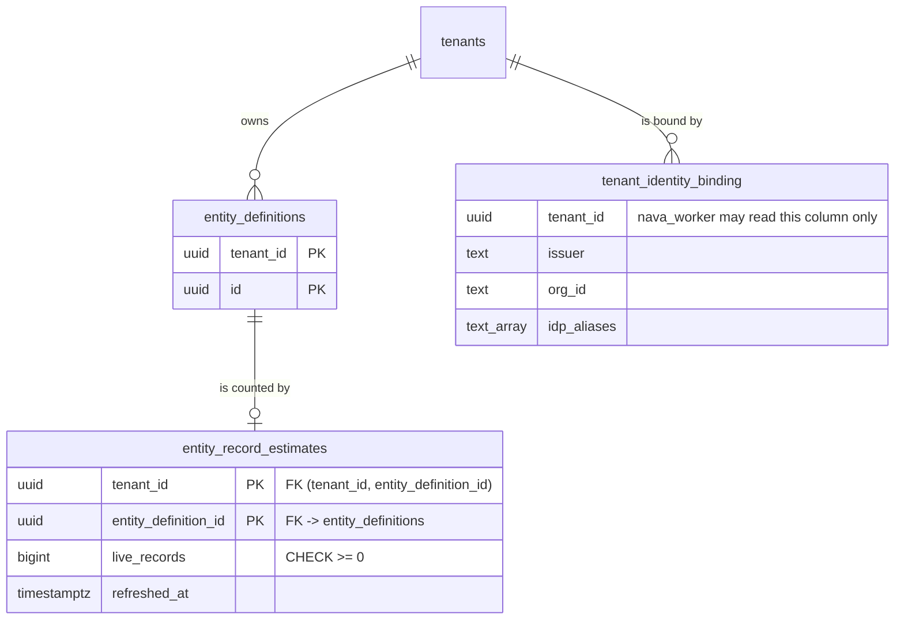

# entity_record_estimates: N-hat_e, the per-type record estimate

TICK-1070 (S31), from ADR-010-A2 A2-9 and PLAN-011-A2 D-11A2-2. Migrations:
`db/migrations/20261121163600_entity_record_estimates.sql` and
`db/migrations/20261121163700_binding_lookup_worker.sql`.

## What it is for

The `under` list leaf picks its SQL shape from K\* = clamp(0.8 × √(page × N̂_e),
1,000, 20,000), where N̂_e is the number of live records of entity type `e` in
the tenant (A2-5, A2-5a). No per-tenant, per-type count existed before:
`record_counters` is the numbering sequence and is purged per period, and
`pg_stats_ext` would show one tenant other tenants' volumes.

This table holds N̂_e. The hourly refresh job (TICK-1071, `internal/estimates`
in `nava-worker`) writes it one tenant at a time, under that tenant's
`app.tenant_id`. The leaf reads one row by its key. A missing row means
"no estimate": K\* = 1,000, and the probe runs. A stale or wrong value changes
cost, never rows (A2-6).

## Model



| Decision | Why |
| --- | --- |
| PK `(tenant_id, entity_definition_id)` is the only index | The reader looks one row up by the full key. The job's upsert arbitrates on it. No other access path exists. |
| FK `(tenant_id, entity_definition_id)` → `entity_definitions`, no action | The FK carries `tenant_id`, so a row can only name its own tenant's type. No runtime role deletes `entity_definitions`. |
| `live_records bigint CHECK (live_records >= 0)` | It is a `count(*)`. |
| No `DELETE` policy or grant | A type's row is overwritten, never removed. |
| Exempt from audit (`db/audited-tables.yaml`) | Derived data, not configuration. It holds no fact of its own. |

## Access

ENABLE + FORCE RLS. Every policy uses the canonical `app.tenant_id` predicate,
with one command per policy.

| Role | Grant | Policy |
| --- | --- | --- |
| `nava_app` | `SELECT` | `entity_record_estimates_select` |
| `nava_worker` | `SELECT`, `INSERT`, `UPDATE (live_records, refreshed_at)` | `_select`, `_insert` (WITH CHECK), `_update` (USING and WITH CHECK) |
| `nava_groupsync`, `nava_relay`, `nava_purge`, `nava_onboard` | none | none |

The job's write:

```sql
INSERT INTO entity_record_estimates (tenant_id, entity_definition_id, live_records, refreshed_at)
VALUES ($1, $2, $3, $4)
ON CONFLICT (tenant_id, entity_definition_id)
DO UPDATE SET live_records = EXCLUDED.live_records, refreshed_at = EXCLUDED.refreshed_at;
```

The INSERT's WITH CHECK runs on the proposed row before the conflict arbiter.
So an upsert of another tenant's key fails with 42501, even when that tenant's
row exists.

### Listing tenants (D-11A2-2)

The job must list tenants without a cross-tenant read on `records` or
`tenants`. It reads `SELECT DISTINCT tenant_id FROM tenant_identity_binding`
through `binding_lookup`, the ADR-001 A.3 allow-listed policy (`USING (true)`)
that tenant resolution and group sync already use. The second migration adds
`nava_worker` to that policy's roles. `db/grants.yaml` grants the worker
`SELECT (tenant_id)` only, so the issuer, org id and aliases stay out of its
reach. The roles are pinned in `catalog.AllowList` (`BindingLookupRoles`).
Editing them needs CTO sign-off (PLAN-001 D-P10).

The binding table can list every tenant the job must refresh:
- Onboarding writes the binding while the tenant is provisioning
  (`onboard.PGStore.Bind`), before the tenant can be activated.
- A record is written only after a token resolves to a tenant through its
  binding.
- No role holds `DELETE` on the table.

A tenant can hold more than one binding, hence the `DISTINCT`.

## Cost

Measured: nothing yet. This change landed during the S31 bench-window hold,
when no container could start on the bench host. The figures below are
calculated, not measured:
- **Size.** About 80 bytes of heap per row (a 24-byte header plus 48 bytes of
  data, aligned), and about 56 bytes per PK index entry. There is one row per
  (tenant, entity type), so 400 tenants with 50 types each is 20,000 rows,
  about 1.6 MB of heap and 1.1 MB of index.
- **Write amplification.** One heap row and one PK entry per type per hour.
  An unchanged count still writes a new row version, since the upsert always
  sets `refreshed_at`. The FK check reads `entity_definitions_pkey` once per
  write.
- **Read.** One PK lookup per `under` leaf on a list request.

TICK-1036 records the read's plan in its own benchmark. `EXPLAIN (ANALYZE,
BUFFERS)` of the PK lookup can be added here once the hold lifts.

## Migration safety

- **The table.** It is new. The FK's `ALTER` takes a SHARE ROW EXCLUSIVE lock
  on `entity_definitions`, which blocks publishes but not reads, for the
  length of the DDL. `lock_timeout = 5s` fails the migration rather than
  queue behind a long publish.
- **`ALTER POLICY binding_lookup`.** It takes an ACCESS EXCLUSIVE lock on
  `tenant_identity_binding`, but only for the catalogue update. Tenant
  resolution reads that table on every request, so `lock_timeout = 5s`
  fails the migration rather than queue those reads behind it.
- **No backfill.** A missing row is a valid state: the job fills the table on
  its first run.
