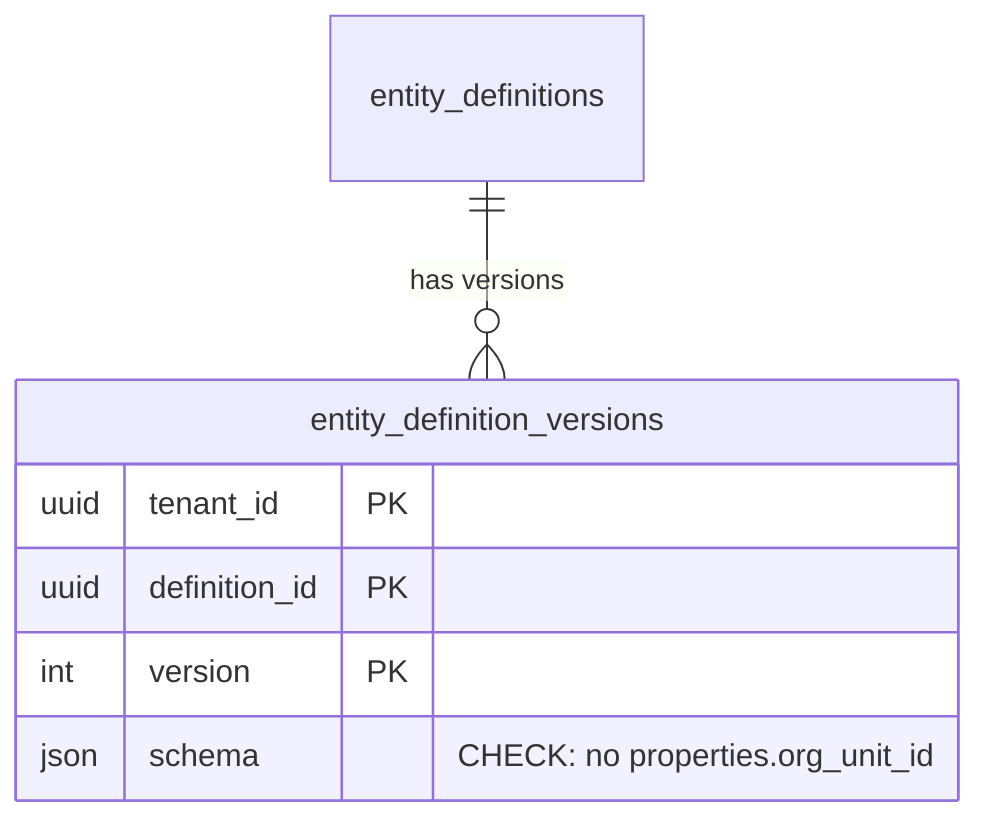

# No stored entity version has a top-level `org_unit_id` property (TICK-1115)

Migration: `db/migrations/20261125040000_entity_versions_org_unit_id_reserved.sql`.
Tests: `internal/db/dbtest/entity_versions_org_unit_id_test.go` and
`internal/server/entitytypes_org_unit_id_integration_test.go`. Benchmark:
`scratch/tick-1115-org-unit-id-guard/` (`bench.sh`, output in `bench-out.txt`).

## Decision

S31 reserves the property name `org_unit_id` (ADR-010 D8). `Compile` refuses it
and also loads stored versions, and earlier releases accepted it. A CHECK on
`entity_definition_versions` stops the upgrade when a stored version has it,
because the API cannot repair such a version: publish compiles the previous
version first. The CHECK also refuses a publish by a replica of the previous
release between the migration and the rollout.

## Why the expression replaces escapes first

`json ->` de-escapes the whole document. It raises `22P05` on a `\u0000` escape
and `22P02` on a lone surrogate, wherever they are. The `json` column stores
both. The API reads a type whose stored version holds a `\u0000` (measured:
200), so such a row must not block an upgrade.

| Step | Replaces | Why |
| --- | --- | --- |
| 1 | an escaped backslash (two characters) | A backslash left after it starts an escape |
| 2 | `\u0000` | `22P05` |
| 3 | `\ud` and `\uD` | Covers every surrogate, `22P02` when alone |

Each becomes `?`. Neither `properties` nor `org_unit_id` holds a `?`, so a
replaced key never becomes one of them. Any other escape stays, so
`\u006frg_unit_id` is found.

## Evidence

PostgreSQL 16.10 in Docker Desktop (16 vCPUs of an Intel Core i7-1260P, 24 GB),
`shared_buffers` 1 GB, three runs, 10,000 rows. The host also ran the local
stack and other agents' containers, so compare the columns, not the absolute
times, with a quiet host.

| `ADD CONSTRAINT` scan, under ACCESS EXCLUSIVE | Plain `->` | Chosen |
| --- | --- | --- |
| Plain schemas, 2.4 kB each | 1,383 / 1,413 / 1,944 ms | 2,884 / 2,628 / 4,176 ms |
| Escape-dense, 28 kB average, 2,000 rows of 122 kB | 9,994 / 7,132 / 7,789 ms | 20,436 / 14,089 / 12,294 ms |

- **Insert:** 10,000 plain rows take 72 / 50 / 111 ms without the CHECK and
  1,630 / 1,650 / 2,383 ms with it, so 0.16 to 0.23 ms per publish.
- **Storage:** none. No index is added and no column changes.
- **Answers:** 12 schemas built from bytes (`chr(92)`) all give the expected
  answer, escaped key letters and an escaped surrogate pair included.
- `lock_timeout` bounds the wait for the lock, not the scan.

## Rollout

If the migration is refused (`23514`, the constraint's name), run the query in
the migration's header as a superuser to list the versions. No data is changed
by Up or Down.
