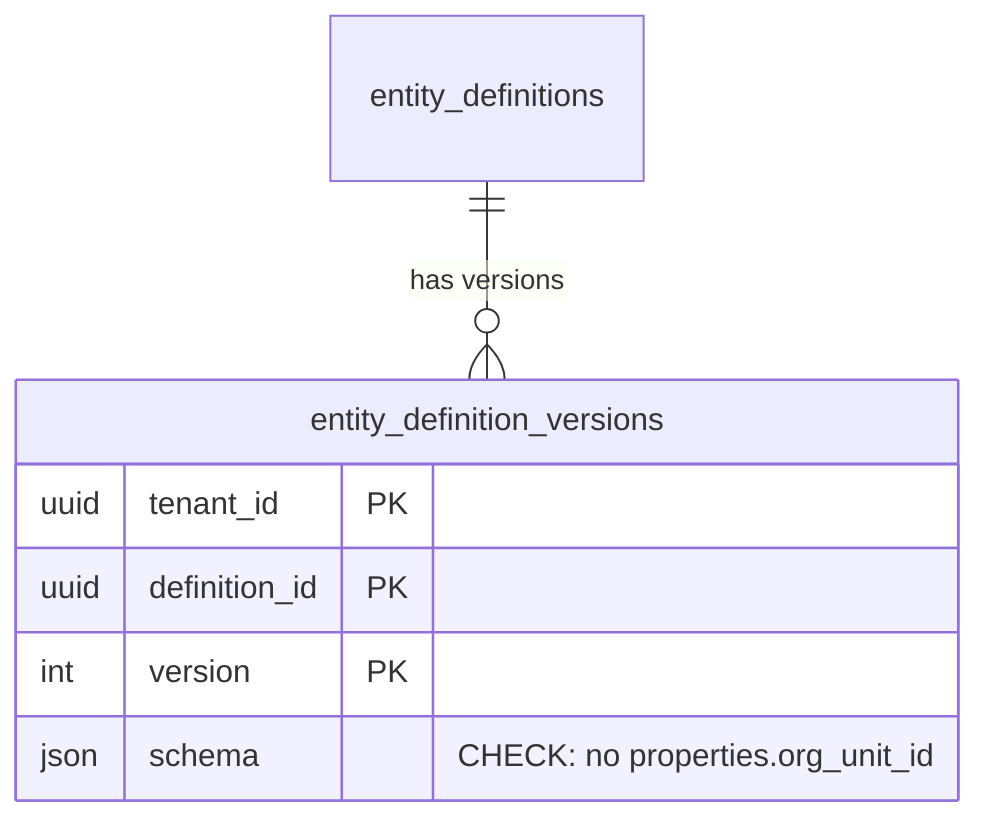

# No stored entity version has a top-level `org_unit_id` property (TICK-1115)

Migration: `db/migrations/20261120235900_entity_versions_org_unit_id_reserved.sql`.
Tests: `internal/db/dbtest/entity_versions_org_unit_id_test.go` and
`internal/server/entitytypes_org_unit_id_integration_test.go`. Benchmark:
`scratch/tick-1115-org-unit-id-guard/` (`bench.sh`, output in `bench-out.txt`).

## Decision

S31 reserves the property name `org_unit_id` (ADR-010 D8). `Compile` refuses it
and also loads stored versions, and earlier releases accepted it. A CHECK on
`entity_definition_versions` stops the upgrade when a stored version has it,
because the API cannot repair such a version: publish compiles the previous
version first. The CHECK also refuses a publish by a replica of the previous
release between the migration and the rollout.



## Why it is S31's first migration

`migrate.Run` returns at a refused migration, before it applies
`db/grants.yaml`, and every earlier migration stays committed. Stamped after
the other 11 S31 migrations, a refusal left them applied without their grants.
`20261121161036` replaces `acl2_problem` and calls functions `nava_app` may not
execute, so every tenant's access publish failed with `42501` until one
tenant's row was repaired (Security review on TICK-1115, PostgreSQL 16.10).
Stamped `20261120235900`, after `main`'s newest migration and before S31's
first, a refusal leaves nothing of S31 applied. If `main` gets a newer
migration before S31 ships, every S31 migration is re-stamped and this one
stays first. `TestTICK1115RefusalAppliesNothingOfS31` fails if it does not.

A long-lived database that applied this file under its old stamp
(`20261125040000`, story branch only) must be rebuilt.

## Why the expression replaces escapes first

`json ->` de-escapes the whole document. It raises `22P05` on a `\u0000` escape
and `22P02` on a lone surrogate, wherever they are. The `json` column stores
both. The API reads a type whose stored version holds a `\u0000` (measured:
200), so such a row must not block an upgrade.

| Step | Replaces | Why |
| --- | --- | --- |
| 1 | an escaped backslash (two characters) | A backslash left after it starts an escape |
| 2 | `\u0000` | `22P05` |
| 3 | `\ud` and `\uD` | Covers every surrogate, `22P02` when alone |

Each becomes `?`. Neither `properties` nor `org_unit_id` holds a `?`, so a
replaced key never becomes one of them. Any other escape stays, so
`\u006frg_unit_id` is found.

## Evidence

PostgreSQL 16.10 in Docker Desktop (16 vCPUs of an Intel Core i7-1260P, 24 GB),
`shared_buffers` 1 GB, three runs, 10,000 rows. The host also ran the local
stack and other agents' containers, so compare the columns, not the absolute
times, with a quiet host.

| `ADD CONSTRAINT` scan, under ACCESS EXCLUSIVE | Plain `->` | Chosen |
| --- | --- | --- |
| Plain schemas, 2.4 kB each | 1,383 / 1,413 / 1,944 ms | 2,884 / 2,628 / 4,176 ms |
| Escape-dense, 28 kB average, 2,000 rows of 122 kB | 9,994 / 7,132 / 7,789 ms | 20,436 / 14,089 / 12,294 ms |

- **Insert:** 10,000 plain rows take 72 / 50 / 111 ms without the CHECK and
  1,630 / 1,650 / 2,383 ms with it, so 0.16 to 0.23 ms per publish.
- **Storage:** none. No index is added and no column changes.
- **Answers:** 12 schemas built from bytes (`chr(92)`) all give the expected
  answer, escaped key letters and an escaped surrogate pair included.
- `lock_timeout` bounds the wait for the lock, not the scan.

## Rollout

If the migration is refused (`23514`, the constraint's name), run the query in
the migration's header as a superuser to list the versions. Nothing of S31 is
applied; the Security review measured access publish and record create on the
running release as still accepted. No data is changed by Up or Down.

## Pre-upgrade check and repair (TICK-1125)

The upgrade to S31 refuses a stored version with a top-level `org_unit_id`.
The API cannot repair one: versions are immutable and audited, and publish
compiles the previous version first. This section is for an operator: check
the database on the release before S31, and repair it when the check finds a
refused version. The tests run the SQL below from this file (`TestTICK1125*` in
`internal/db/dbtest/entity_versions_org_unit_id_repair_test.go` and
`internal/server/entitytypes_org_unit_id_integration_test.go`).

### Check

Run as a superuser, because RLS hides the rows from every other role.

```sql tick-1125-check
SELECT v.tenant_id, v.definition_id AS type_id, d.key, v.version, v.version = d.current_version AS is_current
FROM public.entity_definition_versions v
JOIN public.entity_definitions d ON d.tenant_id = v.tenant_id AND d.id = v.definition_id
WHERE (replace(replace(replace(replace(v.schema::text,
    '\\', '?'), '\u0000', '?'), '\ud', '?'), '\uD', '?')::json
    -> 'properties' -> 'org_unit_id') IS NOT NULL
ORDER BY 1, 2, 4;

SELECT count(*) AS versions, coalesce(sum(octet_length(schema::text)), 0) AS schema_bytes
FROM public.entity_definition_versions;
```

| The check shows | Do |
| --- | --- |
| No row, under 10,000 versions and under 256 MiB (268,435,456 bytes) | Upgrade as usual |
| A row | Repair that type, see below |
| 10,000 versions or more, or 256 MiB or more | Stop and ask the Technical Lead. The guard would be split into `NOT VALID` plus `VALIDATE` |

The guard scans every version under `ACCESS EXCLUSIVE`, and a tenant chooses
both figures. 256 MiB is just below the largest size measured (280 MB, 12.3 to
20.4 s, loaded host). The version limit alone allows 1.2 GiB.

The second refusal of the upgrade, AR-S30-01 (`20261121000100`), is checked in
the same step:

```sql tick-1125-ar-s30-01
SELECT DISTINCT a.tenant_id, a.entity_definition_id, a.version, x.id AS org_unit_id
FROM public.acl_versions a
CROSS JOIN LATERAL (
    SELECT v #>> '{}' AS id
    FROM jsonb_path_query(a.rules, 'lax $.**.under ? (@.of.type() == "array").of[*]') v) x
WHERE NOT EXISTS (
    SELECT 1 FROM public.org_units o WHERE o.tenant_id = a.tenant_id AND o.id::text = lower(x.id))
ORDER BY 1, 2, 3, 4;
```

It lists each stored `under` id that is not an org unit of the row's tenant. It
is written for the release before S31, where `org_units.deleted_at` does not
exist. It compares text, so an id that is not a UUID is listed and raises
nothing. After a refusal at `20261121000100` the column does exist, and the
query does not read it. That matters only if S31's group sync was started
early: a unit it tombstoned is refused by the migration and not listed here.
**If it lists a row, do not migrate: ask the Technical Lead.** A
refusal there leaves the guard and `20261121000000` applied. Until the upgrade
finishes, the old group sync deletes no removed org unit and reports no error;
access publishing still works.

### Order of work

This order applies only when the check finds a refused version. Otherwise the
normal upgrade order holds.

1. **Stop** every replica of `nava-core` and `nava-worker`. `nava-relay`,
   `nava-purge`, `nava-groupsync` and `nava-onboard` may stay up.
2. **Check.**
3. **Repair**, once per tenant and type in the check's output.
4. **Check** again.
5. **`migrate`.**
6. **Start** the services.

The services stay down until `migrate` ends, because the old release still
accepts the name: a tenant could publish it again.

### Repair

One tenant and one type per run, as a superuser, in two pastes in one open
transaction. It renames the property in the type's refused versions and in its
records. It bypasses no trigger and no constraint. It bypasses RLS only for the
superuser's reads in paste 1 and for one UPDATE in paste 2; versions are
immutable only because no role has UPDATE on them.

In psql, run `\set ON_ERROR_ROLLBACK off` first. Then set the five inputs at
the top of paste 1. Only paste 1 reads them: the plan keeps the tenant id, type
id, new name and `source_ref` that were checked, and paste 2 takes them from
the plan. To change an input, type `ROLLBACK` and paste 1 again.

| Input | Value |
| --- | --- |
| `tenant_id`, `type_id` | From the check |
| `new_name` | `old_unit_id`, or another name that matches `^old_[a-z0-9_]{1,7}$`. 11 bytes at most, the length of the old name, so no size limit can be crossed |
| `source_ref` | Change ticket, `/`, run id, such as `CHG-12/run-1`. Letters, digits and `-` only; no person's name |
| `record_limit` | Leave it at 100,000, the largest size measured |

**Paste 1** checks and lists. It writes to no platform table.

```sql tick-1125-paste-1
BEGIN ISOLATION LEVEL READ COMMITTED;
SET LOCAL search_path = pg_catalog, public, pg_temp;
SET LOCAL lock_timeout = '5s';
SET LOCAL idle_in_transaction_session_timeout = '10min';
SELECT set_config('nava_repair.tenant_id', '<tenant id>', true);
SELECT set_config('nava_repair.type_id', '<type id>', true);
SELECT set_config('nava_repair.new_name', 'old_unit_id', true);
SELECT set_config('nava_repair.source_ref', '<change ticket>/<run id>', true);
SELECT set_config('nava_repair.record_limit', '100000', true);
CREATE TEMP TABLE nava_repair_plan (
    kind text NOT NULL, -- inputs, version, fixed_columns or triggers
    tenant_id uuid,
    type_id uuid,
    new_name text,
    source_ref text,
    version integer,
    new_schema text,
    new_sha256 bytea,
    new_fixed_columns jsonb,
    entry_id uuid,
    content_sha256 bytea,
    salt bytea,
    diff text,
    truncated boolean,
    triggers jsonb
) ON COMMIT DROP;
CREATE TEMP TABLE nava_repair_records (
    id uuid NOT NULL,
    version bigint NOT NULL,
    entry_id uuid NOT NULL,
    salt bytea NOT NULL,
    diff text NOT NULL,
    truncated boolean NOT NULL,
    loses_history_page boolean NOT NULL
) ON COMMIT DROP;
GRANT SELECT ON nava_repair_plan, nava_repair_records TO nava_app;
DO $nava_repair$
DECLARE
    c_old CONSTANT text := 'org_unit_id';
    -- audit.MaxDiffBytes
    c_max CONSTANT integer := 65536;
    c_tokens CONSTANT text[] := ARRAY['AKIA', 'ASIA', 'ghp_', 'gho_', 'ghu_', 'ghs_', 'ghr_', 'github_pat_',
        'xox', '-----BEGIN', 'eyJ'];
    v_tenant uuid;
    v_type uuid;
    v_new text;
    v_ref text;
    v_limit bigint;
    v_refused integer[];
    v_column text;
    v_count bigint;
    v_rows text;
BEGIN
    -- 0. The lock, inside this block: see "Why" below.
    IF current_setting('transaction_isolation') <> 'read committed' THEN
        RAISE EXCEPTION 'the transaction is not READ COMMITTED';
    END IF;
    PERFORM set_config('app.tenant_id', coalesce(current_setting('nava_repair.tenant_id', true), ''), true);
    IF current_setting('lock_timeout') <> '5s' THEN
        RAISE EXCEPTION 'lock_timeout is not 5s';
    END IF;
    LOCK TABLE public.entity_definition_versions IN ACCESS EXCLUSIVE MODE;

    -- 1. The session and the inputs. A plan of an earlier paste 1 in this
    -- transaction is never added to.
    IF EXISTS (SELECT 1 FROM pg_temp.nava_repair_plan) OR EXISTS (SELECT 1 FROM pg_temp.nava_repair_records) THEN
        RAISE EXCEPTION 'the plan already has rows: type ROLLBACK, then paste 1 again';
    END IF;
    IF current_setting('session_replication_role') <> 'origin' THEN
        RAISE EXCEPTION 'session_replication_role is not origin: triggers would not fire';
    END IF;
    IF coalesce(current_setting('nava_repair.tenant_id', true), '') !~ '^[0-9a-f]{8}(-[0-9a-f]{4}){3}-[0-9a-f]{12}$' THEN
        RAISE EXCEPTION 'tenant_id is not a lowercase UUID';
    END IF;
    IF coalesce(current_setting('nava_repair.type_id', true), '') !~ '^[0-9a-f]{8}(-[0-9a-f]{4}){3}-[0-9a-f]{12}$' THEN
        RAISE EXCEPTION 'type_id is not a lowercase UUID';
    END IF;
    IF coalesce(current_setting('nava_repair.new_name', true), '') COLLATE "C" !~ '^old_[a-z0-9_]{1,7}$' THEN
        RAISE EXCEPTION 'new_name does not match ^old_[a-z0-9_]{1,7}$';
    END IF;
    IF coalesce(current_setting('nava_repair.source_ref', true), '') COLLATE "C" !~ '^[A-Za-z0-9-]+/[A-Za-z0-9-]+$' THEN
        RAISE EXCEPTION 'source_ref is not <change ticket>/<run id>';
    END IF;
    IF coalesce(current_setting('nava_repair.record_limit', true), '') !~ '^[0-9]{1,9}$' THEN
        RAISE EXCEPTION 'record_limit is not a number';
    END IF;
    v_tenant := current_setting('nava_repair.tenant_id')::uuid;
    v_type := current_setting('nava_repair.type_id')::uuid;
    v_new := current_setting('nava_repair.new_name');
    v_ref := current_setting('nava_repair.source_ref');
    v_limit := current_setting('nava_repair.record_limit')::bigint;

    -- 2. The type is the tenant's.
    IF NOT EXISTS (SELECT 1 FROM public.entity_definitions d WHERE d.tenant_id = v_tenant AND d.id = v_type) THEN
        RAISE EXCEPTION 'type % is not a type of tenant %', v_type, v_tenant;
    END IF;

    -- 3. The refused versions, with the guard's own expression.
    SELECT array_agg(v.version ORDER BY v.version) INTO v_refused
    FROM public.entity_definition_versions v
    WHERE v.tenant_id = v_tenant AND v.definition_id = v_type
      AND (replace(replace(replace(replace(v.schema::text,
          '\\', '?'), '\u0000', '?'), '\ud', '?'), '\uD', '?')::json
          -> 'properties' -> 'org_unit_id') IS NOT NULL;
    IF v_refused IS NULL THEN
        RAISE NOTICE 'nothing to repair';
        RETURN;
    END IF;

    -- 4. The refusals.
    SELECT string_agg(format('version %s', v.version), ', ' ORDER BY v.version) INTO v_rows
    FROM public.entity_definition_versions v
    WHERE v.tenant_id = v_tenant AND v.definition_id = v_type
      AND (NOT pg_input_is_valid(v.schema::text, 'jsonb') OR v.schema::text IS NOT JSON WITH UNIQUE KEYS);
    IF v_rows IS NOT NULL THEN
        RAISE EXCEPTION 'R6: a schema holds an escape, a number or a duplicate key that jsonb cannot keep'
            USING ERRCODE = 'P0001', DETAIL = v_rows;
    END IF;

    SELECT string_agg(format('version %s', v.version), ', ' ORDER BY v.version) INTO v_rows
    FROM public.entity_definition_versions v
    WHERE v.tenant_id = v_tenant AND v.definition_id = v_type
      AND (v.version <> ALL (v_refused) AND v.fixed_columns ? c_old
           OR EXISTS (SELECT 1 FROM public.entity_definition_versions w
                      WHERE w.tenant_id = v_tenant AND w.definition_id = v_type
                        AND w.fixed_columns IS DISTINCT FROM v.fixed_columns));
    IF v_rows IS NOT NULL THEN
        RAISE EXCEPTION 'R8: the versions do not have the same fixed_columns, or a clean version maps the property'
            USING ERRCODE = 'P0001', DETAIL = v_rows;
    END IF;
    SELECT v.fixed_columns ->> c_old INTO v_column
    FROM public.entity_definition_versions v
    WHERE v.tenant_id = v_tenant AND v.definition_id = v_type AND v.version = v_refused[1];
    IF v_column NOT IN ('state', 'requester_id', 'assignee_id', 'assignment_group_id') THEN
        RAISE EXCEPTION 'R8: the property is mapped to a column this repair does not know'
            USING ERRCODE = 'P0001', DETAIL = format('version %s', v_refused[1]);
    END IF;

    IF v_column IS NOT NULL THEN
        SELECT string_agg(format('record %s', r.id), ', ' ORDER BY r.id) INTO v_rows
        FROM public.records r
        WHERE r.tenant_id = v_tenant AND r.entity_definition_id = v_type AND r.data ? c_old;
        IF v_rows IS NOT NULL THEN
            RAISE EXCEPTION 'R11: the property is mapped to a column and a record holds it in data too'
                USING ERRCODE = 'P0001', DETAIL = v_rows;
        END IF;
    END IF;

    SELECT string_agg(format('entry %s', a.id), ', ' ORDER BY a.id) INTO v_rows
    FROM public.audit_log a
    WHERE a.tenant_id = v_tenant AND a.occurred_at >= now()
      AND a.domain = 'record' AND a.entity_definition_id = v_type;
    IF v_rows IS NOT NULL THEN
        RAISE EXCEPTION 'R9: a record entry of the type is not older than this transaction; run the repair again'
            USING ERRCODE = 'P0001', DETAIL = v_rows;
    END IF;
    PERFORM pg_stat_clear_snapshot();
    SELECT string_agg(format('backend %s of %s', s.pid, s.usename), ', ' ORDER BY s.pid) INTO v_rows
    FROM pg_stat_activity s
    WHERE s.datname = current_database() AND s.usename IN ('nava_app', 'nava_worker')
      AND s.pid <> pg_backend_pid() AND s.xact_start < now();
    IF v_rows IS NOT NULL THEN
        RAISE EXCEPTION 'R9: a service transaction is older than this one; run the repair again'
            USING ERRCODE = 'P0001', DETAIL = v_rows;
    END IF;

    SELECT count(*) INTO v_count
    FROM public.records r
    WHERE r.tenant_id = v_tenant AND r.entity_definition_id = v_type
      AND CASE v_column WHEN 'state' THEN to_jsonb(r.state) WHEN 'requester_id' THEN to_jsonb(r.requester_id)
          WHEN 'assignee_id' THEN to_jsonb(r.assignee_id) WHEN 'assignment_group_id' THEN to_jsonb(r.assignment_group_id)
          ELSE r.data -> c_old END IS NOT NULL;
    IF v_count > v_limit THEN
        RAISE EXCEPTION 'R10: more records hold the property than record_limit allows; ask the Technical Lead'
            USING ERRCODE = 'P0001', DETAIL = format('%s records, limit %s', v_count, v_limit);
    END IF;

    SELECT string_agg(format('access version %s', a.version), ', ') INTO v_rows
    FROM (SELECT x.version, x.masks FROM public.acl_versions x
          WHERE x.tenant_id = v_tenant AND x.entity_definition_id = v_type
          ORDER BY x.version DESC LIMIT 1) a
    WHERE EXISTS (SELECT 1 FROM jsonb_array_elements(a.masks) m WHERE m ->> 'field' IN (c_old, v_new));
    IF v_rows IS NOT NULL THEN
        RAISE EXCEPTION 'R1: a mask names the old or the new name; stop and ask the Technical Lead and Security'
            USING ERRCODE = 'P0001', DETAIL = v_rows;
    END IF;

    SELECT string_agg(format('workflow %s version %s', d.id, v.version), ', ' ORDER BY d.id, v.version) INTO v_rows
    FROM public.workflow_definitions d
    JOIN public.workflow_definition_versions v ON v.tenant_id = d.tenant_id AND v.definition_id = d.id
    WHERE d.tenant_id = v_tenant AND v_type IN (d.entity_definition_id, v.trigger_entity_definition_id)
      AND (v.version = d.current_version
           OR EXISTS (SELECT 1 FROM public.workflow_ref w
                      JOIN public.records r ON r.tenant_id = w.tenant_id AND r.id = w.record_id
                      WHERE w.tenant_id = v_tenant AND w.closed_at IS NULL AND r.entity_definition_id = v_type))
      AND CASE WHEN NOT pg_input_is_valid(v.body::text, 'jsonb') THEN true
          ELSE EXISTS (
              SELECT 1 FROM jsonb_path_query(v.body::jsonb, '$.**') n (node)
              WHERE jsonb_typeof(n.node) = 'object'
                AND (n.node -> 'set' ?| ARRAY[c_old, v_new]
                     OR split_part(n.node ->> 'field', '/', 2) IN (c_old, v_new))) END;
    IF v_rows IS NOT NULL THEN
        RAISE EXCEPTION 'R2: a workflow names the old or the new name'
            USING ERRCODE = 'P0001', DETAIL = v_rows;
    END IF;

    SELECT string_agg(format('version %s', v.version), ', ' ORDER BY v.version) INTO v_rows
    FROM public.entity_definition_versions v
    CROSS JOIN LATERAL (SELECT v.schema::jsonb -> 'properties' -> c_old AS prop) p
    WHERE v.tenant_id = v_tenant AND v.definition_id = v_type
      AND EXISTS (SELECT 1 FROM jsonb_each(CASE WHEN jsonb_typeof(p.prop) = 'object' THEN p.prop END) e
                  WHERE replace(lower(e.key COLLATE "C"), 'ſ', 's') IN ('x-nava-secret', 'writeonly')
                    AND e.value <> 'false');
    IF v_rows IS NOT NULL THEN
        RAISE EXCEPTION 'R3: the property is marked x-nava-secret or writeOnly'
            USING ERRCODE = 'P0001', DETAIL = v_rows;
    END IF;

    SELECT string_agg(c.what, ', ' ORDER BY c.what) INTO v_rows
    FROM (
        SELECT format('version %s', v.version) AS what
        FROM public.entity_definition_versions v
        WHERE v.tenant_id = v_tenant AND v.definition_id = v_type AND v.schema::jsonb -> 'properties' ? v_new
        UNION ALL
        SELECT format('record %s', r.id)
        FROM public.records r
        WHERE r.tenant_id = v_tenant AND r.entity_definition_id = v_type AND r.data ? v_new
        UNION ALL
        SELECT format('entry %s', a.id)
        FROM public.audit_log a
        WHERE a.tenant_id = v_tenant AND a.domain = 'record' AND a.entity_definition_id = v_type
          AND a.diff IS NOT NULL
          AND CASE WHEN NOT pg_input_is_valid(a.diff::text, 'jsonb') THEN true
              ELSE EXISTS (
                  SELECT 1 FROM jsonb_path_query(a.diff::jsonb, '$[*]') o (op)
                  WHERE v_new IN (split_part(o.op ->> 'path', '/', 2), split_part(o.op ->> 'from', '/', 2))
                     OR o.op ->> 'path' = '' AND o.op -> 'value' ? v_new) END) c;
    IF v_rows IS NOT NULL THEN
        RAISE EXCEPTION 'R4: the new name is already used; choose another'
            USING ERRCODE = 'P0001', DETAIL = v_rows;
    END IF;

    -- s.doc is the schema without the two places the rename changes, beside
    -- the property's own schema.
    SELECT string_agg(format('version %s', s.version), ', ' ORDER BY s.version) INTO v_rows
    FROM (
        SELECT v.version, jsonb_build_array(
            CASE WHEN jsonb_typeof(d.doc) <> 'object' THEN d.doc
                WHEN jsonb_typeof(d.doc -> 'required') = 'array'
                    THEN jsonb_set(d.doc, '{required}', (d.doc -> 'required') - c_old) #- ARRAY['properties', c_old]
                ELSE d.doc #- ARRAY['properties', c_old] END,
            d.doc -> 'properties' -> c_old) AS doc
        FROM public.entity_definition_versions v
        CROSS JOIN LATERAL (SELECT v.schema::jsonb AS doc) d
        WHERE v.tenant_id = v_tenant AND v.definition_id = v_type) s
    WHERE EXISTS (
        SELECT 1
        FROM jsonb_path_query(s.doc, '$.**') n (node)
        CROSS JOIN LATERAL (
            SELECT e.key, e.value FROM jsonb_each(CASE WHEN jsonb_typeof(n.node) = 'object' THEN n.node END) e
            UNION ALL
            SELECT NULL, i.value FROM jsonb_array_elements(CASE WHEN jsonb_typeof(n.node) = 'array' THEN n.node END) i) m
        WHERE strpos(m.key, c_old) > 0 OR strpos(m.key, v_new) > 0
           OR m.key IN ('propertyNames', 'patternProperties')
           OR jsonb_typeof(m.value) = 'string' AND (
               m.key IN ('$ref', '$dynamicRef') AND strpos(m.value #>> '{}', '%') > 0
               OR coalesce(m.key NOT IN ('title', 'description', '$comment'), true)
                   AND (strpos(m.value #>> '{}', c_old) > 0 OR strpos(m.value #>> '{}', v_new) > 0)));
    IF v_rows IS NOT NULL THEN
        RAISE EXCEPTION 'R5: a schema may refer to the old or the new name elsewhere'
            USING ERRCODE = 'P0001', DETAIL = v_rows;
    END IF;

    SELECT string_agg(c.what, ', ' ORDER BY c.what) INTO v_rows
    FROM (
        SELECT format('version %s', v.version) AS what, p.prop AS value, p.prop::text AS schema_text
        FROM public.entity_definition_versions v
        CROSS JOIN LATERAL (SELECT v.schema::jsonb -> 'properties' -> c_old AS prop) p
        WHERE v.tenant_id = v_tenant AND v.definition_id = v_type
        UNION ALL
        SELECT format('record %s', r.id), CASE v_column WHEN 'state' THEN to_jsonb(r.state) ELSE r.data -> c_old END, ''
        FROM public.records r
        WHERE r.tenant_id = v_tenant AND r.entity_definition_id = v_type) c
    WHERE CASE jsonb_typeof(c.value)
          WHEN 'string' THEN strpos(c.value #>> '{}', ':') > 0 AND strpos(c.value #>> '{}', '@') > 0
          WHEN 'object' THEN strpos(c.value::text, '@') > 0
          WHEN 'array' THEN strpos(c.value::text, '@') > 0
          ELSE false END
       OR EXISTS (SELECT 1 FROM unnest(c_tokens) t (token) WHERE strpos(c.schema_text, t.token) > 0);
    IF v_rows IS NOT NULL THEN
        RAISE EXCEPTION 'R7: a value or the property''s schema may hold what the audit log refuses'
            USING ERRCODE = 'P0001', DETAIL = v_rows;
    END IF;

    -- 5. The plan, with the inputs it was checked with. The schema text is
    -- rebuilt with json_each on json: nested values keep their bytes.
    INSERT INTO pg_temp.nava_repair_plan (kind, tenant_id, type_id, new_name, source_ref)
    VALUES ('inputs', v_tenant, v_type, v_new, v_ref);
    INSERT INTO pg_temp.nava_repair_plan (kind, version, new_schema, new_sha256, new_fixed_columns, entry_id,
        content_sha256, salt, diff, truncated)
    SELECT 'version', v.version, s.txt, sha256(convert_to(s.txt, 'UTF8')),
        CASE WHEN v.fixed_columns ? c_old
            THEN (v.fixed_columns - c_old) || jsonb_build_object(v_new, v.fixed_columns -> c_old)
            ELSE v.fixed_columns END,
        public.audit_seed_uuidv7(), sha256(convert_to(s.txt, 'UTF8')),
        substring(sha256(uuid_send(gen_random_uuid()) || uuid_send(gen_random_uuid())) FROM 1 FOR 16),
        d.diff, d.truncated
    FROM public.entity_definition_versions v
    CROSS JOIN LATERAL (
        SELECT '{' || string_agg(to_json(e.key)::text || ':' || CASE
            WHEN e.key = 'properties' THEN (
                SELECT '{' || string_agg(to_json(CASE p.key WHEN c_old THEN v_new ELSE p.key END)::text || ':' || p.value::text,
                    ',' ORDER BY p.n) || '}'
                FROM json_each(e.value) WITH ORDINALITY p (key, value, n))
            WHEN e.key = 'required' AND json_typeof(e.value) = 'array' THEN (
                SELECT '[' || coalesce(string_agg(
                    CASE WHEN q.value #>> '{}' = c_old THEN to_json(v_new)::text ELSE q.value::text END,
                    ',' ORDER BY q.n), '') || ']'
                FROM json_array_elements(e.value) WITH ORDINALITY q (value, n))
            ELSE e.value::text END, ',' ORDER BY e.n) || '}' AS txt
        FROM json_each(v.schema) WITH ORDINALITY e (key, value, n)) s
    CROSS JOIN LATERAL (
        SELECT '[' || coalesce(string_agg(o.op, ',' ORDER BY o.n) FILTER (WHERE o.size <= c_max), '') || ']' AS diff,
            bool_or(o.size > c_max) AS truncated
        FROM (
            SELECT u.op, u.n, 1 + sum(octet_length(u.op) + 1) OVER (ORDER BY u.n) AS size
            FROM (
                SELECT format('{"op":"add","path":"/properties/%s","value":%s}', v_new,
                    v.schema::jsonb -> 'properties' -> c_old) AS op, -2::bigint AS n
                UNION ALL
                SELECT format('{"op":"remove","path":"/properties/%s"}', c_old), -1
                UNION ALL
                SELECT format('{"op":"replace","path":"/required/%s","value":"%s"}', q.n - 1, v_new), q.n
                FROM jsonb_array_elements(CASE WHEN jsonb_typeof(v.schema::jsonb -> 'required') = 'array'
                    THEN v.schema::jsonb -> 'required' END) WITH ORDINALITY q (value, n)
                WHERE q.value = to_jsonb(c_old)) u) o) d
    WHERE v.tenant_id = v_tenant AND v.definition_id = v_type AND v.version = ANY (v_refused);

    IF v_column IS NOT NULL THEN
        INSERT INTO pg_temp.nava_repair_plan (kind, entry_id, content_sha256, salt, diff, truncated)
        SELECT 'fixed_columns', public.audit_seed_uuidv7(),
            sha256(convert_to(jsonb_build_object('fixed_columns', p.new_fixed_columns)::text, 'UTF8')),
            substring(sha256(uuid_send(gen_random_uuid()) || uuid_send(gen_random_uuid())) FROM 1 FOR 16),
            format('[{"op":"add","path":"/fixed_columns/%s","value":"%s"},{"op":"remove","path":"/fixed_columns/%s"}]',
                v_new, v_column, c_old),
            false
        FROM pg_temp.nava_repair_plan p
        WHERE p.kind = 'version' AND p.version = v_refused[1];
    END IF;

    INSERT INTO pg_temp.nava_repair_plan (kind, triggers)
    SELECT 'triggers', jsonb_object_agg(t.oid::text, t.tgenabled::text) FROM pg_trigger t;

    INSERT INTO pg_temp.nava_repair_records (id, version, entry_id, salt, diff, truncated, loses_history_page)
    SELECT r.id, r.version, public.audit_seed_uuidv7(),
        substring(sha256(uuid_send(gen_random_uuid()) || uuid_send(gen_random_uuid())) FROM 1 FOR 16),
        d.diff, d.truncated, coalesce(h.entries = 500, false)
    FROM public.records r
    CROSS JOIN LATERAL (
        SELECT CASE v_column WHEN 'state' THEN to_jsonb(r.state) WHEN 'requester_id' THEN to_jsonb(r.requester_id)
            WHEN 'assignee_id' THEN to_jsonb(r.assignee_id) WHEN 'assignment_group_id' THEN to_jsonb(r.assignment_group_id)
            ELSE r.data -> c_old END AS value) x
    CROSS JOIN LATERAL (
        SELECT '[' || coalesce(string_agg(o.op, ',' ORDER BY o.n) FILTER (WHERE o.size <= c_max), '') || ']' AS diff,
            bool_or(o.size > c_max) AS truncated
        FROM (
            SELECT u.op, u.n, 1 + sum(octet_length(u.op) + 1) OVER (ORDER BY u.n) AS size
            FROM unnest(ARRAY[
                format('{"op":"add","path":"/%s","value":%s}', v_new, x.value),
                format('{"op":"remove","path":"/%s"}', c_old)]) WITH ORDINALITY u (op, n)) o) d
    LEFT JOIN (
        SELECT a.subject_id, count(*) AS entries
        FROM public.audit_log a
        WHERE a.tenant_id = v_tenant AND a.domain = 'record' AND a.subject_type = 'record'
          AND a.action IN ('create', 'update', 'state_change')
        GROUP BY a.subject_id) h ON h.subject_id = r.id
    WHERE r.tenant_id = v_tenant AND r.entity_definition_id = v_type AND x.value IS NOT NULL;
END
$nava_repair$;
SELECT p.version AS version_to_change, p.truncated AS diff_truncated
FROM pg_temp.nava_repair_plan p WHERE p.kind = 'version' ORDER BY p.version;
SELECT count(*) AS records_to_change FROM pg_temp.nava_repair_records;
SELECT r.id AS record_losing_its_history_page FROM pg_temp.nava_repair_records r WHERE r.loses_history_page ORDER BY r.id;
SELECT r.id AS record_with_truncated_diff FROM pg_temp.nava_repair_records r WHERE r.truncated ORDER BY r.id;
```

Read the four lists. **Nothing is written yet, and the transaction is open.**

- **Versions and records** that will change. No version and no record, with
  `nothing to repair`, means there is nothing to do.
- **Records losing their history page:** they have exactly 500 history entries,
  the cap, and the repair adds one.
- **Truncated diffs:** a record's history is unknown from the repair's entry on.

To stop, type `ROLLBACK`. The session also ends after 10 idle minutes. To go
on, paste the second block.

**Paste 2** writes, or does nothing when the plan is empty. It reads no input:
everything comes from the plan.

```sql tick-1125-paste-2
DO $nava_repair$
DECLARE
    c_old CONSTANT text := 'org_unit_id';
    v_tenant uuid;
    v_type uuid;
    v_new text;
    v_ref text;
    v_want bigint;
    v_got bigint;
    v_versions bigint;
    v_records bigint;
BEGIN
    IF NOT EXISTS (SELECT 1 FROM pg_temp.nava_repair_plan p WHERE p.kind = 'version') THEN
        RAISE NOTICE 'the plan is empty: nothing is written';
        RETURN;
    END IF;
    SELECT p.tenant_id, p.type_id, p.new_name, p.source_ref INTO STRICT v_tenant, v_type, v_new, v_ref
    FROM pg_temp.nava_repair_plan p WHERE p.kind = 'inputs';
    PERFORM set_config('app.tenant_id', v_tenant::text, true);

    -- 1. Triggers fire.
    IF current_setting('session_replication_role') <> 'origin' THEN
        RAISE EXCEPTION 'session_replication_role is not origin: triggers would not fire';
    END IF;

    -- 2. The one superuser write.
    UPDATE public.entity_definition_versions v
    SET schema = p.new_schema::json, schema_sha256 = p.new_sha256, fixed_columns = p.new_fixed_columns
    FROM pg_temp.nava_repair_plan p
    WHERE v.tenant_id = v_tenant AND v.definition_id = v_type AND p.kind = 'version' AND v.version = p.version;
    GET DIAGNOSTICS v_got = ROW_COUNT;
    SELECT count(*) INTO v_want FROM pg_temp.nava_repair_plan p WHERE p.kind = 'version';
    IF v_got <> v_want THEN
        RAISE EXCEPTION 'updated % versions, planned %', v_got, v_want;
    END IF;
    v_versions := v_got;

    -- 3. nava_app until COMMIT, so RLS scopes the rest and the commit check
    -- runs under it.
    PERFORM set_config('role', 'nava_app', true);

    -- 4. The entries and the records.
    INSERT INTO public.audit_log (tenant_id, id, domain, action, subject_type, subject_id, version_before, version_after,
        actor_system, source, source_ref, content_sha256, diff_sha256, diff_truncated, diff, diff_salt)
    SELECT v_tenant, p.entry_id, 'config', 'update', 'entity_definition', v_type, p.version, p.version,
        'operator', 'system', v_ref, p.content_sha256, sha256(p.salt || convert_to(p.diff, 'UTF8')), p.truncated,
        p.diff::json, p.salt
    FROM pg_temp.nava_repair_plan p
    WHERE p.kind IN ('version', 'fixed_columns');
    GET DIAGNOSTICS v_got = ROW_COUNT;
    SELECT count(*) INTO v_want FROM pg_temp.nava_repair_plan p WHERE p.kind IN ('version', 'fixed_columns');
    IF v_got <> v_want THEN
        RAISE EXCEPTION 'wrote % config entries, planned %', v_got, v_want;
    END IF;

    INSERT INTO public.audit_log (tenant_id, id, domain, action, subject_type, subject_id, entity_definition_id,
        version_before, version_after, actor_system, source, source_ref, diff_sha256, diff_truncated, diff, diff_salt)
    SELECT v_tenant, r.entry_id, 'record', 'update', 'record', r.id, v_type, r.version, r.version + 1,
        'operator', 'system', v_ref, sha256(r.salt || convert_to(r.diff, 'UTF8')), r.truncated, r.diff::json, r.salt
    FROM pg_temp.nava_repair_records r;
    GET DIAGNOSTICS v_got = ROW_COUNT;
    SELECT count(*) INTO v_want FROM pg_temp.nava_repair_records;
    IF v_got <> v_want THEN
        RAISE EXCEPTION 'wrote % record entries, planned %', v_got, v_want;
    END IF;

    UPDATE public.records t
    SET version = t.version + 1,
        data = CASE WHEN t.data ? c_old
            THEN (t.data - c_old) || jsonb_build_object(v_new, t.data -> c_old) ELSE t.data END
    FROM pg_temp.nava_repair_records r
    WHERE t.tenant_id = v_tenant AND t.entity_definition_id = v_type AND t.id = r.id AND t.version = r.version;
    GET DIAGNOSTICS v_got = ROW_COUNT;
    IF v_got <> v_want THEN
        RAISE EXCEPTION 'updated % records, planned %', v_got, v_want;
    END IF;
    v_records := v_got;

    -- 5. The rest of the checks. Salts come from the plan: nava_app cannot
    -- read audit_log.diff_salt.
    SELECT count(*), count(DISTINCT e.salt) INTO v_want, v_got
    FROM (SELECT p.salt FROM pg_temp.nava_repair_plan p WHERE p.diff IS NOT NULL
          UNION ALL SELECT r.salt FROM pg_temp.nava_repair_records r) e;
    IF v_got <> v_want THEN
        RAISE EXCEPTION '% distinct salts for % diffs', v_got, v_want;
    END IF;
    IF EXISTS (SELECT 1 FROM public.entity_definition_versions v
               WHERE v.tenant_id = v_tenant AND v.definition_id = v_type
                 AND v.schema -> 'properties' -> 'org_unit_id' IS NOT NULL) THEN
        RAISE EXCEPTION 'a refused version of the type is left';
    END IF;
    IF (SELECT jsonb_object_agg(t.oid::text, t.tgenabled::text) FROM pg_trigger t)
        IS DISTINCT FROM (SELECT p.triggers FROM pg_temp.nava_repair_plan p WHERE p.kind = 'triggers') THEN
        RAISE EXCEPTION 'a trigger is not in the mode it had before the repair';
    END IF;
    RAISE NOTICE 'repaired: % versions, % records', v_versions, v_records;
END
$nava_repair$;
COMMIT;
```

**The only success is the line `NOTICE:  repaired: N versions, M records` and
then `COMMIT`**, with the counts of the lists. `COMMIT` alone is no proof: with
`ON_ERROR_ROLLBACK=on` a failed paste 2 leaves the transaction open, and psql
then answers `COMMIT` with nothing written. Anything else means nothing was
written: read the error and start again from paste 1. An error ends the repair
whole, because both pastes are one transaction.

- **`55P03` (lock timeout):** another session reads or writes a version. Run it
  again.
- **`R9`:** run it again. With the services stopped it does not normally fire;
  `nava-onboard` reads as `nava_app` and can cause it.
- **Locks:** `ACCESS EXCLUSIVE` on `entity_definition_versions`, row locks on
  the type's records and the usual insert locks. Until `COMMIT`, every tenant's
  record reads and writes wait.

### What the repair refuses

Each refusal raises `P0001` with a message that starts `R<n>:` and the ids in
its DETAIL. None shows schema text or a value. They run in the order R6, R8,
R11, R9, R10, R1 to R5, R7, and the first one that hits ends the run.

| # | Refuses when |
| --- | --- |
| R1 | A mask in the newest access version names the old or the new name. **Stop and ask the Technical Lead and Security. Never tell the tenant's admin to drop the mask:** that shows the value to everyone it was hidden from |
| R2 | The current version of a workflow triggered by the type names either name in `set` or `field`. Or an older version does while a run on a record of the type is open: `workflow_ref` stores no version, so the run may use it |
| R3 | Any stored version marks the property `x-nava-secret` or `writeOnly`, in any letter case and with `ſ` (U+017F) for `s`, with a value other than `false`. The audit masker reads the marker that way too, and after the rename it would mask the old name no more |
| R4 | The new name is already a property of any version, a top-level key of a record's `data`, the first segment of a record entry's `path` or `from`, or a top-level member of the value of an op at path `""` |
| R5 | Any stored version holds either name, on decoded text, in a key or a string. Not counted: the property's own key in the root `properties`, its entry in the root `required`, and strings in `title`, `description` and `$comment`. Also any `$ref` or `$dynamicRef` with a `%`, and any `propertyNames` or `patternProperties` |
| R6 | A version holds what `jsonb` cannot keep: a `\u0000` or lone-surrogate escape, a duplicate key, or a number out of range |
| R7 | A record value, or the property's schema in any version, holds a string with both `:` and `@`, or an object or array with an `@`. For the schema also `AKIA`, `ASIA`, `ghp_`, `gho_`, `ghu_`, `ghs_`, `ghr_`, `github_pat_`, `xox`, `-----BEGIN` or `eyJ`. The audit log refuses such text, and SQL cannot run that check |
| R8 | The type's versions do not all have the same `fixed_columns`, or a version that is not refused maps the property |
| R9 | A record entry of the type is not older than this transaction, or a transaction of `nava_app` or `nava_worker` in this database is older than it. History sorts by the transaction's start, so replay would break |
| R10 | More records hold the property than `record_limit`: stop and ask the Technical Lead |
| R11 | The property is mapped in `fixed_columns` and a record's `data` holds it too: two values for one property have no safe rename |

They refuse too much on purpose: a nested `org_unit_id`, a property such as
`my_org_unit_id`, and an email address with a colon all stop the repair. A
nested `org_unit_id` is therefore never touched. A tenant can hit R1 to R5 or
R7 on purpose (AR-S31-02 in
[accepted-risks.md](../security/accepted-risks.md)).

### What the repair changes

| Item | Change |
| --- | --- |
| `schema` | The property's key in the root `properties`, and its entry in the root `required`. Nested values keep their bytes (`1e2` stays). Whitespace between the rebuilt members goes, and an escaped key is stored decoded |
| `schema_sha256` | SHA-256 of the new text; the table CHECK enforces it |
| `fixed_columns` | Key renamed where the property is mapped |
| `version`, `id`, `compat`, `states`, `published_by`, `published_at` | Unchanged |
| `records.data` | Key renamed, only in records that hold the property. `version` + 1, so an old record ETag conflicts; `updated_at` and `state` unchanged |
| Mapped property | Records whose column is not NULL get `version` + 1 and an entry; the column does not change |
| Masks, workflows | Never rewritten (R1, R2) |
| Stored idempotent responses, exports | Unchanged: they keep the old name |

**A client that cached the type's schema must fetch it again:** the type's
`ETag` is its version, which does not change.

### What the audit trail shows

No stored entry changes. Every new entry has `actor_system = 'operator'`,
`source = 'system'` and the `source_ref` input.

| Entry | Content |
| --- | --- |
| One per record | `record`/`update`, `entity_definition_id` set, version n to n + 1. The diff adds the new name and removes the old |
| One per version | `config`/`update` on the type, `version_before` = `version_after` = that version, `content_sha256` = the new hash. The diff has the ops of `jsondiff.Diff(old, new)` |
| One if `fixed_columns` changed | `config`/`update`, no versions, diff of `{"fixed_columns": …}`, `content_sha256` of the after document |

- **The publish entries** keep their old hash; the version entry explains the
  difference. The database does not require it, because the commit check on
  versions fires on INSERT and DELETE only, so paste 2 asserts it.
- **Bytes:** the diff has `jsondiff`'s ops, order and cut rule, not its bytes
  (`jsonb` text has spaces). The hash covers the stored bytes. Over 65,536
  bytes, whole ops are kept in order until one does not fit, so an oversized
  value stores `[]`.
- **Values from before the repair** stay in the audit timeline. S31's record
  history does not show them, and no mask can be added for the old name
  afterwards (AR-S31-04).

### Why

- **The lock is taken inside the block.** With psql's `ON_ERROR_ROLLBACK=on` a
  failed lock statement of its own does not end the transaction, and paste 2
  then wrote without the lock (Security review). In the block, a failed lock
  leaves the plan empty.
- **READ COMMITTED:** under REPEATABLE READ the checks would use a snapshot from
  before the lock and miss a mask committed while the repair waited.
- **The plan holds its inputs.** Read again in paste 2, an input changed between
  the pastes reached the writes unchecked; with another type's ids, one tenant's
  schema replaced another's (Security review of PR #877).
- **The salt** is per row and in the select list. A scalar subquery is evaluated
  once for all rows.
- **A superuser** does one UPDATE. Every record and audit write runs as
  `nava_app` under the tenant's RLS.

### If the upgrade stops later

If `migrate` stops after `20261121161036`, for example on a `lock_timeout`, run
`migrate` again. Until it finishes, access publishing fails with `42501`,
because the grants are applied at the end of the run (AR-S31-03).
A successful upgrade has the same gap for a short time: 0.7 to 1.0 s in three
runs (PostgreSQL 16.10 with default settings, 100,000 records, same host as
below), from the commit of `20261121161036` to the grant of the first function
it adds. A long-running transaction that holds up a later migration makes it
longer.

### Time

Paste 1 + paste 2 + `COMMIT`, the time record reads and writes of every tenant
wait:

| Records | Paste 1 | Paste 2 | `COMMIT` | Total |
| --- | --- | --- | --- | --- |
| 10,000 (3 runs) | 0.3 to 0.4 s | 1.2 s | 2.2 to 2.8 s | 3.8 / 4.1 / 4.4 s |
| 100,000 (2 runs) | 2.3 / 2.6 s | 15.9 / 16.9 s | 25.5 / 28.0 s | 43.7 / 47.5 s |

The 100,000 figures are from before the plan held its inputs; the 10,000 figure
was then 3.4 / 3.6 / 3.7 s, 15% less on the mean. An earlier set, with more load
on the host, took 3.8 to 5.7 s and 47.1 to 56.6 s. `COMMIT` is the commit check,
one per record.

PostgreSQL 16.10 in Docker Desktop (16 vCPUs of an Intel Core i7-1260P, 24 GB)
with default settings (`shared_buffers` 128 MB, `work_mem` 4 MB, `fsync` on),
beside 15 other containers. Records hold 294 bytes of data and one create entry
each; the tenant also has 100,000 audit entries of another type, and the type
has 2 refused versions. Generator and raw output:
`scratch/tick-1125-repair/` (`bench.py`, `gen.sql`, `bench-out.txt`). The time
the operator takes to read the lists comes on top.
