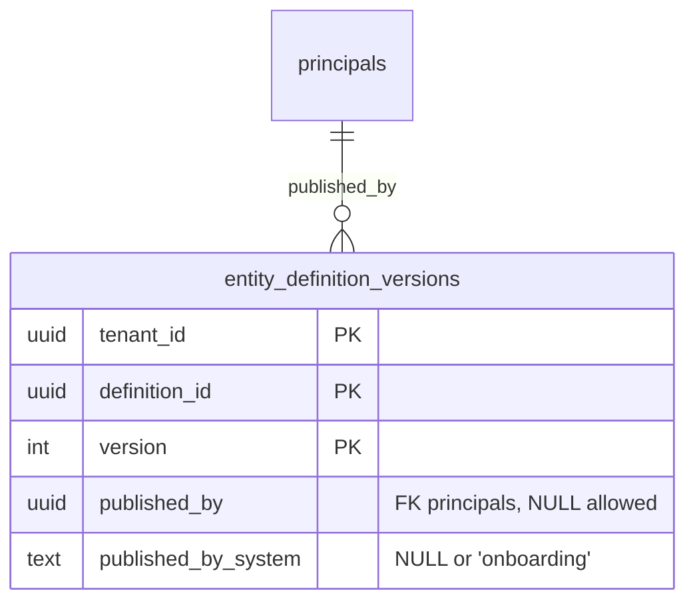

# A version after v1 names a principal or the system as its publisher (TICK-1172)

Migrations: `db/migrations/20261127110000_entity_versions_published_by_system.sql`
(expand) and `db/migrations/20261127110100_entity_versions_published_by_system_validate.sql`
(validate). Tests: `internal/db/dbtest/published_by_system_test.go`.

## Decision

S22's onboarding (TICK-752) publishes version 2 of each seed ticket type, with
its filterable fields flagged, while the tenant is still provisioning and has
no principal. `entity_definition_versions_published_by_check` (P3-06c,
`20261101130000`) refused a v2 with `published_by` NULL. The Technical Lead
chose option 1 on TICK-752: record a system publisher in its own column, and
leave the `record_index_fields` grant alone.

| Rule | Constraint |
|---|---|
| `published_by_system` is NULL or `'onboarding'` | `entity_definition_versions_published_by_system_check` |
| `version = 1 OR num_nonnulls(published_by, published_by_system) = 1` | `entity_definition_versions_published_by_check` (same name, new rule) |

Version 1 keeps today's rule: any combination passes, so the seeded v1 rows
(`published_by` NULL) and API-published v1 rows stay valid. A later version
names exactly one publisher; neither, both, or another system word is refused
with `23514`, for every role including the superuser.

## Online steps

- `ADD COLUMN` with no default is a catalogue change: no rewrite.
- Both CHECKs are added `NOT VALID` under `lock_timeout = '5s'`, then validated
  in `20261127110100` under `SHARE UPDATE EXCLUSIVE`, the same split as
  P3-06c. The old CHECK is dropped and its replacement added in one
  transaction, so no insert runs unchecked between them.
- No index: nothing filters on the column.

## Grants and RLS

No grant diff. `nava_onboard` and `nava_app` hold table-level `INSERT` on
`entity_definition_versions` (`db/grants.yaml`), which covers the new column.
Forced RLS and the three policies are unchanged; `nava_onboard`'s insert policy
still requires its own provisioning tenant.
