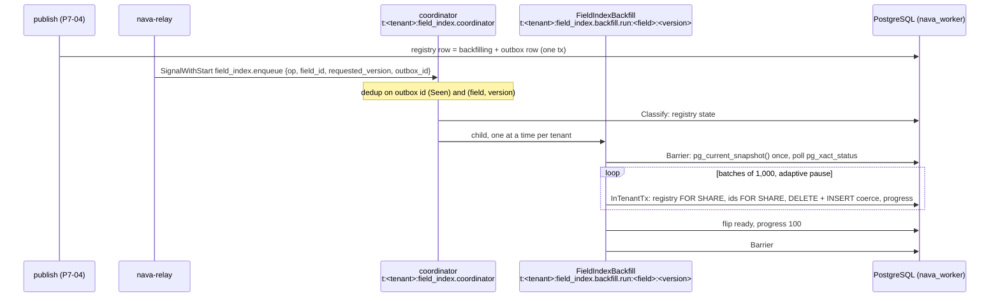

# Field index: the coordinator, the barrier and the backfill (P7-05)

TICK-745, S21 (TICK-739). ADR-006 D9, D10, R11; PLAN-007 D-7-12, D-7-15.
Code: `internal/fieldindex/backfill` (workflows and activities),
`internal/fieldindex/coordinator.go` (the names the relay uses),
`internal/relay/dispatch.go` (the `field_index.backfill` dispatch). Builds on
P7-02 (`docs/data/field-index-trigger.md`) and P7-04 (the outbox row).

A field flagged after its type already has records reaches `ready` with
every existing value in its side table. A record written at any moment across
either flip is in the side table afterwards.

## Flow

## The pieces

| Piece | What it does |
|---|---|
| Relay | A `field_index.backfill` row is a `SignalWithStart` of the tenant's coordinator, never a start of the backfill. `field_id` comes from the payload, `requested_version` from `target_seq`, and the outbox id from the row. The tenant is the row's: a payload `tenant_id` that differs fails closed, and the row is marked dead with no Temporal call (TICK-748 condition). The coordinator refuses such a start payload too. Reuse policy `ALLOW_DUPLICATE`: the coordinator completes when idle, and the next row starts it again. |
| Coordinator | One per tenant. Dedups each item on its outbox id (`workerguard.AppliedSignals`, kept across continue-as-new) and on `(field, requested_version)` within a run. One item at a time, in arrival order: `Classify` reads the registry row (`backfilling` → backfill child, `removing` → `FieldIndexRemove` child from TICK-750, `ready` or gone → nothing). It continues as new after 100 items with the rest still queued, and completes after 5 minutes idle. A failed child is logged, and the queue moves on. |
| Child id | `t:<tenant>:field_index.backfill.run:<field>:<version>`. The activities read the field and the pinned version from it, not from an argument. Version 0 means not pinned: an item carried across continue-as-new. |
| Barrier | One snapshot, taken once: `pg_current_snapshot()`'s xip **plus** every xid from its `xmax` up to a fence xid the barrier takes right after it that is still in progress. `pg_snapshot_xip` alone misses a running transaction whose xid is the newest assigned, because `xmax` then equals it (`1869:1869:` with 1869 running; found in TICK-745 testing). The xids are kept in the heartbeat details, and the barrier polls `pg_xact_status` 1 s apart, backing off to 10 s, holding no connection between polls. Heartbeat timeout 30 s: a lost worker's attempt is retried from the same snapshot. A cancel ends the wait at once. For a backfill child, a registry row that is removed, set to `removing` or moved to another version ends the wait at the next poll. `field_index_barrier_slow` (metric, plus a log line with `alert=true`) fires once after 15 minutes, and the barrier keeps waiting. |
| Batch | One `InTenantTx`. (a) The registry row `FOR SHARE`: stop unless it is `backfilling` at the pinned version. (b) The next ids after the cursor, `ORDER BY id LIMIT 1000 FOR SHARE`. (c) DELETE the field's side rows for those ids, then INSERT `record_field_coerce` rows, all in SQL. (d) Progress as a whole percentage, at most 99. |
| Pause | Starts at 500 ms. Its only input is the batch duration the workflow measures (`workflow.Now()` around the activity). More than 25% over the fastest batch doubles the pause, up to 10 s. Within 10% of it halves the pause, down to 500 ms. TICK-747 checks the +25% live-write p95 against the real histogram. |
| Ready | Flips to `ready` with progress 100, only while still `backfilling` at the pinned version. The barrier runs again afterwards. |

## Why a record is never missed (R1)

A writer that inserted a record before the flip to `backfilling` committed
saw no registry row, so its trigger copied nothing. If it commits after the
batch passed its id, the record is missed. That writer had an xid when the
flip committed, so it is in the barrier's snapshot, and the batches start
only after it ends. Every later write sees the registry row: writers run
READ COMMITTED, and the trigger's registry read is a statement of a volatile
plpgsql function, so it takes its own snapshot. `TestR1WriterAcrossTheFlip`
proves it both ways: with the barrier replaced by a no-op, the same schedule
leaves exactly one record missing.

## Security conditions (PR #734 review)

1. Only `internal/fieldindex` names the field-index workflow types; the relay may name the coordinator. `internal/fieldindex/names_test.go` fails otherwise.
2. The coordinator's tenant is its workflow id's. An item with another tenant's `field_id` finds no registry row under RLS: no child runs, and nothing is written (`TestOtherTenantsFieldWritesNothing`).
3. The batch re-reads the state and the version in its own `InTenantTx` (`TestVersionBumpMidBackfill`).

## Design deviations (TICK-745)

The worker guard (`internal/workerguard`, CI-7) records only references in
histories, and the guard stays unchanged:

1. A batch returns `{"cursor": uuid}`, or `{}` when it is done or stopped.
   Progress is written to the registry in the batch transaction, not
   returned. This is narrower than D10.3.
2. The child input is `{"field_id"}`, plus a `cursor` on a continued run
   (every 1,000 batches, to bound the history). The version comes from the
   child id, and the state from the registry.
3. Across continue-as-new the coordinator carries `{"pending": [field ids]}`
   in `RunInput.Refs`. The op is re-read by `Classify`, and the child runs
   unpinned.
4. The barrier polls inside one activity attempt instead of failing and
   retrying on a server timer. The guard records a non-allow-listed activity
   failure as an alerting `record_data` deny, so retry-driven polls would
   page on every barrier.
5. The workflows live in `internal/fieldindex/backfill`, not
   `internal/fieldindex`. `internal/metadata` imports the leaf, which must
   stay free of a database driver and of Temporal. The barrier activity is
   `backfill.BarrierActivity` (`field_index.Barrier`).

## Known limits

- **Keyset on the primary key.** The keyset walks `records (tenant_id, id)`
  filtered by type, so a tenant with many types reads past the other types'
  rows. There is no new index (migrations are the Postgres specialist's);
  TICK-747 measures it.
- **Progress counts every batch.** Each batch counts the type's records for
  progress: one index scan per 1,000 records.
- **No uncoerced count in the backfill.** A value the backfill cannot coerce
  writes no row, as in the trigger, but it does not increment
  `nava_field_index_uncoerced_total`. A follow-up can add the trigger's
  count.
- **REPEATABLE READ writers are not covered.** A writer whose snapshot
  predates the flip but whose first write comes after the barrier's snapshot
  is not covered. No record writer runs REPEATABLE READ today.
