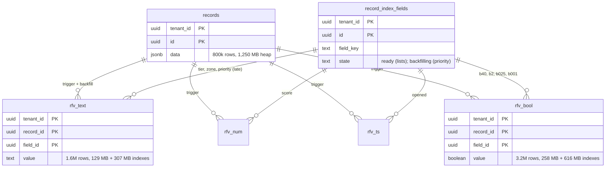

# Field index measured on the merged S21 code (P7-07)

TICK-747, S21 (TICK-739). ADR-006 D10, D13, R-a, R-b, R12. Measured on the
story branch `TICK-739/filterable-fields` at `c29c3361`, after TICK-745,
TICK-746, TICK-979 (E1-5 READ COMMITTED guard) and TICK-980 (barrier
heartbeat) merged. The spike this repeats is
`docs/adr/ADR-006/spikes/postgres/s1-s3/field-index-spike.md`.

Harness: `TestFieldIndexPerf800k`
(`internal/server/records_fieldindex_perf_integration_test.go`, tags
`integration perf`), run by `scratch/field-index-measured/run.sh`. Raw
output: `docs/data/field-index-measured/`.

## Verdict

| Requirement (P7-07) | Target | Result |
| --- | --- | --- |
| List p95, every band, with and without a narrowing ACL | ≤ 150 ms; 2% + ACL ≤ 350 ms | **Not scored: host invalid** for 8-client p95 (the no-filter control read 105–219 ms against 73 ms on the idle reference machine). **Two code findings stand regardless of the host:** (1) **ts range misses**: a two-sided range compiles to two `EXISTS`, 222–3,251 ms single-client (F1). (2) **2% without ACL very likely misses**: 120–145 ms of server time single-client, before any concurrency. |
| Insert tps, 5 flagged fields | ≥ 40% of baseline | **Meets: 105%** (99.9 against 94.9 tps, 3 alternating rounds through `POST`). The trigger's cost is inside the round-to-round noise. |
| Backfill live-write p95 | ≤ +25% | **As merged: meets** (−23% against the control before, −50% against the control after), **but only because the adaptive pause sits at its 10 s ceiling** (F3). With F2 applied (batches 2.4× faster): +68% / +9% against the two controls, which differ from each other by 53%; **not resolved on this host**. |
| Backfill time alone and under load | reported | **About an hour per 400k field** (projected from 40–60 measured batches: 63 min alone, 51 min under load, as merged), against 3.0 / 4.6 min in the spike. Causes: the batch's keyset step runs a **generic plan, 821 ms against 17 ms** (F2), and the pause ratchets to 10 s (F3). |
| Bool planning at statistics target 10,000 | reported | **7–29 ms per statement with an ACL, 1.6–3.2 ms without**. A list plans two statements, so up to 55 ms per request (spike: 5–11 ms). `ANALYZE rfv_bool`: 16.3 s at 3.2M rows. |
| E1-5 guard | reported | **0.78 µs per fired row** |

Fix tasks on the story: **F1** (a range compiles to one `EXISTS` per field),
**F2** (`nava_worker` plans with `force_custom_plan`), **F3** (the adaptive
pause and the per-batch progress count), **F4** (re-run lists and the
backfill delta on an idle host after F1–F3, and decide the 2% band without
an ACL).

## Setup

- Host: Windows 11, 12th Gen Intel Core i7-1260P. Docker 29.9.2 on WSL2
  (kernel 5.15.167.4), VM with 16 CPUs and 24.5 GiB. `postgres:16.10` with
  P3-01's settings (`shared_buffers = 2GB`, `effective_cache_size = 6GB`,
  `fsync = on`, `jit = off`); `nava_app` at `plan_cache_mode =
  force_custom_plan`. No PgBouncer: the handler's own pool, as P3-36.
- **The host was shared**: two full compose stacks (`nava-s18-*`, `nava-*`),
  another agent's benchmark containers, and other agents' lint and test runs
  (Windows CPU about 66%). `SELECT 1` at 8 clients read p50 2.2–10.8 ms
  before the list cells (P3-36's host gate is 3 ms). The other containers
  and their CPU are in `docs/data/field-index-measured/*.contention`.
- Data: P3-36's seed (P3-01's shape, `setseed(0.339)`), 800,000 records,
  one tenant with 400,000 of one type, 399 tenants with 1,002–1,003. Band
  fields come from an md5 of (tenant, n), so selectivity does not follow
  `updated_at` or the ACL: `tier` (text `eq`), `zone` (text `in`, 2 values),
  `score` (num `lt`), `opened` (ts `gte` + `lt`), `b40`, `b2`, `b025`, `b001`
  (bool `eq`), each with a value or range at 40%, 2%, 0.25% and 0.01%.
- What is real and what is set up by hand. Lists, creates and patches go
  through the real handlers (`GET`, `POST`, `PATCH /api/v1/records/...`),
  so the SQL is the list builder's and the trigger is the merged one. The
  backfill is the real `FieldIndexBackfill` workflow and activities as
  `nava_worker`, on a Temporal dev server (real timers), for a field flagged
  through the real publish. Set up as the superuser: the seed, and for the
  list phase the registry rows (`ready`) and side rows, copied with
  `record_field_coerce`. Eight band fields exceed the publish quota
  (`DefaultPerTypeLimit` = 5), so the list phase cannot flag them through
  the API.
- ACL: "ACL" is one of 200 agents (agents group plus 3 assignment groups,
  P3-36's actor); "no ACL" is the tenant admin (no row predicate).



Side tables at 8 flagged fields on all 400 types (6.4M record-field rows):
`rfv_text` 1.6M rows, 129 MB heap + 307 MB indexes; `rfv_num` and `rfv_ts`
0.8M rows, 71 MB + 152 MB each; `rfv_bool` 3.2M rows, 258 MB + 616 MB. About
273 bytes per record-field row with indexes (spike: 212).

## Lists

### 8 clients, 15 s per cell: p95 ms, ACL / no ACL (host invalid, reported only)

No-filter control: **219.1 / 208.0 before the cells, 123.8 / 104.9
after**. P3-36 measured the same handler scenario at 72.5–73.5 ms on the idle
reference machine, so this host inflated every cell by about 1.5–3×.

| Operator | 40% | 2% | 0.25% | 0.01% |
| --- | --- | --- | --- | --- |
| text `eq` | 655.8 / 793.5 | 338.7 / 454.3 | 314.3 / 327.3 | 132.3 / 185.3 |
| text `in` (2 values) | 571.3 / 226.9 | 327.5 / 453.2 | 293.5 / 154.0 | 114.1 / 97.1 |
| num `lt` | 408.6 / 138.8 | 300.2 / 401.6 | 205.8 / 188.9 | 106.1 / 130.6 |
| ts range | 857.3 / 140.5 | **1,481.0 / 1,079.9** | **1,893.0 / 4,196.6** | **1,914.8 / 13,418.1** |
| bool `eq` | 302.1 / 438.9 | 453.8 / 411.2 | 338.2 / 451.5 | 194.9 / 102.8 |

### Server time per request, single client (host-robust)

Each list request runs two statements: the capped count (`LIMIT 1001`) and
the page. EXPLAIN (ANALYZE) as `nava_app` in the actor's tenant transaction,
exactly as the handler sent them; planning + execution of both, ms. ACL / no
ACL.

| Operator | 40% | 2% | 0.25% | 0.01% |
| --- | --- | --- | --- | --- |
| text `eq` | 46.2 / 41.9 | 100.1 / **127.9** | 43.4 / 31.1 | 26.6 / 4.1 |
| text `in` | 128.5 / 25.1 | 112.9 / **120.5** | 35.2 / 27.9 | 50.9 / 5.1 |
| num `lt` | 132.0 / 19.3 | 107.5 / **144.8** | 36.7 / 67.1 | 27.7 / 4.6 |
| ts range | 221.8 / 30.9 | **594.9 / 283.5** | **629.1 / 1,140.4** | **985.8 / 3,250.6** |
| bool `eq` | 69.3 / 21.8 | 153.3 / **143.8** | 30.8 / 19.1 | 77.9 / 6.8 |

Reading it:

- **ts range is a code defect (F1).** `filter[opened][gte]=a&filter[opened][lt]=b`
  compiles to two correlated `EXISTS` on `rfv_ts`, one per operator
  (`records_list_index.go` `existsTerm`). Each half alone matches 30–70% of
  the type, so the planner estimates 10,632 rows where 46 match (230×),
  walks `records_list_updated` over all 400,000 records and probes both:
  3,172 ms for the 0.01% page without ACL. With both bounds in one `EXISTS`
  (`v.value >= a AND v.value < b`), the same captured statements run as
  below. The same applies to any two operators on one num field.

  | Cell (direct SQL, 8 clients) | as compiled p95 / p50 | one `EXISTS` p95 / p50 | page EXPLAIN, as compiled / one `EXISTS` |
  | --- | --- | --- | --- |
  | 40%, ACL | 602.0 / 426.4 | 387.1 / 256.8 | 14.3 / 8.0 ms |
  | 40%, no ACL | 100.6 / 72.4 | 188.9 / 78.0 | 3.0 / 2.3 ms |
  | 2%, ACL | 1,674.5 / 1,008.9 | 472.3 / 296.5 | 444.4 / 144.6 ms |
  | 2%, no ACL | 1,387.6 / 860.1 | 462.7 / 306.4 | 54.8 / 140.0 ms |
  | 0.25%, ACL | 1,744.5 / 1,321.8 | 316.9 / 151.8 | 423.6 / 17.3 ms |
  | 0.25%, no ACL | 4,416.3 / 3,095.6 | 409.9 / 236.5 | 203.1 / 18.5 ms |
  | 0.01%, ACL | 1,755.6 / 1,238.4 | 134.1 / 70.5 | 721.4 / 2.7 ms |
  | 0.01%, no ACL | 11,946.3 / 10,473.7 | 162.0 / 47.7 | 3,172.2 / 1.0 ms |

  With one `EXISTS` the ts bands fall in line with the other operators. The
  semantics differ for an array field (one element in the range, against
  some element above `a` and some element below `b`); F1 has to decide
  which one the API means.
- **The 2% band without an ACL is the D13 risk.** Its server time alone is
  120–145 ms, single-client, against a 150 ms p95 at 8 clients. The page
  drives from the side index (8,000 ids), fetches each record and sorts.
  This is the spike's R1 band; the spike measured 99–224 ms here, and D13
  allowed 350 ms only for 2% with an ACL. With an ACL, 100–153 ms
  single-client is inside the 350 ms target.
- **40% with an ACL is the count.** The page is 6–8 ms; the capped count has
  to find 1,001 visible matches: 116–201 ms for `in`, `lt` and ts.
- **Bool planning (R12).** With the MCV list at target 10,000, planning is
  7–29 ms per bool statement with an ACL and 1.6–3.2 ms without; a list
  plans the count and the page, so a bool list with an ACL spends up to
  55 ms planning.

Every captured plan: `docs/data/field-index-measured/run1-explain.md`.

## Inserts and the E1-5 guard

`POST /api/v1/records/ticket`, 8 agents, 60 s per round, alternating so
growth and host noise hit both arms. Baseline: the same type with its 5
registry rows set to `removing`, so the trigger still fires, runs the E1-5
guard and reads the registry, and copies nothing (the cost of a type with no
flagged field). 5 flagged: `tier`, `zone`, `score`, `opened`, `b2`.

| Round | 0 flagged tps (p95 ms) | 5 flagged tps (p95 ms) |
| --- | --- | --- |
| 1 | 87.9 (214.0) | 115.0 (113.9) |
| 2 | 66.4 (287.9) | 104.8 (132.2) |
| 3 | 130.4 (109.7) | 79.9 (208.0) |
| **Mean** | **94.9** | **99.9 (105%)** |

The floor is 40%; the spike's raw-SQL insert reached 43–63%. Through the
real create path (validation, ACL, number allocation, audit, the outbox,
synchronous commit) the five side rows are a small part of each request,
and on this host smaller than the noise between rounds. 21 baseline
requests answered `503 retry_later` (number allocation timed out during host
stalls); none in the flagged arm.

E1-5 guard: a plpgsql loop of 1,000,000 `current_setting('transaction_isolation')`
checks takes 983 ms against 202 ms for a constant condition (medians of 5):
**0.78 µs per fired row**.

## Backfill and live writes (D10)

`priority` (text, 5 values) flagged late through the real publish
(`POST /api/v1/entity-types/ticket/versions`, version 2), which writes the
registry row (`backfilling`) and the outbox row. `FieldIndexBackfill` then
runs on a Temporal dev server (real timers) as `nava_worker`, with the
production `Activities`; a wrapper only times each `Batch`. Each run starts
from no side rows. Run 3 (`2026-11-19T11:11Z`, `c29c3361`); the other
containers used 0.5–1.2 CPUs throughout.

The live mix: 8 clients through the handlers, alternating `POST` (all band
fields set; `tier`, `zone`, `score`, `opened` flagged) and `PATCH` of `score`
(flagged, `If-Match`), as `nava_app`. Each worker patches 500 records of its
own; its first patch of each record per window answers 412 (the harness
restarts versions at 1) and is excluded.

### Finding: the keyset step runs a generic plan (F2)

`nava-worker`'s pool uses pgx's statement cache and `nava_worker` has no
`plan_cache_mode` setting. After five executions on a connection PostgreSQL
switches the batch's `SELECT id … ORDER BY id LIMIT 1000 FOR SHARE` to its
generic plan, which estimates 2 rows and wins on cost:

| Plan, as `nava_worker`, cursor mid-way through the 400k type | Execution |
| --- | --- |
| custom: `records_pkey` range walk, stops at 1,000 | **17 ms** |
| generic: `records_list_assignee`, 200,430 rows, external merge sort (6.3 MB on disk) | **821 ms** |

A sample of the worker's active statements during the run found it in this
statement 29 times out of 44. `nava_app` already has
`plan_cache_mode = force_custom_plan` (P3-01); giving `nava_worker` the same
is F2, and is what the "fix candidate" rows below run with (`ALTER ROLE` in
the harness, connections reset).

### Finding: the pause sits at its ceiling (F3)

The pacer doubles the pause whenever a batch is more than 25% slower than the
fastest batch seen, and halves it only within 10% of that minimum. The
fastest batches are the first few; later ones drift (cache, checkpoints,
live writes), so in every run the pause reaches 10 s within 10–22 batches and
stays there. The batch also counts the whole type on every call
(`progressSQL`, a parallel index-only scan of 400,000 entries: 159 ms), which
is 30–60% of a custom-plan batch and grows with the type.

### Results

| Backfill (40 or 60 batches, then stopped) | Batch min / p50 / avg / p95 / max ms | Pauses | Projected whole run |
| --- | --- | --- | --- |
| as merged, alone | 289 / 1,042 / 1,187 / 1,852 / 2,262 | 10 s from batch 10 | **63 min** (409 batches) |
| as merged, under the live mix | 1,462 / 1,912 / 1,929 / 2,390 / 2,431 | 10 s from batch 22 | **51 min** (425) |
| fix candidate, alone | 211 / 430 / 623 / 965 / 8,397 | 10 s from batch 16 | **60 min** (425) |
| fix candidate, under the live mix | 549 / 794 / 803 / 1,051 / 1,399 | 10 s from batch 17 | **59 min** (440) |

The spike's backfill (200 ms fixed pause, no generic plan) took 3.0 min alone
and 4.6 min under load. First barrier: 92–169 ms alone, 1.2–1.3 s under the
live mix. WAL in each window: 5.3–6.2 MB per batch alone and 13.5–14.7 MB
under load. Those windows include the pauses, autovacuum after the live mix
and live writes, so they are not comparable to the spike's clean 1.24 MB.
The diff was not checked on stopped runs; TICK-745's tests prove diff = 0,
and a whole run is `NAVA_PERF_FIX_BATCHES=0`.

| Live mix, 8 clients | Window | ops/s | p50 ms | **p95 ms** | p99 ms | create p95 | patch p95 |
| --- | --- | --- | --- | --- | --- | --- | --- |
| alone, before | 180 s | 83.5 | 95.3 | **180.1** | 234.5 | 83.4 | 202.0 |
| with the backfill as merged | 289 s | 91.1 | 68.8 | **138.3** | 197.0 | 82.7 | 159.4 |
| with the backfill, fix candidate | 486 s | 53.9 | 96.7 | **302.4** | 560.9 | 165.7 | 418.4 |
| alone, after | 180 s | 54.6 | 78.1 | **276.4** | 513.8 | 130.8 | 408.9 |

- **As merged: meets D10 (−23% against the control before, −50% against the
  control after).** It meets because the backfill applies load for one to two
  seconds in every twelve. A 400k field then takes about an hour.
- **Fix candidate: not resolved on this host.** +68% against the control
  before, +9% against the control after. The two controls, 35 minutes apart,
  differ by 53%, more than the 25% budget. Once F2 and F3 make batches
  faster and the pause shorter, the live-write delta has to be re-measured
  on an idle host.
- Run 2 (`docs/data/field-index-measured/` does not keep it) had a live mix
  of creates only: every `PATCH` was refused for a missing
  `Idempotency-Key`, a harness bug since fixed. Its batch and pause figures
  match run 3.

Raw: `docs/data/field-index-measured/run3-backfill.md` (batch durations and
pauses in order, per run).

## Reproduce

```sh
sh scratch/field-index-measured/run.sh                      # every phase, about 90 min plus the backfill caps
NAVA_PERF_PHASES=lists sh scratch/field-index-measured/run.sh   # the idle-host D13 re-run
NAVA_PERF_PHASES=backfill NAVA_PERF_FIX_BATCHES=0 sh scratch/field-index-measured/run.sh   # a whole fix-candidate backfill, with the diff
```

Env: `NAVA_PERF_LIST_SECONDS` (20), `NAVA_PERF_WRITE_SECONDS` (60),
`NAVA_PERF_WRITE_ROUNDS` (3), `NAVA_PERF_LIVE_SECONDS` (180),
`NAVA_PERF_LIVE_MAX` (1200), `NAVA_PERF_ASIS_BATCHES` (40),
`NAVA_PERF_FIX_BATCHES` (60), `NAVA_PERF_CLIENTS` (8), `NAVA_PERF_OUT`.
