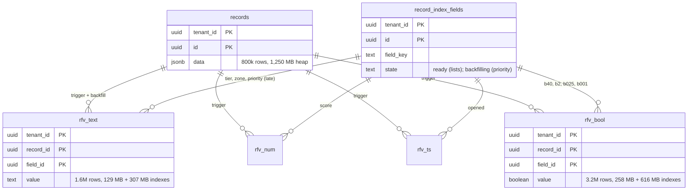

# Field index measured on the merged S21 code (P7-07, TICK-992)

TICK-747, S21 (TICK-739). ADR-006 D10, D13, R-a, R-b, R12. Measured on the
story branch `TICK-739/filterable-fields` at `c29c3361`, after TICK-745,
TICK-746, TICK-979 (E1-5 READ COMMITTED guard) and TICK-980 (barrier
heartbeat) merged. The spike this repeats is
`docs/adr/ADR-006/spikes/postgres/s1-s3/field-index-spike.md`.

Harness: `TestFieldIndexPerf800k`
(`internal/server/records_fieldindex_perf_integration_test.go`, tags
`integration perf`), run by `scratch/field-index-measured/run.sh`. Raw
output: `docs/data/field-index-measured/`.

## TICK-1009 and TICK-1039: scored on a fully idle host (2026-11-28)

**Host:** fully idle. The only other containers were the `multica-*` platform's: `multica-postgres-1` peaked at 15.9% CPU and the others stayed under 7%. There were no `nava`, `nava-*`, `nava-it-*` or bench containers, and no other agent's Go work. The transport floor read p50 0.54 ms after the seed, 0.61 / 1.68 ms before and after TICK-1009, and 0.69 / 1.52 ms before and after TICK-1039, so the p50 ≤ 3 ms gate passed at every check. The no-filter controls read 46.3–82.7 ms p95.

**Run:** commit `660e243a`, `postgres:16.10` with P3-01's settings (`work_mem` 4 MB, `random_page_cost` 4, `nava_app` at `force_custom_plan`), on Docker 29.9.3 on WSL2 (16 CPUs, 24.5 GiB). 800k records, a 400k type, 8 clients, 20 s per cell; 2,088 s in all. Raw report: `docs/data/field-index-measured/tick1009-1039-raw.md`. Plans: `tick1009-edges-explain.md` and `tick1039-arms-explain.md`, each one `EXPLAIN (ANALYZE, BUFFERS, SETTINGS)` per cell, as `nava_app`. Contention log: `tick1009-1039.contention`.

### TICK-1009 (A1-7): which outcome applies

- **S1 5%: band (i) extends to 5% with an ACL.** Both operators pass (188.8 and 187.4 ms). Without an ACL, `text eq` passes provisionally at 343.5 ms. `num lt` **misses provisionally at 358.3 ms**, 2.4% over 350. Both no-ACL pages fan out over the matches: a nested loop over `records_pkey`, 20,292 and 20,087 inner loops (A1-2). So without an ACL the 5% edge is provisional. A rerun decides it; I have not changed the line.
- **S1 10% and 20% with an ACL: a new band.** These cells read 208.7–421.5 ms against 150. The page walks the agents' whole visible set (`records_list_group`, 24,118 rows) to sort the matches. Without an ACL, 10% and 20% pass at 89.9–127.2 ms: the walk over `records_list_updated` stops after a few hundred rows. I report this and do not edit the D13 line.
- **S2: every breadth passes, which removes the 6% condition.** At 2% the cells read 186.5 / 191.4 ms at 6% visible, 200.6 / 209.0 ms at 26% and 207.6 / 215.5 ms at 50% (`num lt` / `text eq`). Broader groups cost at most 24 ms more at p95.
- **The fixture leaves TICK-992's shares alone:** `v40` 40.173%, `v2` 1.999%, `v025` 0.254%, `v001` 0.010%, as before. The new values read `v5` 5.014%, `v10` 9.963% and `v20` 19.946%.

| Cell (p95 ms, the line in brackets) | `num lt` | `text eq` |
| --- | --- | --- |
| S1 5%, ACL (350) | 188.8 pass | 187.4 pass |
| S1 5%, no ACL (350) | **358.3 miss, provisional** | 343.5 pass, provisional |
| S1 10%, ACL (150) | **246.7 miss** | **208.7 miss** |
| S1 10%, no ACL (150) | 89.9 pass | 93.0 pass |
| S1 20%, ACL (150) | **421.5 miss** | **391.7 miss** |
| S1 20%, no ACL (150) | 108.6 pass | 127.2 pass |
| S2 2%, agents see 6%, the control (350) | 186.5 pass | 191.4 pass |
| S2 2%, agents see 26% (350) | 200.6 pass | 209.0 pass |
| S2 2%, agents see 50% (350) | 207.6 pass | 215.5 pass |

### TICK-1039 (A1-6): which arm passes

**Arm (b), the promoted column with `assignment_group_id` in its index, meets the exit criterion in every fixture: 11 of 11, 27.2–131.3 ms.** The other arms fall short:

- **(a), the adaptive shape:** 2 of 11. The pre-count sent every request to the walk-and-probe shape, because every fixture value has more than 4,500 side rows. When the value is anti-correlated or invisible, the walk probes `rfv_num_pkey` once for every visible record: 24,339 to 392,102 inner loops and 1.18–1.96M buffers, for 1,178–4,377 ms. (1) of A1-6 bounds the page only when matches are independent of `updated_at`, and these fixtures are built so that they are not.
- **D7:** 2 of 11. Its worst case is the a50 agent with a value none of its records carry: 2,223 ms, a walk over 200,113 rows of `records_list_updated`.
- **(b) without the group key:** 10 of 11. Its one miss is the a50 agent with the broad 50% value, at 163.6 ms (provisional), where the count joins all 200,000 index entries.

Neither arm needs a change to RLS, to CI-2 or to D7's `EXISTS` semantics. Arm (b) has a different cost, which is a design call and not mine to make. Each field that needs the band takes per-field DDL on `records`: a column, plus an index of 66 MB per 800k rows. I didn't measure the write amplification of that extra index on `records`. This is the schema-less trade-off ADR-006-A1 lists under Rejected. The ADR-006 amendment, if one follows, is the Technical Lead's to request from the Solution Architect.

| Fixture (p95 ms, line 150) | D7 | (a) | (b) | (b) + group |
| --- | --- | --- | --- | --- |
| anti-correlated 2%, a6 | 192.9 | 1,178.0 | 71.7 | 66.8 |
| anti-correlated 2%, a50 | 216.1 | 2,362.3 | 63.6 | 69.4 |
| anti-correlated 2%, no ACL | 355.2 | 4,376.6 | 50.9 | 76.6 |
| none visible, a6 | 124.8 | 1,249.9 | 78.6 | 27.2 |
| none visible, a50 | 2,223.2 | 2,662.0 | 79.8 | 30.5 |
| partly correlated, a6 | 211.3 | 349.7 | 99.7 | 62.9 |
| partly correlated, a50 | 420.9 | 534.9 | 101.8 | 74.1 |
| 19,999 invisible, a6 | 135.3 (provisional) | 1,204.6 | 71.9 | 29.6 |
| 19,999 invisible, a50 | 242.0 | 2,301.6 | 69.9 | 31.0 |
| broad 50%, a6 | 405.6 | 84.9 | 79.4 | 131.3 |
| broad 50%, a50 | 212.4 | 85.8 | 163.6 (provisional) | 60.9 |
| **cells that pass** | **2 / 11** | **2 / 11** | **10 / 11** | **11 / 11** |

### How the cells were built

Run: `sh scratch/field-index-measured/spikes.sh` (`NAVA_PERF_PHASES=edges,arms`
on the TICK-992 harness). One 800k seed serves both. `edges` (TICK-1009) runs
first, because `arms` (TICK-1039) rewrites the records heap. Cell code:
`internal/server/records_fieldindex_spikes_perf_integration_test.go`.

| Spike | Cells | Line |
| --- | --- | --- |
| TICK-1009 S1, band edge | `num lt` (`score` lt 500 / 1000 / 2000) and `text eq` (`tier` `v5` / `v10` / `v20`) at 5 / 10 / 20%, with the agents' ACL (6%) and without: 12 | 5%: 350 ms; 10%, 20%: 150 ms (over is a new band, reported) |
| TICK-1009 S2, ACL breadth | 2% `num lt` and `text eq`, agents seeing 6% (control), 26% and 50%: 6 | 350 ms |
| TICK-1039 arms | D7, (a) adaptive, (b) promoted column, (b) with `assignment_group_id` in the index, × 11 `pk` fixtures (below): 44 | 150 ms |
| Both | no-filter controls and transport floor before and after each phase | floor p50 ≤ 3 ms |

Fixture changes, none of which move a TICK-992 band:

- **`tier`** gains `v5` 5%, `v10` 10% and `v20` 20%, taken from the 97
  others. Those keep the remaining 22.74%. `v40` / `v2` / `v025` / `v001`
  keep 40 / 2 / 0.25 / 0.01%, and the run logs every share.
- **Broader agents.** `a25-N` and `a50-N` use `agent-N`'s principal, with 13
  and 25 of the 50 assignment groups. The existing `agent-N` (3 groups) is
  unchanged. The group sets nest, 6% inside 26% inside 50%. 25% is not a
  multiple of one group's 2%, so a25 sees 26%. Measured: agent-1 sees 24,666
  records (6.2%), a25-1 sees 104,490 (26.1%) and a50-1 sees 200,402 (50.1%).
- **`pk`** (num, large type only, one side row per record). TICK-1039's a6
  is `agent-1` and its a50 is `a50-1`:

  | Value | Side rows | Visible to a6 / a50 | Fixture |
  | --- | --- | --- | --- |
  | 40 | 8,000, the oldest by `updated_at` | 484 / 4,011 | A1-6 (3): anti-correlated 2%; a6's count stays under the cap |
  | 10 | 26,593 | 0 / 0 | none visible |
  | 20 | 21,487 | 494 / 494 | partly correlated |
  | 30 | 19,999 | 0 / 0 | the R13 step's lower side |
  | 3 | 200,000 | 15,819 / 133,409 | broad 50% |
  | 4 | the remaining 123,921 | – | – |

  Unlike A2-11, a50 is a superset of a6, so a50 also sees the 494.

Arms. Each arm goes through the real handler, ACL and RLS, with
`WithListIndexTerm`, a compiler seam that exists only under the
`integration` tag.

- **(a), adaptive.** A capped pre-count (`LIMIT 4501`) of the value's side
  rows runs in the list's transaction. If it finds at most 4,500, the list
  keeps D7's `EXISTS`, which drives from the side index. If it finds more,
  the `EXISTS` gets `OFFSET 0`. That blocks the semi-join pull-up, so the
  list walks the records index in list order and probes `rfv_num_pkey` once
  per record. The count does the same per group-visible record, up to the
  cap. The shape forces the probe, with no `enable_*` and no hints. The cap
  was fixed before any run: sqrt(51 × 400,000) ≈ 4,500 is where a 51-row
  walk (51 / s probes) costs the same as reading s × 400k side rows.
- **(b), promoted column.** `records.spike_pk` with an index on (tenant_id,
  entity_definition_id, spike_pk, updated_at), then the same with
  `assignment_group_id` before `updated_at`. This is scratch DDL inside the
  perf test and is dropped at the end. The column is filled before any arm
  runs, and `VACUUM FULL records` follows, so every arm reads the same heap.
  Index sizes: 52 MB and 66 MB for 800k rows.

## TICK-992: scored on the reference machine (2026-11-19)

**Host condition: `nava` stack running at idle, waived by the Technical Lead
on TICK-992.** These numbers were not taken on a fully empty host. The
`nava-s18` stack (TICK-669, done) was stopped first (`docker compose -p
nava-s18 down`, volumes kept). The owner's `nava` stack (15 containers) kept
running. A `docker stats` sample before each run put it at 21% of one core
(`tick992-nava-stats.txt`). Across the 318 samples taken during the runs it
used a p50 of 32% and a p95 of 78% of one core, with a maximum of 117%
(`tick992-*.contention`). No other `nava-*`, `nava-it-*` or bench container
ran. Transport floor (`SELECT 1`, 8 clients): p50 1.48 ms at the start of
the list run and 1.1–2.7 ms before every cell; 1.15 ms at the start of the
backfill run. That is under P3-36's 3 ms gate throughout. The no-filter list
control read **92.7 / 99.4 ms before and 89.2 / 85.9 ms after** (ACL / no
ACL). P3-36's fully idle figure is 73 ms, so read every list cell as up to
about 1.3× inflated.

Code: story head `9ec4e1f5` (F1 TICK-989, F2 TICK-990, F3 TICK-991
merged), plus two harness-only fixes on this branch. (1) With F1 a range is
already one `EXISTS`, so the "as compiled vs one `EXISTS`" comparison is
removed: it stopped the list phase. (2) `NAVA_PERF_*_BATCHES=0` now runs the
backfill to the end; `perfEnvInt` used to drop 0 and keep the 60-batch cap.
Lists and inserts ran at `ea1b1785`, 2026-11-19 20:00Z. The backfill ran at
`ed028d69`, 20:53Z. Same machine and settings as § Setup.

Scoring rule (Technical Lead, TICK-992):

- **Final:** the cell passes its budget by more than 10%.
- **Provisional:** the cell misses, or passes by 10% or less. A provisional
  cell may be rerun on a fully empty host.

### Verdict

| Requirement | Target | Result | Status |
| --- | --- | --- | --- |
| D13 list p95, 40 cells | ≤ 150 ms; 2% + ACL ≤ 350 ms | 26 pass by more than 10%; 2 pass by 10% or less; **12 miss** | 26 final, 14 provisional |
| D13: 2% band, no ACL | ≤ 150 ms | **Misses in all 5 operators: 236.6–267.6 ms** (single-client server time 84–97 ms) | Provisional; decision for the Technical Lead (scope item 3, options below) |
| D13: 40% band, with ACL | ≤ 150 ms | **Misses in all 5 operators: 176.1–327.6 ms.** The capped count is the cost (32–94 ms single-client) | Provisional; new finding |
| D10 live-write p95 delta, whole backfill | ≤ +25% | **−7.4%** (117.2 against 126.6 ms); +4.8% against the lower control after (111.8 ms) | **Final, meets** |
| TICK-990: batch p50, backfill alone | < 400 ms | **163 ms** (417 batches, whole run) | **Final, meets** |
| Backfill time, 400k field | reported | **8 min 14 s alone, 10 min 26 s under the live mix**; diff = 0 (missing 0, surplus 0) in both | — |
| Insert tps, 5 flagged fields | ≥ 40% | **83%** (157.7 against 190.9 tps, 3 rounds) | Final, meets |
| E1-5 guard | reported | 0.19 µs per fired row | — |

### Lists: p95 ms, 8 clients, 20 s per cell, ACL / no ACL

**Bold** marks a miss. *Italics* mark a pass by 10% or less: under 150
but over 135 ms, or with an ACL in the 2% band, under 350 but over 315 ms.

| Operator | 40% | 2% (ACL ≤ 350) | 0.25% | 0.01% |
| --- | --- | --- | --- | --- |
| text `eq` | **176.1** / 117.8 | *317.6* / **247.6** | 114.2 / 115.0 | 66.7 / 85.4 |
| text `in` (2 values) | **327.6** / 100.1 | 223.9 / **267.6** | **160.9** / **152.8** | 84.8 / 93.9 |
| num `lt` | **290.3** / 121.6 | 238.3 / **236.6** | 109.1 / 117.8 | 60.7 / 88.6 |
| ts range | **280.9** / 110.1 | 223.1 / **260.2** | 129.1 / 110.6 | 47.9 / 83.7 |
| bool `eq` | **181.7** / 118.0 | 233.7 / **238.2** | *143.5* / 124.7 | 82.3 / 72.3 |

F1 fixed the ts range. Its cells were 1,079–13,418 ms in P7-07 and now
fall in line with the other operators: 47.9–280.9 ms.

Single-client server time per request. This is the planning plus execution
of the count and the page, from one EXPLAIN (ANALYZE) each, in ms
(`tick992-explain.md`):

| Cell | count | page | total |
| --- | --- | --- | --- |
| 2%, no ACL (5 operators) | 23–27 | 60–73 | **84–97** |
| 40%, ACL, `in` / `lt` / ts | 89–94 | 6–8 | **96–102** |
| 40%, ACL, `eq` text / bool | 32–34 | 9–14 | 42–48 |
| 0.25%, `in`, ACL / no ACL | 22 / 11 | 13 / 19 | 35 / 29 |

- **2% without an ACL.** The page drives from the side index: 7,980 ids,
  then 7,980 `records_pkey` lookups (32,000 buffer hits, 44 ms) and a top-N
  sort for 51 rows. F1–F3 cut the server time from 120–145 ms to 84–97 ms.
  At 8 clients it still reads 2.4–2.8× that. Even with the whole 1.3×
  control inflation taken off, the band would read 182–206 ms, which still
  misses 150 ms.
- **40% with an ACL (new).** The capped count's first `UNION ALL` arm takes
  4,910 group-visible records from `records_list_group`. The planner then
  hash-semi-joins them against every side row of the 40% value: 160,258 rows
  from `rfv_num_value`, 82 ms, and the hash spills to disk (2 batches). A
  probe of the side table's primary key `(tenant_id, record_id, field_id,
  ord)` for each of the 4,910 records was not chosen. `eq` on text and bool
  costs 32–34 ms, because the planner's estimate is different there. This is
  the spike's recommendation 5 (counts with an ACL at 40%), now the only
  miss outside the 2% band.
- **0.25% `in`**: 160.9 / 152.8 ms. This is a borderline miss with 29–35 ms
  of server time, within the host's inflation.

### Backfill and live writes (D10), whole run

| Live mix, 8 clients | Window | ops/s | p50 ms | **p95 ms** | p99 ms |
| --- | --- | --- | --- | --- | --- |
| alone, before | 180 s | 118.3 | 70.3 | **126.6** | 166.0 |
| with the whole backfill (`force_custom_plan`) | 626 s | 114.0 | 66.6 | **117.2** | 171.6 |
| alone, after | 180 s | 101.4 | 54.9 | **111.8** | 158.8 |

| Backfill, whole run | Duration | Batches | Batch min / p50 / avg / p95 / max ms | Pauses | WAL | Diff |
| --- | --- | --- | --- | --- | --- | --- |
| alone | 8 min 14 s | 417 | 59 / **163** / 166 / 195 / 1,222 | 500 ms ×416 | 1,386 MB | missing 0, surplus 0 (416,297) |
| under the live mix | 10 min 26 s | 420 | 212 / 449 / 444 / 583 / 799 | 500 ms ×419 | 2,642 MB | missing 0, surplus 0 (454,441) |

The two controls differ by 13% (P7-07's differed by 53%). The delta is −7.4%
against the control before and +4.8% against the control after, so both are
well inside +25%. With F3 the pause stays at its 500 ms floor on every
batch, and with F2 the custom plan holds the batch at a p50 of 163 ms alone.
A 400k field now takes 8–10 minutes, against about an hour in P7-07. The
harness's "as merged" arm, 40 batches, reads the same: batch p50 157 ms
alone. The role setting from `db/grants.yaml` already applies there, so the
extra `ALTER ROLE` is a no-op.

### Options for the 2% band without an ACL (decision: Technical Lead)

These are from the spike's recommendation 2, with the measured numbers:

| Option | What it costs | Expected effect (not measured here) |
| --- | --- | --- |
| (a) The compiler picks the shape by the planner's estimate. A selective filter drives from the side index; a broad one walks `records_list_updated` and probes. | Compiler work, plus one planning-only `EXPLAIN` per list (1–3 ms measured here without an ACL) or a per-field histogram kept by the backfill | Walking the order index needs about 51 / 0.02 = 2,550 probes for a page, against 7,980 heap fetches now. This needs a spike before it is a fix. |
| (b) A promoted column for the fields that need this band | Per-field DDL. It breaks the schema-less goal for those fields. | The same ordered walk as P3-01 (d): single-digit ms |
| (c) A D13 variance: the 2% band without an ACL ≤ 350 ms, like 2% with an ACL | No code | 236.6–267.6 ms measured, 24–32% inside 350 ms |

My recommendation is (c) now, with (a) as a follow-up spike. Every 2% cell,
with or without an ACL, is between 224 and 318 ms. The band's cost is the
side-index fan-out, which an ACL does not change. (b) is expensive to
reverse once data lands.

## Verdict (P7-07, shared host)

Superseded by TICK-992 above for lists, D10 and backfill time; kept as history.

| Requirement (P7-07) | Target | Result |
| --- | --- | --- |
| List p95, every band, with and without a narrowing ACL | ≤ 150 ms; 2% + ACL ≤ 350 ms | **Not scored: host invalid** for 8-client p95 (the no-filter control read 105–219 ms against 73 ms on the idle reference machine). **Two code findings stand regardless of the host:** (1) **ts range misses**: a two-sided range compiles to two `EXISTS`, 222–3,251 ms single-client (F1). (2) **2% without ACL very likely misses**: 120–145 ms of server time single-client, before any concurrency. |
| Insert tps, 5 flagged fields | ≥ 40% of baseline | **Meets: 105%** (99.9 against 94.9 tps, 3 alternating rounds through `POST`). The trigger's cost is inside the round-to-round noise. |
| Backfill live-write p95 | ≤ +25% | **As merged: meets** (−23% against the control before, −50% against the control after), **but only because the adaptive pause sits at its 10 s ceiling** (F3). With F2 applied (batches 2.4× faster): +68% / +9% against the two controls, which differ from each other by 53%; **not resolved on this host**. |
| Backfill time alone and under load | reported | **About an hour per 400k field** (projected from 40–60 measured batches: 63 min alone, 51 min under load, as merged), against 3.0 / 4.6 min in the spike. Causes: the batch's keyset step runs a **generic plan, 821 ms against 17 ms** (F2), and the pause ratchets to 10 s (F3). |
| Bool planning at statistics target 10,000 | reported | **7–29 ms per statement with an ACL, 1.6–3.2 ms without**. A list plans two statements, so up to 55 ms per request (spike: 5–11 ms). `ANALYZE rfv_bool`: 16.3 s at 3.2M rows. |
| E1-5 guard | reported | **0.78 µs per fired row** |

Fix tasks on the story: **F1, TICK-989** (a range compiles to one `EXISTS`
per field), **F2, TICK-990** (`nava_worker` plans with `force_custom_plan`),
**F3, TICK-991** (the adaptive pause and the per-batch progress count), **F4,
TICK-992** (score lists and the backfill delta on an idle host after F1–F3,
and decide the 2% band without an ACL).

## Setup

- Host: Windows 11, 12th Gen Intel Core i7-1260P. Docker 29.9.2 on WSL2
  (kernel 5.15.167.4), VM with 16 CPUs and 24.5 GiB. `postgres:16.10` with
  P3-01's settings (`shared_buffers = 2GB`, `effective_cache_size = 6GB`,
  `fsync = on`, `jit = off`); `nava_app` at `plan_cache_mode =
  force_custom_plan`. No PgBouncer: the handler's own pool, as P3-36.
- **The host was shared**: two full compose stacks (`nava-s18-*`, `nava-*`),
  another agent's benchmark containers, and other agents' lint and test runs
  (Windows CPU about 66%). `SELECT 1` at 8 clients read p50 2.2–10.8 ms
  before the list cells (P3-36's host gate is 3 ms). The other containers
  and their CPU are in `docs/data/field-index-measured/*.contention`.
- Data: P3-36's seed (P3-01's shape, `setseed(0.339)`), 800,000 records,
  one tenant with 400,000 of one type, 399 tenants with 1,002–1,003. Band
  fields come from an md5 of (tenant, n), so selectivity does not follow
  `updated_at` or the ACL: `tier` (text `eq`), `zone` (text `in`, 2 values),
  `score` (num `lt`), `opened` (ts `gte` + `lt`), `b40`, `b2`, `b025`, `b001`
  (bool `eq`), each with a value or range at 40%, 2%, 0.25% and 0.01%.
- What is real and what is set up by hand. Lists, creates and patches go
  through the real handlers (`GET`, `POST`, `PATCH /api/v1/records/...`),
  so the SQL is the list builder's and the trigger is the merged one. The
  backfill is the real `FieldIndexBackfill` workflow and activities as
  `nava_worker`, on a Temporal dev server (real timers), for a field flagged
  through the real publish. Set up as the superuser: the seed, and for the
  list phase the registry rows (`ready`) and side rows, copied with
  `record_field_coerce`. Eight band fields exceed the publish quota
  (`DefaultPerTypeLimit` = 5), so the list phase cannot flag them through
  the API.
- ACL: "ACL" is one of 200 agents (agents group plus 3 assignment groups,
  P3-36's actor); "no ACL" is the tenant admin (no row predicate).



Side tables at 8 flagged fields on all 400 types (6.4M record-field rows):
`rfv_text` 1.6M rows, 129 MB heap + 307 MB indexes; `rfv_num` and `rfv_ts`
0.8M rows, 71 MB + 152 MB each; `rfv_bool` 3.2M rows, 258 MB + 616 MB. About
273 bytes per record-field row with indexes (spike: 212).

## Lists

### 8 clients, 15 s per cell: p95 ms, ACL / no ACL (host invalid, reported only)

No-filter control: **219.1 / 208.0 before the cells, 123.8 / 104.9
after**. P3-36 measured the same handler scenario at 72.5–73.5 ms on the idle
reference machine, so this host inflated every cell by about 1.5–3×.

| Operator | 40% | 2% | 0.25% | 0.01% |
| --- | --- | --- | --- | --- |
| text `eq` | 655.8 / 793.5 | 338.7 / 454.3 | 314.3 / 327.3 | 132.3 / 185.3 |
| text `in` (2 values) | 571.3 / 226.9 | 327.5 / 453.2 | 293.5 / 154.0 | 114.1 / 97.1 |
| num `lt` | 408.6 / 138.8 | 300.2 / 401.6 | 205.8 / 188.9 | 106.1 / 130.6 |
| ts range | 857.3 / 140.5 | **1,481.0 / 1,079.9** | **1,893.0 / 4,196.6** | **1,914.8 / 13,418.1** |
| bool `eq` | 302.1 / 438.9 | 453.8 / 411.2 | 338.2 / 451.5 | 194.9 / 102.8 |

### Server time per request, single client (host-robust)

Each list request runs two statements: the capped count (`LIMIT 1001`) and
the page. EXPLAIN (ANALYZE) as `nava_app` in the actor's tenant transaction,
exactly as the handler sent them; planning + execution of both, ms. ACL / no
ACL.

| Operator | 40% | 2% | 0.25% | 0.01% |
| --- | --- | --- | --- | --- |
| text `eq` | 46.2 / 41.9 | 100.1 / **127.9** | 43.4 / 31.1 | 26.6 / 4.1 |
| text `in` | 128.5 / 25.1 | 112.9 / **120.5** | 35.2 / 27.9 | 50.9 / 5.1 |
| num `lt` | 132.0 / 19.3 | 107.5 / **144.8** | 36.7 / 67.1 | 27.7 / 4.6 |
| ts range | 221.8 / 30.9 | **594.9 / 283.5** | **629.1 / 1,140.4** | **985.8 / 3,250.6** |
| bool `eq` | 69.3 / 21.8 | 153.3 / **143.8** | 30.8 / 19.1 | 77.9 / 6.8 |

Reading it:

- **ts range is a code defect (F1).** `filter[opened][gte]=a&filter[opened][lt]=b`
  compiles to two correlated `EXISTS` on `rfv_ts`, one per operator
  (`records_list_index.go` `existsTerm`). Each half alone matches 30–70% of
  the type, so the planner estimates 10,632 rows where 46 match (230×),
  walks `records_list_updated` over all 400,000 records and probes both:
  3,172 ms for the 0.01% page without ACL. With both bounds in one `EXISTS`
  (`v.value >= a AND v.value < b`), the same captured statements run as
  below. The same applies to any two operators on one num field.

  | Cell (direct SQL, 8 clients) | as compiled p95 / p50 | one `EXISTS` p95 / p50 | page EXPLAIN, as compiled / one `EXISTS` |
  | --- | --- | --- | --- |
  | 40%, ACL | 602.0 / 426.4 | 387.1 / 256.8 | 14.3 / 8.0 ms |
  | 40%, no ACL | 100.6 / 72.4 | 188.9 / 78.0 | 3.0 / 2.3 ms |
  | 2%, ACL | 1,674.5 / 1,008.9 | 472.3 / 296.5 | 444.4 / 144.6 ms |
  | 2%, no ACL | 1,387.6 / 860.1 | 462.7 / 306.4 | 54.8 / 140.0 ms |
  | 0.25%, ACL | 1,744.5 / 1,321.8 | 316.9 / 151.8 | 423.6 / 17.3 ms |
  | 0.25%, no ACL | 4,416.3 / 3,095.6 | 409.9 / 236.5 | 203.1 / 18.5 ms |
  | 0.01%, ACL | 1,755.6 / 1,238.4 | 134.1 / 70.5 | 721.4 / 2.7 ms |
  | 0.01%, no ACL | 11,946.3 / 10,473.7 | 162.0 / 47.7 | 3,172.2 / 1.0 ms |

  With one `EXISTS` the ts bands fall in line with the other operators. The
  semantics differ for an array field (one element in the range, against
  some element above `a` and some element below `b`); F1 has to decide
  which one the API means.
- **The 2% band without an ACL is the D13 risk.** Its server time alone is
  120–145 ms, single-client, against a 150 ms p95 at 8 clients. The page
  drives from the side index (8,000 ids), fetches each record and sorts.
  This is the spike's R1 band; the spike measured 99–224 ms here, and D13
  allowed 350 ms only for 2% with an ACL. With an ACL, 100–153 ms
  single-client is inside the 350 ms target.
- **40% with an ACL is the count.** The page is 6–8 ms; the capped count has
  to find 1,001 visible matches: 116–201 ms for `in`, `lt` and ts.
- **Bool planning (R12).** With the MCV list at target 10,000, planning is
  7–29 ms per bool statement with an ACL and 1.6–3.2 ms without; a list
  plans the count and the page, so a bool list with an ACL spends up to
  55 ms planning.

Every captured plan: `docs/data/field-index-measured/run1-explain.md`.

## Inserts and the E1-5 guard

`POST /api/v1/records/ticket`, 8 agents, 60 s per round, alternating so
growth and host noise hit both arms. Baseline: the same type with its 5
registry rows set to `removing`, so the trigger still fires, runs the E1-5
guard and reads the registry, and copies nothing (the cost of a type with no
flagged field). 5 flagged: `tier`, `zone`, `score`, `opened`, `b2`.

| Round | 0 flagged tps (p95 ms) | 5 flagged tps (p95 ms) |
| --- | --- | --- |
| 1 | 87.9 (214.0) | 115.0 (113.9) |
| 2 | 66.4 (287.9) | 104.8 (132.2) |
| 3 | 130.4 (109.7) | 79.9 (208.0) |
| **Mean** | **94.9** | **99.9 (105%)** |

The floor is 40%; the spike's raw-SQL insert reached 43–63%. Through the
real create path (validation, ACL, number allocation, audit, the outbox,
synchronous commit) the five side rows are a small part of each request,
and on this host smaller than the noise between rounds. 21 baseline
requests answered `503 retry_later` (number allocation timed out during host
stalls); none in the flagged arm.

E1-5 guard: a plpgsql loop of 1,000,000 `current_setting('transaction_isolation')`
checks takes 983 ms against 202 ms for a constant condition (medians of 5):
**0.78 µs per fired row**.

## Backfill and live writes (D10)

`priority` (text, 5 values) flagged late through the real publish
(`POST /api/v1/entity-types/ticket/versions`, version 2), which writes the
registry row (`backfilling`) and the outbox row. `FieldIndexBackfill` then
runs on a Temporal dev server (real timers) as `nava_worker`, with the
production `Activities`; a wrapper only times each `Batch`. Each run starts
from no side rows. Run 3 (`2026-11-19T11:11Z`, `c29c3361`); the other
containers used 0.5–1.2 CPUs throughout.

The live mix: 8 clients through the handlers, alternating `POST` (all band
fields set; `tier`, `zone`, `score`, `opened` flagged) and `PATCH` of `score`
(flagged, `If-Match`), as `nava_app`. Each worker patches 500 records of its
own; its first patch of each record per window answers 412 (the harness
restarts versions at 1) and is excluded.

### Finding: the keyset step runs a generic plan (F2)

`nava-worker`'s pool uses pgx's statement cache and `nava_worker` has no
`plan_cache_mode` setting. After five executions on a connection PostgreSQL
switches the batch's `SELECT id … ORDER BY id LIMIT 1000 FOR SHARE` to its
generic plan, which estimates 2 rows and wins on cost:

| Plan, as `nava_worker`, cursor mid-way through the 400k type | Execution |
| --- | --- |
| custom: `records_pkey` range walk, stops at 1,000 | **17 ms** |
| generic: `records_list_assignee`, 200,430 rows, external merge sort (6.3 MB on disk) | **821 ms** |

A sample of the worker's active statements during the run found it in this
statement 29 times out of 44. `nava_app` already has
`plan_cache_mode = force_custom_plan` (P3-01); giving `nava_worker` the same
is F2, and is what the "fix candidate" rows below run with (`ALTER ROLE` in
the harness, connections reset).

### Finding: the pause sits at its ceiling (F3)

The pacer doubles the pause whenever a batch is more than 25% slower than the
fastest batch seen, and halves it only within 10% of that minimum. The
fastest batches are the first few; later ones drift (cache, checkpoints,
live writes), so in every run the pause reaches 10 s within 10–22 batches and
stays there. The batch also counts the whole type on every call
(`progressSQL`, a parallel index-only scan of 400,000 entries: 159 ms), which
is 30–60% of a custom-plan batch and grows with the type.

### Results

| Backfill (40 or 60 batches, then stopped) | Batch min / p50 / avg / p95 / max ms | Pauses | Projected whole run |
| --- | --- | --- | --- |
| as merged, alone | 289 / 1,042 / 1,187 / 1,852 / 2,262 | 10 s from batch 10 | **63 min** (409 batches) |
| as merged, under the live mix | 1,462 / 1,912 / 1,929 / 2,390 / 2,431 | 10 s from batch 22 | **51 min** (425) |
| fix candidate, alone | 211 / 430 / 623 / 965 / 8,397 | 10 s from batch 16 | **60 min** (425) |
| fix candidate, under the live mix | 549 / 794 / 803 / 1,051 / 1,399 | 10 s from batch 17 | **59 min** (440) |

The spike's backfill (200 ms fixed pause, no generic plan) took 3.0 min alone
and 4.6 min under load. First barrier: 92–169 ms alone, 1.2–1.3 s under the
live mix. WAL in each window: 5.3–6.2 MB per batch alone and 13.5–14.7 MB
under load. Those windows include the pauses, autovacuum after the live mix
and live writes, so they are not comparable to the spike's clean 1.24 MB.
The diff was not checked on stopped runs; TICK-745's tests prove diff = 0,
and a whole run is `NAVA_PERF_FIX_BATCHES=0`.

| Live mix, 8 clients | Window | ops/s | p50 ms | **p95 ms** | p99 ms | create p95 | patch p95 |
| --- | --- | --- | --- | --- | --- | --- | --- |
| alone, before | 180 s | 83.5 | 95.3 | **180.1** | 234.5 | 83.4 | 202.0 |
| with the backfill as merged | 289 s | 91.1 | 68.8 | **138.3** | 197.0 | 82.7 | 159.4 |
| with the backfill, fix candidate | 486 s | 53.9 | 96.7 | **302.4** | 560.9 | 165.7 | 418.4 |
| alone, after | 180 s | 54.6 | 78.1 | **276.4** | 513.8 | 130.8 | 408.9 |

- **As merged: meets D10 (−23% against the control before, −50% against the
  control after).** It meets because the backfill applies load for one to two
  seconds in every twelve. A 400k field then takes about an hour.
- **Fix candidate: not resolved on this host.** +68% against the control
  before, +9% against the control after. The two controls, 35 minutes apart,
  differ by 53%, more than the 25% budget. Once F2 and F3 make batches
  faster and the pause shorter, the live-write delta has to be re-measured
  on an idle host.
- Run 2 (`docs/data/field-index-measured/` does not keep it) had a live mix
  of creates only: every `PATCH` was refused for a missing
  `Idempotency-Key`, a harness bug since fixed. Its batch and pause figures
  match run 3.

Raw: `docs/data/field-index-measured/run3-backfill.md` (batch durations and
pauses in order, per run).

## Reproduce

```sh
sh scratch/field-index-measured/run.sh                      # every phase, about 90 min plus the backfill caps
NAVA_PERF_PHASES=lists sh scratch/field-index-measured/run.sh   # the idle-host D13 re-run
NAVA_PERF_PHASES=backfill NAVA_PERF_FIX_BATCHES=0 sh scratch/field-index-measured/run.sh   # a whole fix-candidate backfill, with the diff (0 works from TICK-992 on)
sh scratch/field-index-measured/spikes.sh                  # TICK-1009 S1/S2, then TICK-1039 arms; refuses a host with nava or bench containers
```

Env: `NAVA_PERF_LIST_SECONDS` (20), `NAVA_PERF_WRITE_SECONDS` (60),
`NAVA_PERF_WRITE_ROUNDS` (3), `NAVA_PERF_LIVE_SECONDS` (180),
`NAVA_PERF_LIVE_MAX` (1200), `NAVA_PERF_ASIS_BATCHES` (40),
`NAVA_PERF_FIX_BATCHES` (60), `NAVA_PERF_CLIENTS` (8), `NAVA_PERF_OUT`.
