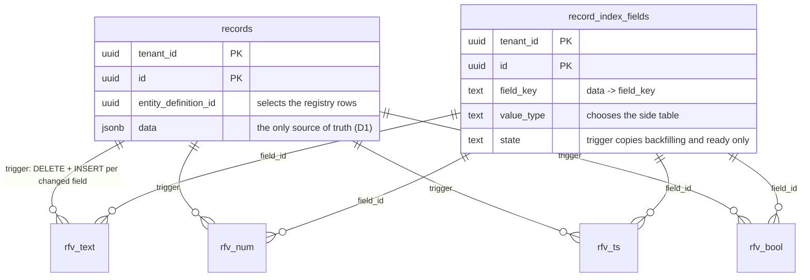
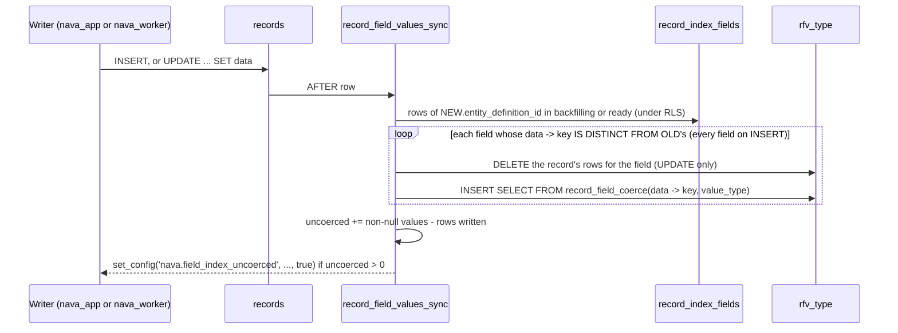

# Field index: coercion and the records trigger (P7-02)

TICK-742, S21 (TICK-739). ADR-006 D1, D4, D5, R5. Migration:
`db/migrations/20261127110100_field_index_trigger.sql`. Builds on P7-01
(`docs/data/field-index.md`).

Any write to `records`, by any writer role and any path, leaves the side
tables equal to a recompute from `records.data` for every field in
`backfilling` or `ready`. This happens in the same transaction, and a bad
value never fails the write.

## Model

## The objects

| Object | Kind | What it does |
|---|---|---|
| `record_field_coerce(v jsonb, value_type text)` | `LANGUAGE sql STABLE PARALLEL SAFE`, returns `(ord, value_text, value_num, value_ts, value_bool)` | The one coercion. The trigger and P7-05's backfill call it. Go never re-implements it |
| `record_field_values_sync()` | plpgsql, `SECURITY INVOKER` | `AFTER INSERT OR UPDATE OF data ON records FOR EACH ROW` (`records_field_values_sync`) |
| `record_field_values_purge()` | plpgsql, `SECURITY INVOKER` | `BEFORE DELETE ON records FOR EACH ROW` (`records_field_values_purge`) |

All three are `SET search_path = pg_catalog, public`, `SET TimeZone = 'UTC'`,
`SET DateStyle = 'ISO, YMD'`. `nava_app` and `nava_worker` have `EXECUTE` on
`record_field_coerce` (`db/grants.yaml`). Nobody has `EXECUTE` on the trigger
functions: a trigger fires without that grant.

## Coercion rules (D5)

`record_field_coerce` returns one row per value that coerces and no row for
anything else. `ord` is the position in a top-level array, or 0 for a scalar.
Positions are kept, so `["a", 1, "c"]` gives rows at ord 0 and 2.

| `value_type` | Coerces | Does not coerce (examples) |
|---|---|---|
| `text` | a JSON string of at most 2,000 bytes | numbers, booleans, objects, a string over 2,000 bytes |
| `num` | a JSON number that is a finite `float8` | `1e400`, `1e-400` (out of range), `"1"`, `"NaN"`, `"Infinity"` (strings) |
| `bool` | a JSON boolean | `"true"`, `"yes"`, `"t"`, `1` |
| `ts` | RFC 3339 `date-time` with an explicit offset (`Z` or `±hh:mm`, `T` or `t`), or `YYYY-MM-DD` (stored as 00:00 UTC) | no offset, a space for `T`, `+0100`, `01/02/2026`, `15.11.2026`, `2026-02-30`, `infinity`, `epoch`, numbers |

Also giving no row, for every type: JSON `null`, an absent key, a nested
array, an object, and array elements past ord 32,767 (`ord` is `smallint`).

Three rules are not spelled out in ADR-006 D5. Each one exists so that a
value can never fail the write:

- **The 2,000-byte cap on text.** A B-tree entry holds about 2,700 bytes, and
  `rfv_text_value` carries three uuids next to the value. A longer string
  would fail the INSERT, and with it the record write.
- **The 32,767-element cap on arrays.** It is the range of the `smallint`
  `ord`.
- **`ts` accepts a bare date for any `ts` field.** The registry holds the
  value type, not the JSON Schema `format`. The trigger would have to read
  the record's definition version to tell `format: date` from
  `format: date-time`. That read is not needed: the write pipeline asserts
  `format` (`internal/metadata/compile.go`, TICK-360), so a `date-time`
  field never holds a bare date, and no field holds a date-time without an
  offset. A writer that skips validation and puts a bare date into a
  `date-time` field gets midnight UTC, the same value as for a `date`
  field.

**Session independence (CI-9).** Text to `timestamptz` reads `TimeZone` and
`DateStyle`, so the function pins both. `STABLE` is the strongest volatility
these casts allow. The regular expressions use `[0-9]`, never `\d`, so a
locale's other digits never match. `TestP702CoerceRulesAcrossSessions` runs
58 cases as `nava_app` and `nava_worker`, under the default session and
under `Pacific/Chatham` with `SQL, DMY` and `German`, and `Pacific/Kiritimati`
with `Postgres, MDY`. It decodes the rows in binary.

## The trigger (D4)

- The trigger reads only the registry, `NEW` and `OLD`. It never reads a side
  table (D1).
- An `UPDATE` that leaves `data` out of its `SET` list does not fire. An
  `UPDATE` that sets an unchanged value rewrites nothing.
  `TestP702UnchangedFieldIsNotRewritten` checks the side row's `ctid`.
- The per-record `DELETE` uses the PK prefix `(tenant_id, record_id,
  field_id)`. The registry lookup uses the unique key `(tenant_id,
  entity_definition_id, field_key)`.
- The `BEFORE DELETE` purge deletes the record's rows from all four tables
  through the PK prefix `(tenant_id, record_id)`. The `NO ACTION` record FKs
  then pass at the end of the statement.
- **A `removing` field is skipped.** Its rows are deleted by the D11 removal
  workflow, not here.
- **READ COMMITTED only (ADR-006-E1 E1-5, TICK-979).** The first statement of
  `record_field_values_sync()` raises SQLSTATE `25000`
  (`invalid_transaction_state`) when `current_setting('transaction_isolation')`
  is not `read committed`. The message names ADR-006-E1. The D9 barrier is
  sound only for a writer whose registry read takes a fresh snapshot, so a
  REPEATABLE READ, SERIALIZABLE or READ UNCOMMITTED write (including one set
  by `default_transaction_isolation`) is refused instead of slipping past it.
  The check runs before the registry read, so it also refuses writes to a
  type with no flagged field. An `UPDATE` that does not name `data` does not
  fire the trigger and is not checked. Migration
  `20261127110200_field_index_sync_read_committed.sql`.
- **The trigger stays AFTER ROW, and is the only `records` trigger that reads
  the registry** (E1-2). `TestP705cRecordsTriggerCatalog` pins both from
  `pg_trigger.tgtype` and each trigger function's `prosrc`.

## The uncoerced counter (R5): the mechanism

There is no `RAISE` and no table write. The mechanism is a
**transaction-local setting**:

1. The trigger counts the values that did not coerce: the non-null values
   minus the rows it wrote. It adds the count to the setting
   `nava.field_index_uncoerced`, a JSON object
   `{"<entity_definition_id>": n}` written with `set_config(..., true)`. It
   writes the setting only when the count is above 0. A value in the setting
   that the trigger did not write (not JSON, not an object, not a whole
   number) is dropped, never cast blindly, so it cannot fail a write.
2. After a successful write to a type whose current definition flags a
   top-level property (`metadata.Compiled.Filterable`, P7-03),
   `internal/records/pipeline` registers
   `tenancy.ReadSettingAtCommit(tx, "nava.field_index_uncoerced", ...)`. It
   does this once per transaction. A write to any other type registers
   nothing, so its commit batch keeps the TICK-692 statement budget
   (`TestRecordCreateAndGetRoundTrips`: 19 statements, 4 trips). Nothing is
   missed: the registry holds a `backfilling` or `ready` row only for a field
   the current definition flags (P7-04), and the trigger skips `removing`
   rows.
3. `tenancy.InTenantTx` sends `SELECT coalesce(current_setting($1, true), '')`
   in the same batch as `COMMIT`, after every queued statement. No round trip
   is added. Only after the `COMMIT` succeeds does it hand the value to the
   pipeline.
4. The pipeline adds each count to `nava_field_index_uncoerced`, exported to
   Prometheus as `nava_field_index_uncoerced_total{entity_definition}`. The
   entity definition id is the only attribute: no tenant id and no value.

Two properties follow:

- A rolled-back savepoint or transaction takes its counts back, because the
  setting rolls back with it.
- A failed commit counts nothing.

`TestP702UncoercedValuesAreCounted` covers the setting (savepoint, junk
values, both roles). `TestUncoercedValueIsCountedNotRaised` covers the
metric end to end through `pipeline.Write`: one count, two writes in one
transaction, a rollback and a good write. nava-core wires the metric in
`internal/server/api.go`. nava-worker wires it through
`recordports.NewWriter`.

The P7-05 backfill batch counts the values it skips on the same counter,
from its own INSERT, after its transaction commits
(`pipeline.FieldIndexMetrics.AddUncoerced`, TICK-974;
`TestBackfillCountsUncoercedValues`).

A records write that does not go through `tenancy.InTenantTx` and the
pipeline still gets correct side rows, but is not counted.

**For the Security reviewer.** The `entity_definition` label is a tenant's
type id: an opaque UUID that names no tenant. The allocator's metrics carry
no type at all (T01). This task's acceptance criteria name the label, and R5
needs it for the admin report.

## Who the trigger runs as

The trigger is `SECURITY INVOKER`, so it sees what the writer sees under
forced RLS (ADR-001 I3, D14):

- `nava_app` and `nava_worker` hold the registry SELECT policy and the side
  tables' SELECT, INSERT and DELETE (P7-01,
  `TestP701EveryRecordWriterReadsTheRegistry`).
- **`nava_migrator` has no registry SELECT policy.** A data migration that
  writes `records` as the migrator sees no registry row and silently indexes
  nothing. **Any future `records` data migration must run the P7-05 rebuild
  afterwards.** A migrator DELETE of a record that has side rows fails on the
  record FK, because the purge sees no side rows. It fails loudly and never
  leaves an orphan.
- No runtime role may DELETE a record. The purge runs for whoever can,
  including the superuser in tests.

## Acceptance evidence

All tests run on PostgreSQL 16.10 (`postgres:16.10`, fsync off), on a
Windows 11 host with Docker Desktop.

| Criterion | Test | What it checks |
|---|---|---|
| CI-4 trigger vs recompute | `TestP702TriggerMatchesRecompute` | 400 random operations per writer role (`nava_app`, `nava_worker`) over two tenants: INSERT (1 or 2 per transaction), UPDATE of the whole `data`, `jsonb_set` of one key, removal of one key, a rolled-back UPDATE, and DELETE as the superuser. Values cover all four types, arrays, null, absent and non-coercing values. Afterwards the side tables equal the recompute through `record_field_coerce` (`EXCEPT ALL` both ways), the `removing` field has 0 rows, and no row names another tenant's field. A mutation that drops the `rfv_num` DELETE fails it at operation 12 |
| CI-9 coercion across sessions | `TestP702CoerceRulesAcrossSessions`, `TestP702CoerceLongArray` | 58 cases (including `1e400`, `"1"`, `"NaN"` and a date-time with no offset) in 4 sessions, as both roles |
| CI-8 audit bytes unchanged | `TestP702AuditBytesUnchanged` | The same INSERT and UPDATE, with the same ids, are run without and then with flagged fields, and each run rolls back. The `records` row, the readable columns of both `audit_log` entries and the `audit_chain_head` count are byte-identical. The chain hash is built from those columns |
| Non-coercing write succeeds and counts | `TestP702UncoercedValuesAreCounted`, `TestUncoercedValueIsCountedNotRaised` | See the counter section above |
| E1-5 READ COMMITTED guard | `TestP705cRecordsWriteRequiresReadCommitted` | As `nava_app` and `nava_worker`, on a type with flagged fields and one without: INSERT and UPDATE of `data` at READ COMMITTED succeed and write their side rows; at REPEATABLE READ, SERIALIZABLE and READ UNCOMMITTED, and under `default_transaction_isolation = 'repeatable read'`, they fail with `25000` naming ADR-006-E1 and leave no record. With the guard removed, 26 assertions fail |
| E1-5 trigger catalogue | `TestP705cRecordsTriggerCatalog` | The sync trigger is the only one calling `record_field_values_sync`, and is AFTER ROW (`tgtype`); no other `records` trigger function's `prosrc` reads `record_index_fields`. In rolled-back transactions it catches the sync trigger redefined BEFORE ROW and AFTER STATEMENT, and a second registry-reading trigger |
| Catalogue | `TestP702Catalog`, `TestP702MigrationDownUp` | `SECURITY INVOKER`, the `SET` list, volatility, the trigger events, the `EXECUTE` grants, and down then up |

This task adds no benchmark. The write cost with 5 flagged fields was
measured in the spike: 338 tps, 43–63% of baseline, at 800k records on PG
16.10 (ADR-006 Evidence, R-b). The spike's trigger ran one INSERT per type.
This one runs one INSERT per changed field, plus one DELETE on update.
P7-07 measures the insert cost on the real code.

## Migration safety

`CREATE FUNCTION` and `CREATE TRIGGER` are catalogue changes. `CREATE
TRIGGER` takes `SHARE ROW EXCLUSIVE` on `records` for milliseconds and scans
nothing. `lock_timeout = 5s` makes the migration fail and be re-run instead
of queueing record writes behind a long transaction. The registry is empty
until P7-04 publishes a flag, so the triggers copy nothing until then. The
down migration drops both triggers and all three functions.
