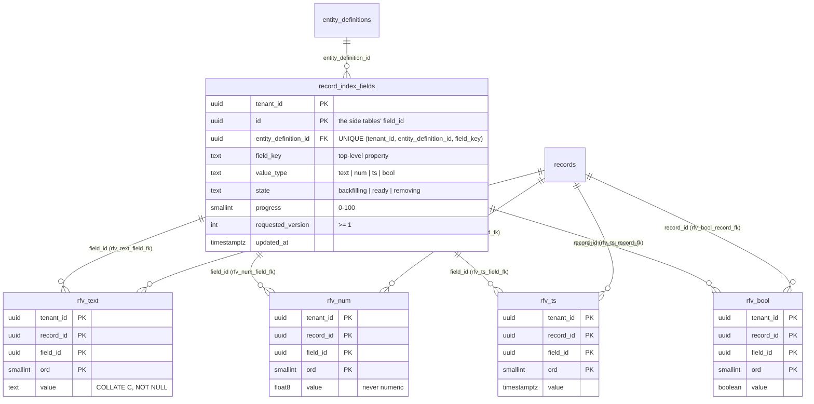

# Field index: the registry and the four typed side tables (P7-01)

TICK-741, S21 (TICK-739). ADR-006 D2, D3, D14. Migration:
`db/migrations/20261115120000_field_index_tables.sql`. Go names:
`internal/fieldindex` (`TypeText`, `TypeNum`, `TypeTS`, `TypeBool`,
`StateBackfilling`, `StateReady`, `StateRemoving`, `ValueType.SideTable`).

These tables hold no data until P7-02 adds the trigger. `records.data` stays
the only source of truth (D1). The side tables are derived from it and can be
rebuilt.

## Model

## Keys, indexes and statistics

Each side table has two B-trees, and `tenant_id` leads both:

| Object | Columns | Serves |
|---|---|---|
| `rfv_<t>_pkey` | `(tenant_id, record_id, field_id, ord)` | the trigger's per-record DELETE (P7-02), the D7 `EXISTS` probe's `record_id = r.id` join, and `rfv_<t>_record_fk` |
| `rfv_<t>_value` | `(tenant_id, field_id, value, record_id)` | the filter's index condition (`eq`, `in`, ranges), and `rfv_<t>_field_fk` (a registry DELETE checks for side rows with one probe) |
| `rfv_<t>_field_mcv` | MCV on `(tenant_id, field_id)` | the row estimate for one tenant's field |
| `rfv_text_value_mcv`, `rfv_bool_value_mcv` | MCV on `(tenant_id, field_id, value)` | equality estimates for the low-cardinality types. Bool's target is 10,000 (R12) |

Both foreign keys are `NO ACTION`. A record cannot be deleted while it has
side rows (P7-02's `BEFORE DELETE` purge clears them first). A registry row
cannot be deleted while side rows remain (D11 step 5).

Why two indexes and no more: the spike (PR #587) measured this exact set at
800k records (one 400k tenant, 8 clients, PostgreSQL 16.10, as `nava_app`
under forced RLS). A list filter took p95 19–103 ms in every band except the
2% band with an ACL, which took 221–327 ms (D13). With 5 flagged fields,
inserts ran at 338 tps (43–63% of baseline). Storage was 212 bytes per
record-field. The required registry FK cost nothing measurable (331 tps with
it, 318 without). The figures are in ADR-006 Evidence and
`docs/adr/ADR-006/spikes/postgres/s1-s3/`. The DDL here is the spike's
`23_split.sql` plus the D14 policies and grants. This task adds no new
benchmark. CI-1 (the pushdown `EXPLAIN` for each operator) is a later S21 task.

## Leakproof by construction (CI-2)

Under forced RLS, PostgreSQL pushes a qual below the policy as an index
condition only when its operator is leakproof. The value types are chosen for
that. The `=`, `<`, `<=`, `>` and `>=` operators of `text` (under
`COLLATE "C"`), `float8`, `timestamptz` and `bool` are leakproof. `numeric`'s
are not, so `num` is `double precision` (R3 covers the precision this gives
up). `TestP701LeakproofCatalog` pins the catalog and checks that no table
here has a `numeric` column.

## RLS, policies and grants (D14)

All five tables are `ENABLE` and `FORCE` row-level security. Each policy
covers one command and one role (never `FOR ALL`) and uses exactly the
canonical tenant predicate.

| Table | `nava_app` | `nava_worker` |
|---|---|---|
| `rfv_text`, `rfv_num`, `rfv_ts`, `rfv_bool` | SELECT, INSERT, DELETE | SELECT, INSERT, DELETE |
| `record_index_fields` | SELECT, INSERT, UPDATE (`state`, `progress`, `requested_version`, `updated_at`) | SELECT, UPDATE (`state`, `progress`, `updated_at`), DELETE |

- No role may UPDATE a side table. The trigger and the backfill rewrite a
  value as DELETE then INSERT.
- No role may UPDATE a registry row's `tenant_id`, `id`,
  `entity_definition_id`, `field_key` or `value_type`.
- `nava_app` and `nava_worker` are the only roles that write `records`, and
  both are in the registry's SELECT policies. P7-02's trigger is
  `SECURITY INVOKER`, so it runs as the writer.
- `TestP701Grants` (CI-5b) pins the exact grant set for every role.
  `TestP701TenantIsolationAndKeys` (CI-3) and the isolation suite
  (`internal/tenancy/isolation/fieldindex_paths.go`, plus the generic checks
  over the seeded rows) pin the tenant boundary.

## Audit

All five tables are `exempt` in `db/audited-tables.yaml`.

- The side tables are derived from `records.data`, and every write to
  `records.data` is audited.
- The registry holds index configuration. The entity-definition publish that
  creates a row, flips it or asks to remove it is audited in that same
  transaction (subject `entity_definition`, P7-04). The worker's `state`,
  `progress` and DELETE writes are workflow bookkeeping, of the same kind as
  `workflow_ref`.

## Migration safety

The migration creates new, empty tables. The only locks it takes on existing
tables are SHARE ROW EXCLUSIVE on `entity_definitions` and `records`, for the
foreign keys, and it holds them for milliseconds. `lock_timeout = 5s` makes
the migration fail and be re-run instead of queueing record writes behind a
long transaction. The down migration drops the five tables.
`TestP701MigrationDownUp` runs down, checks that nothing is left (tables,
indexes, statistics), and runs up again.
