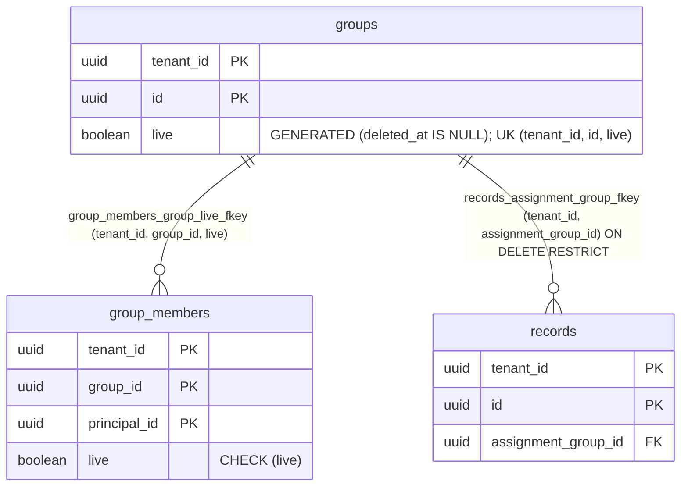

# Foreign-key validation under FORCE ROW LEVEL SECURITY (TICK-715)

Found in P3-40 (TICK-709). Schema:
`db/migrations/20261112100000_group_members_group_live_fkey_recheck.sql` and
`20261112100100_records_assignment_group_fkey_recheck.sql`. Guard:
`db/fk_validate_force_rls_test.go` (runs in `task test`, no database).
Test: `internal/db/dbtest/fk_recheck_force_rls_test.go`. Bench:
`scratch/tick-715-fk-recheck/bench.sql`, output in `bench-out.txt` next to it.

## The bug

Every platform table is `ENABLE` and `FORCE ROW LEVEL SECURITY`, and
`nava_migrator` owns them all. FORCE makes RLS apply to the owner too, and
`nava_migrator` has no policy on a tenant table.

When the caller owns both tables, PostgreSQL validates a foreign key with one
anti-join query (`RI_Initial_Check`), and that query runs under both tables'
RLS. With no policy for `nava_migrator`, the referencing scan returns no row,
so the key is marked valid whatever the table holds. This affects:

- `ALTER TABLE ... VALIDATE CONSTRAINT <fk>`;
- `ALTER TABLE ... ADD CONSTRAINT <fk> FOREIGN KEY ...` without `NOT VALID`,
  on a table that already holds rows.

A `CHECK` is validated by a heap scan, which RLS does not filter, so it is
not affected. Row-by-row checks on later writes run as the owner with
`SECURITY_NOFORCE_RLS` and are not affected either: only the one-off check of
existing rows passes vacuously.

Reproduced on PostgreSQL 16.10 (`bench-out.txt`, "BUG"): with one orphan in
each table, the owner's bare `VALIDATE` set `convalidated = true` on both keys.

## What it affected

| Migration | Key | Re-checked by |
|---|---|---|
| `20261104013500_groups_tombstone_validate.sql` | `group_members_group_live_fkey` | `20261112100000` |
| `20261104043100_groups_contract_validate.sql` | `records_assignment_group_fkey` | `20261112100100` |

The guard checked every other foreign key the migrations add with
`ALTER TABLE`. `20261101190000` (five `records` keys) and `20261108184658`
(two `record_shares` keys) add each key in the same statement as one of its
columns. That column is NULL in every existing row, and `MATCH SIMPLE` does
not check a row with a NULL key column, so a real check would have passed
too.

**Orphan scan.** `scratch/tick-715-fk-recheck/orphans.sql` counts the orphans
of both keys. It must run as a role that bypasses RLS (the superuser). As
`nava_migrator` it would see no rows and report 0. No long-lived platform
database exists yet: every database is a developer stack or a CI cluster
built from the migrations, so there was no shipped database to scan. Results:

- On the bench database after the orphans were removed, and on the
  integration test's migrated database, the scan found 0 and 0.
- Where it matters, on any database that already ran the two old
  migrations, the re-check migrations run the same check when they are
  applied. They stop the deploy on an orphan (SQLSTATE 23503, naming the key)
  instead of letting it pass silently.

## The pattern



A migration that checks a foreign key's existing rows on a FORCE-RLS table
does it in one transaction (never `-- +goose NO TRANSACTION`):

```sql
SET LOCAL lock_timeout = '5s';
CREATE POLICY <child>_migrator_validate ON <child> FOR SELECT TO nava_migrator USING (true);
CREATE POLICY <parent>_migrator_validate ON <parent> FOR SELECT TO nava_migrator USING (true);
ALTER TABLE <child> VALIDATE CONSTRAINT <fk>;
DROP POLICY <parent>_migrator_validate ON <parent>;
DROP POLICY <child>_migrator_validate ON <child>;
```

- **Both tables need a policy.** Without one on the referencing table the
  check passes vacuously. Without one on the referenced table every row looks
  orphaned and the check always fails.
- **The policies never outlive the transaction.** They are dropped before
  `COMMIT`, and a failed `VALIDATE` rolls them back. No other session sees
  them, and the catalogue gate, which runs after the migrations, finds none.
- **A key already marked valid is not checked again.** `VALIDATE` does
  nothing on it. A re-check drops the key and adds it back `NOT VALID`, with
  the same definition and in the same transaction, then validates it
  (`20261112100000`, `20261112100100`).

**The guard.** `TestMigrationsFKValidateUnderForceRLS` replays the Up
sections of every migration in order. It tracks which tables are FORCE-RLS and
which constraints are foreign keys. It fails a migration that does any of the
following:

- validates an FK, or adds one without `NOT VALID`, while no migrator SELECT
  policy covers each FORCE-RLS table of the pair;
- leaves a migrator policy undropped;
- uses the pattern under `NO TRANSACTION`.

Two kinds of statement are exempt: an FK on a table created in the same file
(the table is empty), and an FK added together with one of its columns, with
no default (that column is NULL in every row). The two migrations that already
shipped are allow-listed, each naming its re-check migration.
`TestFKValidateGuardCatchesBareValidateFixture` runs the guard on
`db/testdata/fk_validate_force_rls/`, a bare `VALIDATE` it must catch.

## Cost

PostgreSQL 16.10 (`postgres:16.10`) in Docker 29.9.2 on Windows 11, Intel
i7-1260P (16 threads), `shared_buffers = 1GB`. 200 tenants, 50,000 groups,
2,500,000 memberships (404 MB with indexes), and 1,000,000 records (900,000
with a group, 553 MB).

| Step | Locks held to COMMIT | Whole transaction |
|---|---|---|
| `20261112100000` (group_members key) | ACCESS EXCLUSIVE on `group_members` and `groups` | 1,021 ms (VALIDATE ~1.0 s) |
| `20261112100100` (records key) | ACCESS EXCLUSIVE on `records` and `groups` | 579 ms (VALIDATE ~0.4 s) |
| Old bare VALIDATE, for comparison | SHARE UPDATE EXCLUSIVE + ROW SHARE | 124 to 214 ms, checking nothing |

`CREATE POLICY` takes ACCESS EXCLUSIVE, so while the scan runs, reads and
writes of both tables wait: about 1 s for memberships and groups, then about
0.6 s for records and groups, at this scale. Each re-check is a migration of
its own, so the two lock windows do not add up. `lock_timeout = '5s'` makes a
migration that queues behind a long transaction fail and be re-run. The
pattern adds no index and no write cost.

No pattern that checks for real avoids ACCESS EXCLUSIVE. Any read the owner
makes under FORCE RLS needs a policy, and `CREATE POLICY` takes that lock. A
blocking window of about a second, once, is accepted for these two keys. A
future FK on a much larger table should measure its window the same way
before it ships.
