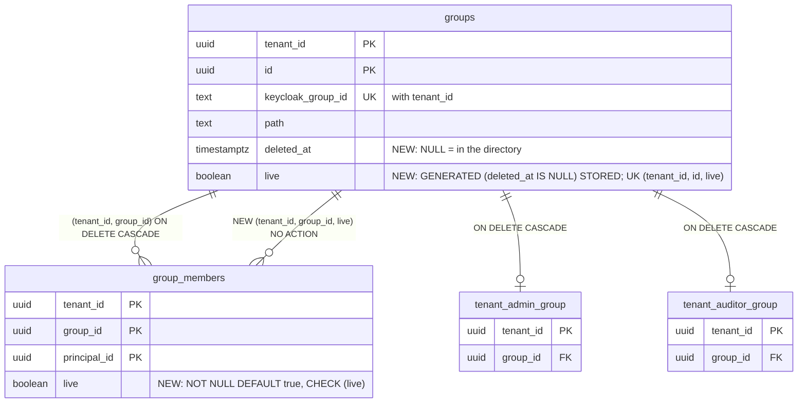

# Groups are tombstoned, step (i) expand (TICK-534)

Decision: [ADR-004-E5](../adr/ADR-004-E5-no-fk-actions-no-record-secrets.md)
D1, D2, D5, D10 step (i), D11, I1, I5. Schema:
`db/migrations/20261104013400_groups_tombstone.sql` and
`20261104013500_groups_tombstone_validate.sql`. Bench:
`scratch/e5-groups-tombstone/bench.sql`, output in `bench-out.txt` next to it.
Tests: `internal/db/dbtest/groups_tombstone_test.go`, plus the split denial
tests in `tenant_admin_group_test.go` and `tenant_auditor_group_test.go`.

## Model

A membership row carries `live = true` and can carry nothing else. It
references the group's `(tenant_id, id, true)` key, and that key exists only
while `deleted_at IS NULL`. So, for every role including the owner:

| Write | Result |
|---|---|
| Insert a member into a tombstoned group | `23503` |
| Set `deleted_at` on a group that still has a member | `23503` |
| Insert a member with `live = false` | `23514` |
| `DELETE FROM groups` as `nava_groupsync` (after step (ii), TICK-538) | `42501`: no DELETE grant, no `groups_delete` policy |
| Owner `DELETE` of a group a record names (after step (ii)) | `23503` (`records_assignment_group_fkey`, `ON DELETE RESTRICT`) |

## Grants and policies (nava_groupsync)

| Object | Change |
|---|---|
| `groups` | `UPDATE (path, deleted_at)`. Never `id` or `keycloak_group_id`. DELETE and `groups_delete` removed in step (ii-a), TICK-538. |
| `tenant_admin_group` | `DELETE`, under `tenant_admin_group_delete_tombstoned` |
| `tenant_auditor_group` | `SELECT (tenant_id, group_id)` and `DELETE`; added to `tenant_auditor_group_select`'s `TO` list (I1); DELETE under `tenant_auditor_group_delete_tombstoned` |

Both DELETE policies are the tenant predicate `AND EXISTS (SELECT 1 FROM groups
g WHERE g.tenant_id = <table>.tenant_id AND g.id = <table>.group_id AND
g.deleted_at IS NOT NULL)`. They are pinned in
`internal/db/catalog/policy.go`, so a copy without the tombstone test fails
CI-1.

## Evidence

PostgreSQL 16.10 (`postgres:16.10`, the `docs/pins.md` pin) in Docker Desktop
on Windows 11, 16 vCPU, 20.8 GB VM memory, default settings. 200 tenants,
50,000 groups and 2,500,000 memberships (the I5 scale).

| Step | Lock | Time |
|---|---|---|
| A: `ALTER TABLE groups` (adds `deleted_at`, `live` and the unique key; rewrites the table) | ACCESS EXCLUSIVE on `groups` | 205 ms |
| A: `ALTER TABLE group_members` (constant default, no rewrite; CHECK and FK `NOT VALID`) | ACCESS EXCLUSIVE on `group_members`, SHARE ROW EXCLUSIVE on `groups` | 1.7 ms |
| B: `VALIDATE` the CHECK | SHARE UPDATE EXCLUSIVE on `group_members` | 171 ms |
| B: `VALIDATE` the FK | SHARE UPDATE EXCLUSIVE on `group_members`, ROW SHARE on `groups` | 742 ms |

**Erratum (TICK-715).** As `nava_migrator` under FORCE RLS, migration B's FK
`VALIDATE` checked no rows (the 742 ms above was measured as a superuser).
`20261112100000` re-checks the key for real; see
[`fk-validate-force-rls.md`](fk-validate-force-rls.md).

Migration A blocks reads of `groups` for about 0.2 s at this scale. It sets
`lock_timeout = '5s'`, so it fails and is re-run rather than queueing reads
behind a long sync transaction. Migration B blocks neither reads nor writes.

**Write cost.** 100,000 membership inserts in one statement took 2.08 s and
2.87 s before, and 3.11 s and 3.25 s after: about +30%, from one extra
`groups_live_key` probe per row. Group sync inserts memberships in
per-tenant batches, so this is the cost of D11 and is accepted.

**Storage.** `groups_live_key` is 2.9 MB at 50,000 groups; `groups` grew from
11 MB to 13 MB in total. Existing memberships keep `live` in the catalogue as
the missing-attribute default (no rewrite); new and updated rows store one
byte more.

**Plan.** The tombstone of an emptied group uses an index scan on
`groups_live_key` (0.45 ms, excluding the 8.7 ms the bench spends picking a group). The
`group_members_group_live_fkey` check costs 0.25 ms per call: it probes
`group_members_pkey`, whose leading `(tenant_id, group_id)` serves it, so
there is no new index on `group_members`.
