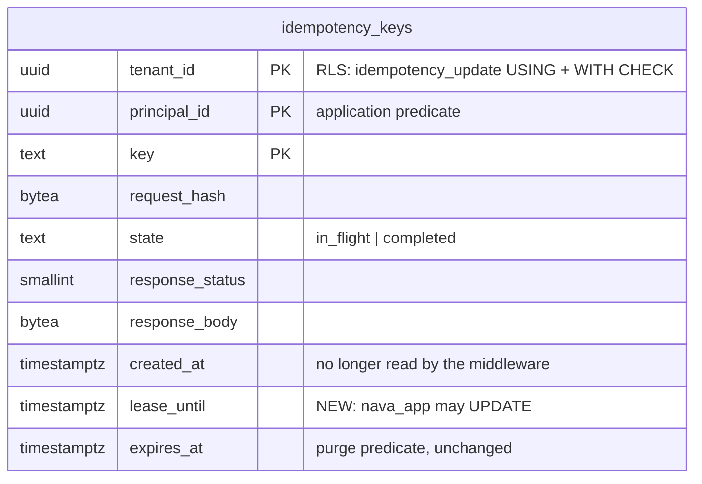

# Idempotency lease (T22a, TICK-212)

Migration `20261028175712_idempotency_lease.sql` adds a `lease_until` column that
`nava_app` may UPDATE. The middleware (`internal/platform/idempotency`) now
takes over an abandoned `in_flight` row with one conditional UPDATE that
commits **before** the handler runs. A takeover holds no transaction, row lock
or connection while the handler runs, so takeovers cannot use up the pool or
PgBouncer's server connections. T22's retake semaphore (`MaxConns/4`) is
**removed**: it is not needed as a backstop, and removing it also removes the
cross-tenant starvation it allowed.

## The problem it fixes

In T22, a takeover locked the row with `SELECT ... FOR UPDATE NOWAIT` and ran
the handler inside that transaction, because `nava_app` could not update
`created_at`. That held one connection for the whole handler, and the handler
needed a second one. With N concurrent takeovers on a pool of N, the pool
deadlocked for every tenant. Behind PgBouncer, takeovers from R replicas shared
`default_pool_size` (20), which no per-process semaphore can bound. A 5xx
leaves the row `in_flight`, so any tenant that can cause 5xx responses could
trigger this.

## Model

| Step | Statement (as `nava_app`, inside `InTenantTx`) | Commits before the handler runs? |
| --- | --- | --- |
| First request | `INSERT ... lease_until = now() + 60 s ... ON CONFLICT DO NOTHING` | yes (as in T22) |
| Duplicate, row read | `SELECT request_hash, state, ..., lease_until < now()` by primary key | n/a |
| Takeover | `UPDATE ... SET lease_until = now() + 60 s WHERE <pk> AND state = 'in_flight' AND lease_until < now() AND request_hash = $4` | **yes (new)** |
| Store | `UPDATE ... SET state = 'completed', response_status, response_body` | separate transaction (as in T22) |

**Exactly once.** Under READ COMMITTED, a second takeover's UPDATE waits on
the row until the first one commits. It then re-checks the row, finds
`lease_until` in the future and matches 0 rows, so the request gets 409
`idempotency_in_flight`. The isolation case *two concurrent takeovers of one
abandoned row* forces this race: a superuser transaction holds the row lock
until both takeovers are queued on it.

**Grants and policies.** The only new right is `UPDATE (lease_until)` for
`nava_app` (`db/grants.yaml`). No policy changes. `idempotency_update` already
scopes `nava_app`'s UPDATE by tenant in both `USING` and `WITH CHECK`, so
another tenant's lease can be neither reset nor extended (CI-8: *extend tenant
B's lease*, *reset tenant B's lease*). RLS stays `FORCE`d, and the purge
policies still test only `expires_at`. The CI-1 allow-list is untouched.

**Principal.** As for `state` and `response_body`, the principal is an
application predicate: the only statement that writes `lease_until` has
`principal_id = $2` from the resolved principal, and there is no
`app.principal_id` setting. Making the database enforce it would need a new
setting and a policy that is not the canonical tenant predicate, which is an
ADR-001 A.3 change. The CI-8 case *another principal's request with the same
key leaves the abandoned row's lease alone* covers it at the middleware.

## Evidence

Host: Windows 11, Docker 29.9.2 VM with 16 CPUs and 19.4 GiB. PostgreSQL
16.10 (the `docs/pins.md` pin), `shared_buffers = 1GB`, `full_page_writes =
off`. Seed: 500,000 `idempotency_keys` rows over 25 h, 90% in one big tenant,
2,000 principals, 1% (5,000) abandoned `in_flight`, and the rest completed
with a ~550-byte body (heap 242 MB). Script: `sh docs/data/lease-bench/run.sh`.
Output: `bin/lease-bench-output.txt`.

### Migration cost

| | Before 00006 | After 00006 |
| --- | --- | --- |
| `ALTER TABLE ... ADD COLUMN` over 500,000 rows | | 3.5 ms (commit 5.6 ms) |
| heap bytes | 253,698,048 | 253,698,048 |
| relfilenode | 16494 | 16494 (no rewrite) |

The default `now() + 60 s` is stable, so it is stored once as the column's
missing value. The ACCESS EXCLUSIVE lock lasts only as long as the catalogue
update. `lock_timeout = 5s` stops the migration from queueing behind a long
transaction and blocking every idempotency write behind it. No tenant is
locked out for longer than that. Existing rows get the migration time + 60 s,
so no `in_flight` row becomes takeable sooner than its lease allows.

### Plans (as `nava_app`, RLS on, big tenant, warm)

| Statement | Plan | Buffers | Execution |
| --- | --- | --- | --- |
| Row read (`selectRow`) | Index Scan `idempotency_keys_pkey`, tenant in Index Cond | 4 hit | 0.150 ms |
| Takeover UPDATE, wins | Index Scan `idempotency_keys_pkey` → Update | 12 hit | 0.48–0.84 ms |
| Takeover UPDATE, loses (lease fresh) | Index Scan `idempotency_keys_pkey`, 1 row removed by filter | 4 hit | 0.102–0.108 ms |
| T22 `FOR UPDATE NOWAIT` (before) | Index Scan `idempotency_keys_pkey` → LockRows | 5 hit | 0.190–0.262 ms |

Every statement is a primary-key lookup, so no new index is needed.

### Write and storage cost

| Per takeover (2,000 takeovers, one transaction each) | T22 `FOR UPDATE` | T22a lease UPDATE |
| --- | --- | --- |
| WAL bytes | 96.8 | 155.1 |
| HOT updates | n/a | 1,916 / 2,000 (95.8%): no index entry written |
| Wall time for 2,000 (commit-bound) | 7.79 s | 7.21 s |

A takeover now writes 58 bytes more WAL and one new heap tuple version, almost
always HOT. That cost applies only to takeovers, which happen once per
abandoned or 5xx'd key. First requests and replays write nothing new. The
column adds 8 bytes to a rewritten row before alignment. Across the seeded
table, copies with and without it differ by 1.05 bytes per row (0.2%),
because most rows already end in alignment padding.

In exchange, a takeover holds a connection for about 1 ms instead of for the
whole handler.

## Tests

| Criterion | Case (`internal/tenancy/isolation/idempotency_paths.go`, `registry.go`) | On T22's code |
| --- | --- | --- |
| N+1 takeovers on a pool of N finish, handler once each | *5 concurrent takeovers on a pool of 4 (direct)*. Each handler waits for all 5, then takes a connection. | fails: only 1 of 5 handlers ran at once |
| No server connection held across replicas | *5 concurrent takeovers on a pool of 4 (through PgBouncer, one server connection)* | fails: only 1 of 5 handlers ran at once |
| Two concurrent takeovers of one row: handler once, other 409 | *two concurrent takeovers of one abandoned row ...* | fails: NOWAIT rejects both before they queue |
| One tenant's failing writes cannot starve another's takeovers | *a tenant's stuck takeovers do not turn another tenant's takeover away* (3 stuck in tenant A, over T22's 1 slot) | hangs on the semaphore (now bounded at 15 s) |
| CI-8: no reset or extend of another tenant's lease | SQL paths *extend tenant B's lease*, *reset tenant B's lease so a takeover can run* | n/a (new column) |
| CI-8: another principal's lease | *another principal's request with the same key leaves the abandoned row's lease alone* | |
| Earlier T22 and PR #114 CI-8 cases | unchanged and passing | |
