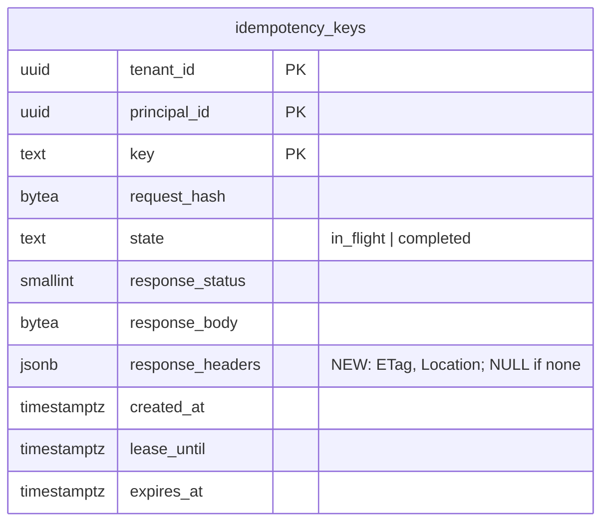

# idempotency_keys.response_headers (TICK-412)

A replayed idempotent response restores `ETag` and `Location`, not only
`Content-Type`. TICK-357's `POST /api/v1/records/{entity}` answers 201 with
`ETag: W/"<version>"` and `Location`. A client that retries after a timeout
gets the replay, and it needs that `ETag` for its next `If-Match` (TICK-359).

## Decision

| Question | Answer |
| --- | --- |
| Shape | One nullable `response_headers jsonb` column. It holds an object of header name to one string value, for example `{"ETag":"W/\"1\"","Location":"/api/v1/records/incident/…"}`. |
| Why not inside `response_body` | The body is the handler's bytes, so a replay stays byte-identical (CI-8). An envelope would mean parsing and re-serialising on every replay. |
| Why not one column per header | The allow-list lives in Go (`idempotency.ReplayHeaders`). Adding a header is then a code change, not DDL. |
| Allow-list | `ETag` and `Location`. Nothing else a handler sets (`Retry-After`, caching, tracing, cookies) is stored. This is the "same response" of ADR-001 D6, I7 and CI-8 for the headers a client acts on. It is not a store of every header. |
| NULL | No allow-listed header was set (problems, for example), or the row was written before this migration. Such a row replays as before, without them. |
| CHECK | `response_headers IS NULL OR jsonb_typeof(response_headers) = 'object'`. The middleware scans the value into `map[string]string`, so any other top-level type would make that replay a 500 (the same reason as TICK-378). |
| Grant | `nava_app` gets `UPDATE (response_headers)` (`db/grants.yaml`). It is written by the completing `UPDATE`. `INSERT` is table-wide already. No policy change: `idempotency_update` scopes it by tenant. |
| Index | None. Every read and write is a primary-key lookup on `(tenant_id, principal_id, key)`, and that path does not change. |

## Migration (online, no per-tenant DDL)

1. `20261102120000_idempotency_response_headers`: `ADD COLUMN` (nullable, no
   default, catalogue only) plus `ADD CONSTRAINT … NOT VALID`. These take a
   brief ACCESS EXCLUSIVE lock behind `lock_timeout = 5s`.
2. `20261102120100_idempotency_response_headers_validate`: `VALIDATE
   CONSTRAINT` under SHARE UPDATE EXCLUSIVE. The middleware's reads and
   writes keep running while it scans.

The expand step is complete on its own: the old middleware never names the
column, so old and new code can run side by side during a rollout.

## Evidence

Run on PostgreSQL 16.10 (the `docs/pins.md` pin), in Docker on an
i7-1260P laptop (16 vCPU, 19 GiB given to Docker). The table held 200,000
completed rows across 500 tenants, with record-shaped bodies of about 100 B.
Script: `scratch/idempotency-headers-bench/`. Raw output: `result.txt` there.

| Step | Figure |
| --- | --- |
| `ADD COLUMN` + `NOT VALID` CHECK | 0.4 ms, no rewrite (heap 57,556,992 B before and after) |
| `VALIDATE CONSTRAINT`, 200k rows | 17.9 ms, without blocking reads or writes |
| Average stored value (ETag + Location of a record) | 99 B, inline (under the 2 kB TOAST threshold) |
| Heap with every row carrying both headers | 78,077,952 B, against 57,556,992 B: +20.5 MB, about 103 B a row, +36 % |

The +36 % is the worst case, where every write is a create. Updates and
problems store NULL, which costs only a null-bitmap bit. Rows live for 24 h
before `nava-purge` deletes them, so the cost does not compound. Write
amplification is zero extra index entries. The completing `UPDATE` already
rewrites the row, and the column is unindexed, so it stays HOT-eligible
(only page fill changes).

## Tests

- `internal/platform/idempotency/headers_test.go` (unit): covers the
  allow-list and first-value encoding, NULL when there are none, refusal of a
  non-object, and that a replay sets only allow-listed headers.
- `internal/tenancy/isolation/idempotency_paths.go` (CI-8, real `nava_app`
  plus RLS): a replay restores `ETag` and `Location` and drops other handler
  headers. A stored problem holds NULL. A pre-migration row (NULL) still
  replays.
