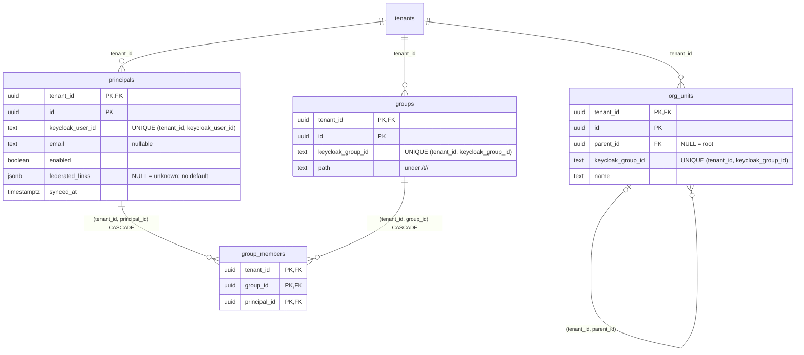
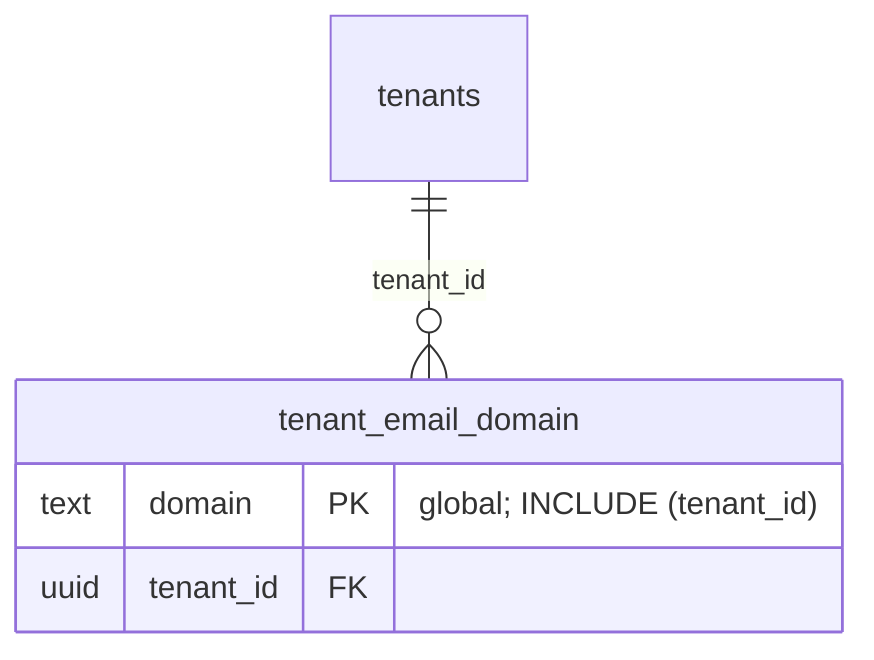
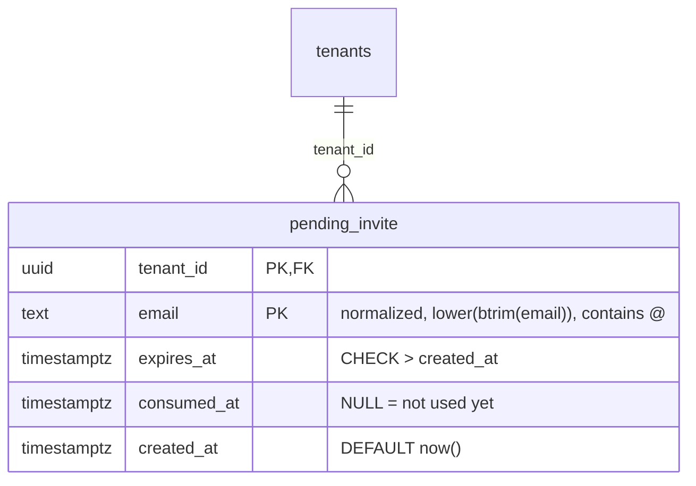

# Identity tables under forced RLS (T16)

Scope: TICK-69. ADR-001 A.1 (step 3 and platform rules), A.3 (group sync
row), PLAN-001 T16 and D-P13. Migration
`db/migrations/00003_identity_tables.sql`, grants in `db/grants.yaml`.
PostgreSQL 16.10.

Group sync (`nava_groupsync`, T25) writes these tables from the Keycloak
admin API, one transaction per tenant. Tenant resolution (`nava_app`, T17)
reads them. Keycloak user and group ids come only from these rows, read
under RLS (A.1).

## Tables



Every table is `ENABLE` + `FORCE ROW LEVEL SECURITY`. Every primary key,
unique key and foreign key leads with `tenant_id`, so a membership cannot
join a principal to another tenant's group and an org unit cannot hang under
another tenant's unit. The database refuses both with SQLSTATE 23503, even
when the tenant's own sync writes them.

### `federated_links`: NULL fails closed

| Value | Meaning | Resolver (A.1 step 3) |
| --- | --- | --- |
| `NULL` | Unknown: sync has not recorded the user's links | 401 |
| `'[]'` | Synced, no federated identity | Passes the link check |
| `'[{"identityProvider": "idp-a", ...}]'` | Synced links, as the Keycloak admin API returns them | Every `identityProvider` must be a bound alias, else 401 |
| no row | User not synced yet | 401 (unknown, the same as `NULL`) |

The column is `jsonb` with no `NOT NULL` and no default. A writer that omits
it stores `NULL`. `NOT NULL DEFAULT '[]'` would turn "not synced" into
"synced, no links" and fail open. `TestT16FederatedLinksFailClosed` reads
`attnotnull` and `atthasdef` from the catalogue and fails if either is set.

`principals_federated_links_check` accepts only `NULL` or an array whose
elements are all objects with a string `identityProvider`. It rejects `{}`,
`null`, `[1]`, `["idp-a"]`, `[{"userId": "u1"}]` and
`[{"identityProvider": 7}]`. The resolver therefore never sees a link that it
cannot compare with the bound aliases and might skip.

### Other constraints

- `groups_path_check`: `path` starts with `/t/<own tenant_id>/`. A group from
  another tenant's subtree, or from the realm root, is refused (23514), even
  when sync maps it wrongly.
- `org_units_parent_check`: a unit cannot be its own parent.
- `group_members` FKs are `ON DELETE CASCADE`, so deleting a principal or a
  group removes its memberships. The key includes `tenant_id`, so the cascade
  stays inside one tenant (tested).
- `org_units_parent_fkey` is `NO ACTION`. A parent with children cannot be
  deleted on its own, but sync can delete a whole subtree in one statement.

## Policies and grants

Each policy uses the canonical tenant predicate
`tenant_id = NULLIF(current_setting('app.tenant_id', true), '')::uuid`, is
`FOR` one command and is `TO` named roles. None is on the A.3 allow-list, so
`TestT09PolicyAllowList` still counts 10 allow-listed policies, and the
catalogue gate checks the 15 new ones.

| Table | `nava_app` | `nava_groupsync` |
| --- | --- | --- |
| `principals` | SELECT | SELECT, INSERT, UPDATE (`email`, `enabled`, `federated_links`, `synced_at`), DELETE |
| `groups` | SELECT | SELECT, INSERT, UPDATE (`path`), DELETE |
| `group_members` | SELECT | SELECT, INSERT, DELETE |
| `org_units` | SELECT | SELECT, INSERT, UPDATE (`parent_id`, `name`), DELETE |

Policy names are `<table>_select` (TO `nava_app`, `nava_groupsync`) and
`<table>_insert`, `_update`, `_delete` (TO `nava_groupsync`).
`group_members` has no UPDATE grant or policy. `UPDATE` never covers a key
column: sync re-keys a row by deleting and inserting it, so a bug cannot
point an existing id at a different Keycloak user (`TestT16WriteGrants`).
No other role holds anything on these tables.

## Tests

| Acceptance criterion | Test |
| --- | --- |
| RLS hides tenant B's rows from tenant A in every new table | `TestT16TenantRowsInvisible`: as `nava_app` and `nava_groupsync`, with tenant A, an empty tenant and none. Also: A's inserts of B rows are refused (42501); A's updates and deletes reach 0 of B's rows |
| FKs reject cross-tenant references | `TestT16ForeignKeysRejectCrossTenant` |
| A `group_members` row cannot reference another tenant's group | `TestT16ForeignKeysRejectCrossTenant` (23503); also another tenant's principal and parent unit |
| T10/T11 pick the tables up from the catalogue | The catalogue gate runs after every migration in every dbtest. `make isolation` runs CI-2 over all four tables as every runtime role, directly and through PgBouncer. Its seed (`internal/tenancy/isolation/testdata/seed.sql`) has rows of both tenants, with the Keycloak ids repeated across tenants. |

Also covered: `TestT16FederatedLinksFailClosed`, `TestT16KeysArePerTenant`
(Keycloak ids are unique per tenant, not globally; group path check),
`TestT16DeletesCascadeWithinTenant`, `TestT16WriteGrants`.
`TestT09EveryTableForcesRLS` now expects the 4 new tables as well.

## Evidence

Measured on 2026-10-25 with `sh docs/data/identity-bench/run.sh`, which
writes its full output to `bin/identity-bench-output.txt` (gitignored).
Setup: PostgreSQL 16.10
(`postgres:16.10`) on Docker Desktop 28.0.1 under Windows 11, 16 CPUs,
19.4 GiB in the VM, `shared_buffers=1GB`. The roles and every migration were
applied by `nava-db roles` and `nava-db migrate`, so the catalogue gate
passed on this schema.

The data covers 200 tenants. Ten large tenants are at the acceptance volume,
each with **50,000 principals, 5,000 groups**, 8 memberships per principal
and 500 org units. 190 small tenants each have 100 principals and 10 groups.
The large tenants hold 96% of the rows. Totals: `principals` 519,000,
`groups` 51,900, `group_members` 4,154,300, `org_units` 11,900. One
principal per tenant is in 200 groups, the worst case the resolver reads.
One principal in three has a federated link.

Each plan ran as the role that issues the query, with RLS on and the tenant
set transaction-locally, as `InTenantTx` does it. None ran as the owner or a
superuser.

### The resolver lookup (A.1 step 3)

After the binding lookup (T09 Q1: 0.239 ms) has given the tenant, T17 reads
the principal, its links and its group ids in one statement:

```sql
SELECT p.id, p.enabled, p.federated_links,
       ARRAY(SELECT gm.group_id FROM group_members gm
             WHERE gm.tenant_id = p.tenant_id AND gm.principal_id = p.id
             ORDER BY gm.group_id) AS groups
FROM principals p
WHERE p.tenant_id = $1 AND p.keycloak_user_id = $2;
```

| Query (`nava_app`) | Plan | Buffers (warm) | Time cold / warm |
| --- | --- | --- | --- |
| R1 Large tenant, user in 8 groups | Index Scan `principals_keycloak_user_key` + Index Scan `group_members_principal` | 18 | 0.941 / 0.497 ms |
| R1b Large tenant, user in 200 groups | same | 10 | 0.523 / 0.412 ms |
| R1c R1 with RLS as the only tenant filter | same, RLS predicate in both Index Conds | 15 | 0.224 / 0.128 ms |
| R1d Unknown user (no row, 401) | Index Scan `principals_keycloak_user_key`, 0 rows | 3 | 0.256 / 0.096 ms |
| R1e Small tenant, user in 8 groups | same as R1 | 15 | 0.499 / 0.783 ms |

"Cold" is the first run after the seed and `VACUUM ANALYZE`, and "warm" is
the second. Every Index Cond leads with `tenant_id`, including R1c, where
the only tenant filter is the RLS policy. That works because `uuid =` and
`text =` are leakproof. No query reads `federated_links` through an
operator, so the column needs no GIN index. The resolver reads it whole and
compares it in Go.

An earlier run with the same index measured R1 warm at 0.311 ms, with the
same plan and buffer count. The spread comes from the shared laptop.

### Group sync (T25, `nava_groupsync`, large tenant)

| Query | Plan | Buffers | Time |
| --- | --- | --- | --- |
| S1 Snapshot of all 50,000 principals | Bitmap Heap Scan via `principals_pkey` | 1,432 | 53.8 ms |
| S2 Snapshot of all 400,192 memberships | Index Only Scan `group_members_pkey`, 0 heap fetches | 93,381 | 364 ms |
| S3 Members of one group (81) | Index Only Scan `group_members_pkey` | 23 | 1.69 ms |
| S4 Children of an org unit | Index Scan `org_units_parent` | 3 | 0.127 ms |
| S5 Delete a principal, cascading to 8 memberships | `principals_pkey`; cascade trigger 2.13 ms | 10 | 3.69 ms |
| S6 Delete a group, cascading to its members | `groups_pkey`; cascade trigger | 9 | 6.02 ms |
| S7 Delete a leaf org unit (FK check for children) | `org_units_pkey`; FK check trigger | 8 | 1.55 ms |

S2 is the most expensive read: a full snapshot of a 50k-user tenant, once
per 5-minute tick (D-P13). It reads the primary key only.

### Index choice: `group_members (tenant_id, principal_id)`

I measured the description's two-column index against a covering
`(tenant_id, principal_id, group_id)`, which allows an index-only scan. Both
were freshly built on the same 4.15 M rows:

| Index | Size | R1 plan | R1 buffers (warm) | R1 warm |
| --- | --- | --- | --- | --- |
| `(tenant_id, principal_id)` (shipped) | **51 MB** (69 MB as built by inserts) | Index Scan + 8 heap rows | 18 | 0.497 ms |
| `(tenant_id, principal_id, group_id)` | 269 MB | Index Only Scan, 0 heap fetches | 10 | 0.502 ms |

The two-column index is about a fifth of the size. B-tree deduplication
(PostgreSQL 13+) folds each principal's 8 entries into one posting list,
while three unique columns cannot deduplicate. It costs 8 more buffer hits
per lookup and no measurable time. The migration ships the two-column form.

### Index cost

| Index | Size | Why it exists |
| --- | --- | --- |
| `group_members_pkey` | 363 MB | PK; sync snapshot (S2), members of a group (S3), the group FK's cascade |
| `group_members_principal` | 69 MB | resolver (R1), the principal FK's cascade |
| `principals_keycloak_user_key` | 52 MB | resolver lookup by Keycloak user id; sync upsert |
| `principals_pkey` | 34 MB | PK; FK target |
| `groups_keycloak_group_key`, `groups_pkey` | 5.2 MB, 3.3 MB | sync upsert by Keycloak id; PK |
| `org_units_keycloak_group_key`, `org_units_pkey`, `org_units_parent` | 592 kB, 416 kB, 136 kB | sync upsert; PK; the self-FK's check on delete and children-of (S4) |

Heaps: `group_members` 309 MB, `principals` 92 MB, `groups` 7.6 MB,
`org_units` 728 kB. Two indexes go beyond the description's contract.
`org_units_keycloak_group_key` exists because sync upserts units by Keycloak
id, the same as groups. `org_units_parent` backs the self-FK: without it,
every delete checks for children with a sequential scan, and because RI
checks bypass RLS, that scan covers every tenant's units. There is no JSONB
index.

Write cost as `nava_groupsync` in one tenant transaction, with every index,
FK check and `WITH CHECK`, over three runs on the same host. The first run
had the three-column membership index; the other two had the shipped
schema:

| Write | Rows | Time | Per row |
| --- | --- | --- | --- |
| W1a Insert principals | 10,000 | 330–726 ms | 33–73 µs |
| W1b Insert memberships (2 indexes, 2 FK checks) | 80,000 | 3.5–8.7 s | 44–109 µs |
| W2 Touch every principal of a tenant (`synced_at`, `federated_links`) | 60,000 | 1.27–2.56 s | 21–43 µs |

The runs vary by up to 2.5x on a shared laptop. Treat these as ranges until
they run on dedicated hardware, as in [platform-tables.md](platform-tables.md).
A full 50k-user resync touches every principal in about 2.6 s at worst. Sync
should still write only the rows that changed (T25's diff), because W2
rewrites every principal row and its indexes.

## Migration safety

All four tables are new and empty, so `CREATE TABLE`, the constraints and the
plain `CREATE INDEX` statements take no lock on existing data. They run in
one goose transaction. No tenant is locked, and no per-tenant DDL is needed.
Later column additions go through expand/contract. A new index on a populated
table needs `CREATE INDEX CONCURRENTLY` in its own `NO TRANSACTION`
migration (db/README.md).

## Not done here (owners)

- The resolver query in Go, the `idp` claim check, and 401 for `NULL` links
  or a missing row: T17 (TICK-72). The query above is the one measured.
- The sync diff, the per-tenant advisory lock, and writing only changed rows:
  T25.
- Registered named isolation paths for these tables (`Paths()` in
  `internal/tenancy/isolation/registry.go`). That file needs CTO sign-off,
  and the generic CI-2 checks already cover all four tables.

## Tenant email domains (T18a)

Scope: TICK-194, security finding 3 on PR #101 (T18). Migration
`db/migrations/00004_tenant_email_domain.sql`. Keycloak `InviteUser` creates
a new user only for an email whose domain the tenant owns
(`Registry.TenantOwnsEmailDomain`, implemented by `pgstore.Store`). Without
this rule, tenant A could pre-create `anyone@tenant-b.test` and lock B's
federated user out of their first brokered login.



- **One owner per domain, realm-wide.** The primary key is `(domain)`, not
  `(tenant_id, domain)`, for the same reason
  `tenant_identity_binding`'s `UNIQUE (issuer, org_id)` is global: two
  tenants claiming one domain is the conflict this table exists to refuse
  (SQLSTATE 23505).
- **`CHECK`**: lower-case ASCII labels (an IDN in punycode form), at least
  two labels, at most 253 bytes. A mixed-case row would never match the
  lower-cased lookup. The store lower-cases its input too.
- **Policies.** `email_domain_select`: `nava_app`, canonical tenant
  predicate. Another tenant's domain is no row, so it reads as `false`, the
  same as a domain nobody owns, and the caller never learns who owns it.
  `email_domain_onboard`: `nava_onboard` `INSERT` (columns `tenant_id`,
  `domain`), tenant predicate **and** "tenant is provisioning". This is
  pinned in `catalog.PinnedTenantPolicies`, like `binding_onboard`, so
  domains are claimed only in T21's onboarding transaction, never added to
  an active tenant. No role has `UPDATE` or `DELETE`.

### Evidence

PostgreSQL 16.10 (`postgres:16.10`, Docker 29.9.2), fsync off. Intel
i7-1260P, 16 threads, 19 GB RAM, Windows 11 host. 25,000 rows: 10,000
active tenants with 1–3 domains each, plus one large tenant with 5,000
domains. The `EXPLAIN` ran as `nava_app` with FORCE RLS on, in a
transaction with `app.tenant_id` set (queries under "Reproducing" below).
Statement: `pgstore.emailDomainSQL`.

| Case (tenant context) | Plan | Buffers | Execution |
| --- | --- | --- | --- |
| Own domain, small tenant | Index Only Scan `tenant_email_domain_pkey`, Heap Fetches 0 | 4 hit | 0.150 ms |
| Large tenant's domain, from a small tenant | same; Rows Removed by Filter 1 | 4 hit | 0.104 ms |
| Domain nobody owns | same | 3 hit | 0.071 ms |
| Own domain, large tenant | same | 4 hit | 0.183 ms |

```text
Result  (actual time=0.054..0.056 rows=1 loops=1)
  InitPlan 1 (returns $0)
    ->  Result  (actual time=0.051..0.052 rows=0 loops=1)
          One-Time Filter: ((NULLIF(current_setting('app.tenant_id'::text, true), ''::text))::uuid = '...0005'::uuid)
          ->  Index Only Scan using tenant_email_domain_pkey on tenant_email_domain  (actual time=0.039..0.040 rows=0 loops=1)
                Index Cond: (domain = 'big-d17.example'::text)
                Filter: (tenant_id = '...0005'::uuid)
                Rows Removed by Filter: 1
                Heap Fetches: 0
```

The planner turns the RLS predicate into a one-time filter, because the
query names the same tenant. The unique `domain` key finds at most one
entry, and the `INCLUDE`d `tenant_id` answers the tenant predicate from the
index, without touching the heap. The tenant predicate is index-backed for
every tenant size.

### Index cost

The shape comparison under "Reproducing" compared the chosen key with the binding's
shape, `PRIMARY KEY (tenant_id, domain)` + `UNIQUE (domain)`, on the same
25,000 rows inserted in random order:

| Shape | Indexes | Index size | Heap | Insert of 25,000 rows (median of 5) |
| --- | --- | --- | --- | --- |
| `PRIMARY KEY (domain) INCLUDE (tenant_id)` (chosen) | 1 | 1,952 kB | 1,656 kB | 329 ms |
| `PK (tenant_id, domain)` + `UNIQUE (domain)` | 2 | 3,192 kB | 1,656 kB | 376 ms |

The second index would add one index write per row and 64% more index
storage. It would serve only "all domains of a tenant", and no query asks
for that yet. Writes are rare (onboarding only), so either shape is cheap.
The rule of the fewest indexes decides. The foreign key to `tenants` has no
index of its own, because tenants are never deleted at runtime. The table
holds two short columns, so a seq-scanned FK check on a tenant delete would
read about 1.6 MB at 25,000 rows.

### Reproducing

As the superuser on a migrated `nava` database (a dbtest cluster), load the
volume, then run the lookups as `nava_app`:

```sql
INSERT INTO tenants (id, state)
SELECT ('00000000-0000-4000-8000-' || lpad(to_hex(g), 12, '0'))::uuid, 'active'
FROM generate_series(1, 10001) g;
-- 10,000 tenants with 1-3 domains each
INSERT INTO tenant_email_domain (tenant_id, domain)
SELECT ('00000000-0000-4000-8000-' || lpad(to_hex(g), 12, '0'))::uuid, 't' || g || '-d' || d || '.example'
FROM generate_series(1, 10000) g, generate_series(1, 1 + g % 3) d;
-- the large tenant (0x2711 = 10001): 5,000 domains
INSERT INTO tenant_email_domain (tenant_id, domain)
SELECT '00000000-0000-4000-8000-000000002711', 'big-d' || d || '.example'
FROM generate_series(1, 5000) d;
VACUUM ANALYZE tenant_email_domain;

SET ROLE nava_app;
BEGIN;
SELECT set_config('app.tenant_id', '00000000-0000-4000-8000-000000000005', true);
EXPLAIN (ANALYZE, BUFFERS) SELECT EXISTS (SELECT 1 FROM tenant_email_domain
WHERE tenant_id = '00000000-0000-4000-8000-000000000005' AND domain = 't5-d2.example');   -- own
-- the same with domain = 'big-d17.example' (another tenant's) and
-- 'nobody.example' (nobody's)
COMMIT;
BEGIN;
SELECT set_config('app.tenant_id', '00000000-0000-4000-8000-000000002711', true);
EXPLAIN (ANALYZE, BUFFERS) SELECT EXISTS (SELECT 1 FROM tenant_email_domain
WHERE tenant_id = '00000000-0000-4000-8000-000000002711' AND domain = 'big-d4999.example');
COMMIT;
RESET ROLE;
```

The index-shape comparison, as the superuser on the same database. Run the
`TRUNCATE` and the two timed inserts (psql `\timing on`) five times and take
the median:

```sql
CREATE TABLE bench_one (tenant_id uuid NOT NULL, domain text NOT NULL,
    PRIMARY KEY (domain) INCLUDE (tenant_id));
CREATE TABLE bench_two (tenant_id uuid NOT NULL, domain text NOT NULL,
    PRIMARY KEY (tenant_id, domain), UNIQUE (domain));
CREATE TEMP TABLE src AS SELECT tenant_id, domain FROM tenant_email_domain ORDER BY random();
TRUNCATE bench_one, bench_two;
INSERT INTO bench_one SELECT * FROM src;
INSERT INTO bench_two SELECT * FROM src;
SELECT relname, pg_size_pretty(pg_indexes_size(oid)) AS indexes, pg_size_pretty(pg_relation_size(oid)) AS heap
FROM pg_class WHERE relname IN ('bench_one', 'bench_two');
DROP TABLE bench_one, bench_two;
```

### Not done here (owners)

- Inserting the domains in `CreateTenantOrg`, in the binding's
  transaction: T21 (TICK-81). The contract is one `INSERT` per domain into
  `tenant_email_domain (tenant_id, domain)`, as `nava_onboard`, inside
  `tenancy.InTenantTx` for the provisioning tenant. A 23505 means another
  tenant already owns the domain. T21 decides how an operator verifies that
  the tenant really owns a domain before claiming it. The first claim wins.
- A Postgres implementation of the rest of `keycloak.Registry` (user, group
  and alias lookups). Only `TenantOwnsEmailDomain` is in `pgstore` so far.

## Pending invites (T252a)

Scope: TICK-254, the schema for the option-2 fix to TICK-252 (CTO,
2026-10-27). Migration `db/migrations/00006_pending_invite.sql`. For an
unknown email, `DirectoryAdmin.InviteUser` no longer creates a Keycloak user.
It records the invite here. The invitee's first broker login creates the
user, and group sync then places them in `/t/<tenant_id>/` and consumes the
invite (TICK-252 conditions 2a, 2c and 2d).



**Lifecycle.** An invite starts **pending** (`consumed_at IS NULL`,
`expires_at > now()`). It ends in one of two states:

- **Consumed:** group sync sets `consumed_at` exactly once.
- **Expired:** `expires_at` passes before anyone consumes it. Nothing writes
  the row.

Re-inviting a pending invite only moves `expires_at`. Re-inviting a consumed
invite changes nothing, so a consumed invite stays consumed. An expired
invite that was never consumed can be re-invited, which makes it pending
again with the new `expires_at`. The table only stores the expiry; the
default TTL lives in the code (TICK-252).

```sql
-- nava_onboard, InviteUser: 1 row for a new or pending invite, 0 for a consumed one
INSERT INTO pending_invite (tenant_id, email, expires_at) VALUES ($1, $2, $3)
ON CONFLICT (tenant_id, email) DO UPDATE SET expires_at = EXCLUDED.expires_at
WHERE pending_invite.consumed_at IS NULL;
-- nava_groupsync, condition 2d, inside tenancy.InTenantTx
UPDATE pending_invite SET consumed_at = now()
WHERE tenant_id = $1 AND email = $2 AND consumed_at IS NULL AND expires_at > now()
RETURNING tenant_id, email;
```

- **Key.** `PRIMARY KEY (tenant_id, email)` is the `UNIQUE (tenant_id,
  email)` Security requires, and the only index. It is the upsert's conflict
  arbiter and the consume lookup. The same email can have an invite in each
  of two tenants; condition 2c decides which one, if any, applies.
- **`CHECK`s.** The email must equal `lower(btrim(email))` and contain `@`,
  the same form `keycloak.normalizeEmail` returns, so a row that the
  normalized lookup could never match cannot be written. A second CHECK
  requires `expires_at > created_at`.
- **Policies.** There is one policy per command and role. Each tests the
  canonical tenant predicate (on both USING and WITH CHECK for UPDATE), and
  the `nava_onboard` write policies also require the tenant to be
  provisioning:
  - `pending_invite_select`: `nava_onboard` and `nava_groupsync`.
  - `pending_invite_insert`: `nava_onboard`, tenant predicate **and**
    `tenant_id IN (SELECT id FROM tenants WHERE state = 'provisioning')`.
  - `pending_invite_reinvite`: `nava_onboard` UPDATE, the same guard on
    USING and WITH CHECK. `nava_onboard` needs an UPDATE policy because
    `ON CONFLICT DO UPDATE` checks the existing row against it. Without one,
    a re-invite fails with `new row violates row-level security policy
    (USING expression)` (checked on PG 16.10).
  - `pending_invite_consume`: `nava_groupsync` UPDATE, tenant predicate
    only, because group sync consumes invites in active tenants.

  The guard matches `email_domain_onboard` and `binding_onboard`: every
  `nava_onboard` write is limited to its own tenant while that tenant is
  provisioning, so onboarding cannot plant or extend an invite in an active
  tenant (security finding 1 on PR #164). `inviteAdmin` runs before
  `Activate`, so InviteUser's statements are unchanged. Both guarded
  policies are pinned in `catalog.PinnedTenantPolicies`.
- **Grants** (`db/grants.yaml`):
  - `nava_onboard`: SELECT `(tenant_id, email, expires_at, consumed_at)`,
    INSERT `(tenant_id, email, expires_at)`, UPDATE `(expires_at)`. The
    upsert reads the conflict key, `consumed_at` in its WHERE, and
    `EXCLUDED.expires_at`, and needs SELECT on each.
  - `nava_groupsync`: SELECT on the same four columns and UPDATE
    `(consumed_at)`.
  - No other role has any grant.

  `nava_onboard` has no UPDATE on `consumed_at`, so it can neither consume an
  invite nor reopen one. That is also why the upsert leaves `consumed_at =
  NULL` out of its SET: under the WHERE it would change nothing, and it
  would need that grant.
- **No DELETE.** No role may delete a row. A row is the record that an
  invite was issued and whether it was used. A delete would turn "consumed"
  back into "never invited", and then a second invite with a fresh expiry
  could place the same email in the tenant again, which breaks the
  single-use rule (`TestInviteIsSingleUse`). Expired and consumed rows are
  few (one per invited admin) and stay. If they ever need a purge, it would
  be a `nava_purge` policy on the A.3 allow-list, like the others.

### Evidence

PostgreSQL 16.10 (`postgres:16.10`, Docker 29.9.2), on an Intel i7-1260P
(16 threads, 19 GB RAM) with a Windows 11 host. The table holds 70,000 rows:
10,000 tenants with 1–3 invites each, plus one large tenant with 50,000. A
third of all rows are consumed. Each `EXPLAIN (ANALYZE, BUFFERS)` ran as its
runtime role, with FORCE RLS on and `app.tenant_id` set. The two re-invite
rows were measured before the provisioning guard was added; the guard adds
one `tenants` primary-key lookup to each.

| Case (role, tenant context) | Plan | Buffers | Execution |
| --- | --- | --- | --- |
| Consume, large tenant (`nava_groupsync`) | Index Scan `pending_invite_pkey` on both key columns, 1 row | 8 hit | 0.265 ms |
| Consume an already-consumed invite, small tenant | same; Rows Removed by Filter 1, 0 rows | 4 hit | 0.338 ms |
| Consume the large tenant's invite from a small tenant | One-Time Filter false, index scan never executed | 0 | 0.145 ms |
| Open invites of a small tenant (3 rows) | Index Scan `pending_invite_pkey`, `tenant_id` prefix | 4 hit | 0.455 ms |
| Open invites of the large tenant (33,334 of 70,000 rows) | Seq Scan (it returns 48% of the table) | 743 hit | 30.2 ms |
| Re-invite a pending invite (`nava_onboard`) | Conflict Arbiter `pending_invite_pkey`, updated | 7 hit | 0.271 ms |
| Re-invite a consumed invite | same; Rows Removed by Conflict Filter 1 | 6 hit | 0.138 ms |

```text
Update on pending_invite  (actual time=0.200..0.205 rows=1 loops=1)
  Buffers: shared hit=8
  ->  Result  (actual time=0.058..0.062 rows=1 loops=1)
        One-Time Filter: ((NULLIF(current_setting('app.tenant_id'::text, true), ''::text))::uuid = '...2711'::uuid)
        ->  Index Scan using pending_invite_pkey on pending_invite  (actual time=0.049..0.053 rows=1 loops=1)
              Index Cond: ((tenant_id = '...2711'::uuid) AND (email = 'u49999@big.example'::text))
              Filter: ((consumed_at IS NULL) AND (expires_at > now()))
```

The tenant predicate is index-backed. The planner folds the RLS predicate
into a one-time filter, and the key scan leads with `tenant_id`. A
cross-tenant consume never reaches the index.

### Index cost

At 70,000 rows the heap is 5,944 kB and the one index is 5,968 kB. Loading
all 70,000 rows as the superuser took 2.5 s (fsync off), so each insert costs
one heap write and one index write. No partial index on open invites is
added: the large-tenant listing is the only seq scan, and it returns about
half the table, so an index on it would save little and add one write per
invite and per consume. Writes are rare (one per invited admin), so the
fewest-indexes rule decides. The foreign key to `tenants` has no index of
its own, because tenants are never deleted at runtime (the same as T18a).

### Tests

- `internal/db/dbtest/pending_invite_test.go`:
  - Security's negative test 10, the table part: from tenant B's
    transaction, and with `app.tenant_id` unset or empty, neither role reads,
    inserts, re-invites, extends or consumes tenant A's invite.
  - The lifecycle, in a provisioning tenant: invite, extend, consume once,
    then a second consume and a re-invite of the consumed invite both change
    nothing; an expired invite cannot be consumed. Once the tenant is
    active, `nava_onboard` can neither invite nor extend there (42501 and 0
    rows), and `nava_groupsync` still consumes.
  - The grants: no DELETE, `nava_onboard` cannot touch `consumed_at`,
    `nava_groupsync` writes only `consumed_at`, and no other role can read
    the table.
  - The CHECKs.
- Isolation suite: generic CI-2 checks over every role, plus six registered
  `pending_invite:` paths in `internal/tenancy/isolation/registry.go`. Its
  seed has the same email invited by both tenants. The CI-9 path
  `onboardCannotWriteActive` also covers the insert, the re-invite upsert
  and the `expires_at` update. From tenant A's own transaction, against A
  against B from A's, and against A from P's, all of them are refused or reach 0
  rows. Its positive control (`onboardInvitesOnlyProvisioning`) runs the
  same statements for provisioning tenant P and each reaches a row; after
  P is activated in the same transaction, none of them do.

### Not done here (owners)

- The `InviteUser` write, the group-sync placement and consume, the default
  TTL, and the Keycloak flow: TICK-252.
- The migration is forward-only, like every migration here (`db/README.md`).
  To back it out, a later migration would drop the table, once no code
  reads it.
