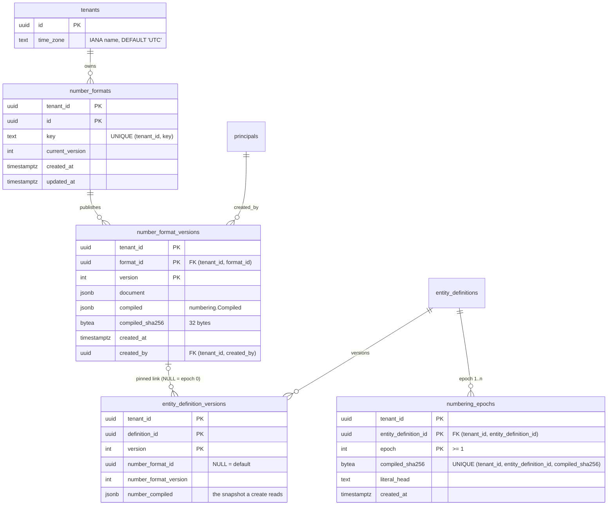

# Number formats, epochs and the pinned link (P6-06, TICK-671)

ADR-005 §3.2, §3.3, §3.6, §3.7 C8, C9, C12. Migrations
`db/migrations/20261113100000_number_format_tables.sql` to
`20261113100600_audit_log_subject_number_format_validate.sql`. Tests:
`internal/db/dbtest/number_format_tables_test.go` and the isolation registry
(`internal/tenancy/isolation/numberformat_paths.go`). Bench:
`scratch/tick-671-number-formats/` (`sh run.sh`).

## Model

## Decisions

| Decision | Why |
|---|---|
| Every key and FK leads with `tenant_id`; the pinned link is `(tenant_id, number_format_id, number_format_version) → number_format_versions (tenant_id, format_id, version)` | C8. FK checks run as the owner and skip RLS. With the composite key, tenant B's format id and a made-up id both fail with 23503 on `entity_definition_versions_number_format_fkey` (`TestP606LinkToAnotherTenantsFormat`). |
| The link is MATCH SIMPLE plus `entity_definition_versions_number_format_check` (all three columns NULL, or none) | `tenant_id` is never NULL, so MATCH FULL would refuse the default link. |
| The FK is added in the same `ALTER TABLE` as its columns | Every existing row has a NULL key, so nothing is skipped under FORCE RLS (`db/fk_validate_force_rls_test.go` exempts this form). The CHECK is `NOT VALID`, then `VALIDATE`. |
| `numbering_epochs` PK `(tenant_id, entity_definition_id, epoch)`, `epoch >= 1` | Epoch 0 is implicit (§3.3). The PK is the first UNIQUE key of §3.3. |
| `compiled_sha256` is computed in Go; the database checks only that it is 32 bytes | `jsonb` reorders keys, so SQL cannot recompute the hash the compiler wrote. |
| `literal_head ~ '^[A-Z]{2,6}[A-Z0-9_./-]*$'`, at most 64 characters | The leading-`{prefix}` rule (§3.1): the head starts with `number_prefix`, then literal characters. |
| `created_by NOT NULL` | Formats have no onboarding seed, and §3.7 C11 gives plugins a `principals` row, so every publish names a principal. |
| `tenants.time_zone text NOT NULL DEFAULT 'UTC'` with a shape CHECK | There is no tenant settings table. Whether a zone exists is checked in Go against the tzdata the binary ships with. `pg_timezone_names` is not immutable, so it cannot back a CHECK. |
| No secondary index | Every lookup is a PK or UNIQUE probe that leads with `tenant_id` (below). The one query without its own index, "types that pin format F", reads 250 rows of one tenant in 0.65 ms. |
| Audited under `number_format` (formats, versions) and `entity_definition` (epochs), `attached: false` | Nothing writes these tables yet. The publish task writes the entries and attaches `audit_commit_check`, as with `record_shares`. |

## Evidence

PostgreSQL 16.10 (`docs/pins.md`), Docker Desktop VM with 16 CPUs and 24 GiB
on Windows 11 x86_64, warm cache. The data has 2,000 tenants, 100,000 types,
500,000 definition versions (100,000 of them pinned), 20,000 formats, 60,000
format versions and 200,000 epochs. Each query runs as an RLS-bound role under
the canonical predicate. Full plans are in
`scratch/tick-671-number-formats/result.txt`.

| Query | Plan | Buffers | Time |
|---|---|---|---|
| (a) format by key | Index Scan `number_formats_key_key` | 3 | 0.068 ms |
| (b) pinned version by format key and version | `number_formats_key_key`, then `number_format_versions_pkey` | 7 | 0.109 ms |
| (c) every epoch of a type (disjointness, C10) | `entity_definitions` key, then the `(tenant_id, entity_definition_id)` prefix of `numbering_epochs_compiled_sha256_key` | 9 | 0.099 ms |
| (d) the epoch of one compiled template | Index Scan `numbering_epochs_compiled_sha256_key` | 5 | 0.039 ms |
| (e) types that pin format F, no index on the link | `number_formats_key_key`, then Bitmap on the `tenant_id` prefix of `entity_definition_versions_pkey` (250 rows) | 259 | 0.646 ms |
| (f) pinned definition-version insert | FK trigger probes `number_format_versions_pkey` | 15 | 0.516 ms (FK 0.256 ms) |

Migration cost at 500,000 definition versions: the `ADD COLUMN` × 3 + `ADD
CONSTRAINT … FOREIGN KEY` statement takes 51.7 ms, `ADD CHECK … NOT VALID`
2.9 ms, and `VALIDATE` 79.6 ms. The VALIDATE holds SHARE UPDATE EXCLUSIVE, so
reads and publishes continue while it runs.

Storage: `numbering_epochs` is 22 MB of heap and 37 MB of indexes at 200,000
rows. Both of its UNIQUE keys are required by §3.3. Write amplification is
one heap row plus two index entries per epoch, and an epoch is written only
when a definition publish changes the compiled template. `number_formats` and
`number_format_versions` each carry one index besides the PK
(`number_formats_key_key`) or none. The link columns add no index to
`entity_definition_versions`.

**Revisit (e)** if a tenant gets more than about 10,000 definition versions:
add a partial index `(tenant_id, number_format_id) WHERE number_format_id IS
NOT NULL`, built `CONCURRENTLY`.

## Grants (db/grants.yaml)

| Role | number_formats | number_format_versions | numbering_epochs |
|---|---|---|---|
| nava_app | SELECT, INSERT, UPDATE (current_version, updated_at) | SELECT, INSERT | SELECT, INSERT |
| nava_worker | SELECT | SELECT | SELECT |
| any other | none | none | none |

The `entity_definitions` UPDATE grant stays `current_version, updated_at,
numbering_mode`.
