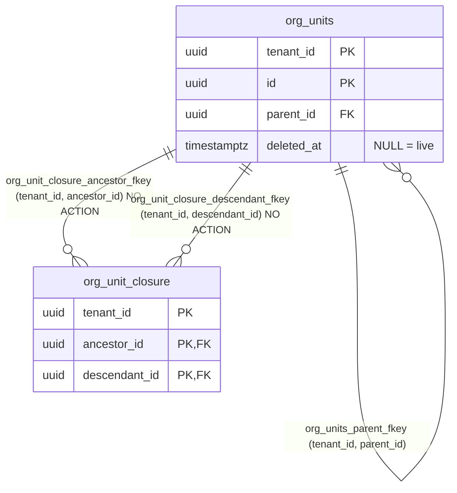

# Org-unit closure: live subtrees without a tree walk (TICK-1032)

S31 fix after the Solution Architect's R1 ruling on TICK-946 (ADR-010 D7 as
amended, ADR-010-A2). Schema:
`db/migrations/20261121050000_org_unit_closure.sql`. Bench:
`scratch/tick-1032-org-unit-closure/bench.sql`, output in `bench-out.txt` next
to it. Tests: `internal/db/dbtest/org_unit_closure_test.go`
(`TestTICK1032*`), the T16 identity-table tests, and the `org_unit_closure:`
paths in `internal/tenancy/isolation/registry.go`.

## What the table holds

For each live org unit, `org_unit_closure` lists every live unit at or below
it, the unit itself included. A row exists only if every unit from the root
down to the descendant is live. A tombstoned unit has no rows, and neither
has any unit below it, even a live one. A unit on a parent cycle (no root
above it) has no rows either.

Group sync is the only writer. A rebuild deletes the tenant's rows and
inserts them again (TICK-1033); since TICK-1054 a run that touched units
replaces only the rows of the touched units' subtrees, and the full rebuild
remains for the first import and for drift. The drift check (stored and live
closure compared as sets) runs only on a run that touched no unit, so drift
outside the touched subtrees is repaired by the next such run. The migration's backfill,
`org_unit_closure_rebuild_all()`, runs the same recursive statement per
tenant: live roots, then the live children of every unit reached.

## Access patterns

| Pattern | Query | Served by |
| --- | --- | --- |
| `Allows`: is record unit `d` under unit `a`? | `(tenant_id, ancestor_id, descendant_id) = (…)` | PK probe |
| List leaf: the live subtree of `a` | `descendant_id WHERE (tenant_id, ancestor_id) = (…)` | PK prefix, index-only |
| Rebuild: drop one tenant's rows | `DELETE … WHERE tenant_id = $1` | PK prefix |

Every query is tenant-scoped by `org_unit_closure_select` (`app.tenant_id`),
and the tenant is the PK's leading column.

## Evidence

PostgreSQL 16.10 (docs/pins.md) in Docker, 16 CPUs and 24 GiB for the VM, on
a Windows 11 host that was also running the local stack. `jit = off`, no
parallel workers. 400 tenants, 13,310 units. Tenant 0 has a 5-level tree of
11,111 units with fan-out 10. One level-2 unit is tombstoned, which removes
its 111-unit subtree. Tenants 1 to 9 have 201 units each, and the other 390
have only a root.

| Measure | Result |
| --- | --- |
| Closure rows | 57,777 in total, 53,778 for tenant 0 (11,000 live units, about 4.9 rows per unit). |
| Storage | heap 4,320 kB, `org_unit_closure_pkey` 5,384 kB, 9,736 kB in total. |
| Backfill, all 400 tenants | 1,143 ms and 2,729 ms on two runs (the host was shared). |
| Tenant 0 rebuild (DELETE then INSERT) | DELETE 26 ms. INSERT 1,257 ms: the recursive select is 150 ms, and the two FK triggers are 385 ms and 395 ms (53,778 calls each), 62% of the INSERT. |
| `Allows` probe, level-4 leaf under the root | Index Only Scan `org_unit_closure_pkey`, 1 row, 4 buffers, 0.059 ms. |
| List leaf, root's subtree (11,000 rows) | Index Only Scan `org_unit_closure_pkey`, 152 buffers, 0 heap fetches, 5.99 ms. |
| List leaf, a level-1 unit (1,000 live of 1,111) | Index Only Scan `org_unit_closure_pkey`, 18 buffers, 0.68 ms. |
| The same with only the RLS predicate | Index Only Scan, `Index Cond` takes `tenant_id` from the policy, 18 buffers, 0.47 ms. |

## Recommendation

- One index, the primary key. It serves all three patterns, and its tenant
  prefix backs every RLS-scoped read. A second index on
  `(tenant_id, descendant_id)` would serve only an FK check when a unit is
  deleted or re-keyed, and neither ever happens: no role holds DELETE on
  `org_units`, and no role can UPDATE `id`.
- Write cost: each row writes one heap tuple and one PK entry, and it runs
  two FK checks. On a full rebuild the checks are most of the cost (780 ms
  of 1,257 ms at 53,778 rows). If that matters, group sync can write only
  the rows that changed; that is TICK-1033's call. The FKs stay because the
  contract makes them carry `tenant_id`: they are what refuses a row that
  joins one tenant's ancestor to another tenant's descendant.

## `records_org_unit` gains `entity_definition_id` (SP-1d, critique B1)

`db/migrations/20261121060000_records_org_unit_entity_definition.sql` replaces
`records_org_unit` with `(tenant_id, org_unit_id, entity_definition_id) WHERE
org_unit_id IS NOT NULL`. The name stays the same, so the region bench and its
plans refer to the same index. The `(tenant_id, org_unit_id)` prefix still
backs the NO ACTION check of `records_org_unit_fkey`.

The migration runs with NO TRANSACTION, in three steps:

1. It drops an INVALID `records_org_unit_new` left over from a failed build.
2. It runs `CREATE INDEX CONCURRENTLY records_org_unit_new`.
3. In one DO-block transaction, it drops the old index and renames the new
   one. The DO block uses `lock_timeout` 2 s and retries 5 times, the same
   way `20261113210000` does.

Each statement commits on its own, but the drop and the rename commit
together. So `records` always has one of the two indexes: the old one before
the swap commits, the new one after. Re-running the migration is a no-op
(`TestNoTransactionMigrationsAreIdempotent`). `TestTICK1032RecordsOrgUnitKey`
checks the key columns, the predicate, validity, and that no build index is
left over.

Measured with `scratch/tick-1032-org-unit-closure/swap.sql` (output in
`swap-out.txt`). Same host and PostgreSQL 16.10. `records` has 1,000,000 rows
and a 420 MB heap. 400,000 rows in tenant 0 carry one of 200 units, spread
over 4 entity types.

| Measure | Result |
| --- | --- |
| Concurrent build | 803 ms. Writes continue during the build. |
| Swap transaction (DROP + RENAME) | 14.6 ms with ACCESS EXCLUSIVE on `records`. |
| Index size | 2,896 kB for the old 2-column key, 3,056 kB for the new key (+5.5%). |
| `under` leaf with an entity type, 20-unit set (9,998 rows) | Index Only Scan `records_org_unit`, all three columns in `Index Cond`, 72 buffers, 2.93 ms. |

## Unrooted-unit check (TICK-1058)

Since TICK-1034, a live unit with no `(u, u)` row is outside every region:
`under` never grants for it and `not under` admits it. Such a unit is an
orphan (its parent row is missing), a unit on a parent cycle, or a live unit
under a tombstoned ancestor. Group sync never leaves any of the three. Every
snapshot unit's parent must be in the snapshot, and an apply tombstones every
unit the snapshot lacks. A hand edit, a bypassed FK, or a bug can still create
one, so the count is checked.

- Query: `closureUnrootedSQL` in `internal/groupsync/closure.go` counts the
  tenant's live units with no self row (one anti-join).
- Group sync runs it after every `rebuildClosure` call, rebuilt or not. It
  also runs on every unchanged-snapshot cycle, because an orphan written by
  hand leaves the stored and live row counts equal, and the next apply
  tombstones it.
- A count above 0 adds to the counter `groupsync_org_closure_unrooted_units`,
  with no tenant attribute (T01), and writes a WARN line that names the
  tenant. The sync does not fail.
- `org_unit_closure_rebuild_all()` raises a `WARNING` per affected tenant
  (`db/migrations/20261121144100_org_unit_closure_unrooted_warning.sql`).

**Metric, not fail.** Failing the sync would not repair anything: the rollback
keeps the stored closure, which still has no self row. It would also stop
that tenant's principal tombstones and group removals, so deprovisioning
would wait for a hand fix. In the apply path, the run that reports an orphan
is the run that heals it.

Bench: `scratch/tick-1058-closure-self-row/bench.sql`, output in
`bench-out.txt`. Same host and PostgreSQL 16.10 as above, the same 400
tenants and 13,310 units, `jit = off`. The setup tombstones one level-2 unit
of tenant 0 but leaves its 110 descendants live, so the check counts 110,
and 111 with one orphan added.

| Measure | Result |
| --- | --- |
| Tenant 0 (11,111 units, 53,778 closure rows) | Hash Right Anti Join: Seq Scan of the closure (93% of the table is this tenant) and of `org_units`, 677 buffers, 22 to 29 ms. |
| The same, nested loop forced | Index Only Scan `org_unit_closure_pkey`, 11,111 probes, 44,470 buffers, 44 ms. The planner's hash join is cheaper. |
| Tenant 1 (201 units) | Hash anti-join over an Index Only Scan of the PK prefix, 253 buffers, 0.43 ms. |
| Against the rebuild it follows | Tenant 0's rebuild is 1,249 ms, so the check adds about 2%. No new index: the PK and `org_units_pkey` serve it. |

## Rollout

- The migration locks `org_units` in SHARE mode while it backfills, so no
  sync transaction changes the tree between the read and the commit. Reads
  continue. `lock_timeout` is 5 s.
- Until TICK-1033 ships, nothing keeps the closure up to date after a tree
  change. Nothing reads it before TICK-1034. If a long-lived stack needs a
  fresh closure before then, run `SELECT org_unit_closure_rebuild_all()` as
  `nava_migrator`.
- Down drops the function and the table. Nothing else depends on either.

