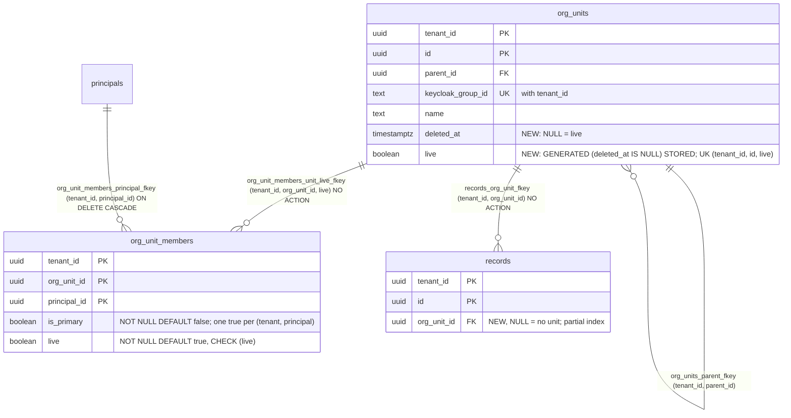

# Org units: tombstones, membership and `records.org_unit_id` (TICK-947)

Decision: [ADR-010](../adr/ADR-010-composable-access-rules.md) D7, D8;
PLAN-011 C5, D-11-6, D-11-11. Design: SP-2,
`acl-format2-caps.md` section 5 ([link](acl-format2-caps.md)).
Schema: `db/migrations/20261120120000_org_unit_members.sql` to
`20261120120400_records_org_unit_index.sql`. Bench:
`scratch/tick-947-org-units/bench.sql`, output in `bench-out.txt` next to it.
Tests: `internal/db/dbtest/org_units_test.go` (`TestTICK947*`), the T16
identity tests, the isolation registry and
`TestS31UnderChecksUnitsAtTheRouteAndGrantsBySubtree`.

## Results

**Setup:** `postgres:16.10` (`docs/pins.md`) in Docker Desktop, 16 vCPUs and
26 GB for the VM, Windows 11 host. The VM also ran the idle local stack and
two other agents' containers (named in `bench-out.txt`), so timings are
indicative. Data: 400 tenants, 1,000,000 records (400,000 in tenant 0, 300
bytes of `data` each, 579 MB with indexes), 200 org units in each of 10
tenants, 5,000 principals in tenant 0. Reads run as a non-owner role under
FORCE RLS, warm cache, JIT off.

| Question | Answer |
|---|---|
| M3 (`ADD COLUMN` + FK `NOT VALID`) | **2.5 ms**, catalogue only. |
| M4 (`VALIDATE` with the migrator policies), every row NULL | **112 ms** at 1,000,000 rows. `records` is locked ACCESS EXCLUSIVE for that long (the policies' lock). |
| M5 (`CREATE INDEX CONCURRENTLY`), every row NULL | **180 ms**; the index is **8 kB** (one empty page). |
| `records_org_unit` size, 400,000 rows with a unit | **2.9 MB** (for scale: `records_pkey` is 69 MB at 1,000,000 rows). Tenants with no regions add nothing. |
| `under` page 1 (20-unit set S, 40,058 matching rows, sort `-updated_at`, `LIMIT 51`) | **16.2 ms** with the index (Index Scan `records_org_unit`, 2,326 buffers) against **152.6 ms** without (Bitmap Heap Scan of all 400,000 tenant rows, 26,507 buffers). |
| Count of one unit (1,980 rows) | **0.41 ms** (Index Only Scan, 8 buffers) against **143.4 ms** without. |
| Write cost, single-row insert as the app role, 20,000 each | No index: 15.5 µs (NULL unit), 23.2 µs (with a unit: the FK check). With the index: 20.8 µs (NULL), 25.5 µs (with a unit). A NULL row skips the partial index, so its difference is noise; a row with a unit pays about 2.3 µs for the index entry. |
| "Units of a principal" (set S seed), 10,001 memberships | Index Only Scan `org_unit_members_principal`, 3 rows, 3 buffers, 0.014 ms. |
| Tombstone check of a unit with members | Index Scan `org_unit_members_pkey`, 49 rows, 0.12 ms. |
| `org_unit_members` index sizes at 10,001 rows | pkey 960 kB, `_principal` 688 kB, `_one_primary` 264 kB. |

Recommendation: the 3-index set on `org_unit_members` and the one partial
index on `records`, as SP-2 proposed. The `under` page without
`records_org_unit` costs 152 ms, the whole 150 ms list budget
(`docs/quality/acl-perf-800k.md`); with it, 16 ms. That 16 ms is the
filter-then-sort shape measured here; the `under` leaf's real SQL and its
place in the branch planner are TICK-950's, and the 800k region bench is
TICK-951's.

## Model



- **Units are tombstoned, never deleted (D7).** `org_units_delete` is dropped
  and `nava_groupsync` has no `DELETE`. A tombstoned unit stays a valid target
  for `records.org_unit_id`, so a record never dangles. Group sync
  tombstones a vanished unit and revives a returning one on the same id
  (`internal/groupsync/apply.go`; TICK-948 adds membership and the subtree
  metric).
- **Membership (D11 for units).** The live FK with `CHECK (live)` refuses a
  member of a tombstoned unit, and refuses tombstoning a unit that still has a
  member, with 23503 for every role. Sync deletes a unit's memberships before
  it tombstones the unit, as it does for groups.
- **One primary unit (D-11-6).** `org_unit_members_one_primary` is unique on
  `(tenant_id, principal_id) WHERE is_primary`.
- **Every key carries `tenant_id`.** A membership of tenant A cannot name
  tenant B's unit or principal, and a record of tenant A cannot name tenant
  B's unit (23503, `TestTICK947MembershipConstraints`,
  `TestTICK947RecordOrgUnitIsTenantScoped`).

## Indexes

| Index | Columns | Serves |
|---|---|---|
| `org_unit_members_pkey` | `(tenant_id, org_unit_id, principal_id)` | The NO ACTION check when a unit is tombstoned; group sync's per-unit reads |
| `org_unit_members_principal` | `(tenant_id, principal_id, org_unit_id)` | "Units of a principal", the set S seed (D7), index-only |
| `org_unit_members_one_primary` | `(tenant_id, principal_id) WHERE is_primary` | D-11-6, at most one row per principal |
| `org_units_live_key` | UNIQUE `(tenant_id, id, live)` | The target of the live FK |
| `records_org_unit` | `(tenant_id, org_unit_id) WHERE org_unit_id IS NOT NULL` | The `under` leaf (`org_unit_id IS NOT NULL AND org_unit_id = ANY(S)`) |

No index on `org_units.parent_id` is added: `org_units_parent` exists. The
FK from `records` needs no index on the `records` side for its own check:
units are never deleted and their key is never updated.

## Grants

| Role | `org_units` | `org_unit_members` | `records.org_unit_id` |
|---|---|---|---|
| `nava_groupsync` | `SELECT`, `INSERT`, `UPDATE (parent_id, name, deleted_at)`; no `DELETE` | `SELECT`, `INSERT`, `UPDATE (is_primary)`, `DELETE` | none |
| `nava_app` | `SELECT` | `SELECT` | `INSERT`, `UPDATE` (D8) |
| `nava_worker` | `SELECT (tenant_id, id, parent_id, deleted_at)` | `SELECT (tenant_id, org_unit_id, principal_id, is_primary)` | `INSERT`, `UPDATE` (D8) |

`org_unit_id` is in the records commit check's `UPDATE OF` list and in
`db/audited-tables.yaml`, so a write that moves it cannot commit without the
record's audit entry. `org_unit_members` is exempt from audit like the other
identity mirrors.

## The tenant-id trigger and AR-S30-01

`acl2_tenant_ids` (TICK-940) now also looks up every id of an
`under {"of": [ids]}` in `org_units` filtered by `NEW.tenant_id` and
`deleted_at IS NULL`. Another tenant's unit, a tombstoned unit and an id of no
unit all get 23514 with `{"code": "foreign_id", "pointer": ...}`, as groups and
users do, so the answer is no oracle for which ids exist. The lookup is one
`count(*)` over the distinct ids, backed by `org_units_pkey`.

`20261120120100` refuses to apply while any stored `acl_versions` row names
an `under` id that is not a live unit of its own tenant (AR-S30-01's one-off
check). To list them by hand, as the superuser:

```sql
SELECT a.tenant_id, a.entity_definition_id, a.version, x #>> '{}' AS org_unit_id
FROM acl_versions a
CROSS JOIN LATERAL jsonb_path_query(a.rules, 'lax $.**.under ? (@.of.type() == "array").of[*]') x
WHERE NOT EXISTS (SELECT 1 FROM org_units o
                  WHERE o.tenant_id = a.tenant_id AND o.deleted_at IS NULL AND o.id = (x #>> '{}')::uuid);
```

## Migrations

| File | What | Lock |
|---|---|---|
| `20261120120000_org_unit_members` | `org_units.deleted_at`, `live`, `org_units_live_key`; drop `org_units_delete`; `org_unit_members` with RLS and its 3 indexes | Rewrites `org_units` (one row per unit) under ACCESS EXCLUSIVE |
| `20261120120100_acl_tenant_ids_org_units` | The trigger's org-unit lookup; the AR-S30-01 check | ACCESS EXCLUSIVE on `acl_versions` and `org_units` for the check, both small |
| `20261120120200_records_org_unit_id` | `ADD COLUMN org_unit_id`, `records_org_unit_fkey NOT VALID`, the commit check's new `UPDATE OF` list | Catalogue only |
| `20261120120300_records_org_unit_fkey_validate` | `VALIDATE` with the TICK-715 migrator policies | ACCESS EXCLUSIVE on `records` for the scan (see Results) |
| `20261120120400_records_org_unit_index` | `CREATE INDEX CONCURRENTLY records_org_unit` | None that blocks writes |

None is per-tenant DDL. Each sets `lock_timeout = '5s'` where it takes a
lock. Rows written under the old schema read `org_unit_id` NULL, which never
matches `under` (D8).

**Rerun the bench:** `sh scratch/tick-947-org-units/bench.sh` (about 5
minutes).
