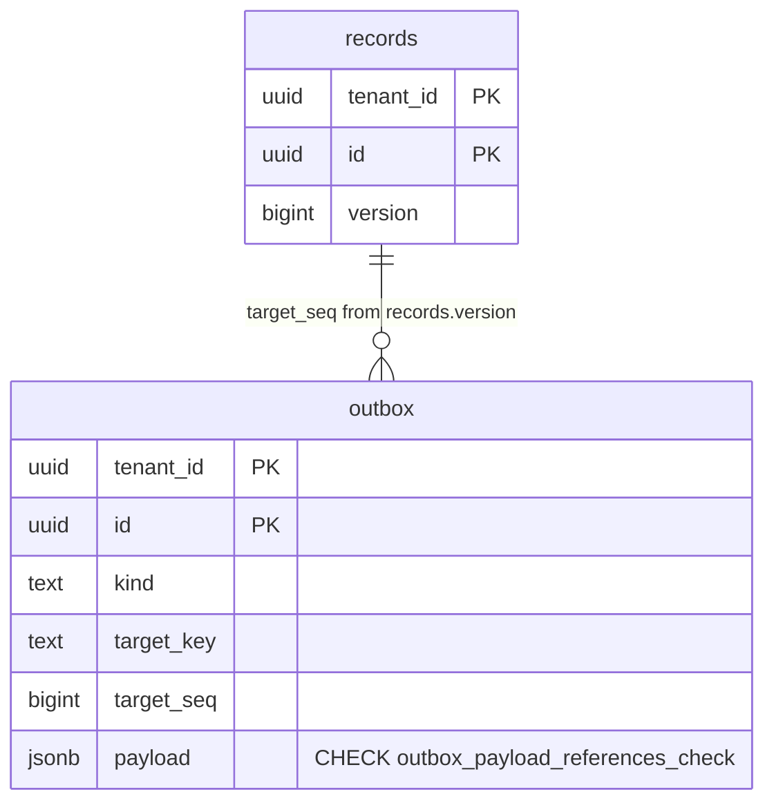

# outbox.payload: references only, in the database

TICK-214 (T32c), CI-7 finding T32b-1 ([temporal-ci6.md](../security/temporal-ci6.md)).
Migration `db/migrations/00006_outbox_payload_references.sql`.

## Requirement

`nava_app` and `nava_worker` may INSERT every `outbox` column, and the relay
forwards `payload` to Temporal unchecked. A writer that skips `outbox.Enqueue`
could put record data in a cross-tenant, unencrypted history (ADR-001 R1). The
database must refuse such a row from any writer, with the same rule as
`outbox.ValidatePayload`.

## The rule

`payload` is a JSON object, and each value is a UUID string or an array of
UUID strings. The array may be empty. A "UUID string" is anything
`github.com/google/uuid.Parse` (v1.6.0) accepts:

| Form | Example |
| --- | --- |
| canonical, hex in either case | `0190a3b2-1c2d-7e8f-9a0b-1c2d3e4f5a6b` |
| URN, prefix in either case | `urn:uuid:0190a3b2-…` |
| 38 characters | `{0190a3b2-…}`, but `Parse` never checks the braces, so any one ASCII character fits on each side |
| 32 hex digits | `0190a3b21c2d7e8f9a0b1c2d3e4f5a6b` |

The CHECK copies the 38-character quirk on purpose. The contract is one rule
with two enforcement points, so tightening it is a change to both. At most two
characters of free text per value can pass this way.

The CHECK is `jsonb_typeof(payload) = 'object' AND NOT jsonb_path_exists(...)`.
The strict-mode path selects every value that is not a matching string or an
array of matching strings. It uses no function, so:

- there is nothing new to grant, and
- `nava_relay` needs no `EXECUTE`, even though PostgreSQL re-checks every CHECK
  on its UPDATEs.

**Parity.** `TestPayloadCheckMatchesValidatePayload` (`internal/outbox`, integration) runs 39
payloads through both checks:

- the CI-7 record-data shapes;
- every `Parse` form;
- the edges where Go's decoder and jsonb could part ways: escapes, duplicate
  keys, `null` values and elements, nested arrays, and non-ASCII wrapping
  characters.

The test fails if either check accepts a payload the other rejects.

**Error text.** A violation's `DETAIL` shows the failing row only to a role
that may SELECT every column. `nava_app` and `nava_worker` may SELECT only
`tenant_id`, `id` and `dedupe_key`, so their errors and logs never echo the
payload.

## Migration

The `outbox` table is live: producers insert into it, and the relay updates it
every poll. So the migration is a `NO TRANSACTION` file with two statements.
Each statement can be re-run safely.

1. `ADD CONSTRAINT … NOT VALID`, inside a `DO` block that skips it when the
   constraint already exists. It holds `ACCESS EXCLUSIVE` only for the catalog
   change, with no scan, under `lock_timeout = '5s'`. From then on, new rows
   are checked.
2. `VALIDATE CONSTRAINT` scans the existing rows under `SHARE UPDATE
   EXCLUSIVE`, which blocks no reads or writes.

If an existing row breaks the rule, the migration fails loudly:

- `VALIDATE` reports `check constraint "outbox_payload_references_check" … is
  violated by some row`;
- goose records no version, and the constraint stays `NOT VALID` but still
  guards new rows (`TestT214PayloadCheckMigrationFailsOnExistingRecordData`).

To recover, find the rows as the superuser. FORCE RLS hides them from
`nava_migrator`. Mark them dead or delete them, then re-run the migrator. The
migration comment gives the query.

## Cost

Measured on PostgreSQL 16.10 (`postgres:16.10`) in Docker Desktop on Windows 11.
The VM had 16 vCPU and 19.4 GiB, and other test containers were running on the
host. Each run wrote 50,000 rows with a typical payload of three references:
`{"record_id": uuid, "watchers": [uuid, uuid]}`. Each figure is 3 runs.

| Statement | No CHECK | With CHECK | Added per row |
| --- | --- | --- | --- |
| `INSERT … SELECT` 50k rows | 1.07–1.23 s | 8.33–9.50 s | ≈ 150 µs |
| `UPDATE … SET n = n + 1` 50k rows (the relay's shape: no payload change) | 0.35–0.97 s | 6.06–7.59 s | ≈ 130 µs |
| `ADD CONSTRAINT` scan, 200k rows | — | 27.7 s | ≈ 140 µs |

Almost all of the cost is the regular expression. On the same host:

- one canonical-UUID match costs about 15 µs;
- the four-form alternation that parity needs costs about 32 µs;
- a two-state pattern costs about 2 µs.

PostgreSQL's matcher builds its DFA states again on every call, and a fixed
36-position shape needs at least 36 of them.

**Alternative measured: a plpgsql function** that walks `jsonb_each` with
string tests and no regex. It cost the same (8.6–9.3 s per 50k), and it would
need `EXECUTE` grants for three roles. Rejected.

**In context:** about 0.15 ms is added to each `Enqueue` and to each relay
UPDATE of a row. That is small next to a commit's WAL flush. At 500 outbox rows
a second, with two relay UPDATEs each, it uses about 20 % of one core.

If relay throughput ever needs it back, there are two options:

- a `BEFORE INSERT OR UPDATE OF payload` trigger checks only writes that set
  `payload`, so relay UPDATEs would not pay;
- narrowing both checks to the canonical form roughly halves the cost.

Both are changes to this contract, not tuning.

**Storage:** none. There is no index, and a CHECK stores nothing per row.
