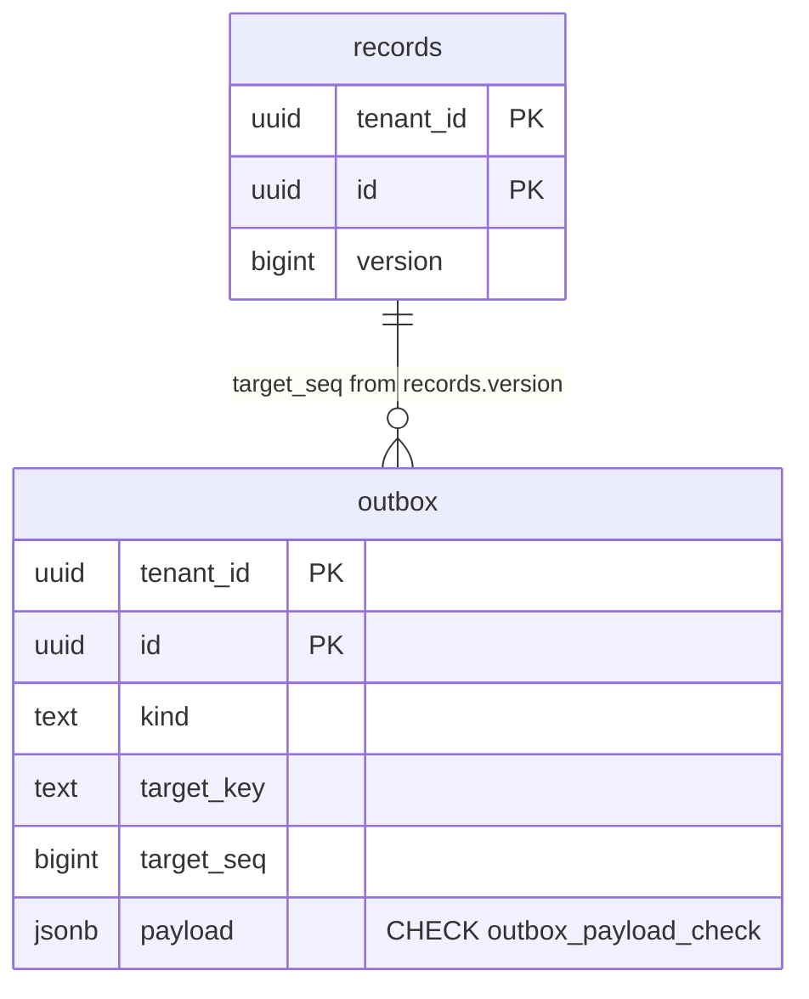

# outbox.payload: references only, in the database

CI-7 finding T32b-1 ([temporal-ci6.md](../security/temporal-ci6.md)).
Values: TICK-214 (T32c), migration `db/migrations/00006_outbox_payload_references.sql`.
Keys and canonical form: TICK-240 (T32f), migration
`db/migrations/00007_outbox_payload_keys.sql`, which replaces the 00006
constraint.

## Requirement

`nava_app` and `nava_worker` may INSERT every `outbox` column, and the relay
forwards `payload` to Temporal. A writer that skips `outbox.Enqueue` could put
record data in a cross-tenant, unencrypted history (ADR-001 R1). The
database must refuse such a row from any writer, with the same rule as
`outbox.ValidatePayload`.

After TICK-214, both checks looked at values only. A key such as
`"printer on fire, call alice@tenant-a.test"` passed both, and every value form
`uuid.Parse` tolerates (URN, braces with any wrapping character, 32 hex digits,
either case) left up to two free characters per value. TICK-240 closes both.



## The rule

`payload` is a JSON object, and:

- every **key** matches `^[a-z][a-z0-9_]{0,31}$`;
- every **value** is a canonical UUID string, or an array (possibly empty) of
  them. Canonical means the one form `uuid.UUID.String()` writes: 36
  characters, lowercase hex, hyphenated, for example
  `0190a3b2-1c2d-7e8f-9a0b-1c2d3e4f5a6b`. Producers already write it.

In Go, `ValidatePayload` checks the key against the same pattern and each value
with `uuid.Parse(s)` followed by `u.String() == s`. A refusal error names no
key and no value: a refused key may be the record data the rule keeps out.

The CHECK, `outbox_payload_check`, is

```sql
CASE WHEN jsonb_typeof(payload) = 'object' THEN
    NOT jsonb_path_exists(payload, 'strict $.keyvalue() ? (bad key || bad value)')
ELSE false END
```

with both regular expressions written out in the migration. `CASE` keeps the
path off a non-object, where strict `keyvalue()` would raise an error instead
of failing the CHECK. It uses `jsonb_path_exists` and `like_regex` and no
function, so:

- there is nothing new to grant, and
- `nava_relay` needs no `EXECUTE`, even though PostgreSQL re-checks every CHECK
  on its UPDATEs.

### Why keys use the fallback pattern, not a per-kind allow-list

The TICK-240 contract asked for a per-`kind` key allow-list in the Go registry,
with a matching CHECK, first. It is not workable today, for three reasons:

1. **`ValidatePayload` has callers with no kind.** `workerguard` applies it to
   activity, child, continue-as-new and update arguments and to `RunInput.Refs`
   (TICK-216), and the relay applies it to a `Delivery` payload. None of them
   has an outbox kind to look up. A per-kind rule would still need a kind-less
   key rule beside it, so the database and Go would no longer hold one rule.
2. **There is no registry to hold it.** No production code writes an outbox
   row yet: every kind in the repository (`ticket.approval`, `approve`, `k`
   and so on) is a test fixture. An allow-list now would be invented, not
   derived from producers, and the first real workflow (Epic 05) would have to
   change it.
3. **Each new kind or key would be DDL on a live table.** A CHECK cannot read
   a table, so the allow-list would be literals in the constraint. Adding a
   kind means adding a new constraint `NOT VALID`, a `VALIDATE` scan of every
   outbox row, and dropping the old one: a data-layer migration in every
   workflow PR. A function holding the list avoids the scan, but changing it
   leaves old rows unchecked, and a row it now refuses blocks the relay's
   UPDATE of that row.

The pattern closes the reported channel: no spaces, punctuation, `@`, capitals
or non-ASCII, and at most 32 characters per key. The rule bounds accidental
record data, such as a producer bug that writes a title or an email. It does not
stop a deliberate encoder. Key words, the number of keys, array length and the
122 writer-chosen bits of each UUID all stay under the writer's control. That
residual is [AR-032](../security/accepted-risks.md). Revisit once real kinds
exist: a per-kind allow-list can then be added in Go for `Enqueue` and the
relay, on top of this pattern, as a second line.

## Parity

`TestPayloadCheckMatchesValidatePayload` (`internal/outbox`, integration) runs
60 cases, each as a `t.Run` subtest, through both checks. Each case states the
expected outcome, and both checks must match it:

- the CI-7 record-data shapes;
- free-text keys, keys off the pattern, and the 32/33-character edge;
- every non-canonical form `uuid.Parse` takes: uppercase, `urn:uuid:`, 38
  characters, 32 hex digits, also inside arrays;
- the edges where Go's decoder and jsonb could part ways: escapes in keys and
  values, duplicate keys, `null` values and elements, nested arrays, and
  non-ASCII characters.

Two cases are refused by the database before the CHECK runs, and the test
says so with the expected SQLSTATE rather than treating it as a mismatch:
`\u0000` in a key or a value (`22P05`, which jsonb cannot store), and text
that is not JSON (`22P02`). Go refuses both too.

`TestPayloadCheckRefusesDirectInsert` inserts a free-text key, an uppercase
UUID and record data directly as `nava_app` and as `nava_worker`, in their own
tenant transactions. All three are refused by `outbox_payload_check`, and the
error does not echo the payload.

**Error text.** A violation's `DETAIL` shows the failing row only to a role
that may SELECT every column. `nava_app` and `nava_worker` may SELECT only
`tenant_id`, `id` and `dedupe_key`, so their errors and logs never echo the
payload. Callers log the constraint name, tenant ID and row ID only.

## Migration

The `outbox` table is live: producers insert into it, and the relay updates it
every poll. So 00007 is a `NO TRANSACTION` file with three steps, expand then
contract. Each step can be re-run safely.

1. `ADD CONSTRAINT outbox_payload_check … NOT VALID`, inside a `DO` block that
   skips it when the constraint already exists. It holds `ACCESS EXCLUSIVE`
   only for the catalog change, with no scan, under `lock_timeout = '5s'`.
   From then on, new rows are checked.
2. `VALIDATE CONSTRAINT` scans the existing rows under `SHARE UPDATE
   EXCLUSIVE`, which blocks no reads or writes.
3. `DROP CONSTRAINT IF EXISTS outbox_payload_references_check`, under the same
   lock timeout. The new constraint implies the old one, and dropping it cuts
   the cost every write pays (see Cost).

If an existing row breaks the new rule, the migration fails loudly:

- `VALIDATE` reports `check constraint "outbox_payload_check" … is violated by
  some row`;
- goose records no version, the 00006 constraint is still there, and the new
  constraint stays `NOT VALID` but still guards new rows
  (`TestT240PayloadKeysMigrationFailsOnExistingRow`, which also covers the
  clean re-run).

**The failed state stops the relay for every tenant.** A `NOT VALID` CHECK
also refuses every UPDATE of an old row that breaks it. While such a row is
still pending, the relay's claim (`attempts = attempts + 1`) fails as one
statement across all tenants, and every poll picks the same row again. So
outbox delivery stops for all tenants until the row is gone. Deleting it is
urgent, not housekeeping.

To recover, act as the superuser, because FORCE RLS hides the rows from
`nava_migrator`:

1. Find the rows, selecting only `tenant_id, id` and never `SELECT *`:
   `SELECT tenant_id, id FROM outbox WHERE NOT (<the CHECK expression>);`
2. **Delete** them: `DELETE FROM outbox WHERE NOT (<the CHECK expression>);`,
   or by `tenant_id, id`.
3. Re-run the migrator.

Never UPDATE them, for example `SET dead_at = now()`. The UPDATE fails with
`23514`, and as the superuser the error's `DETAIL` prints the whole row,
payload included (`TestT240PayloadKeysMigrationFailsOnExistingRow` pins the
refusal). Never copy their payload anywhere.

## Cost

Measured on PostgreSQL 16.10 (`postgres:16.10`, the pinned image) in Docker
Desktop on Windows 11, 16 vCPU and 19.4 GiB. Other containers were running on
the host. The script is `docs/data/outbox-payload-bench/expr.sql`: it
evaluates each CHECK expression over 200,000 typical payloads, each with three
references (`{"record_id": uuid, "watchers": [uuid, uuid]}`), with no heap or
WAL work. There were 5 runs, alternating between the expressions.

| Expression | 200k rows | Per row |
| --- | --- | --- |
| none (`true`) | 36–73 ms | — |
| 00006 `outbox_payload_references_check` | 10.8–14.3 s | 54–72 µs |
| 00007 `outbox_payload_check` | 7.6–10.5 s | 38–52 µs |

The new rule checks more, keys included, and still costs about 30 % less. The
canonical-only value pattern is a single fixed shape, while 00006 needed a
four-way alternation for parity with `uuid.Parse`. That saving is larger than
the cost of three short key matches. 00007 drops the 00006 constraint, so
`Enqueue` and every relay UPDATE pay less after this change, not more. Almost
all of the cost is still the regular expressions: PostgreSQL rebuilds their
DFA states on every call.

TICK-214 measured the end-to-end figures (about 150 µs a row on INSERT, 130 µs
on the relay's UPDATE) on the same host under heavier load. If relay
throughput ever needs it, a `BEFORE INSERT OR UPDATE OF payload` trigger would
check only writes that set `payload`, so relay UPDATEs would not pay. That
would be a change to this contract, not tuning.

**Storage:** none. There is no index, and a CHECK stores nothing per row.
